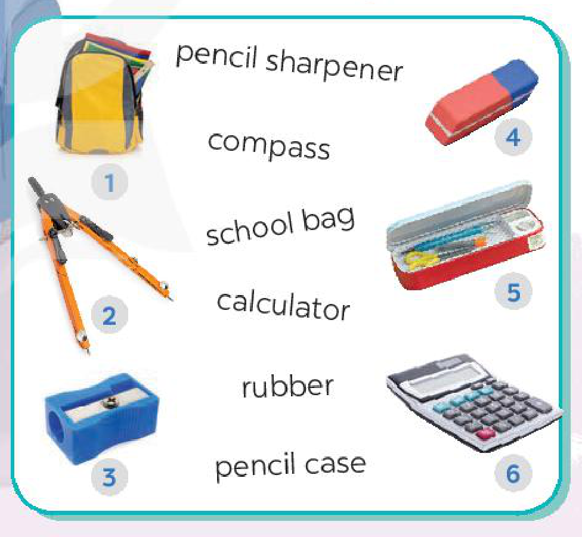
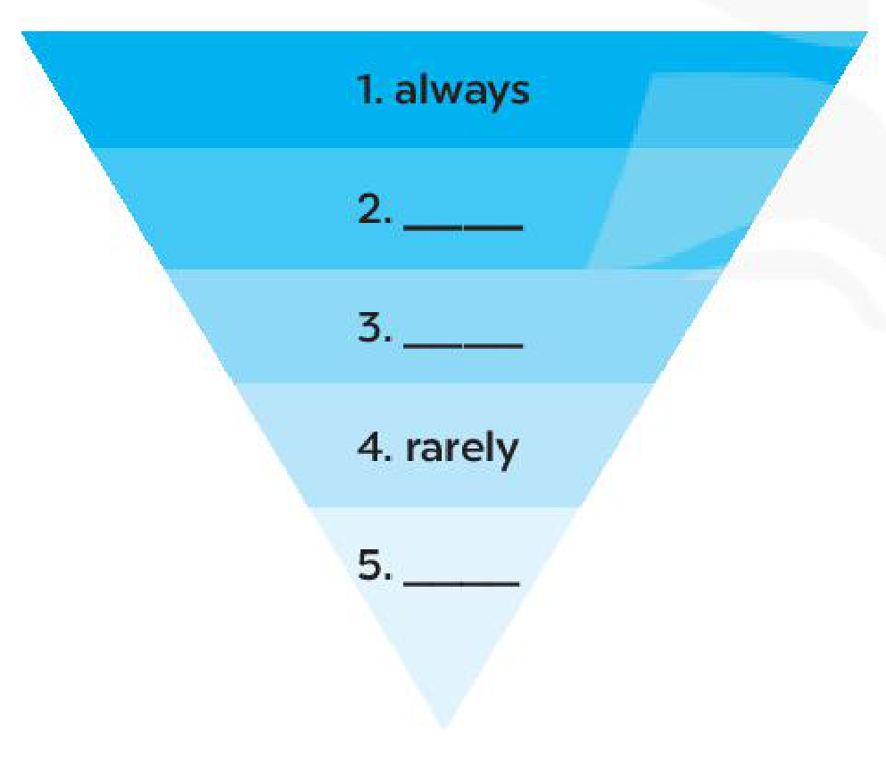
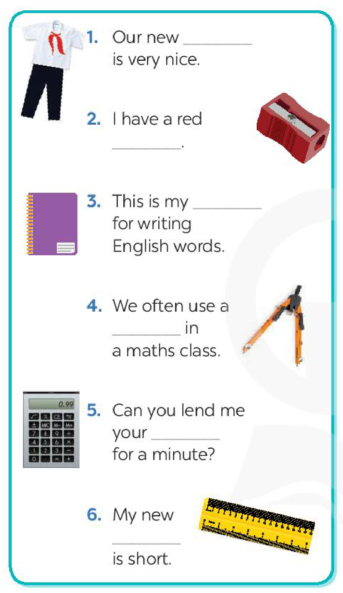

<!-- pdf:7 -->

# UNIT 1: MY NEW SCHOOL

> **THIS UNIT INCLUDES:**
> - **Vocabulary:**
>   - School things and **activities**
>   - Verb (*play*, *do*, *have*, *study*) + Noun
> - **Pronunciation:**
>   - Sounds: /ɑː/ and /ʌ/
> - **Grammar:**
>   - Present simple
>   - Adverbs of frequency
> - **Skills:**
>   - Reading about schools
>   - Talking about the type of school one would like to go to
>   - Listening about school activities
>   - Writing a paragraph about one's school
> - **Everyday English:**
>   - Introducing someone

## GETTING STARTED

**A special day**

**1. Listen and read.**

(Loud **knock**)

**Phong:** Hi, Vy.

**Vy:** Hi, Phong. Are you ready?

**Phong:** Just a minute.

**Vy:** Oh, this is Duy, my new friend.

**Phong:** Hi, Duy. Nice to meet you.

**Duy:** Hi, Phong. I live near here, and we go to the same school!

**Phong:** Good. Hmm, your school bag looks heavy.
<!-- term: school bag -->

**Duy:** Yes! I have new books, and we have new subjects to study.

**Phong:** And a new uniform, Duy! You look **smart**!

**Duy:** Thanks, Phong. We always look smart in our uniforms.

**Phong:** Let me put on my uniform. Then we can go.
<!-- term: uniform -->

<!-- pdf:8 -->

**2. Read the conversation again and tick (✓) T (True) or F (False).**

| | T | F |
| --- | --- | --- |
| 1. Vy, Phong, and Duy go to the same school. | | |
| 2. Duy is Phong's friend. | | |
| 3. Phong says Duy looks smart in his uniform. | | |
| 4. They have new subjects to study. | | |
| 5. Phong is wearing a school uniform. | | |

**3. Write ONE word from the box in each gap.**

| go | subjects | has | wear | uniforms |
| --- | --- | --- | --- | --- |

1. Students \_\_\_\_\_\_\_ their uniforms on Monday.
2. Vy \_\_\_\_\_\_\_ a new friend, Duy.
3. – Do Phong, Vy, and Duy \_\_\_\_\_\_\_ to the same school?
   – Yes, they do.
4. Students always look smart in their \_\_\_\_\_\_\_.
5. – What \_\_\_\_\_\_\_ do you like to study?
   – I like to study English and history.

**4. Match the words and phrases with the school things. Then listen and repeat.**
<!-- term: pencil sharpener -->
<!-- term: pencil case -->
<!-- term: rubber -->

- pencil sharpener
- **compass**
- school bag
- **calculator**
- rubber
- pencil case
<!-- term: school bag -->
<!-- term: pencil sharpener -->
<!-- term: pencil case -->
<!-- term: rubber -->
<!-- ocr-ok: đã đối chiếu ảnh trang gốc, các từ nằm nghiêng trong khung hình nối đồ dùng học tập 1-6 -->

**5. Look around the class. Write the names of the things you see in your notebook.**

<!-- pdf:9 -->

## A CLOSER LOOK 1

### Vocabulary

**1. Listen and repeat the words.**

| | |
| --- | --- |
| school lunch | exercise |
| English | science |
| history | football |
| homework | lessons |
| | music |

**2. Work in pairs. Put the words in 1 in the correct column.**

| play | do | have | study |
| --- | --- | --- | --- |
| | | | |
<!-- ocr-ok: đã đối chiếu ảnh trang gốc, OCR bỏ sót bảng 4 cột play / do / have / study -->

*Can you add more words to each column?*
<!-- ocr-ok: đã đối chiếu ảnh trang gốc, chữ trắng trên nền bóng thoại màu xanh lá cây -->

**3. Put one of these words in each blank.**

| lessons | science | homework | football | exercise |
| --- | --- | --- | --- | --- |

1. Vy and I often do our \_\_\_\_\_\_\_ after school.
2. Nick plays \_\_\_\_\_\_\_ for the school team.
3. Mrs Nguyen teaches all my history \_\_\_\_\_\_\_.
4. They are healthy. They do \_\_\_\_\_\_\_ every day.
5. I study maths, English and \_\_\_\_\_\_\_ on Mondays.
<!-- ocr-ok: đã đối chiếu ảnh trang gốc, OCR đọc nhầm I thành | và đọc dính chữ Englishand -->

### Pronunciation

**/ɑː/ and /ʌ/**

**4. Listen and repeat. Pay attention to the sounds /ɑː/ and /ʌ/.**
<!-- ocr-ok: đã đối chiếu ảnh trang gốc, OCR đọc nhầm kí hiệu phiên âm /ɑː/ và /ʌ/ thành /a:/ và /A/ -->

| 1. /ɑː/ | 2. /ʌ/ |
| --- | --- |
| smart | subject |
| **art** | study |
| carton | Monday |
| class | compass |
<!-- ocr-ok: đã đối chiếu ảnh trang gốc, OCR bỏ sót dòng tiêu đề bảng 1 /ɑː/ và 2 /ʌ/ -->

**5. Listen and repeat. Then listen again and underline the words with the sounds /ɑː/ and /ʌ/.**

1. My brother has a new **compass**.
2. Our classroom is large.
3. They look smart on their first day at school.
4. The **art** lesson starts at nine o'clock.
5. He goes out to have lunch every Sunday.

<!-- pdf:10 -->

## A CLOSER LOOK 2

### Grammar

**The present simple**

**Remember!**

We use the present simple to talk about actions or events that often happen, or are fixed.
<!-- term: Present simple -->

*Example:*
- We usually *go* to school by bus.
- I *don't like* school lunch very much.
<!-- term: school lunch -->

**1. Choose the correct answer A, B, or C.**

1. We \_\_\_\_\_\_\_ new subjects for this school year.
   A. have   B. has   C. having
2. Duy \_\_\_\_\_\_\_ to school every day.
   A. cycling   B. cycle   C. cycles
3. My new school \_\_\_\_\_\_\_ in the centre of the village.
   A. not   B. isn't   C. doesn't
4. I live near here. Where \_\_\_\_\_\_\_ live?
   A. do you   B. you   C. are you
5. My friend has a sister, but she \_\_\_\_\_\_\_ a brother.
   A. not has   B. don't have   C. doesn't have
<!-- ocr-ok: đã đối chiếu ảnh trang gốc, OCR bỏ sót Duy ở câu 2 và đọc ghép Mynewschool ở câu 3 -->

**Remember!**

The present simple verbs with *he / she / it* need an *s / es*.
<!-- term: Present simple -->

**2. Miss Nguyet is interviewing Duy for the school newsletter. Write the correct form of the verbs.**

**Miss Nguyet:** Tell us about your new school, Duy.

**Duy:** Sure! My school (1. have) \_\_\_\_\_\_\_ a large playground.
<!-- term: playground -->

**Miss Nguyet:** \_\_\_\_\_\_\_ you (2. have) \_\_\_\_\_\_\_ any new friends?

**Duy:** Yes. And I (3. like) \_\_\_\_\_\_\_ my new friends, Vy and Phong.

**Miss Nguyet:** \_\_\_\_\_\_\_ Vy (4. walk) \_\_\_\_\_\_\_ to school with you?

**Duy:** Well, we often (5. ride) \_\_\_\_\_\_\_ our bicycles to school.

**Miss Nguyet:** What time do you go home?

**Duy:** I (6. go) \_\_\_\_\_\_\_ home at 4 p.m. every day.
<!-- ocr-ok: đã đối chiếu ảnh trang gốc, OCR đọc nhầm I thành | và đọc dính chữ homeat -->

**Miss Nguyet:** Thank you!

<!-- pdf:11 -->

*Adverbs of frequency*

**Remember!**

We use adverbs of frequency to show how often something happens. We often use them with the present simple. We usually place the adverb of frequency before the main verb.
<!-- term: Adverbs of frequency -->

*Example:*
- Tom *usually* takes the bus to school.
- They don't *often* go to the cinema.

**3. Fill the blanks with usually, sometimes or never.**

1. always
2. \_\_\_\_\_\_\_
3. \_\_\_\_\_\_\_
4. rarely
5. \_\_\_\_\_\_\_
<!-- ocr-ok: đã đối chiếu ảnh trang gốc, văn bản nằm trong hình tam giác ngược màu xanh bài 3 -->

**Write a sentence with one of these adverbs.**

\_\_\_\_\_\_\_\_\_\_\_\_\_\_\_\_\_\_\_\_\_\_\_\_\_\_\_\_\_\_\_\_\_\_\_\_\_\_\_\_\_\_\_

**4. Choose the correct answer A or B to complete each sentence.**

1. I \_\_\_\_\_\_\_ late on Saturdays.
   A. get up usually
   B. usually get up
2. My mum \_\_\_\_\_\_\_ to work late.
   A. rarely goes
   B. goes rarely
3. \_\_\_\_\_\_\_ at weekends?
   A. Do you often travel
   B. Often do you travel
4. What kind of music \_\_\_\_\_\_\_?
   A. usually does Susan listen to
   B. does Susan usually listen to
5. When \_\_\_\_\_\_\_ go on holiday each year?
   A. do you usually
   B. you usually

**5. Work in pairs. Make questions, and then interview your partner.**

1. you / often / ride your bicycle / to school
2. you / sometimes / study / in the school library
3. you / like / your new school
4. your friends / always / go to school / with you
5. you / usually / do your homework / after school
<!-- term: do homework -->

<!-- pdf:12 -->

## COMMUNICATION

### Everyday English

**Introducing someone**

**1. Listen and read the dialogue. Pay attention to the highlighted parts.**

**Vy:** Phong, *this is Duy*, my new friend.

**Phong:** Hi, Duy. *Nice to meet you.*

**Duy:** Hi, Phong. *Nice to meet you, too.*

**2. Work in groups. Practise introducing a friend to someone else.**

**New friends at school**

**3. Read and tick (✓) the questions you think are suitable to ask a new friend at school.**

- [ ] 1. Are you from around here?
- [ ] 2. Do you like music?
- [ ] 3. How much money do you get?
- [ ] 4. What is your **favourite** subject at school?
- [ ] 5. Are you hungry now?
- [ ] 6. Do you play football?
- [ ] 7. How do you go to school every day?
- [ ] 8. Where do you often go shopping?

**Write one or two more questions on a piece of paper. Then share them with the class.**

**4. There is a quiz for students in the new school newsletter. Answer the questions.**

**ARE YOU A GOOD FRIEND AT SCHOOL?**
<!-- ocr-ok: đã đối chiếu ảnh trang gốc, tiêu đề chữ cách điệu nhiều màu trên nền xanh lá -->

1. Do you **remember** all your new **classmates**' names? — [ ] Yes / [ ] No
2. Do you often listen to your friends' advice? — [ ] Yes / [ ] No
3. Do you **share** things with your classmates? — [ ] Yes / [ ] No
4. Do you keep your friends' secret? — [ ] Yes / [ ] No
5. Do you play with your classmates at break time? — [ ] Yes / [ ] No
6. Do you **help** your classmates with their homework? — [ ] Yes / [ ] No
7. Do you go to school with your friends? — [ ] Yes / [ ] No
8. Do you listen when your classmates are talking? — [ ] Yes / [ ] No

**5. Work in groups. Take turns to interview the others. Use the questions above.**

<!-- pdf:13 -->

## SKILLS 1

### Reading

**1. Look at the pictures and quickly read the passages. Match 1–3 with A–C.**

| | |
| --- | --- |
| 1. Sunrise | A. a school in Bac Giang |
| 2. An Son | B. an international school |
| 3. Dream | C. a boarding school in Sydney |

**Sunrise** is a **boarding school** in Sydney. Students study and live there. About 1,200 boys and girls go to Sunrise. It has students from all over Australia. They study subjects like maths, science and English.

**An Son** is a lower secondary school in Bac Giang. It has only 8 classes. There are mountains and green fields around the school. There is a computer room and a library. There is also a school garden and a playground.
<!-- term: lower secondary school -->
<!-- term: playground -->

**Dream** is an **international** school. Here students learn English with English-speaking teachers. In the afternoon, they join many interesting clubs. They play sports and games. Some students do paintings in the **art** club.

**2. Read the passages again and complete these sentences.**

1. Students live and study in a \_\_\_\_\_\_\_ school. They only go home at weekends.
2. Sunrise is a school in \_\_\_\_\_\_\_.
3. There are \_\_\_\_\_\_\_ around An Son School.
4. \_\_\_\_\_\_\_ has an art club.
5. At Dream School, students learn English with \_\_\_\_\_\_\_.

**3. Answer the questions.**

1. Which school is a boarding school?
2. Where is An Son School?
3. Is there a school garden in An Son School?
4. What do Dream School students do in the afternoon?

### Speaking

**4. Which school in 1 would you like to go to? Why? Complete the table.**

| Name of school | Reasons you like it |
| --- | --- |
| | |

**Then discuss your choice with a friend.**

**Example:**
- **A:** Which school would you like to go to?
- **B:** I'd like to go to Dream School.
- **A:** Why?
- **B:** Because I'd like to paint in the art club.

<!-- pdf:14 -->

## SKILLS 2

### Listening

**1. Janet, a student at Palmer School in America, is talking about her school. Guess the answers to these questions.**

1. Do you think the students there wear uniforms?
2. Do they learn Vietnamese as a foreign language?

**Listen to the talk and check your guesses.**

**2. Listen again and choose the correct answer A or B.**
<!-- ocr-ok: đã đối chiếu ảnh trang gốc, OCR đọc dính chữ answerAorB -->

1. Janet's **favourite** teacher is her \_\_\_\_\_\_\_ teacher.
   A. maths   B. science
2. Today Janet \_\_\_\_\_\_\_ her uniform.
   A. is wearing   B. isn't wearing
3. Janet studies \_\_\_\_\_\_\_ for two hours a week.
   A. English   B. Vietnamese
4. Janet usually does her homework \_\_\_\_\_\_\_.
   A. in the library   B. at home
5. Her class is going to have a biology lesson \_\_\_\_\_\_\_.
   A. on a farm   B. in the classroom

### Writing

**3. Write the answers to the following questions about your school.**

1. What is the name of your school?
2. Where is your school?
3. How many classes does your school have?
4. What do students do at your school?
5. What do you like about your school?

**4. Use the answers in 3 to write a paragraph of 40–50 words about your school. You can refer to the reading passages to help you.**

My school is \_\_\_\_\_\_\_\_\_\_\_\_\_\_\_\_\_\_\_\_\_\_\_\_\_\_\_\_\_\_\_\_\_\_\_\_\_\_\_\_\_\_\_

<!-- pdf:15 -->

## LOOKING BACK

### Vocabulary

**1. Look at the pictures. Write the correct words in the gaps.**

1. Our new \_\_\_\_\_\_\_ is very nice.
2. I have a red \_\_\_\_\_\_\_.
3. This is my \_\_\_\_\_\_\_ for writing English words.
4. We often use a \_\_\_\_\_\_\_ in a maths class.
5. Can you lend me your \_\_\_\_\_\_\_ for a minute?
6. My new \_\_\_\_\_\_\_ is short.
<!-- ocr-ok: đã đối chiếu ảnh trang gốc, OCR bỏ sót một phần câu 4, 5, 6 nằm cạnh hình minh hoạ -->

**2. Match the words in A with the words / phrases in B.**

| A | B |
| --- | --- |
| 1. study | a. lunch |
| 2. do | b. the piano |
| 3. play | c. a uniform |
| 4. have | d. exercise |
| 5. wear | e. new words |
<!-- ocr-ok: đã đối chiếu ảnh trang gốc, OCR tách rời hai cột A và B nên lệch thứ tự ghép dòng -->

### Grammar

**3. Complete the sentences with the present simple.**

1. He (come) \_\_\_\_\_\_\_ from Da Nang.
2. – Do you learn Russian?
   – No, I (not do) \_\_\_\_\_\_\_.
3. She always (walk) \_\_\_\_\_\_\_ to school with her friends.
4. I often (do) \_\_\_\_\_\_\_ my homework after school.
5. Mr Nam (teach) \_\_\_\_\_\_\_ history at my school.

**4. Complete the text with the correct form of the verbs in brackets.**

Hoang lives in a small house in the centre of his village. His house (1. be) \_\_\_\_\_\_\_ near his new school. Every day, he (2. have) \_\_\_\_\_\_\_ breakfast at 6 o'clock. Then he (3. walk) \_\_\_\_\_\_\_ to school with his friends. Hoang and his friends (4. study) \_\_\_\_\_\_\_ in grade 6 at An Son School. Hoang (5. like) \_\_\_\_\_\_\_ his new school.

**5. Put the adverb in brackets in the correct place in each sentence.**

1. I **remember** to do my homework. (always)
<!-- term: do homework -->
2. Nick gets good marks in exams. (usually)
3. We do not see a rabbit in town. (often)
4. I read in bed at night. (rarely)
5. Do you sing in the shower? (sometimes)

<!-- pdf:16 -->

## PROJECT

**Your dream school**
<!-- ocr-ok: đã đối chiếu ảnh trang gốc, tiêu đề chữ xanh trong đám mây hồng -->

**Work in groups.**

**1. Design your dream school. What does it look like?**

Is it:
- in a town or in the country?
- a **boarding school**?
- an **international** school?

Does it have:
- a **swimming pool**?
- a video game room?
- a greenhouse and a farm?

**2. Draw a picture of your dream school.**

**3. Present it to the class.**

### Now I can ...

- use the words related to the topic 'My New School'.
- pronounce the sounds /ɑː/ and /ʌ/ correctly.
- use the present simple.
- use the adverbs of frequency.
- introduce someone to someone else.
- read about schools.
- talk about the type of school I'd like to go to.
- listen about school **activities**.
- write a paragraph about my school.

## 📷 Danh mục hình minh hoạ

| Mã hình | Trang PDF | Trang sách | Chú thích / Mô tả |
| --- | --- | --- | --- |
| H6-tieng_anh-u01-01 | 8 | 7 | Khung bài tập nối từ vựng với 6 đồ dùng học tập đánh số 1–6: cặp sách, com-pa, gọt bút chì, cục tẩy, hộp bút chì, máy tính bỏ túi |
| H6-tieng_anh-u01-02 | 11 | 10 | Sơ đồ hình tam giác ngược màu xanh minh hoạ mức độ thường xuyên giảm dần của các trạng từ tần suất từ 1 (always) đến 5 |
| H6-tieng_anh-u01-03 | 15 | 14 | Khung bài tập ôn tập từ vựng với 6 câu điền từ kèm hình minh hoạ: đồng phục học sinh, gọt bút chì màu đỏ, quyển vở, com-pa, máy tính bỏ túi, thước kẻ |
