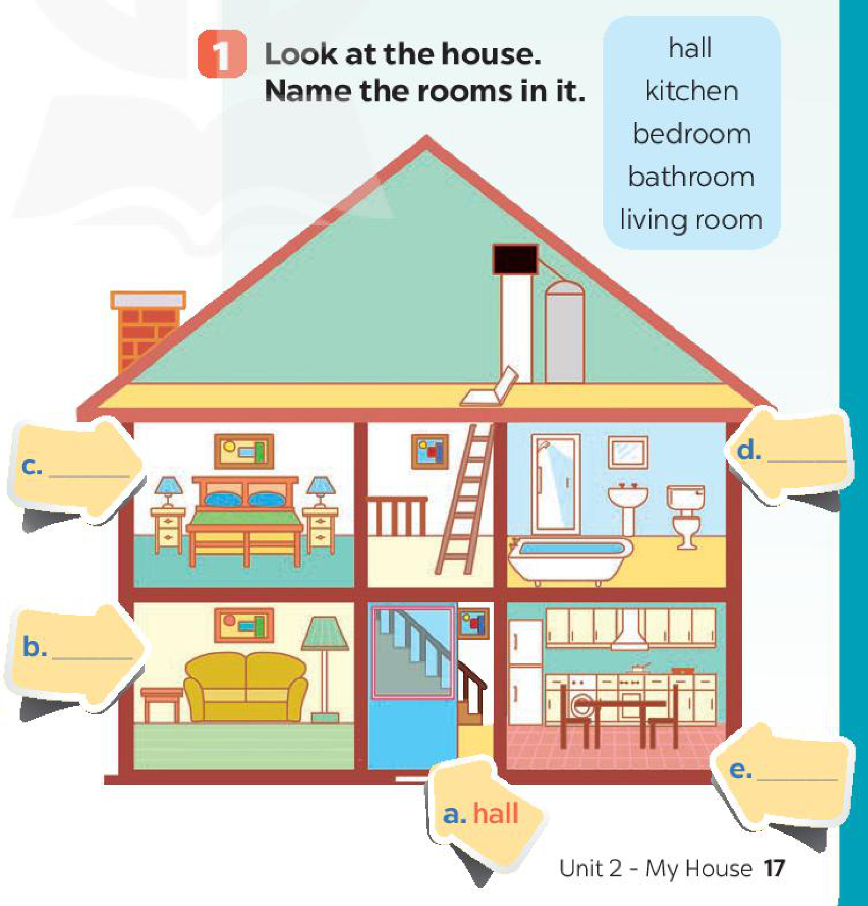
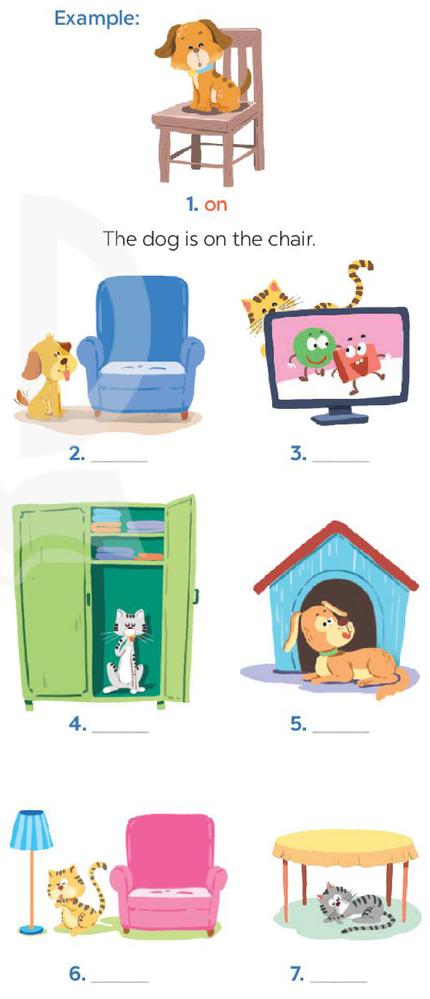
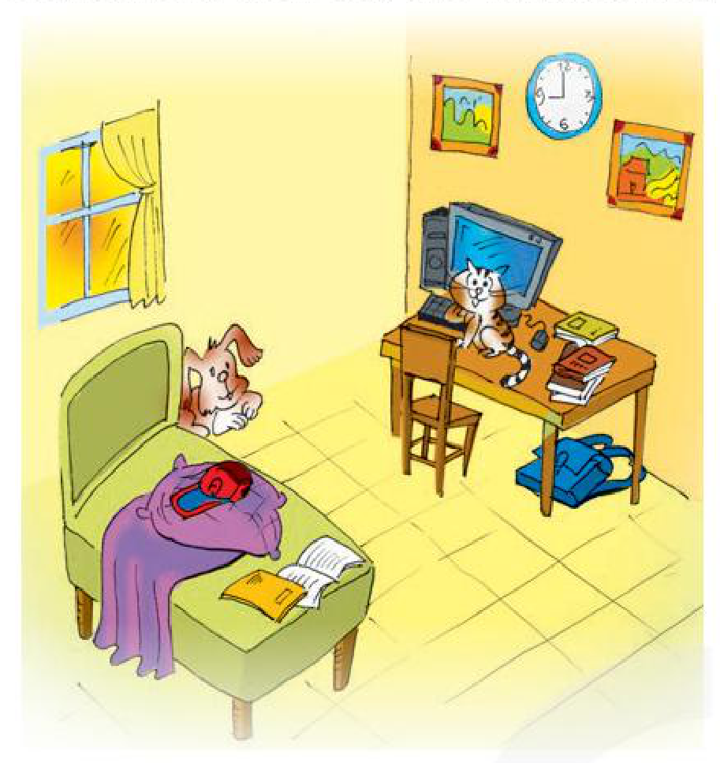
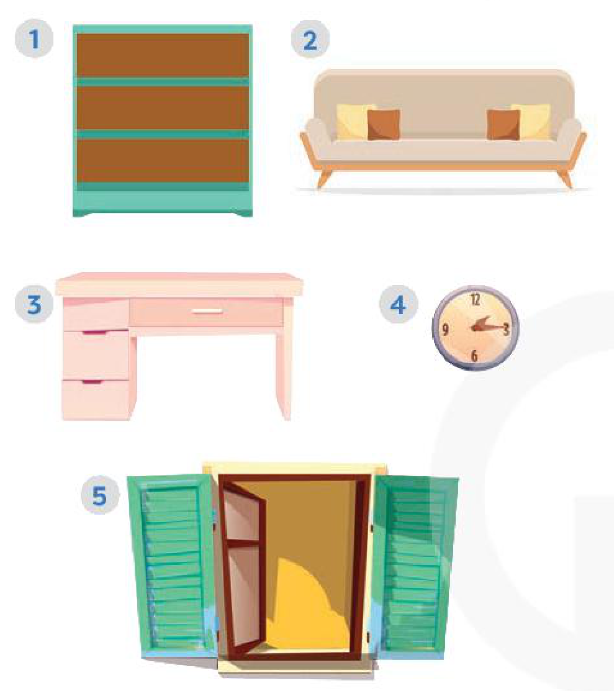
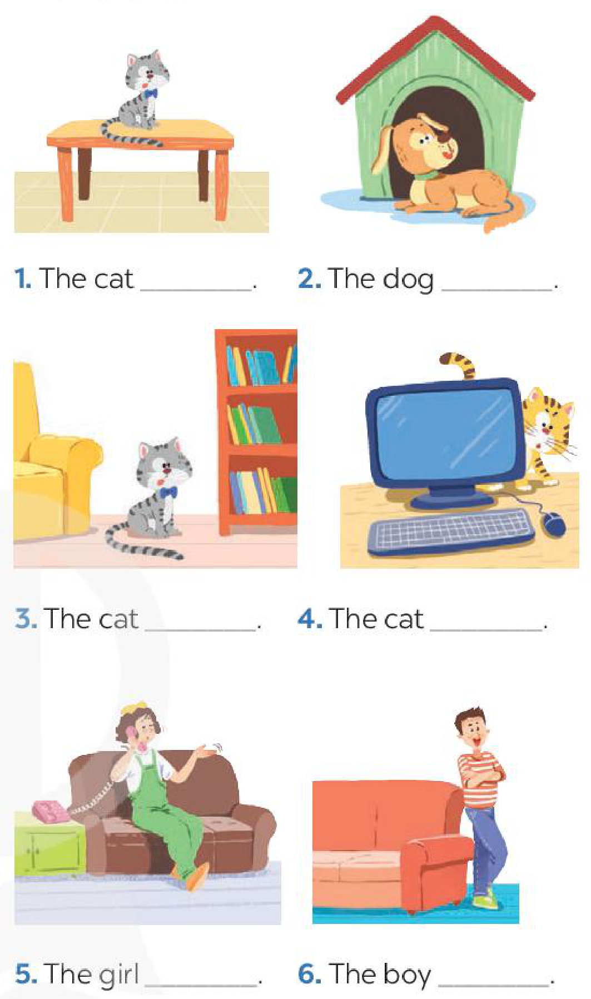

<!-- pdf:17 -->

# UNIT 2: MY HOUSE

> **THIS UNIT INCLUDES:**
> - **Vocabulary:**
>   - Types of house
>   - Rooms and **furniture**
> - **Pronunciation:**
>   - Final sounds: /s/ and /z/
> - **Grammar:**
>   - Possessive case
>   - Prepositions of place
> - **Skills:**
>   - Reading about rooms and furniture
>   - Describing houses, rooms and furniture
>   - Listening about someone's house
>   - Writing an email to a friend describing a house
> - **Everyday English:**
>   - Giving suggestions

## GETTING STARTED

**A look inside**

**1. Listen and read.**

**Mi:** Wow! Your room looks so big, Nick.

**Nick:** It's Elena's room. She's my sister.

**Mi:** I see. Is there a TV behind you?
<!-- term: behind -->

**Nick:** Yes, there is. Where do you live, Mi?

**Mi:** I live in a **town house**. And you?

**Nick:** I live in a **country house**. Who do you live with?

**Mi:** My parents and younger brother. We're moving to a **flat** next month!

**Nick:** Are you?

**Mi:** Yes. My aunt lives near there, and I can play with my cousin.

**Nick:** Are there many rooms in your new flat?

**Mi:** Yes, there are. There's a living room, three bedrooms, a kitchen and two bathrooms.
<!-- term: living room -->
<!-- term: kitchen -->

<!-- pdf:18 -->

**2. Which family members does Mi talk about? Put a tick (✓).**

| | |
| --- | --- |
| 1. parents | ✓ |
| 2. sister | |
| 3. brother | |
| 4. aunt | |
| 5. cousin | |
<!-- ocr-ok: đã đối chiếu ảnh trang gốc, OCR đọc nhầm 2. sister thành 2, Sigler -->

**3. Read the conversation again. Complete each sentence with ONE word.**

1. Elena is Nick's \_\_\_\_\_\_\_.
2. There is a \_\_\_\_\_\_\_ in Elena's room.
3. Now Mi lives in a \_\_\_\_\_\_\_ house.
4. Nick lives in a \_\_\_\_\_\_\_ house.
5. Mi's new flat has \_\_\_\_\_\_\_ bedrooms.
<!-- ocr-ok: đã đối chiếu ảnh trang gốc, OCR đọc dính chữ Thereisa, inElenas, Milivesina và bỏ dấu sở hữu cách -->

**4. Complete the word web. Use the words from the conversation and the ones you know.**

| **TYPES OF HOUSE** | |
| --- | --- |
| town house | \_\_\_\_\_\_\_ |
| \_\_\_\_\_\_\_ | \_\_\_\_\_\_\_ |

**5. Work in groups. Ask your friends where they live. Then report their answers.**
<!-- ocr-ok: đã đối chiếu ảnh trang gốc, OCR đọc dính chữ Askyour và trộn hai cột -->

**Example:**
- **A:** Where do you live?
- **B:** I live in a flat.

## A CLOSER LOOK 1

### Vocabulary

**Rooms and furniture**

**1. Look at the house. Name the rooms in it.**
<!-- ocr-ok: đã đối chiếu ảnh trang gốc, OCR đọc dính chữ roomsinit -->

- **hall**
- kitchen
- bedroom
- bathroom
- living room
<!-- ocr-ok: đã đối chiếu ảnh trang gốc, hộp từ vựng nằm cạnh hình minh hoạ nên OCR chèn kí tự nhiễu giữa các dòng -->

- a. hall
- b. \_\_\_\_\_\_\_
- c. \_\_\_\_\_\_\_
- d. \_\_\_\_\_\_\_
- e. \_\_\_\_\_\_\_
<!-- ocr-ok: đã đối chiếu ảnh trang gốc, các nhãn a-e nằm trên hình cắt dọc ngôi nhà -->

<!-- pdf:19 -->

**2. Name the things in each room in 1. Use the word list below. (You may use a word more than once.)**

| | | |
| --- | --- | --- |
| lamp | toilet | picture |
| **cupboard** | **sink** | sofa |
| **dishwasher** | fridge | shower |
| **chest of drawers** | | |
<!-- term: fridge -->

**3. Think of a room in your house. In pairs, ask and answer questions to guess it.**

**Example:**
- **A:** What's in your room?
- **B:** A sofa and a television.
- **A:** Is it the living room?
- **B:** Yes.

### Pronunciation

**Final sounds: /s/ and /z/**

**4. Listen and repeat these words.**

| | |
| --- | --- |
| lamps | **cupboards** |
| **sinks** | sofas |
| **flats** | kitchens |
| toilets | rooms |

**5. Listen to the conversation. Underline the final s in the words and put them into the correct column.**

**Mi:** Mum, are you home?

**Mum:** Yes, honey. I'm in the kitchen. I've bought these new bowls and chopsticks.

**Mi:** They're beautiful, Mum. Where did you buy them?

**Mum:** In the **department store** near our house. They have a lot of things for homes.

**Mi:** Don't forget we need two lamps for my bedroom, Mum.
<!-- term: bedroom -->

**Mum:** Let's go there this weekend.
<!-- ocr-ok: đã đối chiếu ảnh trang gốc, OCR bỏ sót dấu lược trong Let's -->

| /s/ | /z/ |
| --- | --- |
| | |

**Now practise the conversation with a partner.**

## A CLOSER LOOK 2

### Grammar

*Possessive case*

**Remember!**

1. We use *'s* after a proper name.
   *Example:* This is *Elena's* room.
2. We use *'s* after a singular noun.
   *Example:* This is my *mum's* book.
<!-- term: Possessive case -->

**1. Choose the correct answer.**

1. My (grandmothers / grandmother's) house is in Ha Noi.
2. This is my (sister's / sister') desk.
3. My (cousin's / cousin) dad is my uncle.
4. (Nam's / Nam') house is small.
5. There are two bedrooms in (Ans / An's) flat.

<!-- pdf:20 -->

**2. Complete the sentences with the correct possessive forms.**

1. Thuc Anh is \_\_\_\_\_\_\_ cousin. (Mi)
2. This is their \_\_\_\_\_\_\_ chair. (teacher)
3. Where is \_\_\_\_\_\_\_ computer? (Nick)
4. My \_\_\_\_\_\_\_ motorbike is in the garden. (father)
5. My \_\_\_\_\_\_\_ bedroom is **next to** the living room. (brother)
<!-- ocr-ok: đã đối chiếu ảnh trang gốc, OCR không nhận diện được motorbike is in the ở câu 4 -->

*Prepositions of place*

**Remember!**

Prepositions of place describe where people or things are. These are some prepositions of place.
<!-- term: Prepositions of place -->

- in
- on
- behind
- under
- **next to**
- **in front of**
- **between**
<!-- ocr-ok: đã đối chiếu ảnh trang gốc, các giới từ nằm trong 7 tranh minh hoạ nhỏ của hộp Remember -->

**3. Write the correct preposition in the box under each picture. Say a sentence to describe the picture.**
<!-- ocr-ok: đã đối chiếu ảnh trang gốc, OCR đọc nhầm Say a sentence to describe thành Say ng todescrive -->

| in | on | next to | behind | in front of | under | between |
| --- | --- | --- | --- | --- | --- | --- |

**Example:**
- 1. *on* — The dog is on the chair.
- 2. \_\_\_\_\_\_\_
- 3. \_\_\_\_\_\_\_
- 4. \_\_\_\_\_\_\_
- 5. \_\_\_\_\_\_\_
- 6. \_\_\_\_\_\_\_
- 7. \_\_\_\_\_\_\_
<!-- ocr-ok: đã đối chiếu ảnh trang gốc, OCR bỏ sót câu mẫu The dog is on the chair và các mục 2-7 dưới hình -->

<!-- pdf:21 -->

**4. Look at the picture and write T (True) or F (False) for each sentence. Correct the false ones.**

**Example:**
The books are under the table. *F*
→ The books are on the table.
<!-- term: under -->

1. The dog is behind the bed. \_\_\_\_\_\_\_
<!-- term: behind -->
2. The school bag is on the table. \_\_\_\_\_\_\_
3. The picture is **between** the clocks. \_\_\_\_\_\_\_
4. The cat is **in front of** the computer. \_\_\_\_\_\_\_
5. The cap is under the pillow. \_\_\_\_\_\_\_

**5. GAME: Memory challenge**

**Work in pairs. Look at the picture in 4 carefully, and then cover it. Ask and answer questions about the position of things in the picture.**

**Example:**
- **A:** Where are the books?
- **B:** They're on the table.

## COMMUNICATION

### Everyday English

*Giving suggestions*

**1. Elena and her mum are discussing how to decorate her bedroom. Listen and read the dialogue. Pay attention to the highlighted sentences.**

...

**Elena:** My bedroom isn't nice.

**Mum:** *How about putting a picture on the wall?*
<!-- term: Giving suggestions -->

**Elena:** Great idea, Mum.

**Mum:** *Let's go to the* **department store** *to buy one.*
<!-- term: Giving suggestions -->

...

**2. Work in pairs. Make a similar dialogue. Remember to use the structures:**

- *How about + V-ing?*
- *Let's + V.*

**Living places**

**3. Mi tells Nick about her grandparents' country house. Look at the pictures of her grandparents' house and complete the sentences.**

<!-- pdf:22 -->

1. My grandparents live in a \_\_\_\_\_\_\_ house in Nam Dinh.
2. There \_\_\_\_\_\_\_ four rooms in the house and a big garden.
3. I like the living room. There \_\_\_\_\_\_\_ a big window in this room.
4. There are four \_\_\_\_\_\_\_ and a table in the middle of the room.
5. There are two family photos \_\_\_\_\_\_\_ the wall.

**4. Student A looks at the pictures of Nick's house on this page. Student B looks at the pictures of Mi's house on page 25. Ask questions to find the differences between the two houses.**

**Example:**
- **A:** Where does Mi live?
- **B:** She lives in a town house.

**5. Draw a simple picture of your house. Tell your partner about it.**
<!-- ocr-ok: đã đối chiếu ảnh trang gốc, OCR bỏ sót bài 5 cuối trang 21 -->

<!-- pdf:23 -->

## SKILLS 1

### Reading

**A ROOM AT THE CRAZY HOUSE HOTEL, DA LAT**

**1. Look at the text. Answer the questions.**

1. Is it an email or a letter?
2. What is the text about?

**Reading skill: Predicting**
- Predicting makes reading easy.
- Before reading, look at the pictures, design and title.
- Decide what the text is about.
- Think about what you know about the topic.

**New message**
**To:** phong@webmail.com; mi@webmail.com
**Subject:** A room at the Crazy House Hotel

Hi Phong and Mi,

How are you? I'm in Da Lat with my parents. We're staying at the Crazy House Hotel. Wow! It really is **crazy**. There are ten rooms in the hotel. There's a Kangaroo Room, an Eagle Room, and even an Ant Room. I'm staying in the Tiger Room. It's called the Tiger Room because there's a big tiger on the wall.

The tiger is **between** the bathroom door and the window. The bed is **next to** the window, but the window is a **strange** shape. I put my bag under the bed. There's a lamp, a **wardrobe** and a desk.
<!-- term: bathroom -->
<!-- term: under -->

You should stay here when you visit Da Lat. It's great.

See you soon!

Nick

**2. Read the text again and answer the questions.**

1. Who is Nick in Da Lat with?
2. How many rooms are there in the hotel?
3. Why is the room called the Tiger Room?
4. Where is Nick's bag?

**3. Circle the things in the Tiger Room.**

- *(a window)*
- a wardrobe
- a **cooker**
- a cupboard
- a **shelf**
- a lamp
- a desk
- a tiger
<!-- ocr-ok: đã đối chiếu ảnh trang gốc, OCR đọc nhầm a window thành Ca window và bỏ sót a bed / đọc nhầm dòng 2 -->

### Speaking

**4. Create a new room for the hotel. Draw a plan for the room.**

**5. Show your plan to your partner and describe it.**

**Example:**
This is the Shark Room. There's a big shark at the door. There's a table and a sofa in the middle of the room ...

<!-- pdf:24 -->

## SKILLS 2

### Listening

**1. Look at the pictures. Name each of them. Guess if they are mentioned in the listening text.**

**Now listen and check your guesses.**

**2. Listen to Mai talking about her house. Tick (✓) T (True) or F (False).**

| | T | F |
| --- | --- | --- |
| 1. There are four people in Mai's family. | | |
| 2. Mai's house has seven rooms. | | |
| 3. The living room is next to the kitchen. | | |
| 4. In her bedroom, there's a clock on the wall. | | |
| 5. She often listens to music in her bedroom. | | |

### Writing

**3. Answer the questions.**

1. Where do you live?
2. How many rooms are there in your house? What are they?
3. Which room do you like the best in your house? Why?

**4. Write an email to Mira, your penfriend. Tell her about your house. Use the answers to the questions in 3.**

**New message**
**To:** mira@webmail.com
**Subject:** My house

Hi Mira,

Thanks for your email. Now I'll tell you about my house.

\_\_\_\_\_\_\_\_\_\_\_\_\_\_\_\_\_\_\_\_\_\_\_\_\_\_\_\_\_\_\_\_\_\_\_\_\_\_\_\_\_\_\_

What about you? Where do you live? Tell me in your next email.

All the best,

\_\_\_\_\_\_\_\_\_\_\_

<!-- pdf:25 -->

## LOOKING BACK

### Vocabulary

**1. Put the words into the correct group. Add a new word to each group.**

| | |
| --- | --- |
| kitchen | dishwasher |
| sink | town house |
| flat | cupboard |
| bedroom | country house |
| fridge | chest of drawers |
| bathroom | living room |

| Types of house | Rooms | Furniture |
| --- | --- | --- |
| | | |
<!-- ocr-ok: đã đối chiếu ảnh trang gốc, OCR bỏ sót bảng 3 cột Types of house / Rooms / Furniture -->

### Grammar

**2. Complete the second sentence with the correct possessive form.**

1. My teacher has a house next to our house.
   → Our house is next to my \_\_\_\_\_\_\_ house.
2. My brother has a TV.
   → This is my \_\_\_\_\_\_\_ TV.
3. Elena has a big bookshelf in her bedroom.
   → There's a big bookshelf in \_\_\_\_\_\_\_ bedroom.
4. My grandfather likes the kitchen the best.
   → The kitchen is my \_\_\_\_\_\_\_ favourite room.
5. My aunt has a daughter, Vy.
   → I'm \_\_\_\_\_\_\_ cousin.
<!-- ocr-ok: đã đối chiếu ảnh trang gốc, OCR đọc nhầm câu 2 My brother has a TV thành CO Lá Xu -->

**3. Make sentences. Use prepositions of place.**

1. The cat \_\_\_\_\_\_\_.
2. The dog \_\_\_\_\_\_\_.
3. The cat \_\_\_\_\_\_\_.
4. The cat \_\_\_\_\_\_\_.
5. The girl \_\_\_\_\_\_\_.
6. The boy \_\_\_\_\_\_\_.
<!-- ocr-ok: đã đối chiếu ảnh trang gốc, OCR bỏ sót các câu 2, 3, 4 dưới hình minh hoạ -->

**4. Write three sentences to describe your favourite room in your house. Write the sentences in your notebook.**

**Example:**
There's a big bed next to the door.

<!-- pdf:26 -->

## PROJECT

**STRANGE HOUSES**

These are some **strange** houses around the world.
<!-- ocr-ok: đã đối chiếu ảnh trang gốc, tiêu đề chữ nghiêng màu xanh và trắng trên nền tím -->

**1. Which one would you like to live in? Why?**

**2. Now work in groups.**

- Draw your own strange house.
- Decorate it.
- Tell the class about your house.

*(Communication, Activity 4, Page 21 — Mi's house)*
<!-- ocr-ok: đã đối chiếu ảnh trang gốc, hình minh hoạ ngôi nhà của Mi phục vụ bài tập 4 phần Communication trang 21 -->

### Now I can ...

- use the words for types of house, rooms and furniture.
- pronounce the sounds /s/ and /z/ at the end of the words correctly.
- use possessive case to describe possession.
- use prepositions of place to describe where people or things are.
- give suggestions.
- read about rooms and furniture.
- describe houses, rooms and furniture.
- listen about someone's house.
- write an email to a friend describing my house.

## 📷 Danh mục hình minh hoạ

| Mã hình | Trang PDF | Trang sách | Chú thích / Mô tả |
| --- | --- | --- | --- |
| H6-tieng_anh-u02-01 | 18 | 17 | Hình mặt cắt ngôi nhà với 5 phòng đánh dấu a–e (a. hall) kèm hộp từ vựng các phòng (hall, kitchen, bedroom, bathroom, living room) và đồ đạc bên trong mỗi phòng |
| H6-tieng_anh-u02-02 | 20 | 19 | Bảy bức tranh minh hoạ bài tập điền giới từ chỉ nơi chốn (1. on: chú chó ngồi trên ghế, cùng các tranh 2–7 miêu tả vị trí của chó và mèo so với đồ vật) |
| H6-tieng_anh-u02-03 | 21 | 20 | Tranh minh hoạ căn phòng ngủ màu vàng với vị trí các đồ vật và thú cưng (chó sau giường, mèo trước máy tính, cặp sách dưới bàn, mũ trên gối, đồng hồ giữa hai bức tranh) |
| H6-tieng_anh-u02-04 | 24 | 23 | Năm hình vẽ đồ vật đánh số 1–5 trong phần Nghe: (1) giá sách, (2) ghế sô-pha, (3) bàn học, (4) đồng hồ treo tường, (5) cửa sổ |
| H6-tieng_anh-u02-05 | 25 | 24 | Sáu bức tranh minh hoạ bài tập đặt câu với giới từ chỉ nơi chốn (1–6): mèo trên bàn, chó trước chuồng, mèo giữa ghế sô-pha và giá sách, mèo sau màn hình máy tính, bé gái ngồi trên ghế sô-pha, bé trai đứng cạnh ghế sô-pha |
