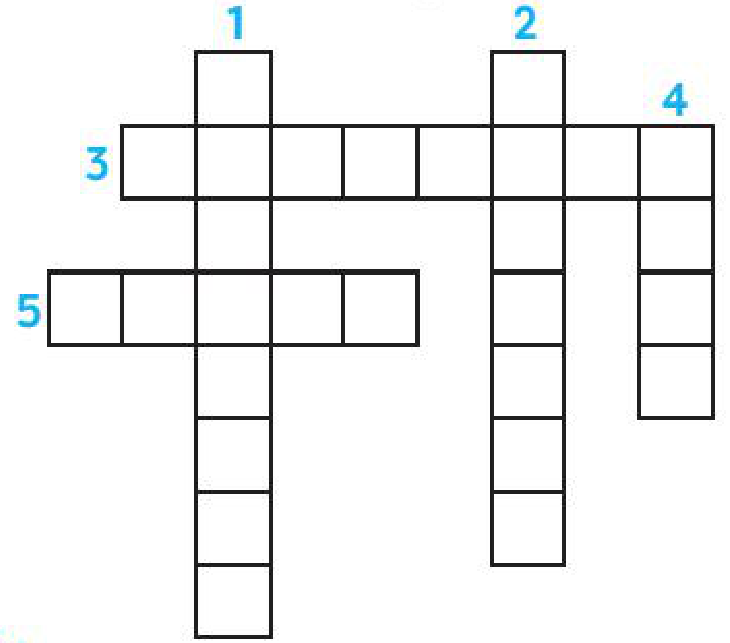
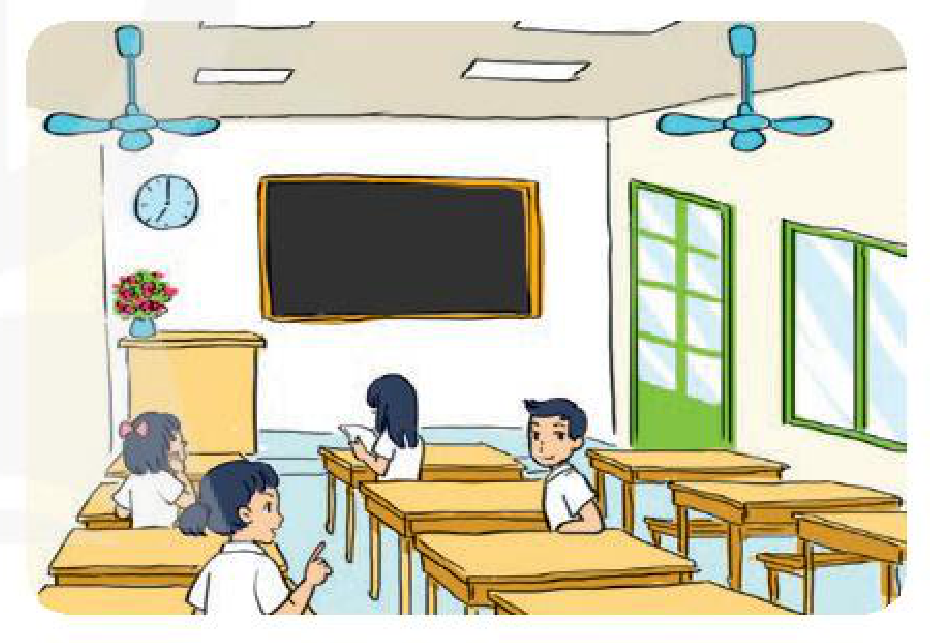

<!-- pdf:37 -->

# REVIEW 1

**(UNITS 1 - 2 - 3)**

## LANGUAGE

### Pronunciation

**1. Choose the word whose underlined part is pronounced differently.**

1. A. ear*s* | B. eye*s* | C. lip*s*
2. A. c*a*t | B. f*a*ther | C. c*a*lm
3. A. light*s* | B. pencil*s* | C. lamp*s*
4. A. notebook*s* | B. ruler*s* | C. room*s*
5. A. br*o*ther | B. h*o*mework | C. m*o*ther
<!-- ocr-ok: đã đối chiếu ảnh trang gốc, phần gạch chân các âm trong bài tập phát âm được biểu diễn bằng in nghiêng -->

**2. Write the names of school things and furniture in the house which begin with /b/ and /p/.**

- /b/: book, \_\_\_\_\_\_\_
- /p/: pen, \_\_\_\_\_\_\_

### Vocabulary

**3. Complete the words.**

1. E \_ l \_ \_ \_
2. h \_ \_ \_ w \_ \_ \_
3. l \_ \_ \_ h
4. s \_ \_ r \_ \_
5. b \_ \_ m \_ \_ \_ \_ n
<!-- ocr-ok: đã đối chiếu ảnh trang gốc, OCR bỏ sót các từ khuyết chữ cái câu 1, 2, 3, 5 -->

**Now write the words in the correct group.**

| play | do | have | study |
| --- | --- | --- | --- |
| | | | |

**4. Solve the crossword puzzle.**

**DOWN**
1. She likes to meet new people. She's \_\_\_\_\_\_\_.
2. People cook meals in this room.
4. You hear with them.

**ACROSS**
3. He's good at drawing. He's very \_\_\_\_\_\_\_.
5. It's a side of the face, below the eyes.

### Grammar

**5. Look at the picture of a classroom. Choose the best answer A, B, or C.**

1. There is a blackboard and a clock \_\_\_\_\_\_\_ the wall.
   - A. in | B. on | C. behind
2. A vase of flowers is on the \_\_\_\_\_\_\_ desk.
   - A. teacher's | B. teachers | C. teacher'
3. A boy and three girls are \_\_\_\_\_\_\_ the classroom.
   - A. in | B. on | C. in front of
4. The window is \_\_\_\_\_\_\_ the big door.
   - A. behind | B. next to | C. under
5. A girl \_\_\_\_\_\_\_ her book now.
   - A. reads | B. reading | C. is reading

**6. Complete the sentences with the present simple or the present continuous form of the verbs in brackets.**

1. We can't go out now. It (rain) \_\_\_\_\_\_\_.
2. What time \_\_\_\_\_\_\_ you (have) \_\_\_\_\_\_\_ breakfast every day?
3. – \_\_\_\_\_\_\_ she (study) \_\_\_\_\_\_\_ English now?
   – No, she isn't.
4. My dog (like) \_\_\_\_\_\_\_ my bed very much.
5. My mother (not cook) \_\_\_\_\_\_\_ now. She (read) \_\_\_\_\_\_\_ a book.

<!-- pdf:38 -->

## SKILLS

### Reading

**1. Choose A, B, or C for each blank in the email below.**

> **From:** an@fastmail.com
>
> **To:** nick@fastmail.com
>
> **Subject:** *My best friend*
>
> Hi Nick,
>
> It's great to hear from you. I want to tell you about my best friend.
>
> My grandma is my best friend. She is 68 years old. She (1) \_\_\_\_\_\_\_ with our family.
>
> She was a maths teacher (2) \_\_\_\_\_\_\_ a secondary school. She likes (3) \_\_\_\_\_\_\_ up early and watering the flowers in our garden. She usually helps (4) \_\_\_\_\_\_\_ with my homework. In the evening, she tells me interesting stories. She also listens (5) \_\_\_\_\_\_\_ me when I'm sad. I love my grandma very much.
>
> What about you? Who's your best friend?
>
> Bye bye,
>
> An

1. A. lives | B. works | C. goes
2. A. for | B. on | C. at
3. A. going | B. staying | C. getting
4. A. I | B. me | C. my
5. A. with | B. to | C. for

**2. Read the text and answer the questions.**

**MY SCHOOL**

My new school is in a quiet place not far from the city centre. It has three buildings and a large yard. This year there are 26 classes with more than 1,000 students at my school. Most students are **hard-working** and **kind**. The school has about 40 teachers. They are all helpful and **friendly**. My school has different clubs: Dance, English, Arts, Football and Basketball. I like English, so I am in the English club. I love my school because it is a good school.

1. Where is the writer's new school?
2. What are the students like?
3. What are the teachers like?
4. How many clubs are there in the school?
5. Why does the writer love the school?

### Speaking

**3. Interview two of your classmates about what they like and dislike about your school. Report their answers.**

| | What he / she likes + reasons | What he / she dislikes + reasons |
| --- | --- | --- |
| Classmate A | | |
| Classmate B | | |
<!-- ocr-ok: đã đối chiếu ảnh trang gốc, OCR đọc lỗi dòng Classmate A trong bảng -->

### Listening

**4. An and Mi are talking on the phone. Listen and fill each blank with ONE word.**

1. Everybody is at \_\_\_\_\_\_\_.
2. Mi's mother is watering the \_\_\_\_\_\_\_ in the garden.
3. Mi's father is in the \_\_\_\_\_\_\_ room.
4. Her younger brother is \_\_\_\_\_\_\_ in her bedroom.
5. Vy is watching \_\_\_\_\_\_\_.
<!-- ocr-ok: đã đối chiếu ảnh trang gốc, các chỗ trống điền từ câu 1-5 -->

### Writing

**5. Write an email of about 50 words to your friend. Tell him / her about a family member. Use these questions as cues.**

1. Who is the person?
2. How old is he / she?
3. What does he / she look like?
4. What is he / she like?

> Hi \_\_\_\_\_\_\_,
>
> Thanks for your email. Now I'll tell you about my \_\_\_\_\_\_\_.
>
> \_\_\_\_\_\_\_
>
> Write me soon and tell me about a member in your family.
>
> Best,
<!-- ocr-ok: đã đối chiếu ảnh trang gốc, OCR đọc nhầm Thanks thành Than, I'll tell thành Hl sell và Write me thành WrRe mẹ -->

## 📷 Danh mục hình minh hoạ

| Mã hình | Trang PDF | Trang sách | Chú thích / Mô tả |
| --- | --- | --- | --- |
| H6-tieng_anh-r01-01 | 37 | 36 | Khung ô chữ (*crossword puzzle*) gồm 3 cột dọc (*Down*: 1, 2, 4) và 2 hàng ngang (*Across*: 3, 5) thuộc bài tập 4 phần Language – Vocabulary |
| H6-tieng_anh-r01-02 | 37 | 36 | Tranh minh hoạ lớp học dùng để chọn đáp án đúng A, B hoặc C ở bài tập 5 phần Language – Grammar |
