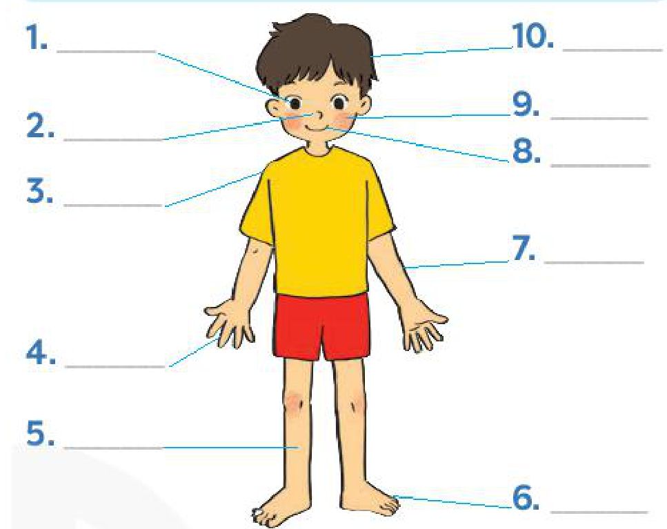
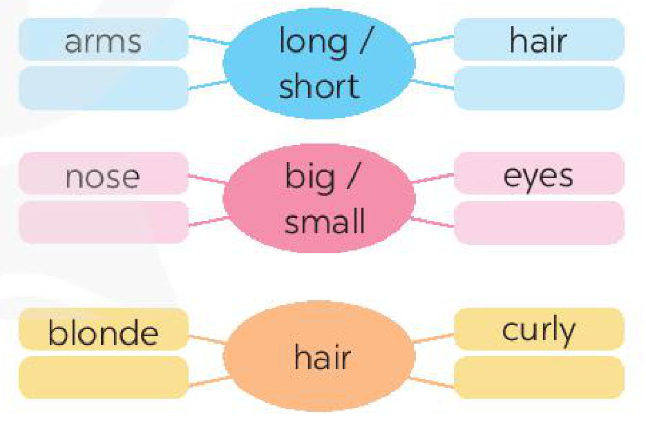
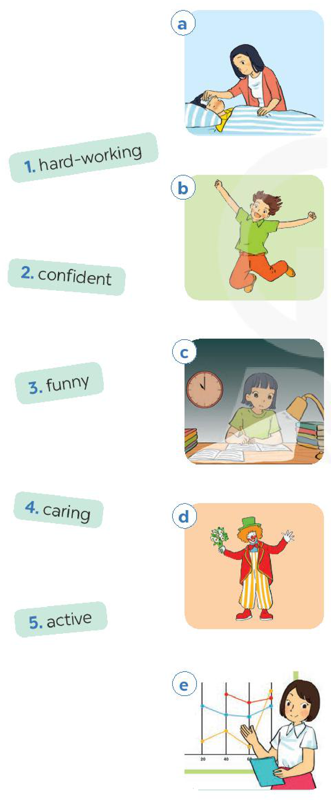
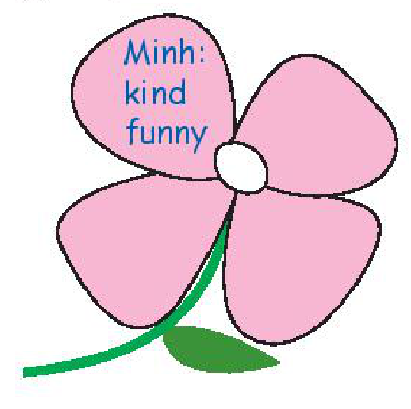
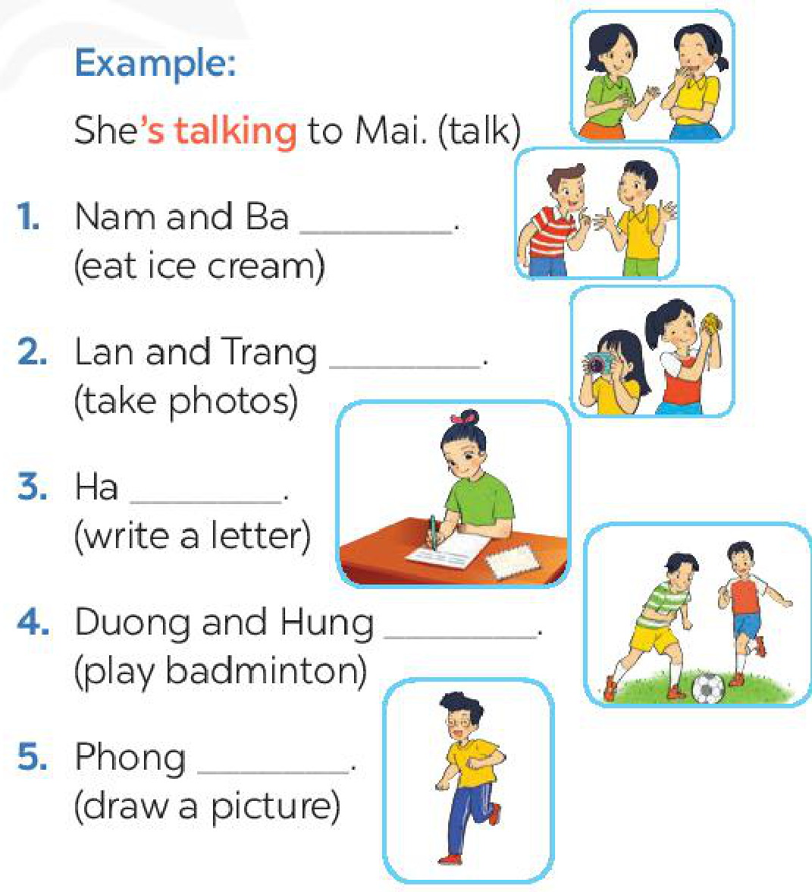
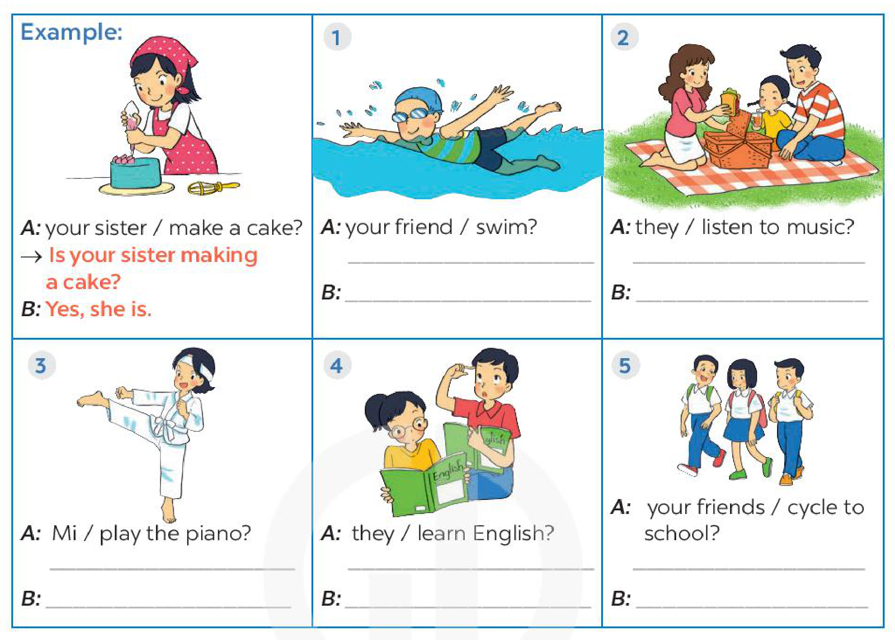
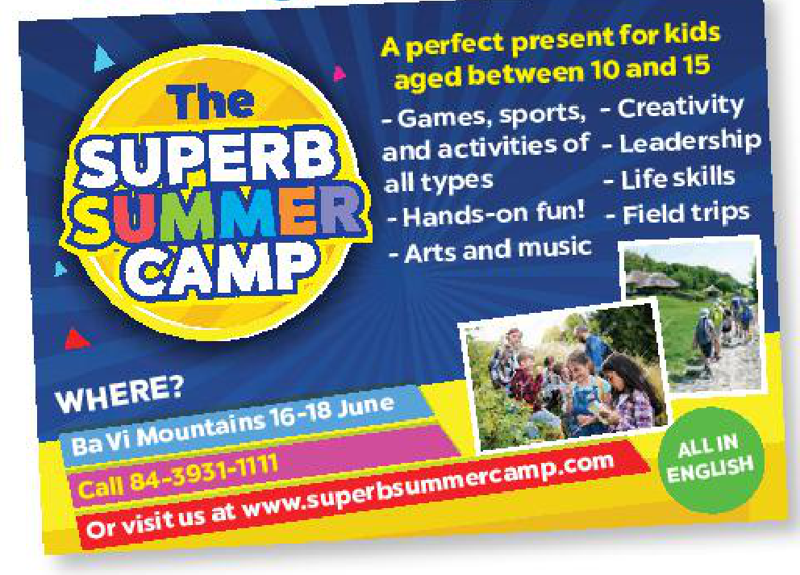
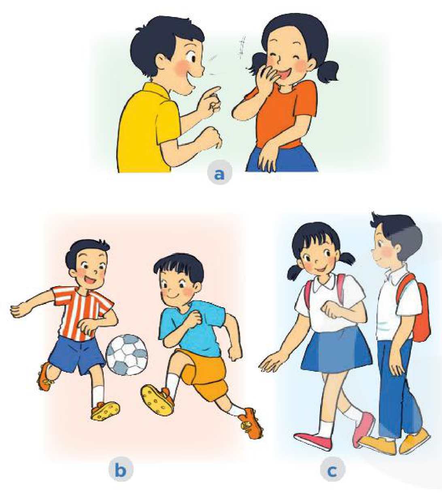
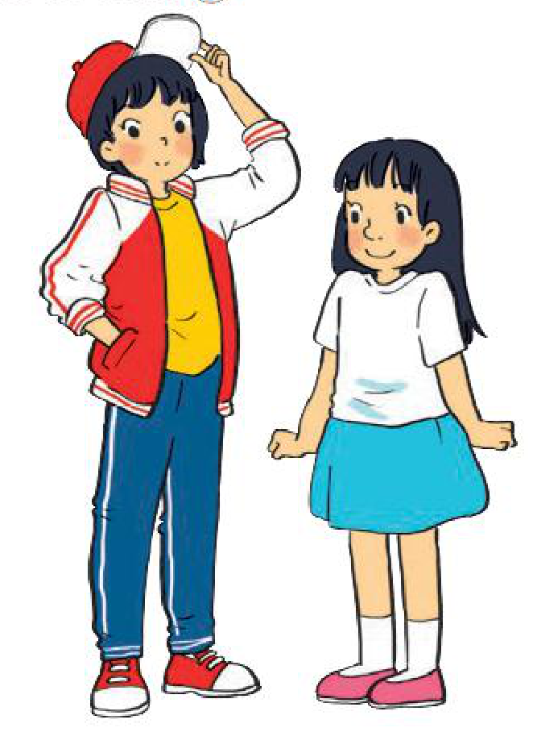
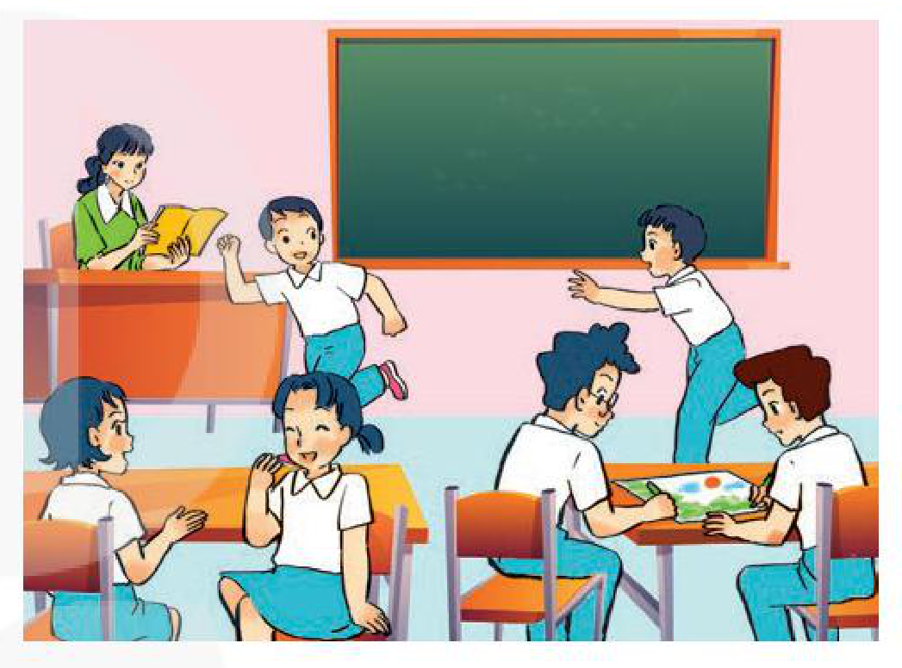

<!-- pdf:27 -->

# UNIT 3: MY FRIENDS

> **THIS UNIT INCLUDES:**
> - **Vocabulary:**
>   - Body parts and **appearance**
>   - **Personality** adjectives
> - **Pronunciation:** Sounds: /b/ and /p/
> - **Grammar:** Present continuous
> - **Skills:**
>   - Reading about friends and a summer camp
>   - Talking about friends and summer camps
>   - Listening about best friends
>   - Writing a diary entry about best friends
> - **Everyday English:** Asking about **appearance** and **personality**

## GETTING STARTED

**A surprise guest**

**1. Listen and read.**

**Phong:** That was a great idea, Nam. I love picnics!

**Nam:** Please pass me the biscuits.

**Phong:** Sure. Here you are.

**Nam:** Thanks. What are you reading, Phong?

**Phong:** *4Teen*. It's my favourite magazine!

**Nam:** Look! It's Mai. And she is with someone.

**Phong:** Oh, who's that? She has glasses and long black hair.

**Nam:** I don't know. They're coming over.

**Mai:** Hi there. This is my friend Chau.

**Phong & Nam:** Hi, Chau. Nice to meet you.

**Chau:** Nice to meet you, too.

**Nam:** Would you like to sit down? We have lots of food.

**Mai:** Oh, sorry, we can't. We're going to the bookshop.

**Chau:** Bye for now.

**Phong & Nam:** Bye bye.

<!-- pdf:28 -->

**2. Fill the blanks with the words from the conversation.**
<!-- ocr-ok: đã đối chiếu ảnh trang gốc, OCR dính chữ Fillthe và withthewords -->

1. Phong and Nam are having a \_\_\_\_\_\_\_.
2. *4Teen* is Phong's \_\_\_\_\_\_\_.
3. Phong and Nam see \_\_\_\_\_\_\_ and \_\_\_\_\_\_\_.
4. Chau has \_\_\_\_\_\_\_ and \_\_\_\_\_\_\_.
5. Mai and Chau \_\_\_\_\_\_\_ the bookshop.

**3. Label the body parts with the words in the box.**

| **cheek** | eye | hand | arm |
| --- | --- | --- | --- |
| mouth | leg | nose | hair |
| **shoulder** | foot | | |
<!-- ocr-ok: đã đối chiếu ảnh trang gốc, khung từ vựng 10 bộ phận cơ thể xếp 4 cột -->

1. \_\_\_\_\_\_\_
2. \_\_\_\_\_\_\_
3. \_\_\_\_\_\_\_
4. \_\_\_\_\_\_\_
5. \_\_\_\_\_\_\_
6. \_\_\_\_\_\_\_
7. \_\_\_\_\_\_\_
8. \_\_\_\_\_\_\_
9. \_\_\_\_\_\_\_
10. \_\_\_\_\_\_\_
<!-- ocr-ok: đã đối chiếu ảnh trang gốc, các dòng kẻ trống đánh số 1-10 để điền bộ phận cơ thể -->

**Do you know any other words for body parts?**

**4. Work in groups. Complete the word webs.**

- *long / short*: arms, hair, \_\_\_\_\_\_\_, \_\_\_\_\_\_\_
- *big / small*: nose, eyes, \_\_\_\_\_\_\_, \_\_\_\_\_\_\_
- *hair*: blonde, curly, \_\_\_\_\_\_\_, \_\_\_\_\_\_\_
<!-- ocr-ok: đã đối chiếu ảnh trang gốc, OCR bỏ sót chữ trong sơ đồ mạng từ (word webs) -->

**5. GAME: Guessing**

**Work in groups. Take turns to describe a classmate. Other group members guess who he / she is.**

**Example:**
- **A:** She has long hair and big eyes.
- **B:** Is that Lan?
- **A:** That's right.

<!-- pdf:29 -->

## A CLOSER LOOK 1

### Vocabulary

**Personality adjectives**

**1. Match the adjectives to the pictures.**

| Adjectives | Pictures |
| --- | --- |
| 1. **hard-working** | a – b – c – d – e |
| 2. **confident** | a – b – c – d – e |
| 3. **funny** | a – b – c – d – e |
| 4. **caring** | a – b – c – d – e |
| 5. **active** | a – b – c – d – e |
<!-- ocr-ok: đã đối chiếu ảnh trang gốc, các thẻ tính từ 1-5 nối với tranh minh hoạ a-e -->

**2. Use the adjectives in the box to complete the sentences. Pay attention to the highlighted words / phrases.**

| **careful** | **shy** | **creative** |
| --- | --- | --- |
| **clever** | **kind** | **friendly** |

1. Mina is very \_\_\_\_\_\_\_. She likes *drawing pictures*. She always has lots of *new ideas*.
2. Nam is \_\_\_\_\_\_\_. He likes *helping his friends*.
3. Minh Duc is \_\_\_\_\_\_\_. He likes *meeting new people*.
4. Kim is very \_\_\_\_\_\_\_. She *pays attention to what she's doing*.
5. Mai is \_\_\_\_\_\_\_. She *learns things quickly and easily*.

**3. GAME: Friendship flower**

**Work in groups. Write two personality adjectives for each group member.**

<!-- pdf:30 -->

### Pronunciation

**/b/ and /p/**

**4. Listen and circle the words you hear. Then repeat.**

| | /b/ | /p/ |
| --- | --- | --- |
| **1.** | big | pig |
| **2.** | bear | pear |
| **3.** | buy | pie |
| **4.** | robe | rope |

**5. Listen. Then practise the chant. Notice the rhyme.**

We're having a picnic.
We're having a picnic.
Fun! Fun! Fun!
We're bringing some biscuits.
We're bringing some biscuits.
Yum! Yum! Yum!
We're playing together.
We're playing together.
Hurrah! Hurrah! Hurrah!

## A CLOSER LOOK 2

### Grammar

**The present continuous**

**Remember!**

- We use the present continuous for actions happening now.
  *Example:*
  - She*'s talking*.
  - They*'re not talking*.
- We can use the present continuous with *now*, *at present*, or *at the moment*.
  *Example:*
  - I'm doing my homework *at present*.
  - **A:** Are you reading *now*?
    **B:** Yes, I am.
<!-- term: Present continuous -->

**1. Put the verbs in brackets in the present continuous.**

1. Nam (read) \_\_\_\_\_\_\_ a book now.
2. They (play) \_\_\_\_\_\_\_ football at the moment.
3. My sister (not make) \_\_\_\_\_\_\_ a sandwich at present.
4. I (go) \_\_\_\_\_\_\_ to the supermarket at the moment.
5. \_\_\_\_\_\_\_ they (talk) \_\_\_\_\_\_\_ about their new friends?
<!-- ocr-ok: đã đối chiếu ảnh trang gốc, OCR đọc nhầm I (go) thành l(go9Q và bỏ sót gạch trống -->

**2. Look at the pictures. Write sentences like the example. Use positive or negative present continuous verbs.**

**Example:** She*'s talking* to Mai. (talk)

1. Nam and Ba \_\_\_\_\_\_\_. (eat ice cream)
2. Lan and Trang \_\_\_\_\_\_\_. (take photos)
3. Ha \_\_\_\_\_\_\_. (write a letter)
4. Duong and Hung \_\_\_\_\_\_\_. (play badminton)
5. Phong \_\_\_\_\_\_\_. (draw a picture)
<!-- ocr-ok: đã đối chiếu ảnh trang gốc, OCR bỏ sót tên Duong and Hung ở câu 4 -->

<!-- pdf:31 -->

**3. Work in pairs. Look at the pictures. Ask and answer.**

| | Prompts & Answers |
| --- | --- |
| **Example:** | **A:** your sister / make a cake? → *Is your sister making a cake?* — **B:** *Yes, she is.* |
| **1.** | **A:** your friend / swim? \_\_\_\_\_\_\_ — **B:** \_\_\_\_\_\_\_ |
| **2.** | **A:** they / listen to music? \_\_\_\_\_\_\_ — **B:** \_\_\_\_\_\_\_ |
| **3.** | **A:** Mi / play the piano? \_\_\_\_\_\_\_ — **B:** \_\_\_\_\_\_\_ |
| **4.** | **A:** they / learn English? \_\_\_\_\_\_\_ — **B:** \_\_\_\_\_\_\_ |
| **5.** | **A:** your friends / cycle to school? \_\_\_\_\_\_\_ — **B:** \_\_\_\_\_\_\_ |
<!-- ocr-ok: đã đối chiếu ảnh trang gốc, OCR bỏ sót câu gợi ý trong ô 2 và ô 4 của khung tranh -->

**Remember!**

- When something often happens or is fixed, we use the present simple.
- When something is happening now, we use the present continuous.
<!-- term: Present continuous -->

**4. Put the verbs in brackets in the present simple or present continuous.**

1. My best friend (not walk) \_\_\_\_\_\_\_ to school every day. Sometimes she (cycle) \_\_\_\_\_\_\_.
2. Look! What \_\_\_\_\_\_\_ he (play) \_\_\_\_\_\_\_?
3. \_\_\_\_\_\_\_ your friends (study) \_\_\_\_\_\_\_ in the library every afternoon?
4. I (write) \_\_\_\_\_\_\_ an email to my friend now.
5. He (not do) \_\_\_\_\_\_\_ his homework now. He (read) \_\_\_\_\_\_\_.

**5. GAME: Charades**

**Take turns to mime different actions. Others guess what you are doing.**

**Example:**
- **A:** Are you dancing?
- **B:** No, I'm not.
- **C:** Are you looking for something?
- **B:** Yes, I am.

<!-- pdf:32 -->

## COMMUNICATION

### Everyday English

**Asking about appearance and personality**

**1. Listen and read the dialogue between Linda and Mi. Pay attention to the highlighted questions.**

...

**Linda:** *What does your best friend look like?*
<!-- term: What does ... look like? -->

**Mi:** She's short with long black hair. She has bright brown eyes.
<!-- term: What does ... look like? -->

**Linda:** *What's she like?*
<!-- term: What's ... like? -->

**Mi:** She's very **kind** and **creative**.
<!-- term: What's ... like? -->

...

**2. Work with a classmate. Ask him / her about his / her best friend. Remember to use the two questions highlighted in 1.**

**Date of birth and personality**

**3. Read about these students in *4Teen* magazine. Use one or two adjectives to describe them.**

- **Vinh (Viet Nam, birthday 7/12):** I live in Da Nang. At home, I can do my homework without my parents' help. At school, I like speaking English. I'm going to an English club now.
- **John (England, birthday 26/2):** I come from Cambridge. In my free time, I draw pictures and play the piano. I also help some old people near my house. I usually read to them at the weekend. Now I'm drawing in my garden.

**4. We may have different personalities because we have different birthdays. Read the descriptions below. Do you think they match the friends in 3?**

- 21/3 – 19/4: **confident**, **active**
- 20/4 – 20/5: **loving**, **hard-working**
- 21/5 – 21/6: **active**, **friendly**
- 22/6 – 22/7: **caring**, **clever**
- 23/7 – 22/8: **confident**, **creative**
- 23/8 – 22/9: **careful**, **hard-working**
- 23/9 – 23/10: **creative**, **friendly**
- 24/10 – 21/11: **careful**, **funny**
- 22/11 – 21/12: **clever**, **confident**
- 22/12 – 19/1: **careful**, **hard-working**
- 20/1 – 18/2: **friendly**, **clever**
- 19/2 – 20/3: **kind**, **creative**
<!-- ocr-ok: đã đối chiếu ảnh trang gốc, OCR đọc sai các mốc ngày 23/7, 23/8, 23/9, 22/11 và 20/3 -->

**5. Read the descriptions in 4. Share your opinion with the class.**

**Example:**
- My birthday is ...
- It's true that ...
- It isn't true that ...

<!-- pdf:33 -->

## SKILLS 1

### Reading

> *The SUPERB SUMMER CAMP*
>
> *A perfect present for kids aged between 10 and 15*
> - Games, sports, and activities of all types
> - Hands-on fun!
> - Arts and music
> - Creativity
> - Leadership
> - Life skills
> - Field trips
>
> *WHERE?* Ba Vi Mountains 16–18 June | Call 84-3931-1111 | Or visit us at www.superbsummercamp.com | *ALL IN ENGLISH*
<!-- ocr-ok: đã đối chiếu ảnh trang gốc, chữ nghiêng màu trên áp phích quảng cáo trại hè -->

**1. Look at the advertisement above and answer the questions.**

1. Who is the Superb Summer Camp for?
2. What can people do at this summer camp?

**2. Read the text and write T (True) or F (False). Correct the false statements.**

> *New message — Friday 16th June*
>
> **To:** My parents \<parents.nguyen@webmail.com\>
>
> **Subject:** My first day at the Superb Summer Camp
>
> Hi Mum and Dad,
>
> Here I am at the Superb Summer Camp. Mr Black asked us to write emails in English! Wow, everything here is in English!
>
> I have some new friends: Jimmy, Phong, and Nhung. They're in the photo. Jimmy has blonde hair and blue eyes. He's **clever** and **creative**. He likes taking photos. Phong is the tall boy. He's sporty and plays basketball very well. Nhung has curly black hair. She's **kind**. She shared her lunch with me today.
>
> We're having fun. Jimmy's taking photos of me. Phong's reading a comic book, and Nhung's playing the violin. I must go now.
>
> Please write soon.
>
> Love,
>
> Nam
<!-- term: summer camp -->
<!-- term: blonde -->
<!-- term: curly -->

**Example:** Nam is writing to his teacher. *F*
→ *Nam is writing to his parents.*

1. The children can speak Vietnamese at the camp. \_\_\_\_\_\_\_
2. Nam has four new friends. \_\_\_\_\_\_\_
3. Phong likes taking photos. \_\_\_\_\_\_\_
4. Nam thinks Nhung is **kind**. \_\_\_\_\_\_\_
5. Phong is tall and sporty. \_\_\_\_\_\_\_

### Speaking

**3. Work in groups. Read about the three students below. Is the Superb Summer Camp suitable for all of them? Why or Why not?**

1. Mi is 12 years old. She likes drawing and writing stories. She's good at English. She's **creative** and **friendly**.
2. An is 16 years old. He doesn't know English. He's **funny** and **kind**.
3. Vy is 14 years old. She likes playing sports. Her English isn't very good. She's **clever**, but she isn't **active**.

**4. Think about yourself. Do you want to go to this kind of camp? Why or Why not?**

**Example:** I want to go to this camp because I can speak English there.

<!-- pdf:34 -->

## SKILLS 2

### Listening

**1. What are the students doing in each picture?**

**2. Listen to Mi and Minh talking about their best friends. Look at the picture below and say which one is Lan and which one is Chi.**

**3. Listen to the talk again. Fill each blank with a word / number you hear.**

1. Mi and Lan are studying in class \_\_\_\_\_\_\_.
2. Lan has short \_\_\_\_\_\_\_ hair and a small \_\_\_\_\_\_\_.
3. Lan is **active** and \_\_\_\_\_\_\_.
4. Chi's hair is long and black, and her nose is \_\_\_\_\_\_\_.
5. Chi is \_\_\_\_\_\_\_ to Minh.
<!-- ocr-ok: đã đối chiếu ảnh trang gốc, OCR dính chữ và bỏ sót các gạch trống câu 1-5 -->

### Writing

**4. Work in pairs. Ask and answer about your best friend. Use these questions to help you.**

1. What's his / her name?
2. What does he / she look like?
3. What's he / she like?
4. Why do you like him / her?
<!-- term: What does ... look like? -->
<!-- term: What's ... like? -->

**5. Write a diary entry of about 50 words about your best friend. Use the answers to the questions in 4.**

> Dear Diary,
>
> My best friend is \_\_\_\_\_\_\_
>
> I like \_\_\_\_\_\_\_ because \_\_\_\_\_\_\_

<!-- pdf:35 -->

## LOOKING BACK

### Vocabulary

**1. Choose the correct answer A, B, or C.**
<!-- ocr-ok: đã đối chiếu ảnh trang gốc, OCR dính chữ A,B, orC -->

1. Nick is very \_\_\_\_\_\_\_. He makes everyone laugh!
   - A. **confident**
   - B. **funny**
   - C. **active**
2. My sister always does her homework before class. She's very \_\_\_\_\_\_\_.
   - A. **hard-working**
   - B. **creative**
   - C. **careful**
3. Mi is \_\_\_\_\_\_\_. She helps me with my homework.
   - A. **hard-working**
   - B. **friendly**
   - C. **kind**
4. He is a \_\_\_\_\_\_\_ person. He cares about everybody.
   - A. **caring**
   - B. **friendly**
   - C. **clever**
5. My best friend is very \_\_\_\_\_\_\_. She likes doing activities.
   - A. **creative**
   - B. **clever**
   - C. **active**

**2. Answer questions about your classmates.**

1. Who has long hair in your class?
2. Who has a small nose?
3. Who has a round face?
4. Does the classmate next to you have long hair?
5. Does the classmate next to you have big eyes?

### Grammar

**3. Put the verbs in brackets in the present continuous.**

This is my class during break time. Some boys (1. run) \_\_\_\_\_\_\_ around the class. Mi and Mai (2. talk) \_\_\_\_\_\_\_. Nam and Phong (3. not talk) \_\_\_\_\_\_\_. They (4. draw) \_\_\_\_\_\_\_ something. My teacher is in the classroom too. She (5. not teach) \_\_\_\_\_\_\_. She's reading a book.

**4. Put the verbs in brackets in the present simple or present continuous.**

1. **A:** What \_\_\_\_\_\_\_ you (do) \_\_\_\_\_\_\_?
   **B:** I (write) \_\_\_\_\_\_\_ an email to my friend.
2. **A:** Mai usually (cycle) \_\_\_\_\_\_\_ to school.
   **B:** Really? I (not cycle) \_\_\_\_\_\_\_. I (walk) \_\_\_\_\_\_\_ every day.
3. **A:** Where is Phong? \_\_\_\_\_\_\_ he (do) \_\_\_\_\_\_\_ his homework?
   **B:** No, he (read) \_\_\_\_\_\_\_ a book in the living room.
<!-- ocr-ok: đã đối chiếu ảnh trang gốc, OCR đọc lỗi I (write) và các gạch trống điền từ -->

<!-- pdf:36 -->

## PROJECT

**My class yearbook**

**How to make a class yearbook**
<!-- term: yearbook -->

1. Stick a photo / drawing of the friend sitting next to you on a large sheet of paper.
2. Interview your friend to find out about him / her (e.g. favourite subjects, favourite books, what he / she likes, etc.).
3. Write a short description of your friend. Describe his / her **appearance** and **personality**. Add some information you have from the interview.
4. Decorate the page. Show it to your class and talk about it.
5. Together make a class yearbook.
<!-- term: yearbook -->

### Now I can ...

- use the words for body parts, **appearance** and **personality**.
- pronounce the sounds /b/ and /p/ correctly.
- use the present continuous to talk about things happening now.
- ask about **appearance** and **personality**.
- read about friends and a summer camp.
- talk about friends and summer camps.
- listen about best friends.
- write a diary entry about my best friend.

## 📷 Danh mục hình minh hoạ

| Mã hình | Trang PDF | Trang sách | Chú thích / Mô tả |
| --- | --- | --- | --- |
| H6-tieng_anh-u03-01 | 28 | 27 | Tranh minh hoạ cậu bé kèm các đường chỉ số từ 1 đến 10 để điền tên các bộ phận cơ thể (bài tập 3 phần Getting Started) |
| H6-tieng_anh-u03-02 | 28 | 27 | Sơ đồ ba mạng từ (*word webs*) về ngoại hình: *long / short*, *big / small* và *hair* (bài tập 4 phần Getting Started) |
| H6-tieng_anh-u03-03 | 29 | 28 | Năm thẻ tính từ chỉ tính cách (*1. hard-working*, *2. confident*, *3. funny*, *4. caring*, *5. active*) nối với năm tranh minh hoạ *a–e* (bài tập 1 phần A Closer Look 1) |
| H6-tieng_anh-u03-04 | 29 | 28 | Hình bông hoa tình bạn (*Friendship flower*) có cánh hoa ghi mẫu *Minh: kind, funny* (bài tập 3 phần A Closer Look 1) |
| H6-tieng_anh-u03-05 | 30 | 29 | Sáu bức tranh minh hoạ hoạt động của các nhân vật cho câu mẫu và các câu 1–5 (bài tập 2 phần A Closer Look 2) |
| H6-tieng_anh-u03-06 | 31 | 30 | Bảng 6 ô tranh minh hoạ (*Example* và các câu 1–5) dùng để hỏi – đáp với thì hiện tại tiếp diễn (bài tập 3 phần A Closer Look 2) |
| H6-tieng_anh-u03-07 | 33 | 32 | Áp phích quảng cáo trại hè tiếng Anh *The Superb Summer Camp* tại Ba Vì (bài tập 1 phần Skills 1 – Reading) |
| H6-tieng_anh-u03-08 | 34 | 33 | Ba bức tranh *a*, *b*, *c* minh hoạ các hoạt động của học sinh (bài tập 1 phần Skills 2 – Listening) |
| H6-tieng_anh-u03-09 | 34 | 33 | Tranh minh hoạ hai bạn nữ để nghe và nhận diện Lan và Chi (bài tập 2 phần Skills 2 – Listening) |
| H6-tieng_anh-u03-10 | 35 | 34 | Tranh minh hoạ cảnh lớp học trong giờ ra chơi (bài tập 3 phần Looking Back – Grammar) |
