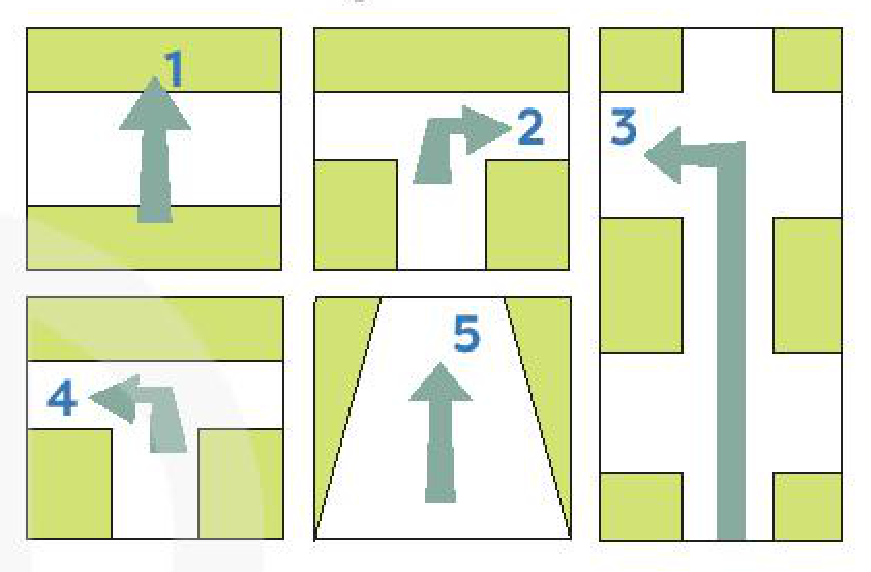
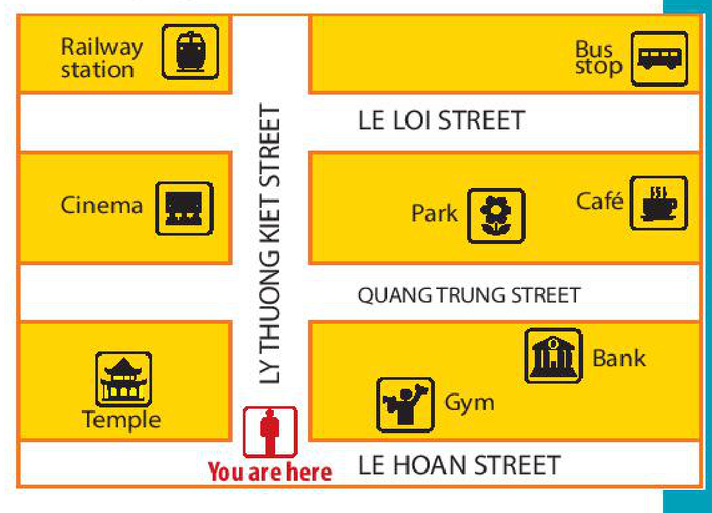
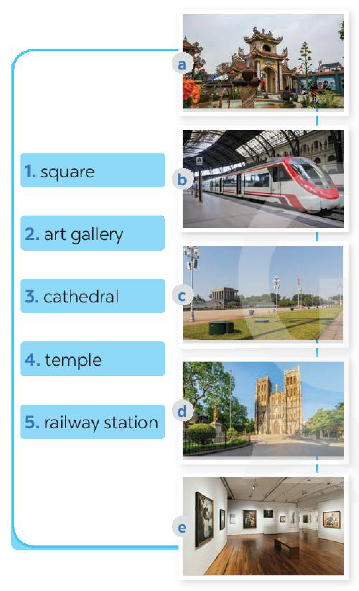
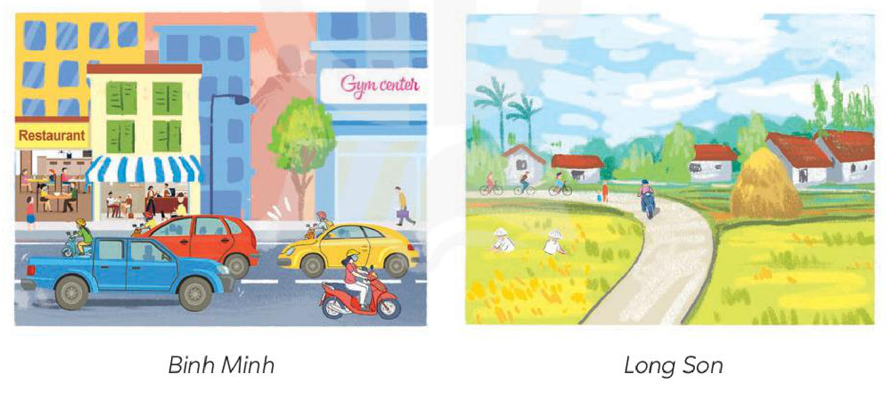
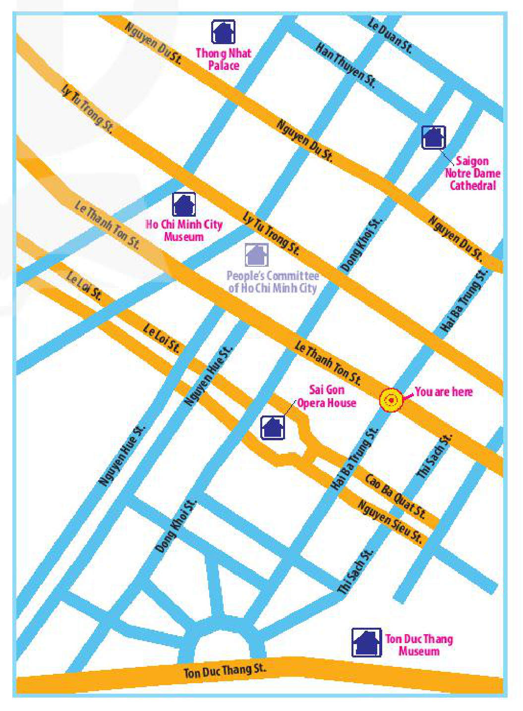
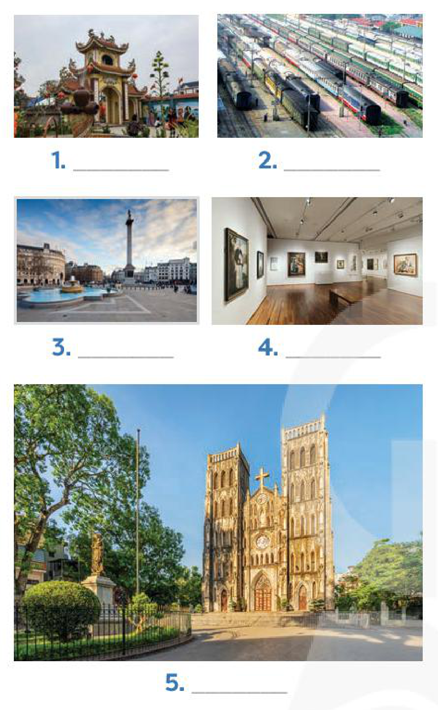
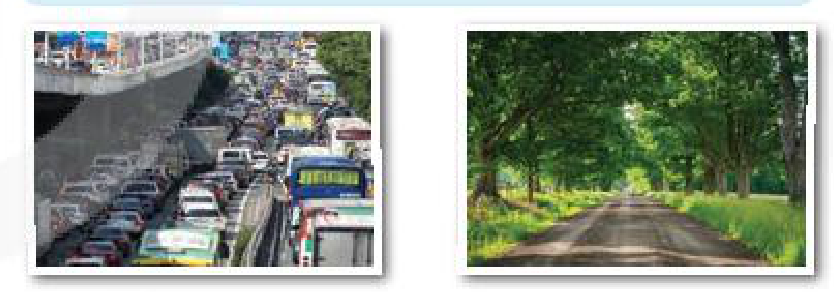
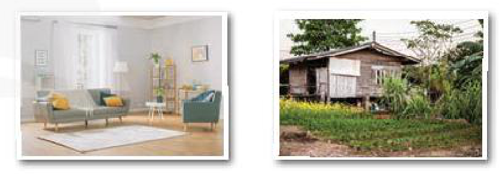
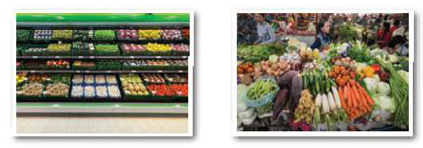
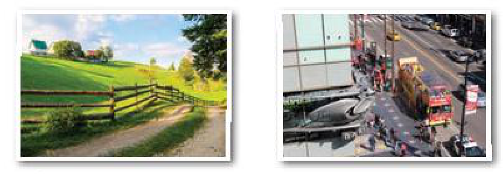

<!-- pdf:39 -->

# UNIT 4: MY NEIGHBOURHOOD

> **THIS UNIT INCLUDES:**
> - **Vocabulary:** Places in a neighbourhood
> - **Pronunciation:** Sounds: /ɪ/ and /iː/
> - **Grammar:** Comparative adjectives: *smaller*, *more expensive*, ...
> - **Skills:**
>   - Reading about a neighbourhood
>   - Talking about a neighbourhood
>   - Listening about a neighbourhood
>   - Writing a paragraph to describe a neighbourhood
> - **Everyday English:** Asking for and giving directions
<!-- ocr-ok: đã đối chiếu ảnh trang gốc, OCR bỏ sót dòng Talking about a neighbourhood và kí hiệu IPA /ɪ/, /iː/ -->

## GETTING STARTED

**Lost in the old town!**

**1. Listen and read.**

**Phong:** Wow! We're in Hoi An. I'm so excited.

**Nick:** Me too. It's so beautiful. Where shall we go first?
<!-- term: Shall we ...? -->

**Khang:** Let's go to Chua Cau.

**Phong:** Well, but Tan Ky House is nearer. Shall we go there first?

**Nick & Khang:** OK, sure.

**Phong:** First, **cross** the road, and then turn left.
<!-- term: turn left -->

**Nick:** Fine, let's go.

**Phong:** Wait.

**Khang:** What's up, Phong?

**Phong:** I think we're lost.
<!-- ocr-ok: đã đối chiếu ảnh trang gốc, OCR đọc nhầm đại từ I thành kí tự | -->

**Nick:** Look, there's a girl. Let's ask her.

**Phong:** Excuse me? Can you tell us the way to Tan Ky House?

**Girl:** Sure. Go straight. Take the second **turning** on the left, and then turn right.
<!-- term: go straight -->
<!-- term: turn right -->

**Phong, Nick & Khang:** Thank you.

<!-- pdf:40 -->

**2. Find in the conversation the sentences used to make suggestions.**

**Example:** Let's go to Chua Cau.

**Remember!**

We can use *shall we* and *let's* to make suggestions.
<!-- term: Shall we ...? -->

**3. Read the conversation again. Put the actions in order.**

- a. The girl shows them the way to Tan Ky House. `[ ]`
- b. Nick, Khang and Phong arrive in Hoi An. `[ ]`
- c. Nick, Khang and Phong decide to go to Tan Ky House. `[ ]`
- d. Nick, Khang and Phong get lost. `[ ]`
- e. Phong asks a girl how to get to Tan Ky House. `[ ]`

**4. Find and underline the following directions in the conversation.**

- A. turn right
- B. **cross** the road
- C. turn left
- D. go straight
- E. take the second **turning** on the left

**Now match these directions with the diagrams below.**

**5. GAME: Find places**

**Work in pairs. Give your partner directions to one of the places on the map, and he / she tries to guess. Then swap.**

**Example:**
- **A:** Go straight. Take the second **turning** on the left. It's on your right.
- **B:** Is that the gym?
- **A:** No, try again.

<!-- pdf:41 -->

## A CLOSER LOOK 1

### Vocabulary

**1. Match the places below with the pictures. Then listen, check and repeat the words.**

| Places | Pictures |
| --- | --- |
| 1. **square** | a – b – c – d – e |
| 2. **art gallery** | a – b – c – d – e |
| 3. **cathedral** | a – b – c – d – e |
| 4. temple | a – b – c – d – e |
| 5. **railway station** | a – b – c – d – e |
<!-- ocr-ok: đã đối chiếu ảnh trang gốc, các thẻ địa điểm 1-5 nối với các ảnh chụp a-e -->

**Name some other places in your neighbourhood.**

**2. Work in pairs. Ask and answer questions about where you live.**

**Example:**
- **A:** Is there a **square** in your neighbourhood?
- **B:** Yes, there is. / No, there isn't.

**3. Work in groups. Ask and answer about your neighbourhood. You can use the adjectives below.**
<!-- term: peaceful -->

| noisy | crowded | peaceful |
| --- | --- | --- |
| quiet | modern | beautiful |
| **busy** | boring | |
<!-- ocr-ok: đã đối chiếu ảnh trang gốc, OCR đọc nhầm noisy crowded peaceful thành Rolsy growed pence] uy -->
<!-- term: peaceful -->

**Example:**
- **A:** Is your neighbourhood quiet?
- **B:** Yes, it is. / No, it's noisy.

### Pronunciation

**/ɪ/ and /iː/**

**4. Listen and repeat the words. Pay attention to the sounds /ɪ/ and /iː/.**
<!-- ocr-ok: đã đối chiếu ảnh trang gốc, OCR đọc nhầm kí hiệu phiên âm /ɪ/ và /iː/ -->
<!-- term: convenient -->

| noisy | exciting | expensive |
| --- | --- | --- |
| clean | peaceful | convenient |
| cheap | friendly | |
<!-- term: convenient -->

**Now, in pairs put the words in the correct column.**

| /ɪ/ | /iː/ |
| --- | --- |
| *noisy* | *convenient* |
| | |
<!-- ocr-ok: đã đối chiếu ảnh trang gốc, OCR bỏ sót dòng tiêu đề /ɪ/ và /iː/ của bảng -->

**5. Listen and practise the chant. Notice the sounds /ɪ/ and /iː/.**
<!-- ocr-ok: đã đối chiếu ảnh trang gốc, OCR đọc nhầm kí hiệu phiên âm /ɪ/ và /iː/ -->

**MY NEIGHBOURHOOD**

My city is very noisy.
There are lots of trees growing.
The people here are **busy**.
It's a lively place to live in.

My village is very pretty.
There are lots of places to see.
The people here are friendly.
It's a fantastic place to be.

<!-- pdf:42 -->

## A CLOSER LOOK 2

### Grammar

*Comparative adjectives*

**Remember!**

We can use comparative adjectives to compare two people or things.
<!-- term: Comparative adjectives -->

**Example:**
- Tom is *taller than* Mary.
- A house in a city is normally *more expensive than* a house in the countryside.
<!-- term: Comparative adjectives -->

**1. Complete the following sentences with the comparative form of the adjectives in brackets. Number 1 is an example.**

1. This building is *taller* than that building. (tall)
2. My neighbourhood is \_\_\_\_\_\_\_ than your neighbourhood. (noisy)
3. The **square** in Ha Noi is \_\_\_\_\_\_\_ than the **square** in Hoi An. (big)
4. Living in the countryside is \_\_\_\_\_\_\_ than living in a city. (peaceful)
5. Is living in a city \_\_\_\_\_\_\_ than living in the countryside? (exciting)

<!-- pdf:43 -->

**2. Use the correct form of the words in brackets to complete the letter.**

> Dear Nick,
>
> How are you?
>
> Ha Noi is beautiful but it's too **busy** for me. I'm having a great time at Cua Lo Beach now. The weather is (1. hot) *hotter* than that in Ha Noi. The houses and buildings are (2. small) \_\_\_\_\_\_\_ and (3. old) \_\_\_\_\_\_\_ than those in Ha Noi.
>
> The streets are (4. wide) \_\_\_\_\_\_\_ with less traffic. The seafood here is (5. delicious) \_\_\_\_\_\_\_ and (6. cheap) \_\_\_\_\_\_\_ than the seafood in Ha Noi.
>
> See you soon,
>
> Vy

**3. Look at the pictures of the two neighbourhoods: Binh Minh and Long Son. Compare two neighbourhoods. You can use the adjectives below.**

| noisy | crowded | quiet | peaceful | modern | **busy** | boring |
| --- | --- | --- | --- | --- | --- | --- |

**Example:** Binh Minh is noisier than Long Son.

**4. Work in pairs. Ask and answer questions about Binh Minh and Long Son neighbourhoods using the pictures in 3.**

**Example:**
- **A:** Is Binh Minh noisier than Long Son?
- **B:** Yes, it is.
- **A:** Is Long Son more modern than Binh Minh?
- **B:** No, it isn't.
<!-- term: modern -->

<!-- pdf:44 -->

## COMMUNICATION

### Everyday English

**Asking for and giving directions**

**1. Listen and read the conversations.**

- **A:** Excuse me. Could you tell me the way to the cinema, please?
  **B:** Go along this street. It's on your left.
- **A:** Excuse me. Where's the nearest post office, please?
  **B:** Go out of the station. Take the first **turning** on the right.

**2. Work in pairs. Make similar conversations to ask for and give directions to places near your school.**

**An audio guide to a place**

**3. Nick is listening to an audio guide to Hoi An. Listen and fill the blanks.**
<!-- term: audio guide -->

> *CITY TOURS!*
>
> Let's start our tour in Hoi An. We are in Tran Phu Street now. First, go to Ong Pagoda. To get there, go (1) \_\_\_\_\_\_\_ along the street for five minutes. It's on your left. Next, go to the Museum of Sa Huynh Culture. Take the (2) \_\_\_\_\_\_\_ **turning** on your left. Turn (3) \_\_\_\_\_\_\_ and it's on your right. **Finally**, go to Hoa Nhap **Workshop** to buy some presents. Turn left and then right. It's (4) \_\_\_\_\_\_\_ Tan Ky House.
<!-- term: turn left -->

**4. Look at the map below and create an audio guide for District 1 of Ho Chi Minh City.**
<!-- ocr-ok: đã đối chiếu ảnh trang gốc, OCR dính chữ belowand và 1of -->
<!-- term: audio guide -->

**Remember to:**
- give directions to at least three different places;
- use *first*, *then*, *after that* and *finally* to link your directions.

> Let's start our tour in Ho Chi Minh City. We are in Hai Ba Trung Street now. First, go to \_\_\_\_\_\_\_

**5. Now present your audio guide to your class.**
<!-- ocr-ok: đã đối chiếu ảnh trang gốc, OCR dính chữ presentyour -->

<!-- pdf:45 -->

## SKILLS 1

### Reading

**1. Read Khang's blog. Look at the words in the box, then find them in the text and underline them. What do they mean?**

| **suburbs** | **dislike** | **outdoor** |
| --- | --- | --- |

> *KHANG'S BLOG (http://www.myblog.com.vn/Khang)*
>
> *Friday, December 23rd ...*
>
> *MY NEIGHBOURHOOD*
>
> I live in the **suburbs** of Da Nang City. There are many things I like about my neighbourhood.
>
> It's great for **outdoor** activities because it has beautiful parks, **sandy** beaches and fine weather. There's almost everything I need here: shops, restaurants, and markets. The people here are friendlier, and the food is better than in other places.
>
> However, there are two things I **dislike** about it: there are many modern buildings and offices; and the streets are **busy** and crowded.
>
> *Posted by Khang at 4:55 P.M.*
<!-- term: neighbourhood -->
<!-- term: modern -->

**2. Read Khang's blog again and fill the table with the information.**

| LIKES | DISLIKES |
| --- | --- |
| *beautiful parks* | \_\_\_\_\_\_\_ |
| \_\_\_\_\_\_\_ | \_\_\_\_\_\_\_ |
<!-- ocr-ok: đã đối chiếu ảnh trang gốc, OCR bỏ sót dòng tiêu đề LIKES và DISLIKES của bảng -->

**3. Read Khang's blog again. Then answer the questions.**

1. Where is Khang's neighbourhood?
2. Why is his neighbourhood great for **outdoor** activities?
3. What are the people in his neighbourhood like?
4. How are the streets in his neighbourhood?

### Speaking

**4. Make notes about your neighbourhood. Think about what you like / dislike about it.**

| LIKES | DISLIKES |
| --- | --- |
| • \_\_\_\_\_\_\_ | • \_\_\_\_\_\_\_ |
| • \_\_\_\_\_\_\_ | • \_\_\_\_\_\_\_ |
<!-- ocr-ok: đã đối chiếu ảnh trang gốc, OCR bỏ sót bảng ghi chú LIKES và DISLIKES -->

**5. Work in pairs. Ask and answer about what you like and dislike about your neighbourhood.**

**Example:**
- **A:** Where do you live?
- **B:** I live in the **suburbs** of Da Nang City.
- **A:** What do you like about it?
- **B:** The weather is fine. The people are friendly and the food is good.
- **A:** What do you **dislike** about it?
- **B:** The streets are **busy** and crowded.

<!-- pdf:46 -->

## SKILLS 2

### Listening

**1. Listen to the conversation between Khang and Vy and tick (✓) T (True) or F (False).**

| | T | F |
| --- | --- | --- |
| 1. Vy lives in the centre of Ho Chi Minh City. | | |
| 2. There is a big market near her house. | | |
| 3. The streets are **narrow**. | | |
| 4. The schools are **faraway**. | | |
| 5. There are some factories near her neighbourhood. | | |

**2. Listen to the conversation again and fill the blanks.**

- **What Vy likes:**
  - many shops, restaurants, and (1) \_\_\_\_\_\_\_ in her neighbourhood
  - (2) \_\_\_\_\_\_\_ streets
  - helpful and (3) \_\_\_\_\_\_\_ people
- **What Vy dislikes:**
  - too (4) \_\_\_\_\_\_\_ schools
  - dirty air
  - noisy and (5) \_\_\_\_\_\_\_ streets
<!-- ocr-ok: đã đối chiếu ảnh trang gốc, OCR bỏ sót tiêu đề What Vy likes và What Vy dislikes trên khung màu -->

### Writing

**3. Tick (✓) what you like or dislike about a neighbourhood.**

| | Likes | Dislikes |
| --- | --- | --- |
| 1. **sandy** beaches | | |
| 2. heavy traffic | | |
| 3. many modern buildings and offices | | |
| 4. peaceful streets | | |
| 5. good restaurants and cafés | | |
| 6. sunny weather | | |
| 7. helpful and friendly people | | |
| 8. many shops and markets | | |
<!-- ocr-ok: đã đối chiếu ảnh trang gốc, OCR đọc nhầm heavy traffic thành heavyiniiic -->

**4. Write a paragraph of about 50 words about your neighbourhood saying what you like and dislike about it. Use Khang's blog as a model.**

> I live in \_\_\_\_\_\_\_. There are many / some things I like about my neighbourhood. \_\_\_\_\_\_\_
>
> However, there are some / many / one thing(s) I **dislike** about it. \_\_\_\_\_\_\_

<!-- pdf:47 -->

## LOOKING BACK

### Vocabulary

**1. Write the name for each picture.**

1. \_\_\_\_\_\_\_
2. \_\_\_\_\_\_\_
3. \_\_\_\_\_\_\_
4. \_\_\_\_\_\_\_
5. \_\_\_\_\_\_\_
<!-- ocr-ok: đã đối chiếu ảnh trang gốc, các chỗ trống đánh số 1-5 dưới mỗi bức ảnh -->

### Grammar

**2. Put the following adjectives in the correct column.**

| fast | noisy | expensive |
| --- | --- | --- |
| heavy | large | beautiful |
| hot | quiet | exciting |

| One syllable | Two syllables | Three syllables |
| --- | --- | --- |
| | | |
<!-- ocr-ok: đã đối chiếu ảnh trang gốc, OCR bỏ sót bảng phân loại One syllable / Two syllables / Three syllables -->

**3. Now write their comparative forms in the table below.**

| Adjectives | Comparative form |
| --- | --- |
| fast | *faster* |
| beautiful | \_\_\_\_\_\_\_ |
| noisy | \_\_\_\_\_\_\_ |
| expensive | \_\_\_\_\_\_\_ |
| hot | \_\_\_\_\_\_\_ |
| exciting | \_\_\_\_\_\_\_ |
| quiet | \_\_\_\_\_\_\_ |
| heavy | \_\_\_\_\_\_\_ |
| large | \_\_\_\_\_\_\_ |

**4. Complete the sentences comparing the pictures. Use the comparative forms of the adjectives below.**

| expensive | modern |
| --- | --- |
| noisy | peaceful |

1. This street is \_\_\_\_\_\_\_ than that one.
<!-- ocr-ok: đã đối chiếu ảnh trang gốc, OCR bỏ sót hoàn toàn câu 1 -->

2. A city house is \_\_\_\_\_\_\_ than a country house.
<!-- ocr-ok: đã đối chiếu ảnh trang gốc, OCR đọc nhầm A city house thành Achy house -->

3. Things at a corner shop are \_\_\_\_\_\_\_ than things at a village market.

4. Life in the countryside is \_\_\_\_\_\_\_ than life in the city.

<!-- pdf:48 -->

## PROJECT

**MY MAP**

**1. Draw a map of a neighbourhood. Write names of at least five places on your map.**

**2. Work in pairs. Take turns to ask for and give directions to the places on the map.**

### Now I can ...

- use the words to name places in a neighbourhood.
- pronounce the sounds /ɪ/ and /iː/ correctly.
- compare two people or things using comparative adjectives.
- ask for and give directions.
- read about a neighbourhood.
- talk about a neighbourhood.
- listen about a neighbourhood.
- write a paragraph to describe a neighbourhood.

## 📷 Danh mục hình minh hoạ

| Mã hình | Trang PDF | Trang sách | Chú thích / Mô tả |
| --- | --- | --- | --- |
| H6-tieng_anh-u04-01 | 40 | 39 | Năm sơ đồ mũi tên chỉ đường (1–5) dùng để nối với các cụm từ chỉ hướng A–E (bài tập 4 phần Getting Started) |
| H6-tieng_anh-u04-02 | 40 | 39 | Bản đồ khu phố gồm *Railway station*, *Bus stop*, *Cinema*, *Park*, *Café*, *Temple*, *Gym*, *Bank* và vị trí *You are here* (bài tập 5 phần Getting Started) |
| H6-tieng_anh-u04-03 | 41 | 40 | Năm thẻ tên địa điểm (*1. square*, *2. art gallery*, *3. cathedral*, *4. temple*, *5. railway station*) nối với năm ảnh chụp *a–e* (bài tập 1 phần A Closer Look 1) |
| H6-tieng_anh-u04-04 | 43 | 42 | Hai tranh minh hoạ đối chiếu khu phố đô thị nhộn nhịp *Binh Minh* và vùng quê yên bình *Long Son* (bài tập 3 phần A Closer Look 2) |
| H6-tieng_anh-u04-05 | 44 | 43 | Bản đồ các tuyến đường và địa danh tiêu biểu tại Quận 1, Thành phố Hồ Chí Minh (bài tập 4 phần Communication) |
| H6-tieng_anh-u04-06 | 47 | 46 | Năm bức ảnh địa điểm đánh số 1–5 để viết tên từ vựng tương ứng (bài tập 1 phần Looking Back – Vocabulary) |
| H6-tieng_anh-u04-07 | 47 | 46 | Cặp ảnh so sánh đường phố đông nghịt xe cộ và con đường rợp bóng cây yên tĩnh cho câu 1 (bài tập 4 phần Looking Back – Grammar) |
| H6-tieng_anh-u04-08 | 47 | 46 | Cặp ảnh so sánh phòng khách ngôi nhà hiện đại ở thành phố và ngôi nhà ở nông thôn cho câu 2 (bài tập 4 phần Looking Back – Grammar) |
| H6-tieng_anh-u04-09 | 47 | 46 | Cặp ảnh so sánh quầy hàng trong cửa hàng tiện lợi và sạp rau củ ở chợ quê cho câu 3 (bài tập 4 phần Looking Back – Grammar) |
| H6-tieng_anh-u04-10 | 47 | 46 | Cặp ảnh so sánh khung cảnh đồng quê thanh bình và đường phố đô thị tấp nập cho câu 4 (bài tập 4 phần Looking Back – Grammar) |
