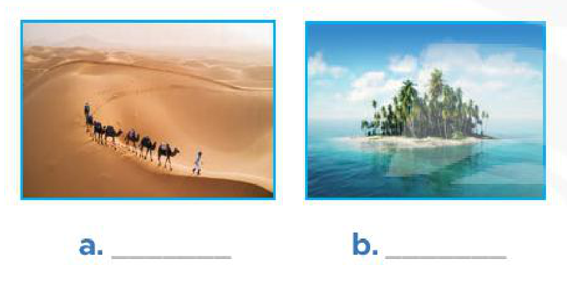
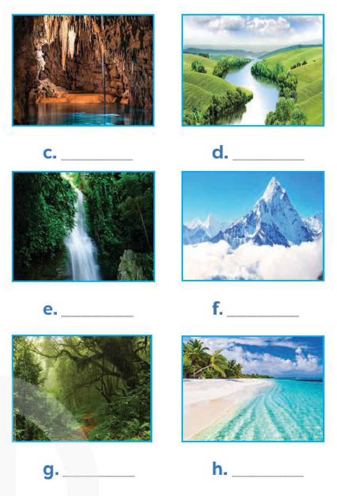
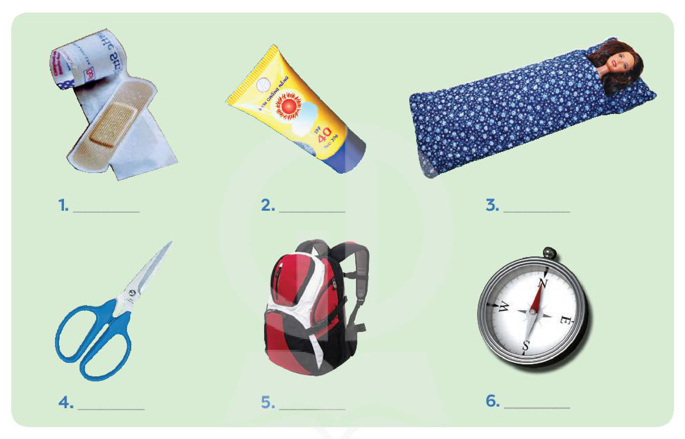
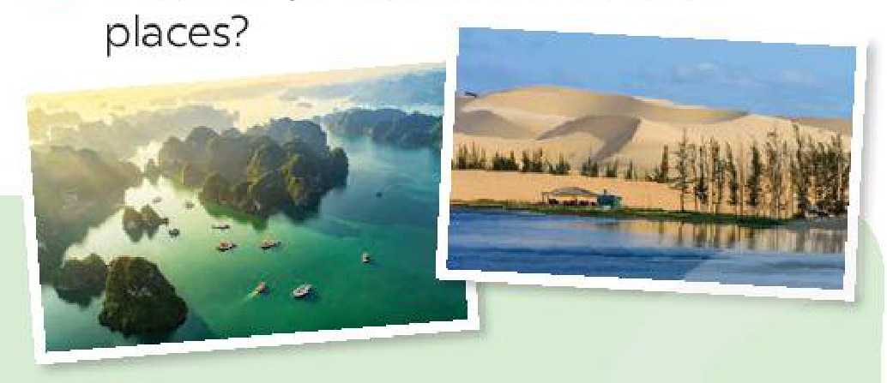
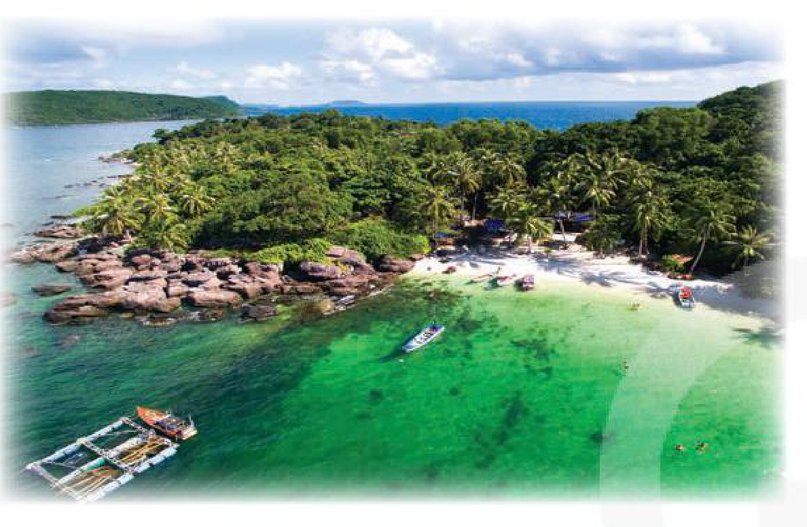
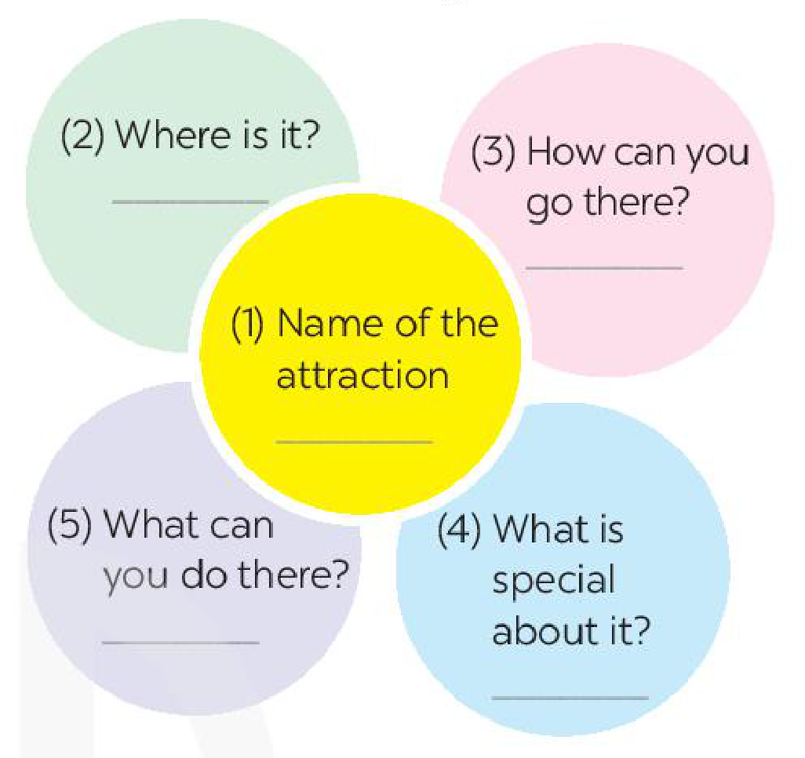
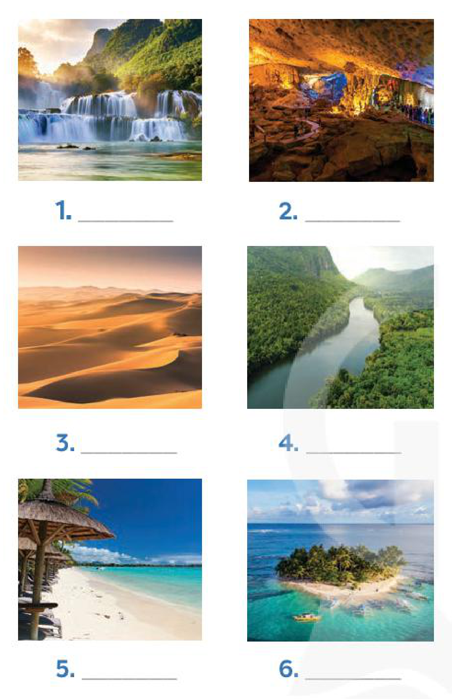
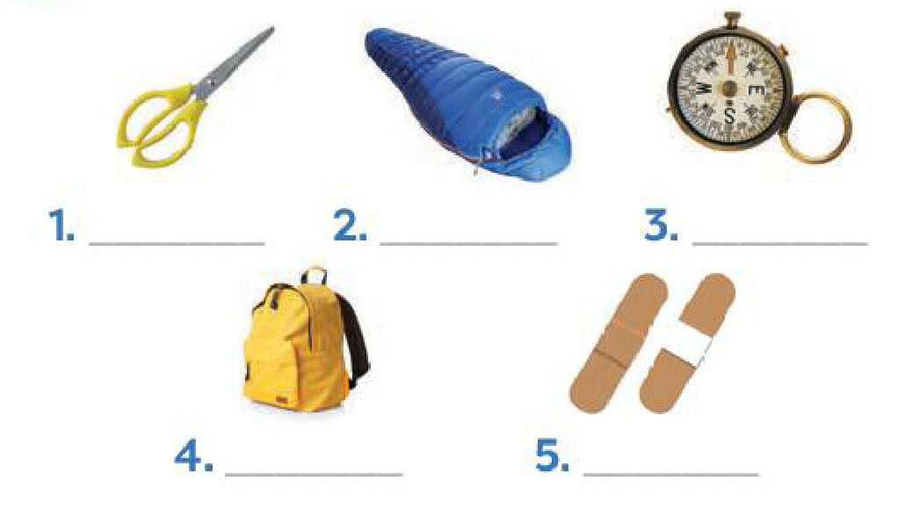

<!-- pdf:49 -->

# UNIT 5: NATURAL WONDERS OF VIET NAM

> **THIS UNIT INCLUDES:**
> - **Vocabulary:**
>   - Things in nature
>   - Travel items
> - **Pronunciation:**
>   - Sounds: /t/ and /d/
> - **Grammar:**
>   - Countable and uncountable nouns
>   - Modal verb: *must* / *mustn't*
> - **Skills:**
>   - Reading about natural wonders
>   - Talking about famous places, and what you must / mustn't do there
>   - Listening about a natural wonder
>   - Writing a paragraph about a natural wonder
> - **Everyday English:**
>   - Making and accepting appointments
<!-- ocr-ok: đã đối chiếu ảnh trang gốc, khung THIS UNIT INCLUDES chia hai cột khiến OCR bỏ sót Pronunciation và dòng Talking about -->

## GETTING STARTED

**Geography Club**

**1. Listen and read.**

**Alice:** Hello, welcome to our Geography Club.

*(Knock at door)*

**Alice:** Come in, Elena. We're just starting now. But remember you must always be on time.

**Elena:** Sure. Sorry.

**Alice:** Today I'm going to talk about some **natural wonders** of Viet Nam.

**Nick:** Great! What's that in the first picture?

**Alice:** It's Ganh Da Dia in Phu Yen.

**Elena:** Wow. It looks **amazing**!

**Nick:** Is picture 2 Ha Long Bay?
<!-- ocr-ok: đã đối chiếu ảnh trang gốc, OCR đọc nhầm Is thành ls -->

**Alice:** Right. What do you know about it?

**Nick:** It has many **islands**.

**Alice:** Yeah! The scenery is wonderful. This picture **shows** Tuan Chau, a large **island**.
<!-- term: scenery -->

**Tommy:** How about picture 3?

...

<!-- pdf:50 -->

**2. Complete the following sentences with the words from the box.**

| scenery | natural | wonders | amazing | islands |
| --- | --- | --- | --- | --- |

1. People didn't make Ganh Da Dia. They are \_\_\_\_\_\_\_ **rocks**.
2. Ha Long Bay has thousands of big and small \_\_\_\_\_\_\_.
3. Ha Long Bay is charming and the \_\_\_\_\_\_\_ is wonderful.
4. Ganh Da Dia has \_\_\_\_\_\_\_ **rock** columns of different shapes and sizes.
5. There are many natural and **man-made** \_\_\_\_\_\_\_ in Viet Nam.

**3. Listen and repeat the words, then label the pictures.**

| 1. mountain | 2. river | 3. **waterfall** |
| --- | --- | --- |
| 4. forest | 5. cave | 6. **desert** |
| 7. beach | 8. **island** | |

- a. \_\_\_\_\_\_\_
- b. \_\_\_\_\_\_\_
- c. \_\_\_\_\_\_\_
- d. \_\_\_\_\_\_\_
- e. \_\_\_\_\_\_\_
- f. \_\_\_\_\_\_\_
- g. \_\_\_\_\_\_\_
- h. \_\_\_\_\_\_\_
<!-- ocr-ok: đã đối chiếu ảnh trang gốc, các nhãn a-h dưới 8 bức tranh bài 3 -->

**4. QUIZ**

**Work in groups. Choose the correct answer to each of the questions.**

1. Which is an island in Viet Nam?
   - A. Con Dao
   - B. Son Doong
2. Where is **Mount** Fansipan?
   - A. In Lao Cai
   - B. In Quang Binh
3. Which of the following is a national park?
   - A. Thong Nhat Park
   - B. Cat Tien Park
4. Which of the following wonders is a cave?
   - A. Cuc Phuong
   - B. Phong Nha
5. Which waterfall is in Cao Bang?
   - A. Giang Dien Waterfall
   - B. Ban Gioc Waterfall
<!-- term: cave -->

<!-- pdf:51 -->

## A CLOSER LOOK 1

### Vocabulary

**1. Write a word under each picture. Practise saying the words.**

| **plaster** | sleeping bag | **backpack** | **compass** | **suncream** | scissors |
| --- | --- | --- | --- | --- | --- |
<!-- term: scissors -->

1. \_\_\_\_\_\_\_  2. \_\_\_\_\_\_\_  3. \_\_\_\_\_\_\_  4. \_\_\_\_\_\_\_  5. \_\_\_\_\_\_\_  6. \_\_\_\_\_\_\_
<!-- ocr-ok: đã đối chiếu ảnh trang gốc, các nhãn số 1-6 dưới tranh trong khung nền xanh -->

**2. Complete the following sentences. Use the words in 1.**

1. We're lost. Please give me the \_\_\_\_\_\_\_.
2. It's so sunny today. I need to put on some \_\_\_\_\_\_\_.
3. A \_\_\_\_\_\_\_ is very useful when you go camping overnight.
4. I've finished packing. All my things are in my \_\_\_\_\_\_\_.
5. My foot hurts. I need to put a \_\_\_\_\_\_\_ on my foot.
<!-- term: sleeping bag -->
<!-- ocr-ok: đã đối chiếu ảnh trang gốc, OCR đọc ghép hai cột bài 2 và bài 3 làm sót từ some ở câu 2 -->

**3. Now put the items in order of usefulness. Number 1 is the most useful, number 6 is the least useful on holiday.**

| plaster | compass | sleeping bag |
| --- | --- | --- |
| scissors | backpack | suncream |

1. \_\_\_\_\_\_\_
2. \_\_\_\_\_\_\_
3. \_\_\_\_\_\_\_
4. \_\_\_\_\_\_\_
5. \_\_\_\_\_\_\_
6. \_\_\_\_\_\_\_
<!-- ocr-ok: đã đối chiếu ảnh trang gốc, các dòng đánh số 1-6 để trống điền thứ tự -->

<!-- pdf:52 -->

### Pronunciation

**/t/ and /d/**

**4. Listen and repeat the words.**

| /t/ | /d/ |
| --- | --- |
| mountain | wonder |
| waterfall | island |
| desert | guide |
| plaster | holiday |
<!-- ocr-ok: đã đối chiếu ảnh trang gốc, OCR đọc nhầm tiêu đề cột /t/ thành tf -->

**5. Listen and repeat. Pay attention to the bold-typed parts of the words.**
<!-- ocr-ok: đã đối chiếu ảnh trang gốc, OCR đọc nhầm từ words ở cuối câu lệnh bài 5 -->

1. – Where's my ha**t**?
   – Oh, it's on your hea**d**.
2. Where **d**o they stay on their holi**d**ay?
3. I nee**d** some mea**t** for my ca**t**.
4. The Sahara is a very ho**t** **d**eser**t**.
5. I wan**t** to explore the islan**d** by boa**t**.
<!-- ocr-ok: đã đối chiếu ảnh trang gốc, đánh dấu in đậm chữ cái âm /t/ và /d/ trong từ làm tách token so với OCR -->

## A CLOSER LOOK 2

### Grammar

*Countable and uncountable nouns*

- Countable nouns are for the people and things we can count using numbers. Countable nouns can be singular: *a rock*, *an island* ..., or plural: *rocks*, *islands* ...
- Uncountable nouns are for the things that we cannot count with numbers. They usually do not have a plural form: *cream*, *chocolate* ...
<!-- term: Countable and uncountable nouns -->

**1. Is the underlined noun countable or uncountable? Write C (countable) or U (uncountable).**

1. The children are very tired after a <u>day</u> of fun. \_\_\_\_\_\_\_
2. Be careful! The <u>water</u> is deep. \_\_\_\_\_\_\_
3. My mother uses real <u>butter</u> in the cakes she bakes. \_\_\_\_\_\_\_
4. Remember to bring the necessary travel <u>items</u>. \_\_\_\_\_\_\_
5. – How about meeting in the canteen for some <u>tea</u>? \_\_\_\_\_\_\_
   – Sure. What time?
<!-- ocr-ok: đã đối chiếu ảnh trang gốc, thẻ u đánh dấu danh từ gạch chân làm thay đổi token so với OCR -->

**Remember!**

- We use *some*, *many*, *a few* with countable nouns.
- We use *some*, *much*, *a little* with uncountable nouns.

<!-- pdf:53 -->

**2. Choose the correct option for each sentence.**

1. I have \_\_\_\_\_\_\_ questions to ask you.
   - A. a few
   - B. a little
2. Australia is very nice. It has \_\_\_\_\_\_\_ natural wonders.
   - A. much
   - B. many
3. This is a difficult lesson, so only \_\_\_\_\_\_\_ students can understand it.
   - A. a few
   - B. many
4. It is a very dry area. There isn't \_\_\_\_\_\_\_ rain in summer.
   - A. a little
   - B. much
5. We've got very \_\_\_\_\_\_\_ time before our train leaves. We must hurry up!
   - A. little
   - B. much
<!-- ocr-ok: đã đối chiếu ảnh trang gốc, OCR đọc dính chữ không dấu cách ở các câu 1, 2, 5 -->

**3. Fill each blank with *a*, *any*, *some*, *much* or *many*.**

1. How \_\_\_\_\_\_\_ books are there in your bag?
2. There isn't \_\_\_\_\_\_\_ milk in the fridge. It's empty.
3. How \_\_\_\_\_\_\_ sugar do you need for your tea, Mum?
4. We need to buy \_\_\_\_\_\_\_ new furniture for the house.
5. There is \_\_\_\_\_\_\_ big cave in this area.
<!-- ocr-ok: đã đối chiếu ảnh trang gốc, OCR đọc nhầm It's empty ở câu 2 và đảo dòng câu 3, 4 -->

**Modal verb:** *must* / *mustn't*

**Remember!**

We use *must* to say that something is very necessary or very important.
We use *mustn't* to say that doing something is not allowed.
<!-- term: must / mustn't -->

| | |
| --- | --- |
| I / you he / she / it you / we / they | must |
| I / you he / she / it you / we / they | mustn't |
<!-- ocr-ok: đã đối chiếu ảnh trang gốc, bảng chia động từ khuyết thiếu must / mustn't -->

**4. Fill each blank with *must* or *mustn't*.**

1. You \_\_\_\_\_\_\_ leave the hotel room before 12 o'clock.
2. You \_\_\_\_\_\_\_ make lots of noise in the museum.
3. My mum says you \_\_\_\_\_\_\_ always tell the truth.
4. You know you \_\_\_\_\_\_\_ go to bed with your shoes on.
5. I want to speak English better. I \_\_\_\_\_\_\_ practise more.
<!-- ocr-ok: đã đối chiếu ảnh trang gốc, OCR đọc lỗi dòng đầu câu 3 và chữ I ở câu 5 -->

**5. Read the classroom rules below. Write some more rules for you and your classmates.**

1. We must arrive on time.
2. We mustn't pick flowers in the school garden.
3. We must \_\_\_\_\_\_\_.
4. We mustn't \_\_\_\_\_\_\_.
5. \_\_\_\_\_\_\_.

<!-- pdf:54 -->

## COMMUNICATION

### Everyday English

**Making and accepting appointments**

**1. Listen and read the short conversation below, paying attention to the highlighted parts.**

**Steven:** Duong, *let's go for a picnic* this Sunday.

**Duong:** *That's fine.* What time can we meet?

**Steven:** *How about* 9 o'clock?

**Duong:** *Sure.* I'll meet you at that time.

**2. Work in pairs. Make a short conversation, following the example in 1.**

**A travel guide**

**3. Read the travel guide entry.**

**GLOBAL TRAVEL GUIDES**
<!-- ocr-ok: đã đối chiếu ảnh trang gốc, dòng tiêu đề cong GLOBAL TRAVEL GUIDES trên vòng tròn -->

The Himalayas is a **mountain range**. It's very special. It has the world's highest mountain – **Mount** Everest.

When visiting the Himalayas, remember to follow these rules.

- You must ask before you visit the area.
- You mustn't travel alone. Always go in a group.
- You mustn't **litter**.
- You must bring only the necessary things.
- You must bring the right clothes too. Don't bring shorts or T-shirts!

**4. Now make a list of the things you must bring to the Himalayas. Then add things you mustn't bring.**

| MUST | MUSTN'T |
| --- | --- |
| *compass* | *bicycle* |
| \_\_\_\_\_\_\_ | \_\_\_\_\_\_\_ |

**5. Role-play being a tour guide and a tourist. Tell your partner what to prepare for their trip to the Himalayas, and give reasons.**

**Example:**

**A:** I'd like to go to the Himalayas next month.

**B:** OK. I think you must bring a waterproof coat. It's cold and rainy there!

**A:** Yes. Anything else?

**B:** You must ..., and you mustn't ...

<!-- pdf:55 -->

## SKILLS 1

### Reading

**1. Before you read, look at the pictures below. Make predictions about the reading. Then read and check your ideas.**

1. What is the reading about?
2. What do you know about these places?
<!-- ocr-ok: đã đối chiếu ảnh trang gốc, OCR bỏ sót từ places? ở cuối câu hỏi 2 -->

**Ha Long Bay** is in Quang Ninh. It has many islands and caves. Tuan Chau, with its beautiful beaches, is a popular tourist attraction in Ha Long Bay. There you can enjoy great seafood. And you can **join in** exciting activities. Ha Long Bay is Viet Nam's best **natural wonder**.
<!-- term: cave -->
<!-- term: tourist attraction -->

**Mui Ne** is popular for its amazing **landscapes**. The sand has different colours: white, yellow, red ... It's like a **desert** here. You can ride a bike down the slopes. You can also fly kites, or have a picnic by the beach. The best time to visit the Mui Ne Sand Dunes is early morning or late afternoon. Remember to wear **suncream** and bring water.

**2. Complete the sentences, using the words from the box.**

| desert | wonder | visit | islands | remember |
| --- | --- | --- | --- | --- |
<!-- ocr-ok: đã đối chiếu ảnh trang gốc, OCR đọc theo cột dọc trong khung từ gợi ý bài 2 -->

1. Ha Long Bay is famous for its beautiful \_\_\_\_\_\_\_.
2. Ha Long Bay is the number one natural \_\_\_\_\_\_\_ in Viet Nam.
3. A \_\_\_\_\_\_\_ is a large area of land with very little water.
4. \_\_\_\_\_\_\_ to bring an umbrella, as it often rains there.
5. A lot of people \_\_\_\_\_\_\_ Ly Son Island in the summer.

**3. Read the text again. Answer the following questions.**

1. Where is Ha Long Bay?
2. What can you do at Ha Long Bay?
3. Is there a desert in Mui Ne?
4. Where can you have a picnic in Mui Ne?
5. What is the best time to visit the Mui Ne Sand Dunes?

### Speaking

**4. Work in pairs. Make notes about one of the places in the reading. You can add your own ideas.**

| Ha Long Bay | Mui Ne |
| --- | --- |
| - *interesting islands* \_\_\_\_\_\_\_ | - *a beautiful place* \_\_\_\_\_\_\_ |
<!-- ocr-ok: đã đối chiếu ảnh trang gốc, OCR đọc ngang qua hai cột bảng ghi chú bài 4 -->

**Then tell your partner about the place.**

**Example:**

Ha Long Bay has a lot of interesting islands. It ...

**5. Some foreign visitors are visiting your city / town / area. You are their tour guide. Tell them some interesting things about the place as well as what they must and mustn't do there.**

**Example:**

- You must follow all the rules.
- You mustn't take photos when you are in the City Museum.

<!-- pdf:56 -->

## SKILLS 2

### Listening

**1. Work in groups. Discuss the question.**

What do you know about Phu Quoc Island?

**Listen to the talk and check your answers.**

**2. Listen again and tick (✓) T (True) or F (False).**

| | T | F |
| --- | --- | --- |
| 1. Phu Quoc is a very beautiful island in Viet Nam. | | |
| 2. There are no green forests in Phu Quoc. | | |
| 3. Tourists can visit fishing villages and national parks there. | | |
| 4. You cannot play water sports in Phu Quoc. | | |
| 5. People sell interesting things at the markets. | | |

### Writing

**3. Fill each blank in the network with the information about a travel attraction you know.**

- (1) Name of the attraction: \_\_\_\_\_\_\_
- (2) Where is it?: \_\_\_\_\_\_\_
- (3) How can you go there?: \_\_\_\_\_\_\_
- (4) What is special about it?: \_\_\_\_\_\_\_
- (5) What can you do there?: \_\_\_\_\_\_\_
<!-- ocr-ok: đã đối chiếu ảnh trang gốc, nội dung 5 hình tròn trong sơ đồ mạng lưới bài 3 -->

**4. Use the notes in 3 to write a paragraph of about 50 words.**

*You can begin your paragraph with:*

I am writing about \_\_\_\_\_\_\_. It is in \_\_\_\_\_\_\_.

<!-- pdf:57 -->

## LOOKING BACK

### Vocabulary

**1. Write the name for each picture.**

1. \_\_\_\_\_\_\_  2. \_\_\_\_\_\_\_  3. \_\_\_\_\_\_\_  4. \_\_\_\_\_\_\_  5. \_\_\_\_\_\_\_  6. \_\_\_\_\_\_\_
<!-- ocr-ok: đã đối chiếu ảnh trang gốc, các nhãn số 1-6 dưới 6 bức tranh bài 1 -->

**2. Match the name of a natural wonder in column A with a word indicating it in column B. 1 is an example.**

| A | B |
| --- | --- |
| 1. Fansipan *(→ d)* | a. bay |
| 2. Ban Gioc | b. island |
| 3. Ha Long | c. waterfall |
| 4. Cuc Phuong | d. **mount** |
| 5. The Sahara | e. forest |
| 6. Con Dao | f. desert |

**3. Write the words.**

1. \_\_\_\_\_\_\_  2. \_\_\_\_\_\_\_  3. \_\_\_\_\_\_\_  4. \_\_\_\_\_\_\_  5. \_\_\_\_\_\_\_
<!-- ocr-ok: đã đối chiếu ảnh trang gốc, các nhãn số 1-5 dưới 5 hình đồ vật bài 3 -->

### Grammar

**4. Find the mistake in each sentence and correct it.**

**Example:**

There <u>is</u> some wonderful camping sites in our area.
*is* → *are*
<!-- ocr-ok: đã đối chiếu ảnh trang gốc, thẻ u đánh dấu từ gạch chân is -->

1. How many candles is on that birthday cake? \_\_\_\_\_\_\_
2. There are so much snow on the road. \_\_\_\_\_\_\_
3. Michael can play different musical instrument. \_\_\_\_\_\_\_
4. There are not much milk left in the fridge. \_\_\_\_\_\_\_
5. Don't take too much luggages on your trip. \_\_\_\_\_\_\_

**5. Complete the dialogue, using *must* or *mustn't*.**

**A:** It's dangerous to go hiking there. You (1) \_\_\_\_\_\_\_ tell someone where you are going.

**B:** Yes. And I (2) \_\_\_\_\_\_\_ take a warm coat. It's very cold there.

**A:** Right. But you (3) \_\_\_\_\_\_\_ bring any heavy or unnecessary things with you.

**B:** OK, and I (4) \_\_\_\_\_\_\_ take a mobile phone. It's very important.

**A:** And you (5) \_\_\_\_\_\_\_ forget to bring a compass.
<!-- ocr-ok: đã đối chiếu ảnh trang gốc, OCR đọc dính chữ Andyou và forgettobringa -->

<!-- pdf:58 -->

## PROJECT

**DREAM DESTINATION**

**1. In groups, make a poster about a natural wonder you would like to visit. Then give some information about it:**

- what the natural wonder is
- where it is
- how you can go there
- what it is special about
- what you can do there
- ...
<!-- ocr-ok: đã đối chiếu ảnh trang gốc, OCR bỏ sót dòng - how you can go there trên nền biển -->

*(Poster: JOIN US NOW! — DREAM ISLAND DESTINATION)*
<!-- ocr-ok: đã đối chiếu ảnh trang gốc, chữ trang trí trên áp phích minh hoạ -->

**2. Introduce the attraction to your class.**

### Now I can ...

- use the words related to things in nature and travel items.
- pronounce the sounds /t/ and /d/ correctly.
- use countable and uncountable nouns.
- use the modal verb *must* / *mustn't*.
- make and accept appointments.
- read about natural wonders.
- talk about famous places, and what you must / mustn't do there.
- listen about a natural wonder.
- write a paragraph about a natural wonder.

## 📷 Danh mục hình minh hoạ

| Mã hình | Trang PDF | Trang sách | Chú thích / Mô tả |
| --- | --- | --- | --- |
| H6-tieng_anh-u05-01 | 50 | 49 | Hai bức tranh (a) sa mạc có đoàn lạc đà và (b) hòn đảo giữa biển dùng để gắn nhãn từ vựng ở bài 3 phần Getting Started |
| H6-tieng_anh-u05-02 | 50 | 49 | Sáu bức tranh thiên nhiên: (c) hang động, (d) dòng sông, (e) thác nước, (f) ngọn núi tuyết, (g) khu rừng, (h) bãi biển ở bài 3 phần Getting Started |
| H6-tieng_anh-u05-03 | 51 | 50 | Sáu vật dụng du lịch: (1) băng cá nhân, (2) kem chống nắng, (3) túi ngủ, (4) cái kéo, (5) ba-lô, (6) la bàn ở bài 1 mục Vocabulary |
| H6-tieng_anh-u05-04 | 55 | 54 | Hai bức ảnh minh hoạ Vịnh Hạ Long và Đồi cát Mũi Né ở bài 1 phần Reading (Skills 1) |
| H6-tieng_anh-u05-05 | 56 | 55 | Ảnh chụp từ trên cao đảo Phú Quốc với rừng cây xanh và làn nước biển trong vắt ở bài 1 phần Listening (Skills 2) |
| H6-tieng_anh-u05-06 | 56 | 55 | Sơ đồ mạng lưới 5 hình tròn gợi ý thông tin viết về một điểm thu hút du lịch ở bài 3 phần Writing (Skills 2) |
| H6-tieng_anh-u05-07 | 57 | 56 | Sáu bức ảnh phong cảnh tự nhiên: (1) thác nước, (2) hang động, (3) sa mạc, (4) dòng sông, (5) bãi biển, (6) hòn đảo ở bài 1 phần Looking Back |
| H6-tieng_anh-u05-08 | 57 | 56 | Năm hình vật dụng du lịch: (1) cái kéo, (2) túi ngủ, (3) la bàn, (4) ba-lô, (5) băng cá nhân ở bài 3 phần Looking Back |
