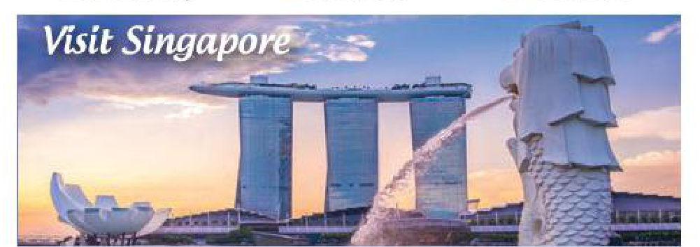

<!-- pdf:69 -->

# REVIEW 2

**(UNITS 4 - 5 - 6)**
<!-- ocr-ok: đã đối chiếu ảnh trang gốc, dòng tiêu đề phụ (UNITS 4 - 5 - 6) -->

## LANGUAGE

### Pronunciation

**1. Listen and circle the word with the different underlined sound.**

1. A. <u>s</u>eat / B. wonder<u>s</u> / C. de<u>s</u>ert
2. A. ch<u>ea</u>p / B. t<u>ea</u>ch / C. br<u>ea</u>d
3. A. <u>s</u>ugar / B. <u>s</u>ome / C. <u>s</u>ure
4. A. <u>e</u>xcuse / B. b<u>e</u>tween / C. cath<u>e</u>dral
5. A. mo<u>d</u>ern / B. crow<u>d</u>ed / C. celebra<u>t</u>e
<!-- ocr-ok: đã đối chiếu ảnh trang gốc, các chữ cái gạch chân đánh dấu bằng thẻ u làm thay đổi token so với OCR -->

### Vocabulary

**2. Write the words in the box (a – h) next to their opposites (1 – 8).**

| a. short | b. noisy | c. low |
| --- | --- | --- |
| d. small | e. boring | f. hot |
| g. sad | h. cheap | |

1. big \_\_\_\_\_\_\_
2. happy \_\_\_\_\_\_\_
3. cold \_\_\_\_\_\_\_
4. quiet \_\_\_\_\_\_\_
5. long \_\_\_\_\_\_\_
6. expensive \_\_\_\_\_\_\_
7. high \_\_\_\_\_\_\_
8. interesting \_\_\_\_\_\_\_
<!-- ocr-ok: đã đối chiếu ảnh trang gốc, OCR bỏ sót dòng 4 quiet và 8 interesting -->

**3. Choose the correct word / phrase for each definition.**

1. A place where a large amount of water falls from a high place. *waterfall* / *lake*
2. A thing which helps you to find directions. *backpack* / *compass*
3. A building where people go and see valuable art or old things. *theatre* / *museum*
4. To tell someone you want them to be happy or successful. *wish* / *hope*
5. Children receive it in red envelopes at Tet. *lucky money* / *new clothes*

### Grammar

**4. Complete the sentences with the correct answer A, B, or C.**
<!-- ocr-ok: đã đối chiếu ảnh trang gốc, OCR bỏ sót cụm correct answer A, B, or C -->

1. \_\_\_\_\_\_\_ long rivers of the world begin from the Himalayas.
   - A. Any
   - B. Some
   - C. A
2. Sue's drawings are more colourful \_\_\_\_\_\_\_ her teacher's.
   - A. most
   - B. as
   - C. than
3. You \_\_\_\_\_\_\_ buy a ticket to enter the zoo. It's not free.
   - A. mustn't
   - B. don't
   - C. must
4. Do you know \_\_\_\_\_\_\_ English songs for children?
   - A. any
   - B. a few
   - C. some
5. The USA has \_\_\_\_\_\_\_ natural wonders.
   - A. many
   - B. much
   - C. a little
<!-- ocr-ok: đã đối chiếu ảnh trang gốc, OCR đọc sai the Himalayas, đáp án câu 4 và natural wonders câu 5 -->

**5. Complete the sentences with *should* or *shouldn't*.**

1. When you get help from somebody, you \_\_\_\_\_\_\_ say "Thank you!".
2. You \_\_\_\_\_\_\_ ask people for lucky money. It's not good behaviour.
3. You \_\_\_\_\_\_\_ make noise when you are eating.
4. Before you visit a natural wonder, you \_\_\_\_\_\_\_ learn about it.
5. What \_\_\_\_\_\_\_ I do if I get lost?
<!-- ocr-ok: đã đối chiếu ảnh trang gốc, OCR bỏ sót câu 5 -->

## SKILLS

### Reading

**1. Read the passage and match the headings (A, B, C) with the paragraphs.**

| A. Family | B. Nature | C. Culture |
| --- | --- | --- |

**Visit Singapore**

1. \_\_\_\_\_\_\_

There are many parks in this country. You can visit them, and enjoy beautiful plants and flowers, or do outdoor activities: cycling or boating. You can also go to the zoo to see animals in real life.
<!-- ocr-ok: đã đối chiếu ảnh trang gốc, OCR bỏ sót hai dòng trong khung nền màu đoạn 1 -->

<!-- pdf:70 -->

2. \_\_\_\_\_\_\_

Go to places like Chinatown and Little India to learn about the people and cultures of China and India. There you can see how they live, try their food, and buy souvenirs. There are festivals too. They attract a lot of visitors.

3. \_\_\_\_\_\_\_

Families looking for exciting activities for both children and adults should go to Sentosa. There are so many things for you to see and to do there, so you will never get bored.

**2. Read the passage again and choose the correct answer A, B, or C.**
<!-- ocr-ok: đã đối chiếu ảnh trang gốc, OCR đọc dính correctanswer -->

1. You can find beautiful plants and flowers in \_\_\_\_\_\_\_.
   - A. a park
   - B. Chinatown
   - C. Sentosa
2. You can see different kinds of animals in real life in a \_\_\_\_\_\_\_.
   - A. zoo
   - B. park
   - C. town
3. You can \_\_\_\_\_\_\_ in places like Chinatown.
   - A. watch animals
   - B. watch festivals
   - C. do outdoor activities
4. \_\_\_\_\_\_\_ has interesting activities for both children and parents.
   - A. Little India
   - B. The zoo
   - C. Sentosa
<!-- ocr-ok: đã đối chiếu ảnh trang gốc, OCR tách rời cụm in places like Chinatown ở câu 3 -->

### Speaking

**3. Work in pairs. Read the passage 'Visit Singapore' again and make a list of the places. Take turns to ask and find out which place your partner wants to visit and why.**

**Example:**

**A:** Which place do you want to visit?

**B:** The zoo.

**A:** Why do you want to visit it?

**B:** I want to see the animals.

### Listening

**4. Mai's family is talking to a travel agent about their trip to Singapore. Listen and tick (✓) T (True) or F (False).**

| | T | F |
| --- | --- | --- |
| 1. Mai's visit to Singapore is four days. | | |
| 2. They won't go to the National Park. | | |
| 3. The visit to Sentosa takes a full day. | | |
| 4. The Sea Aquarium is a zoo for fish. | | |
| 5. The Light and Sound Show is in the afternoon. | | |

### Writing

**5. Complete this paragraph to describe the place where you live.**

I live in (1) \_\_\_\_\_\_\_. Life is very (2) \_\_\_\_\_\_\_ here. There is / are (3) \_\_\_\_\_\_\_ (places) in my neighbourhood.
<!-- ocr-ok: đã đối chiếu ảnh trang gốc, OCR đọc nhầm I thành |, (3) thành G3) và đọc dính chữ -->

At weekends, my friends and I often go to (4) \_\_\_\_\_\_\_ where we can (5) \_\_\_\_\_\_\_ (activities). That's our favourite place.
<!-- ocr-ok: đã đối chiếu ảnh trang gốc, OCR đọc dính oftengoto và wecan -->

## 📷 Danh mục hình minh hoạ

| Mã hình | Trang PDF | Trang sách | Chú thích / Mô tả |
| --- | --- | --- | --- |
| H6-tieng_anh-r02-01 | 69 | 68 | Ảnh phong cảnh *Visit Singapore* với tượng Sư tử biển (Merlion) phun nước và tổ hợp Marina Bay Sands bên vịnh |
