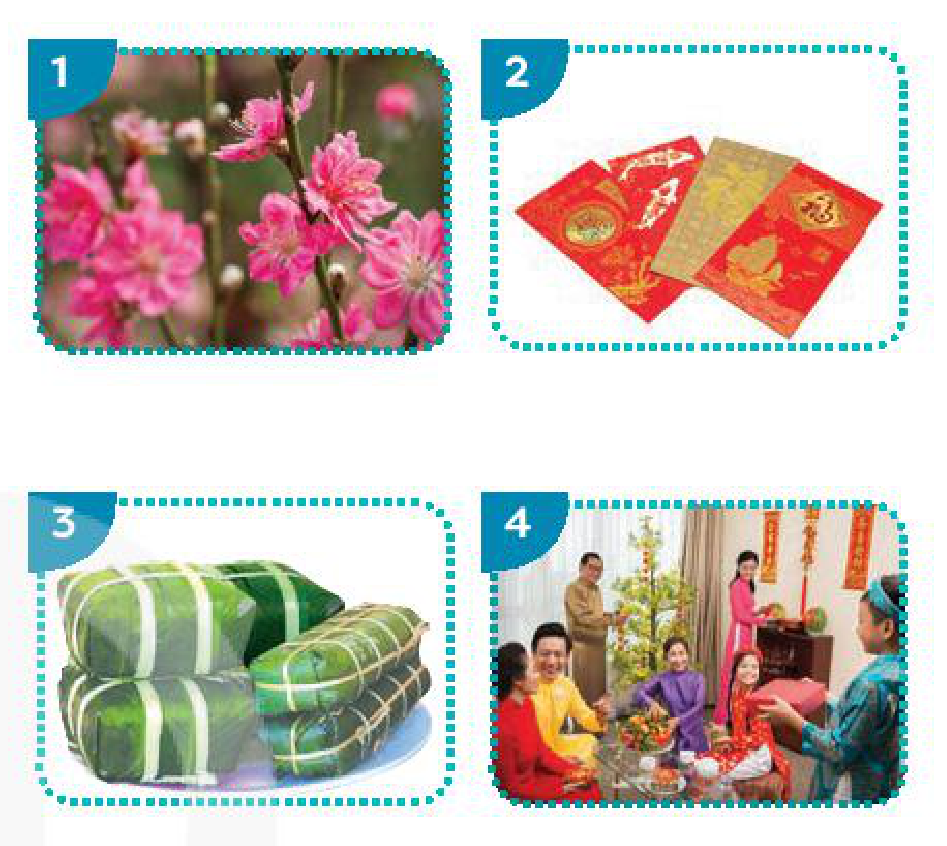
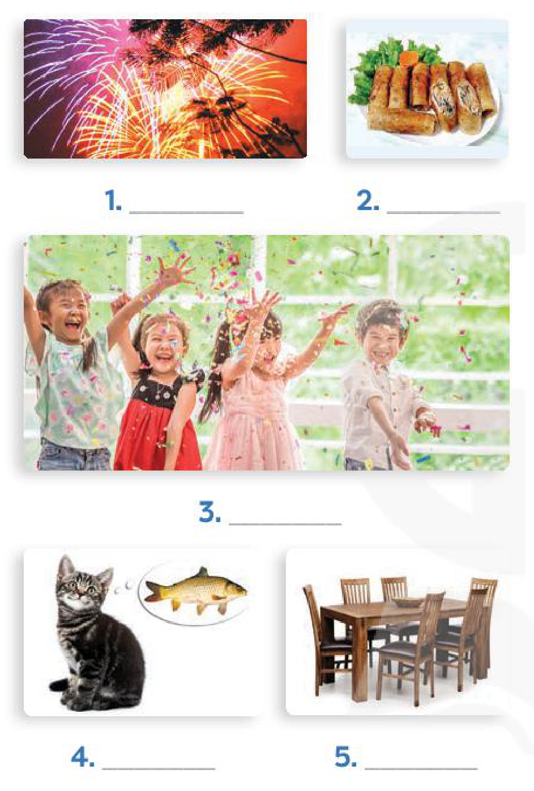
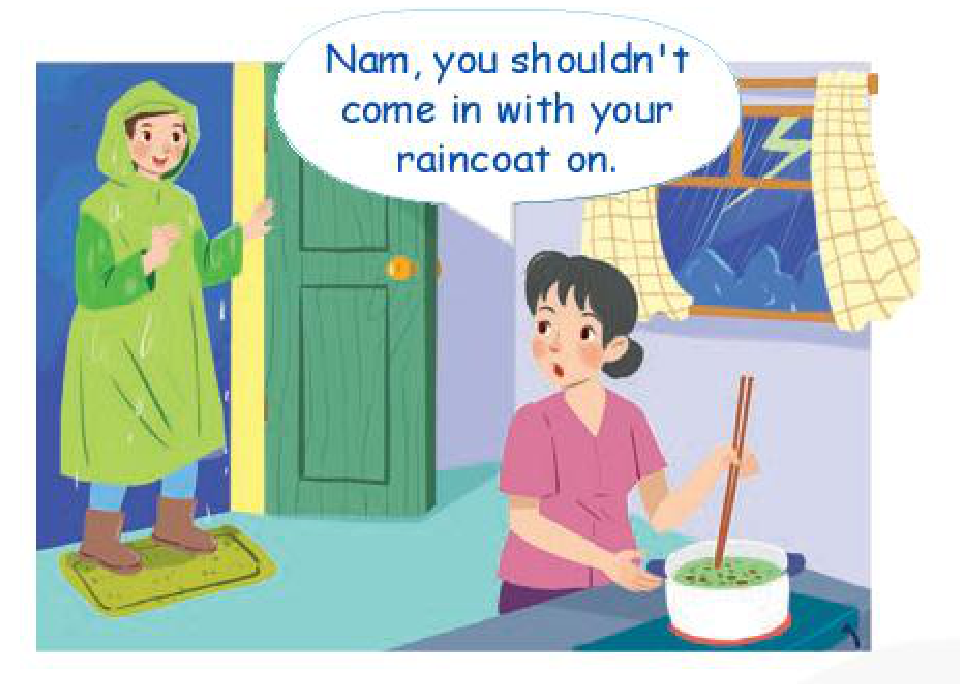
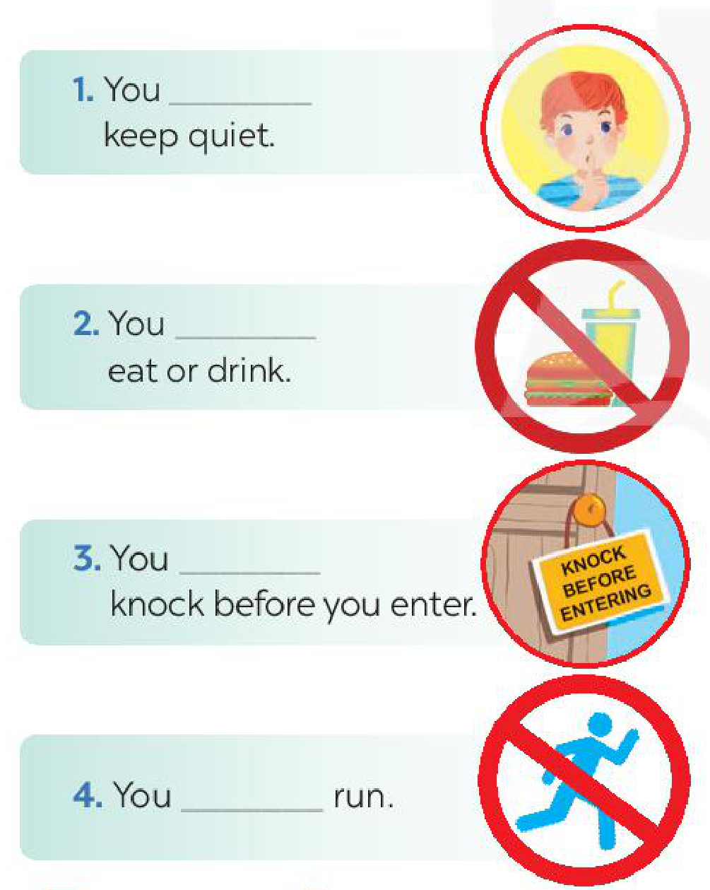
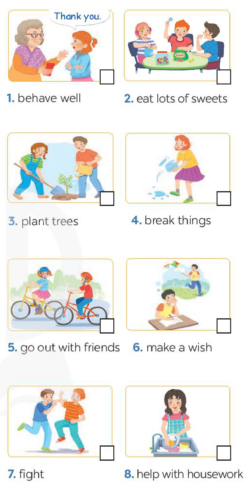
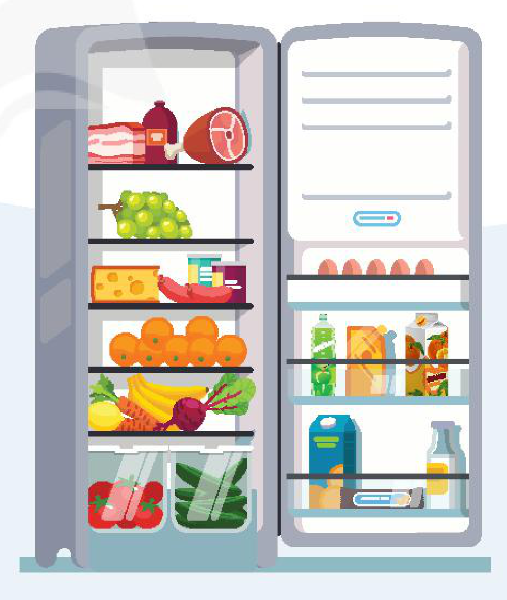
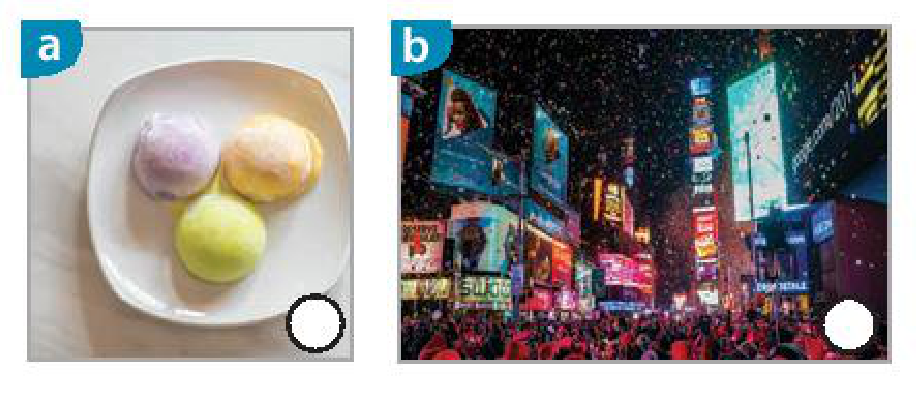
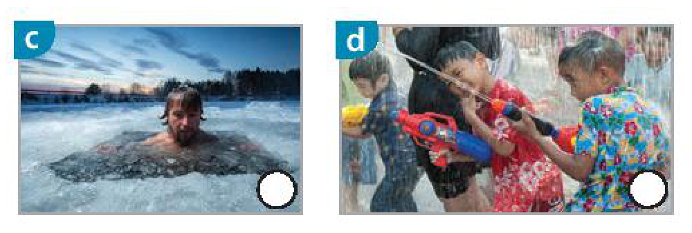
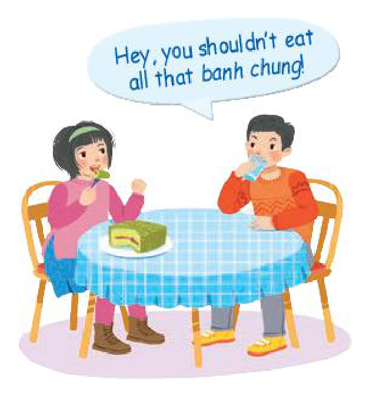

<!-- pdf:59 -->

# UNIT 6: OUR TET HOLIDAY

> **THIS UNIT INCLUDES:**
> - **Vocabulary:**
>   - Things and activities at Tet
> - **Pronunciation:**
>   - Sounds: /s/ and /ʃ/
> - **Grammar:**
>   - *Should* / *shouldn't* for advice
>   - *Some* / *any* for amount
> - **Skills:**
>   - Reading about New Year's practices
>   - Talking about what children should / shouldn't do at Tet
>   - Listening about preparations for Tet
>   - Writing an email about what children should / shouldn't do at Tet
> - **Everyday English:**
>   - Saying New Year's wishes
<!-- ocr-ok: đã đối chiếu ảnh trang gốc, khung THIS UNIT INCLUDES hai cột và kí hiệu phiên âm /ʃ/ -->

## GETTING STARTED

**Happy New Year!**

**1. Listen and read.**

**Linda:** Phong, does Viet Nam **celebrate** New Years?

**Phong:** Yes, we do. We have Tet.

**Linda:** When is Tet?

**Phong:** At different times. This year, it's in January.

**Linda:** What do you do at Tet?

**Phong:** We clean our homes and **decorate** them with flowers.
<!-- term: peach flower -->

**Linda:** Is Tet a time for **family gatherings**?

**Phong:** Yes. It's a happy time for everybody.

**Linda:** Great.

**Phong:** Yes, and another good thing about Tet is that children get **lucky money**.

**Linda:** That sounds interesting. Is there anything special people should do?

**Phong:** We should say "Happy New Year" when we meet people, and we shouldn't break anything.

<!-- pdf:60 -->

**2. What are Linda and Phong talking about?**

- A. New Years in the world
- B. Tet in Viet Nam
- C. What to eat and wear during Tet

**3. Complete the sentences about Tet with the information from the conversation in 1.**

1. This year Tet is in \_\_\_\_\_\_\_.
2. We decorate our \_\_\_\_\_\_\_.
3. Tet is a time for family \_\_\_\_\_\_\_.
4. Children get \_\_\_\_\_\_\_.
5. People shouldn't \_\_\_\_\_\_\_ anything.

**4. Match the words / phrases in the box with the pictures.**

- a. lucky money
- b. peach flowers
- c. *banh chung* and *banh tet*
- d. **family gathering**
<!-- term: peach flower -->

**5. GAME: Is it about Tet?**
<!-- ocr-ok: đã đối chiếu ảnh trang gốc, chữ GAME in trong các ô màu trang trí khiến OCR đọc thành COZV -->

**Write two things or activities and share them with the class. The class listen and decide whether they are about or not about Tet.**

**Example:**

**Student:** *banh chung*

**Class:** It's about Tet.

**Student:** flying a kite

**Class:** It's not about Tet.

<!-- pdf:61 -->

## A CLOSER LOOK 1

### Vocabulary

**1. Write the words / phrases in the box under the pictures.**

| **wish** | **fireworks** | furniture | **fun** | special food |
| --- | --- | --- | --- | --- |

1. \_\_\_\_\_\_\_  2. \_\_\_\_\_\_\_  3. \_\_\_\_\_\_\_  4. \_\_\_\_\_\_\_  5. \_\_\_\_\_\_\_
<!-- ocr-ok: đã đối chiếu ảnh trang gốc, các nhãn số 1-5 dưới 5 bức tranh bài 1 -->

**2. Match the verbs with the nouns.**
<!-- ocr-ok: đã đối chiếu ảnh trang gốc, OCR bỏ sót câu lệnh bài 2 -->

| Verbs | Nouns |
| --- | --- |
| 1. have | a. a wish |
| 2. visit | b. fireworks |
| 3. give | c. the furniture |
| 4. make | d. lucky money |
| 5. clean | e. **relatives** |
| 6. watch | f. fun |
<!-- ocr-ok: đã đối chiếu ảnh trang gốc, các thẻ chữ nghiêng màu trong bảng nối Verbs - Nouns khiến OCR bỏ sót nhiều mục -->

**3. Complete the sentences with the words in the box.**

| shopping | clean | peach | celebrate | food |
| --- | --- | --- | --- | --- |

1. In Viet Nam, we \_\_\_\_\_\_\_ Tet in January or February.
2. At Tet, we decorate our houses with \_\_\_\_\_\_\_ flowers.
3. Children should help their parents to \_\_\_\_\_\_\_ their houses.
4. People do a lot of \_\_\_\_\_\_\_ before Tet.
5. My mother usually cooks special \_\_\_\_\_\_\_ during Tet.
<!-- ocr-ok: đã đối chiếu ảnh trang gốc, OCR đọc dính chữ và trộn cột trái phải ở bài 3 -->

### Pronunciation

**/s/ and /ʃ/**

**4. Listen and repeat the words.**

| shopping | special | rice |
| --- | --- | --- |
| spring | wish | celebrate |

**5. Listen and repeat the poem. Pay attention to the sounds /s/ and /ʃ/ in the underlined words.**

<u>Spring</u> is coming!
Tet is coming!
<u>She</u> <u>sells</u> peach flowers.
Her <u>cheeks</u> <u>shine</u>.
Her eyes <u>smile</u>.
Her <u>smile</u> is <u>shy</u>.
<u>She</u> <u>sells</u> peach flowers.
<!-- ocr-ok: đã đối chiếu ảnh trang gốc, thẻ u đánh dấu từ gạch chân và OCR bỏ sót câu 6-7 của bài thơ -->

<!-- pdf:62 -->

## A CLOSER LOOK 2

### Grammar

***Should* / *shouldn't* for advice**

*(Speech bubble: Nam, you shouldn't come in with your raincoat on.)*

**1. Look at the signs at the library and complete the sentences with *should* or *shouldn't*.**

1. You \_\_\_\_\_\_\_ keep quiet.
2. You \_\_\_\_\_\_\_ eat or drink.
3. You \_\_\_\_\_\_\_ knock before you enter.
4. You \_\_\_\_\_\_\_ run.

**Remember!**

- We use *should* for things that are good to do.
- We use *shouldn't* for things that are not good to do.
<!-- term: Should / shouldn't -->

**2. Tick (✓) the activities children should do at Tet and cross (✗) the ones they shouldn't.**

1. **behave** well [ ]
2. eat lots of sweets [ ]
3. plant trees [ ]
4. break things [ ]
5. go out with friends [ ]
6. make a wish [ ]
7. fight [ ]
8. help with housework [ ]
<!-- ocr-ok: đã đối chiếu ảnh trang gốc, OCR bỏ sót mục 5 go out with friends và 6 make a wish -->

**3. Work in pairs. Look at the activities in 2. Take turns to say what you think children should / shouldn't do.**

**Example:**

- Children should behave well.
- Children shouldn't eat lots of sweets.

<!-- pdf:63 -->

***Some* / *any* for amount**

**Remember!**

- *some*:
  - (+) My mother bought *some fruits*.
  - (+) I need *some milk* for the cake.
- *any*:
  - (-) I can't answer *any questions*.
  - (?) Do you have *any sugar*?
<!-- term: Some / any -->

**4. Complete the sentences with *some* or *any*.**

1. – What do you need to decorate your room?
   – I need \_\_\_\_\_\_\_ colour paper and \_\_\_\_\_\_\_ pictures.
2. – Do you have \_\_\_\_\_\_\_ free time for sports?
   – Yes, I do.
3. – Are there \_\_\_\_\_\_\_ interesting activities here during Tet?
   – Yes, there are \_\_\_\_\_\_\_ traditional games like human chess, running and cooking.

**5. Work in pairs. Look at the fridge. Make sentences with the words / phrases provided, using *some* or *any*.**

**Example:**

- ice cream → *There is not any ice cream.*
- cucumbers → *There are some cucumbers.*

1. eggs → \_\_\_\_\_\_\_
2. fruit juice → \_\_\_\_\_\_\_
3. apples → \_\_\_\_\_\_\_
4. bread → \_\_\_\_\_\_\_
5. bananas → \_\_\_\_\_\_\_
6. cheese → \_\_\_\_\_\_\_

<!-- pdf:64 -->

## COMMUNICATION

### Everyday English

**Saying New Year's wishes**

**1. Listen and read the New Year's wish.**

HAPPY NEW YEAR — *Wishing you joy & laughter ... from January to December!*
<!-- ocr-ok: đã đối chiếu ảnh trang gốc, lời chúc chữ nghệ thuật màu trên thiệp năm mới -->

**2. Practise saying New Year's wishes to your friends, using the suggestions below or creating your own.**

- happy days from January to December
- a year full of fun
- happiness and **cheers**
- a life full of happy moments
- success in your studies
<!-- ocr-ok: đã đối chiếu ảnh trang gốc, OCR đọc dính ayear, alife và trộn cột phải vào danh sách bài 2 -->

**New Year practices in the world**

**3. QUIZ**

**Match the sentences with the pictures. Then match them with the countries.**

1. They go to Times Square to watch the New Year's Eve Ball drop.
2. They bathe in an ice hole.
3. They eat **mochi rice cakes**.
4. They **throw** water on other people.
<!-- term: New Year's Eve -->

| Thailand | Japan | The USA | Russia |
| --- | --- | --- | --- |

**4. Read how people in different countries celebrate their New Year. Then match the countries with the activities.**

- *In Japan*, **temples** ring their bells 108 times at midnight on December 31. By doing so, people believe the bad things of the past year will leave.
- *In Spain*, people try to put 12 grapes in their mouth at midnight for good **luck**.
- *In Switzerland*, they drop ice cream on the floor to celebrate the New Year.
- *In Romania*, they throw coins into a river for good luck.
- *In Thailand*, they throw water on other people to wash away bad luck.

| Countries | Activities |
| --- | --- |
| 1. Japan | a. put 12 grapes in the mouth |
| 2. Spain | b. ring bells 108 times |
| 3. Switzerland | c. throw coins into a river |
| 4. Romania | d. throw water on other people |
| 5. Thailand | e. drop ice cream on the floor |

**5. Work in groups. Each student chooses one activity from 4. Take turns to say them aloud. The group says which country he / she is talking about.**

**Example:**

- They throw water on other people.
- It's in Thailand.

<!-- pdf:65 -->

## SKILLS 1

### Reading

**1. Read the passages and decide who says sentences 1 – 5.**

**A. Russ – the USA:**
<!-- ocr-ok: đã đối chiếu ảnh trang gốc, nhãn tên nhân vật dưới ảnh đại diện khung A -->

I often go to Times Square with my parents to **welcome** the New Year. When the clock **strikes** midnight, colourful **fireworks** light up the sky. Everybody **cheers** and sings.

**B. Wu – China:**
<!-- ocr-ok: đã đối chiếu ảnh trang gốc, nhãn tên nhân vật dưới ảnh đại diện khung B -->

On New Year's Day, we dress beautifully and go to our grandparents' houses. We **wish** them Happy New Year and they give us **lucky money**. Then we go out and have a day full of **fun**.

**C. Mai – Viet Nam:**
<!-- ocr-ok: đã đối chiếu ảnh trang gốc, nhãn tên nhân vật dưới ảnh đại diện khung C -->

I learn some customs about Tet from my parents. People give rice to wish for enough food and buy salt to wish for good **luck**. Dogs are lucky animals but cats are not. A cat's cry sounds like "poor" in Vietnamese.

| A. Russ | B. Wu | C. Mai |
| --- | --- | --- |

| Statements | Who |
| --- | --- |
| 1. Dogs are lucky animals. | C |
| 2. We welcome the New Year at Times Square. | |
| 3. Children get lucky money. | |
| 4. We give rice to wish for enough food. | |
| 5. Children dress beautifully. | |

**2. Test your memory! Tick (✓) the things which appear in the passages, and cross (✗) the ones which don't.**

- a. lucky money [ ]
- b. a day full of fun [ ]
- c. a cat's cry [ ]
- d. decorating the house [ ]
- e. fireworks [ ]
- f. saying wishes [ ]
- g. cheering and singing [ ]
- h. visiting **relatives** [ ]

### Speaking

**3. Work in groups. These are some activities from the reading passages in 1. Tell your group if you do them during Tet.**

**Example:**

go to Times Square to welcome the New Year
→ I don't go to Times Square to welcome the New Year.

1. watch fireworks on New Year's Eve
2. sing when the New Year comes
3. get lucky money
4. go out and have fun
5. dress beautifully
6. buy salt for good luck

<!-- pdf:66 -->

**4. Work in groups. Read the list and discuss what you should or shouldn't do at Tet.**

*(Speech bubble: Hey, you shouldn't eat all that banh chung!)*
<!-- ocr-ok: đã đối chiếu ảnh trang gốc, bóng thoại nghiêng trong tranh minh hoạ bài 4 -->

- break things
- make a wish
- dress beautifully
- say "Have fun!" to friends
- help decorate our houses
- play games all night
- invite friends home
- ask for lucky money
- play loud music
<!-- term: make a wish -->

**Example:**

**A:** We should dress beautifully at Tet.

**B:** I agree. Should we ask for lucky money?

**C:** No, we shouldn't.

## SKILLS 2

### Listening

**1. Nguyen is writing to his penfriend Tom about how his family prepares for Tet. Listen and tick (✓) the things you hear.**

1. old things [ ]
2. peach flowers [ ]
3. new clothes [ ]
4. cakes [ ]
5. **wishes** [ ]
6. good luck [ ]
<!-- ocr-ok: đã đối chiếu ảnh trang gốc, OCR đọc nhầm old things thành ola things và new clothes thành newclothes -->

**2. Listen again and answer the questions in one or two words.**

1. What do they throw away before Tet? \_\_\_\_\_\_\_
2. What do they clean and decorate? \_\_\_\_\_\_\_
3. What colour are the envelopes? \_\_\_\_\_\_\_
4. Who cooks *banh chung*? \_\_\_\_\_\_\_
5. What shouldn't they break? \_\_\_\_\_\_\_

### Writing

**3. Work in groups. Discuss and make a list of four things that you think children should and shouldn't do at Tet.**

- Children should:
  1. \_\_\_\_\_\_\_
  2. \_\_\_\_\_\_\_
- Children shouldn't:
  3. \_\_\_\_\_\_\_
  4. \_\_\_\_\_\_\_
<!-- ocr-ok: đã đối chiếu ảnh trang gốc, khung điền ý tưởng bài 3 cột phải bị OCR trộn với cột trái -->

**4. Complete the email, using your ideas in 3.**
<!-- ocr-ok: đã đối chiếu ảnh trang gốc, OCR đọc nhầm số 3 màu đỏ thành 5 -->

**New message**
**To:** tom@webmail.com
**Subject:** Tet in Viet Nam
<!-- ocr-ok: đã đối chiếu ảnh trang gốc, thanh tiêu đề cửa sổ thư điện tử To và Subject -->

Dear Tom,

Tet is coming. I will tell you more about our Tet.

At Tet, we should \_\_\_\_\_\_\_.
We should \_\_\_\_\_\_\_, too.
But we shouldn't \_\_\_\_\_\_\_.
We shouldn't \_\_\_\_\_\_\_, either.

Please write and tell me about your New Year celebration.

Yours,
Nguyen

<!-- pdf:67 -->

## LOOKING BACK

### Vocabulary

**1. Match the verbs on the left with the nouns on the right.**

| | |
| --- | --- |
| 1. give *(→ d)* | a. a wish |
| 2. cook | b. fireworks |
| 3. plant | c. special food |
| 4. make | d. lucky money |
| 5. watch | e. trees |
| 6. break | f. things |
<!-- ocr-ok: đã đối chiếu ảnh trang gốc, đường kẻ nối mẫu từ 1 sang d khiến OCR đọc nhầm dòng 1 -->

**2. Complete the sentences with the words / phrases in the box.**

| gathering | lucky money | cleaning | *banh chung* | peach |
| --- | --- | --- | --- | --- |

1. At Tet, my mother puts \_\_\_\_\_\_\_ into red envelopes.
2. – What are you doing?
   – I'm \_\_\_\_\_\_\_ my bedroom.
3. \_\_\_\_\_\_\_ is special for Tet.
4. We have \_\_\_\_\_\_\_ flowers only at Tet.
5. When everybody is at home together, we call it a family \_\_\_\_\_\_\_.
<!-- ocr-ok: đã đối chiếu ảnh trang gốc, OCR đọc sai What are you doing ở câu 2 -->

### Grammar

**3. Write full sentences using the cues given, and *should* or *shouldn't*.**

1. ask for permission before entering a room
   He / She \_\_\_\_\_\_\_.
2. run about the house
   He / She \_\_\_\_\_\_\_.
3. take things from a shelf
   He / She \_\_\_\_\_\_\_.
4. make a lot of noise
   He / She \_\_\_\_\_\_\_.
5. ask for some water if he / she feels thirsty
   He / She \_\_\_\_\_\_\_.

**4. Read the passage and fill the blanks with *some* or *any*.**

My room is ready for Tet. By the window are (1) \_\_\_\_\_\_\_ balloons. There is a picture I made from (2) \_\_\_\_\_\_\_ old magazines. It's colourful, but I didn't use (3) \_\_\_\_\_\_\_ paint or colour pencils. I love flowers, but I don't have (4) \_\_\_\_\_\_\_ yet. Oh, look at this new plant. It needs (5) \_\_\_\_\_\_\_ water, but it doesn't need (6) \_\_\_\_\_\_\_ sunlight. It can live in a room.
<!-- ocr-ok: đã đối chiếu ảnh trang gốc, OCR đọc nhầm My thành Mụn và đọc dính nhiều từ trong khung viền chấm -->

<!-- pdf:68 -->

## PROJECT

**I wish**

1. Each student gets a small piece of paper and writes his / her wishes on it.
2. He / She hangs it on a tree.
3. Other students take turns to come up, get a piece of paper and read aloud the wish.
4. The class guess whose wish it is.

- *I want to have a brother.*
- *I want to visit Singapore.*
- *I want to live in a tree house.*
<!-- ocr-ok: đã đối chiếu ảnh trang gốc, chữ viết trên ba mảnh giấy treo trên cây điều ước -->

### Now I can ...

- use the words related to things and activities at Tet.
- pronounce the sounds /s/ and /ʃ/ correctly.
- use *should* / *shouldn't* for advice.
- use *some* / *any* for amount.
- say New Year's wishes.
- read about New Year's practices.
- talk about what children should / shouldn't do at Tet.
- listen about preparations for Tet.
- write an email about what children should / shouldn't do at Tet.

## 📷 Danh mục hình minh hoạ

| Mã hình | Trang PDF | Trang sách | Chú thích / Mô tả |
| --- | --- | --- | --- |
| H6-tieng_anh-u06-01 | 60 | 59 | Bốn bức tranh ngày Tết: (1) hoa đào, (2) phong bao lì xì đỏ, (3) bánh chưng và bánh tét, (4) cảnh sum họp gia đình ở bài 4 phần Getting Started |
| H6-tieng_anh-u06-02 | 61 | 60 | Năm bức tranh minh hoạ từ vựng ngày Tết: (1) pháo hoa, (2) món nem rán đặc biệt, (3) trẻ em nô đùa vui vẻ, (4) chú mèo ước có cá, (5) bộ bàn ghế gỗ ở bài 1 mục Vocabulary |
| H6-tieng_anh-u06-03 | 62 | 61 | Tranh minh hoạ mẹ nhắc Nam *"Nam, you shouldn't come in with your raincoat on."* khi Nam mặc áo mưa bước vào nhà ở mục Grammar |
| H6-tieng_anh-u06-04 | 62 | 61 | Bốn biển báo nội quy thư viện đi kèm câu 1–4: giữ trật tự, cấm ăn uống, gõ cửa trước khi vào (*KNOCK BEFORE ENTERING*), cấm chạy nhảy ở bài 1 mục Grammar |
| H6-tieng_anh-u06-05 | 62 | 61 | Tám tranh hoạt động của trẻ em dịp Tết: (1) cư xử lễ phép (*Thank you.*), (2) ăn nhiều kẹo, (3) trồng cây, (4) làm vỡ đồ, (5) đạp xe đi chơi với bạn, (6) viết điều ước, (7) đánh nhau, (8) phụ làm việc nhà ở bài 2 mục Grammar |
| H6-tieng_anh-u06-06 | 63 | 62 | Tranh minh hoạ bên trong tủ lạnh mở cánh gồm thịt, nho, phô mai, cam, chuối, rau củ, trứng, nước trái cây, sữa ở bài 5 mục Grammar |
| H6-tieng_anh-u06-07 | 64 | 63 | Thiệp chúc mừng năm mới *"HAPPY NEW YEAR — Wishing you joy & laughter ... from January to December!"* ở bài 1 phần Communication |
| H6-tieng_anh-u06-08 | 64 | 63 | Hai bức ảnh phong tục đón năm mới: (a) đĩa bánh gạo mochi và (b) Quảng trường Thời đại (Times Square) đêm Giao thừa ở bài 3 phần Communication |
| H6-tieng_anh-u06-09 | 64 | 63 | Hai bức ảnh phong tục đón năm mới: (c) tắm trong hố băng và (d) té nước chúc may mắn ở bài 3 phần Communication |
| H6-tieng_anh-u06-10 | 66 | 65 | Tranh minh hoạ bạn nữ nhắc bạn nam *"Hey, you shouldn't eat all that banh chung!"* ở bài 4 phần Speaking (Skills 1) |
