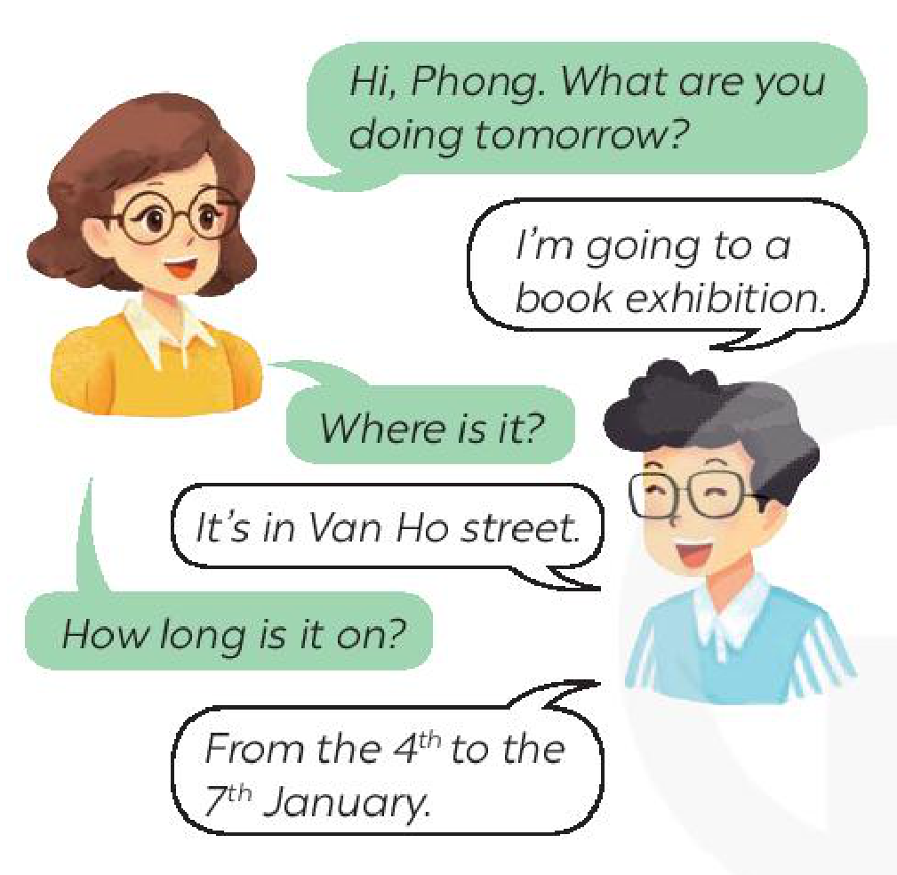
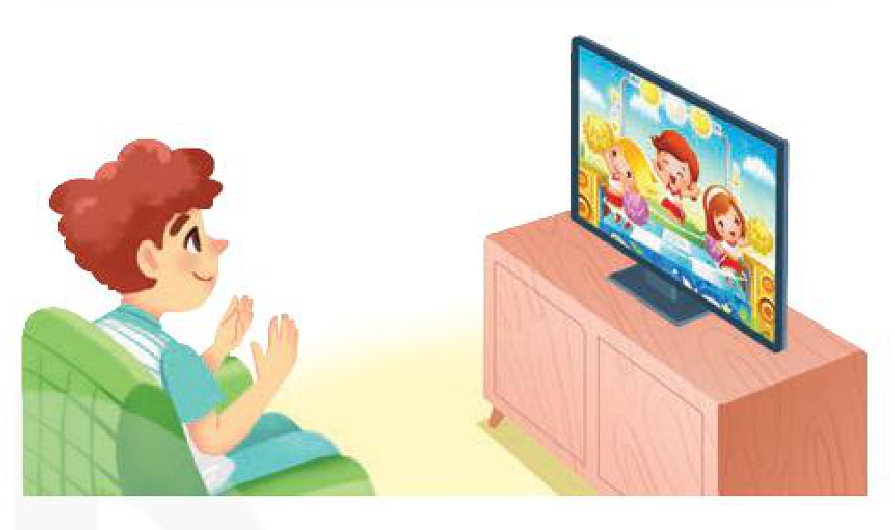
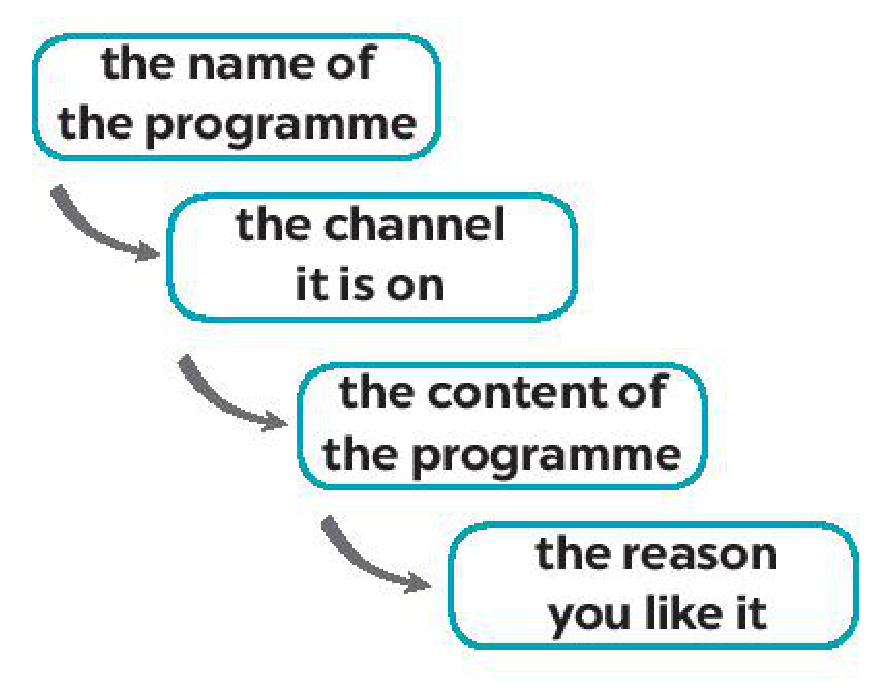

<!-- pdf:7 -->

# UNIT 7: TELEVISION

> **THIS UNIT INCLUDES:**
> - **Vocabulary:** TV programmes
> - **Pronunciation:** Sounds: /θ/ and /ð/
> - **Grammar:**
>   - *Wh*-question words
>   - Conjunctions in compound sentences: *and*, *but*, *so*
> - **Skills:**
>   - Reading a TV guide
>   - Talking about a favourite TV programme
>   - Listening about different TV programmes
>   - Writing a paragraph about TV-viewing habits
> - **Everyday English:** Asking for and giving information about TV programmes
<!-- ocr-ok: đã đối chiếu ảnh trang gốc, hộp THIS UNIT INCLUDES hai cột và kí hiệu phiên âm /θ/, /ð/ -->

## GETTING STARTED

**What's on today?**

**1. Listen and read.**

**Phong:** What are you watching, Hung?

**Hung:** *The Voice Kids*.

**Phong:** That music **talent show** is very interesting.

**Hung:** It is. What **programme** do you often watch, Phong?

**Phong:** Films. I like **animated films** like *The Lion King*.

**Hung:** I love them, too. They're wonderful.

**Phong:** I often watch them with my little brother, but he prefers **cartoons**.

**Hung:** *Tom and Jerry*?

**Phong:** Ha ... ha ... Yes, he loves Jerry the mouse.

**Hung:** Jerry's a **clever** **character**. Do you know any English **programmes** for children?

**Phong:** Yes. I watch *English in a Minute* on *VTV7*. This **channel** has many **educational** programmes.

**Hung:** Great. I'll watch it, too.

<!-- pdf:8 -->

**2. Choose the correct answer A, B, or C.**

1. Phong and Hung are talking about \_\_\_\_\_\_\_.
   - A. *The Voice Kids* programme
   - B. *English in a Minute* programme
   - C. different TV programmes
2. Phong likes \_\_\_\_\_\_\_.
   - A. animated films
   - B. cartoons
   - C. **talent shows**
3. When you're viewing a TV programme, you say: "I'm \_\_\_\_\_\_\_ TV."
   - A. watching
   - B. seeing
   - C. looking
4. When a programme teaches you something, it's \_\_\_\_\_\_\_.
   - A. educational
   - B. funny
   - C. clever

**3. Read the conversation again and match 1-5 with a-e.**

| | |
| --- | --- |
| 1. *The Voice Kids* | a. **animated film** |
| 2. *The Lion King* | b. channel |
| 3. *Tom and Jerry* | c. music talent show |
| 4. *VTV7* | d. educational programme |
| 5. *English in a Minute* | e. **cartoon** |
<!-- ocr-ok: đã đối chiếu ảnh trang gốc, bảng nối hai cột 1-5 và a-e (OCR đọc nhầm 3 thành 5 và English in a thành Englishing) -->

**4. Find and write the adjectives in the conversation which describe the programmes and character below.**

1. *The Voice Kids* \_\_\_\_\_\_\_
2. animated films \_\_\_\_\_\_\_
3. Jerry the mouse \_\_\_\_\_\_\_
4. programmes on *VTV7* \_\_\_\_\_\_\_
<!-- ocr-ok: đã đối chiếu ảnh trang gốc, các dòng điền từ bài 4 không được OCR nhận diện dấu gạch ngang -->

**5. Work in groups. Interview your partners about their favourite TV programmes and report to the class.**

**Example:**

In our group, Mai likes sports programmes on TV. Binh likes ...

<!-- pdf:9 -->

## A CLOSER LOOK 1

### Vocabulary

**1. Write the words / phrases in the box next to the definitions.**

| talent show | **viewer** |
| --- | --- |
| **comedy** | character |
| educational programme | |

1. an animal or a person in a film \_\_\_\_\_\_\_
2. a programme which teaches maths, English, etc. \_\_\_\_\_\_\_
3. a film / show which makes people laugh \_\_\_\_\_\_\_
4. a competition to choose the best performer \_\_\_\_\_\_\_
5. a person who watches TV \_\_\_\_\_\_\_

**2. Complete the sentences with the words / phrases in the box.**

| character | animated films |
| --- | --- |
| **viewers** | **comedies** |
| game show | channel |

1. Do you watch *Bibi*, the popular \_\_\_\_\_\_\_ for children?
2. Which \_\_\_\_\_\_\_ do you prefer: Jerry the mouse or Tom the cat?
3. I love \_\_\_\_\_\_\_ like *Happy Feet* and *Coco*.
4. I love *Children are Always Right*, a \_\_\_\_\_\_\_ for kids.
5. My father often watches \_\_\_\_\_\_\_. They're so **funny**.
6. A popular programme has a lot of \_\_\_\_\_\_\_.

**3. Complete the sentences with the adjectives in the box.**

| popular | **cute** | **live** |
| --- | --- | --- |
| educational | boring | funny |

1. The most \_\_\_\_\_\_\_ channel for children is the *Cartoon Network*.
2. This film is very \_\_\_\_\_\_\_. I don't want to watch it.
3. Cat Kitty is a very \_\_\_\_\_\_\_ character. Children love her.
4. You can watch this programme at the same time it happens. It's \_\_\_\_\_\_\_.
5. Comedies are \_\_\_\_\_\_\_. People laugh a lot when they watch them.
6. We learn a lot from *Discovery Channel*. This channel is \_\_\_\_\_\_\_.
<!-- term: boring -->
<!-- ocr-ok: đã đối chiếu ảnh trang gốc, OCR không nhận diện đầy đủ các khoảng trống điền từ và đọc nhầm chữ I thành | -->

### Pronunciation

**/θ/ and /ð/**
<!-- ocr-ok: đã đối chiếu ảnh trang gốc, kí hiệu phiên âm /θ/ và /ð/ -->

**4. Listen and repeat the words.**

| /θ/ | /ð/ |
| --- | --- |
| theatre | there |
| earth | them |
| anything | neither |
| both | weather |
| through | than |
<!-- ocr-ok: đã đối chiếu ảnh trang gốc, OCR bỏ sót dòng tiêu đề bảng /θ/ và /ð/ -->

**5. Tongue Twister**

**Take turns to read the sentences quickly and correctly.**

1. They are thinking about the weather there.
2. The new theatre opens on Thursday the third.

<!-- pdf:10 -->

## A CLOSER LOOK 2

### Grammar

*Wh-question words*

**1. Read the conversation and underline the question words.**

- Hi, Phong. What are you doing tomorrow?
- I'm going to a book exhibition.
- Where is it?
- It's in Van Ho street.
- How long is it on?
- From the 4th to the 7th January.
<!-- ocr-ok: đã đối chiếu ảnh trang gốc, hội thoại trong bóng thoại tranh minh hoạ (OCR đọc nhầm It's thành Œ và 4th, 7th) -->

**2. Match each question word with the information it needs.**

| Question word | The information it needs |
| --- | --- |
| When | thing |
| How many | time |
| How often | person |
| What | reason |
| Where | repetition |
| Who | number |
| Why | place |
<!-- ocr-ok: đã đối chiếu ảnh trang gốc, OCR đọc thiếu chữ W trong Why ở dòng cuối bảng -->

**Remember!**

Each question word is used for a specific piece of information.
<!-- term: Wh-question words -->

**3. Use the question words in the box to complete the conversations. Then listen and check your answers.**

| When | Who | |
| --- | --- | --- |
| What | Where | How often |

**Conversation 1**

**A:** \_\_\_\_\_\_\_ do you watch TV?

**B:** Not very often. Two or three times a week.

**A:** \_\_\_\_\_\_\_ do you watch?

**B:** It depends. But I like talent shows the most.

**Conversation 2**

**A:** \_\_\_\_\_\_\_ do you like the most in *Doraemon*?

**B:** Nobita. He's so funny.

**Conversation 3**

**A:** \_\_\_\_\_\_\_ do you play football?

**B:** Usually on Saturday or Sunday.

**A:** \_\_\_\_\_\_\_ do you play?

**B:** In the yard.

<!-- pdf:11 -->

*Conjunctions in compound sentences*

| but | so | and |
| --- | --- | --- |
<!-- ocr-ok: đã đối chiếu ảnh trang gốc, tiêu đề Conjunctions in compound sentences và ba thẻ từ but, so, and treo trên dây -->

**Remember!**

We use a conjunction to combine two clauses into a compound sentence.
<!-- term: Conjunctions in compound sentences -->

**Example:**

- I like watching cartoons, **but** my brother likes watching sports.
- I enjoy sports, **so** I spend a lot of time outdoors.
- I'm helping decorate the house, **and** my brother is busy cooking.

**4. Match the beginnings with the endings.**

| Beginnings | Endings |
| --- | --- |
| 1. I like animal programmes, | a. **so** I can be at the stadium on time. |
| 2. I'll get up early tomorrow, | b. **but** he can't draw. |
| 3. Sometimes we read books, | c. **and** my brother likes them, too. |
| 4. My little brother can colour pictures, | d. **so** we spend every Saturday playing sports. |
| 5. We love outdoor activities, | e. **and** sometimes we play sports. |
<!-- ocr-ok: đã đối chiếu ảnh trang gốc, bảng ghép hai cột Beginnings và Endings -->

**5. Use and, but or so to complete the sentences.**

1. I'm tired, \_\_\_\_\_\_\_ I'll go to bed early.
2. My sister is good at school, \_\_\_\_\_\_\_ I'm not.
3. We trained hard, \_\_\_\_\_\_\_ we won the game.
4. The programme is interesting, \_\_\_\_\_\_\_ it's too long.
5. I'll write him some instructions, \_\_\_\_\_\_\_ I hope he'll follow them.
<!-- ocr-ok: đã đối chiếu ảnh trang gốc, OCR đọc lệch hai cột và bỏ sót các khoảng trống điền liên từ -->

<!-- pdf:12 -->

## COMMUNICATION

### Everyday English

**Asking for and giving information about TV programmes**

**1. Listen and read the conversation. Pay attention to the highlighted words.**
<!-- ocr-ok: đã đối chiếu ảnh trang gốc, OCR tách nhầm chữ conversation thành conver sation -->

**A:** *What*'s your favourite TV programme?

**B:** The animal programme.

**A:** *Why* do you like it?

**B:** Because I can see the animals in their real life.

**2. Work in pairs. Make a similar conversation about your favourite TV programme.**

**TV programmes**

**3. Work in groups. Discuss and complete the facts with the countries in the box.**

| the USA | Viet Nam | Japan | Iceland |
| --- | --- | --- | --- |

**Facts**

1. *Pokémon* cartoons are from \_\_\_\_\_\_\_.
2. *Bibi* in \_\_\_\_\_\_\_ shows international and Vietnamese cartoons.
3. In \_\_\_\_\_\_\_, there was no TV on Thursdays before 1986.
4. *Discovery Channel* makes education fun for children in \_\_\_\_\_\_\_.
<!-- ocr-ok: đã đối chiếu ảnh trang gốc, OCR đọc dính chữ câu 3 therewasnoTVon -->

**4. Read about the two TV programmes and tick (✓) the correct programme in the table. You may tick both.**

*Let's Learn* is an educational TV programme. It makes learning fun. Children love it. It has **cute** **characters** and fun songs. People in 80 countries watch it today. Both children and their parents like it.
<!-- term: educational programme -->

*Hello Fatty* is a popular TV **cartoon**. It's about a **clever** fox called Fatty and his friend. Together they go to different places. Children around the world enjoy this programme. It's **funny** and educational.

| | Let's Learn | Hello Fatty |
| --- | --- | --- |
| 1. It's educational. | | |
| 2. It has **viewers** from 80 countries. | | |
| 3. Its main character is a clever fox. | | |
| 4. Both parents and children enjoy it. | | |
| 5. It's a cartoon. | | |
<!-- ocr-ok: đã đối chiếu ảnh trang gốc, OCR bỏ sót dòng tiêu đề cột Let's Learn và Hello Fatty -->

**5. Work in groups. Tell your group which programme in 4 you prefer and why.**

**Example:**

I like *Let's Learn* because it has cute characters and fun songs.

<!-- pdf:13 -->

## SKILLS 1

### Reading

**1. Read the first two columns of the TV guide and answer the questions.**

| TIME | PROGRAMME | DESCRIPTION |
| --- | --- | --- |
| 8.00 | *Wildlife:* *Cuc Phuong Forest* | Watch the colourful world of plants, flowers, and animals in their real life. |
| 9.00 | *Comedy:* *The Fox Teacher* | Have a lot of fun with a fox teacher and his students on their first day at school. |
| 10.30 | *Sports:* *The Pig Race* | Watch the cute pigs **compete** in the most exciting races. Who wins? |
| 11.00 | *Game show:* *Children are Always Right* | Join this game show today and try to answer interesting questions about pets. |
| 12.15 | *Science:* *The Dolphins* | Watch funny and interesting **clips** of intelligent **dolphins** in their natural life – the sea. |
<!-- term: wildlife -->
<!-- term: game show -->
<!-- ocr-ok: đã đối chiếu ảnh trang gốc, bảng TV guide ba cột TIME, PROGRAMME, DESCRIPTION -->

1. What's in the *Wildlife* programme?
2. Is *The Fox Teacher* a **comedy**?
3. What time is the *Sports* programme?
4. Can we watch a game show at 10.30?
5. What is the topic of the *Science* programme?

**2. Read the TV guide in 1 and write the programmes that these people may choose to watch.**

| People | Programmes |
| --- | --- |
| 1. Phong wants to know more about dogs and cats. | |
| 2. Bob likes programmes that make him laugh. | |
| 3. Nga loves learning about plants and animals. | |
| 4. Minh likes watching races. | |
| 5. Linh is interested in sea animals. | |

### Speaking

**3. Work in groups. Share your table in 2 with your group and see if they agree with you.**

**Example:**

**A:** I think the best programme for Phong is the game show *Children are Always Right*.

**B:** I agree. He wants to know more about pets.

<!-- pdf:14 -->

**4. Work in groups. Tell your group about your favourite TV programme. Your talk should include:**

- the name of the programme
- the channel it is on
- the content of the programme
- the reason you like it
<!-- ocr-ok: đã đối chiếu ảnh trang gốc, sơ đồ 4 ý gợi ý nói trong bài 4 phần Speaking -->

**You can use these suggestions.**

- My favourite programme is ...
- It's on ...
- It's about ...
- I like it because it ...
<!-- ocr-ok: đã đối chiếu ảnh trang gốc, OCR đọc nhầm It's on thành ltson và It's about thành Itsabout -->

## SKILLS 2

### Listening

**1. Listen and tick (✓) the correct channel for each programme.**

| PROGRAMMES | CHANNEL 1 | CHANNEL 2 | CHANNEL 3 |
| --- | --- | --- | --- |
| *Green Summer* | | | |
| *My Childhood* | | | |
| *Harry Potter* | | | |
| *English and Fun* | | | |
<!-- ocr-ok: đã đối chiếu ảnh trang gốc, OCR đọc nhầm tiêu đề cột CHANNEL 1, 2, 3 thành RHANNEL -->

**2. Listen again and tick (✓) T (True) or F (False).**

| | T | F |
| --- | --- | --- |
| 1. *Green Summer* is a music programme. | | |
| 2. *My Childhood* is the story of a girl and her dog. | | |
| 3. Children love *Harry Potter*. | | |
| 4. *English and Fun* is at five o'clock. | | |

### Writing

**3. Read the questions and circle the right answers for yourself.**

1. How much do you like watching TV?
   - A. A lot.
   - B. So so.
   - C. Not much.
2. How many hours a day do you watch TV?
   - A. 1 hour.
   - B. 2–3 hours.
   - C. Less than one hour.
3. When do you watch TV the most?
   - A. In the morning.
   - B. In the afternoon.
   - C. In the evening.
4. Do you watch TV when you are eating?
   - A. Always.
   - B. Sometimes.
   - C. Never.
5. What TV programme do you watch the most?
   - A. Cartoons.
   - B. Sports.
   - C. Science.
<!-- ocr-ok: đã đối chiếu ảnh trang gốc, OCR đọc lỗi câu 4 Do you watch TV when you are eating? -->

**4. Write a paragraph of about 50 words about your TV-viewing habits. Use your answers in 3.**
<!-- term: TV-viewing habits -->

\_\_\_\_\_\_\_\_\_\_\_\_\_\_\_\_\_\_\_\_\_\_\_\_\_\_\_\_\_\_\_\_\_\_\_\_\_\_\_\_\_\_\_\_\_\_\_

<!-- pdf:15 -->

## LOOKING BACK

### Vocabulary

**1. Put the words / phrases in the box in the correct column. Add more words if you can.**

| educational | *English in a Minute* |
| --- | --- |
| interesting | animated films |
| sports | popular |
| wildlife | funny |

| Programmes | Adjectives describing programmes |
| --- | --- |
| | |

**2. Use the words in the box to complete the text.**

| viewers | funny | educational | sports | animal |
| --- | --- | --- | --- | --- |

*VTV1* is a popular TV channel in Viet Nam. It attracts many (1) \_\_\_\_\_\_\_ because it has interesting programmes. The (2) \_\_\_\_\_\_\_ programmes show tigers and giraffes in nature. People watch races or football matches on (3) \_\_\_\_\_\_\_ programmes. Comedies make people laugh because they are (4) \_\_\_\_\_\_\_. Game shows are both fun and (5) \_\_\_\_\_\_\_.
<!-- term: popular -->

### Grammar

**3. Complete each question with a suitable question word.**

1. – \_\_\_\_\_\_\_ days a week do you go to class?
   – I go to class five days a week.
2. – \_\_\_\_\_\_\_ did you watch on TV last night?
   – I watched *The Fox Teacher*.
3. – \_\_\_\_\_\_\_ do you like the *Wildlife* programme?
   – Because I love animals.
4. – \_\_\_\_\_\_\_ is your favourite person on TV?
   – I like Minh Phong in *The Gift of Music*.
5. – \_\_\_\_\_\_\_ hours a day do you watch TV?
   – About half an hour a day. I watch more at the weekend.

**4. Use the conjunctions provided to connect the sentences.**

1. *Ocean Life* is on at 7.30. *Laughing out Loud* comes next at 8.00. (and)
   → \_\_\_\_\_\_\_
2. I like *The Seven Kitties* very much. I watch it every day. (so)
   → \_\_\_\_\_\_\_
3. *BBC One* is a British channel. *VTV6* is a Vietnamese channel. (but)
   → \_\_\_\_\_\_\_
4. *Along the Coast* is a famous TV series. I don't like it. (but)
   → \_\_\_\_\_\_\_
5. I have a lot of homework tonight. I can't watch *Eight Feet Below*. (so)
   → \_\_\_\_\_\_\_

<!-- pdf:16 -->

## PROJECT

**How important is TV to you?**
<!-- ocr-ok: đã đối chiếu ảnh trang gốc, tiêu đề dự án trong khung đám mây góc phải trên -->

**Work in groups. Interview your friends, using the questions below. Take notes of their answers and then report the results to the class.**

1. What do you do in your free time?
   - A. Going out.
   - B. Reading books.
   - C. Watching TV.
   - D. Other: \_\_\_\_\_\_\_
2. Where do you prefer to get information from?
   - A. Books.
   - B. Friends.
   - C. Television.
   - D. Other: \_\_\_\_\_\_\_
3. How many hours a day do you watch TV?
   - A. One hour.
   - B. Two hours.
   - C. More than two hours.
   - D. Other: \_\_\_\_\_\_\_
4. Why do you watch TV?
   - A. Because I have nothing else to do.
   - B. Because my parents want me to.
   - C. Because I like it.
   - D. Other: \_\_\_\_\_\_\_
5. How long do you think you can live without TV?
   - A. Just one day.
   - B. Up to a week.
   - C. Up to a month.
   - D. Other: \_\_\_\_\_\_\_
<!-- ocr-ok: đã đối chiếu ảnh trang gốc, các mục D. Other có dòng kẻ điền từ không được OCR nhận diện -->

### Now I can ...

- use the words related to TV programmes and characters.
- pronounce the sounds /θ/ and /ð/ correctly.
- use *wh*-question words to make questions.
- use conjunctions to connect clauses in compound sentences.
- ask for and give information about TV programmes.
- read a **TV guide**.
- talk about a favourite TV programme.
- listen about different TV programmes.
- write a paragraph about TV-viewing habits.

## 📷 Danh mục hình minh hoạ

| Mã hình | Trang PDF | Trang sách | Chú thích / Mô tả |
| --- | --- | --- | --- |
| H6-tieng_anh-u07-01 | 10 | 9 | Tranh hội thoại giữa một bạn nữ đeo kính và Phong về triển lãm sách ở phố Vân Hồ (từ ngày 4 đến ngày 7 tháng 1), minh hoạ các từ để hỏi *What*, *Where*, *How long* |
| H6-tieng_anh-u07-02 | 10 | 9 | Tranh minh hoạ một cậu bé ngồi trên ghế bành vỗ tay hào hứng khi xem chương trình tài năng âm nhạc trên tivi |
| H6-tieng_anh-u07-03 | 14 | 13 | Sơ đồ 4 nội dung cần trình bày khi nói về chương trình TV yêu thích: tên chương trình, kênh phát sóng, nội dung chương trình và lí do yêu thích |
