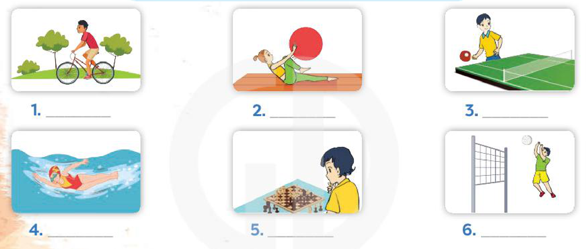
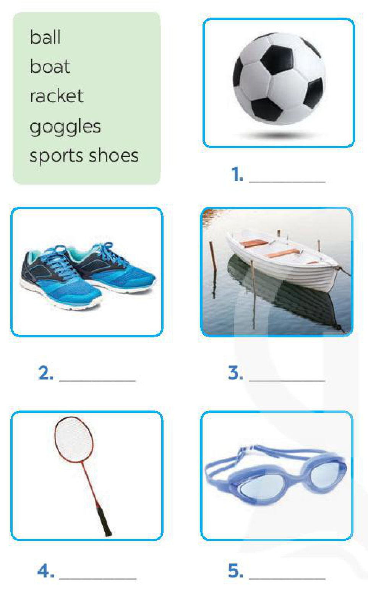
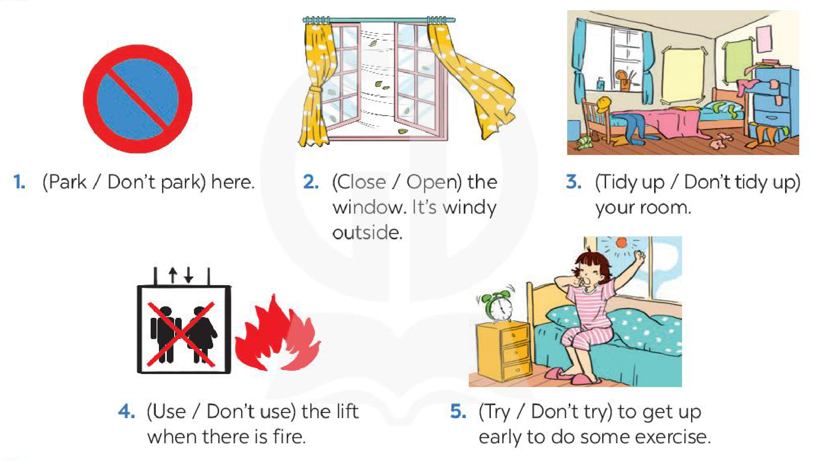
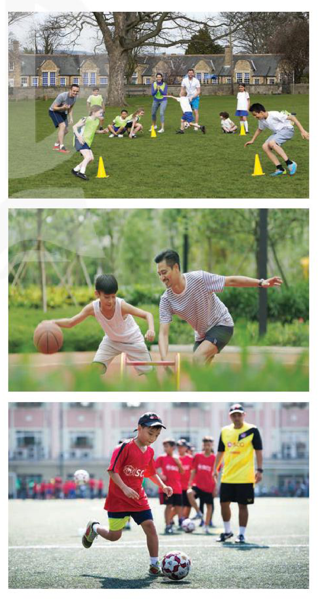

<!-- pdf:17 -->

# UNIT 8: SPORTS AND GAMES

> **THIS UNIT INCLUDES:**
> - **Vocabulary:** Sports and games
> - **Pronunciation:** Sounds: /e/ and /æ/
> - **Grammar:**
>   - Past simple
>   - Imperatives
> - **Skills:**
>   - Reading about a sports star
>   - Talking about favourite sportspeople
>   - Listening about sports and games
>   - Writing a paragraph about a sport / game
> - **Everyday English:** Expressing and responding to congratulations
<!-- ocr-ok: đã đối chiếu ảnh trang gốc, hộp THIS UNIT INCLUDES hai cột và kí hiệu phiên âm /e/, /æ/ -->

## GETTING STARTED

**At the gym**

**1. Listen and read.**

**Duong:** Wow! This **gym** is big!

**Mai:** Yeah. The **equipment** is great. What sports do you do, Duong?

**Duong:** Well, I do **karate**, and I play table tennis. Yesterday I played with Duy, and I won!
<!-- ocr-ok: đã đối chiếu ảnh trang gốc, OCR đọc nhầm đại từ I thành kí tự | -->

**Mai:** **Congratulations**! You look **fit**! I'm not good at sports.

**Duong:** I have an idea – you can go to the karate club with me.

**Mai:** No, I can't do karate.

**Duong:** But you can learn! You'll love it.

**Mai:** Well ... OK.

**Duong:** Great! I'll meet you there at 10 a.m. on Sunday.
<!-- ocr-ok: đã đối chiếu ảnh trang gốc, OCR bỏ sót chữ there do đè lên nền tranh bàn bóng bàn -->

**Mai:** Where's the club?

**Duong:** It's Superfit Club, in Pham Hung Road. You can cycle there.
<!-- ocr-ok: đã đối chiếu ảnh trang gốc, OCR không đọc được câu thoại trên nền màu cam trang trí -->

**Mai:** OK. See you then.

<!-- pdf:18 -->

**2. Put a word from the conversation in each gap.**

1. Duong looks \_\_\_\_\_\_\_. He often does karate.
2. Mai likes coming to the \_\_\_\_\_\_\_. The equipment there is great.
3. Duong played \_\_\_\_\_\_\_ with Duy yesterday, and he won.
4. Mai and Duong will meet at Superfit \_\_\_\_\_\_\_ on Sunday.
5. Mai will \_\_\_\_\_\_\_ to Superfit Club.
<!-- ocr-ok: đã đối chiếu ảnh trang gốc, bố cục hai cột có các khoảng trống điền từ -->

**3. Name these sports and games, using the words from the box.**
<!-- term: volleyball -->
<!-- term: swimming -->

| chess | **aerobics** | table tennis |
| --- | --- | --- |
| cycling | swimming | volleyball |
<!-- term: volleyball -->
<!-- term: swimming -->

1. \_\_\_\_\_\_\_
2. \_\_\_\_\_\_\_
3. \_\_\_\_\_\_\_
4. \_\_\_\_\_\_\_
5. \_\_\_\_\_\_\_
6. \_\_\_\_\_\_\_
<!-- ocr-ok: đã đối chiếu ảnh trang gốc, 6 dòng đánh số điền từ dưới 6 tranh bài 3 -->

**What is the difference between a sport and a game?**

**4. Work in pairs. Ask your partners these questions to find out how sporty they are.**

1. Can you swim?
   - A. Yes.
   - B. No.
2. Do you play outdoors every day?
   - A. Yes.
   - B. No.
3. Do you usually do morning exercise?
   - A. Yes.
   - B. No.
4. What do you usually do at break time at school?
   - A. Play in the schoolyard.
   - B. Sit in the classroom.
5. What do you think of sports and games?
   - A. Very good.
   - B. Not useful.

> If your answers to the questions are mostly "A", you are **sporty**. If they are mostly "B", do more sport and try to be more active.

<!-- pdf:19 -->

## A CLOSER LOOK 1

### Vocabulary

**1. Write the right words / phrase under the pictures.**
<!-- term: sports shoes -->

| ball | boat | **racket** | **goggles** | sports shoes |
| --- | --- | --- | --- | --- |
<!-- term: sports shoes -->
<!-- ocr-ok: đã đối chiếu ảnh trang gốc, hộp từ vựng màu xanh bài 1 -->

1. \_\_\_\_\_\_\_
2. \_\_\_\_\_\_\_
3. \_\_\_\_\_\_\_
4. \_\_\_\_\_\_\_
5. \_\_\_\_\_\_\_
<!-- ocr-ok: đã đối chiếu ảnh trang gốc, 5 dòng đánh số điền từ dưới 5 tranh bài 1 -->

**2. What sports are these things for? Match each thing in column A with a sport in column B.**

| A | B |
| --- | --- |
| 1. bicycle | a. boating |
| 2. ball | b. swimming |
| 3. boat | c. cycling |
| 4. goggles | d. ball games |
| 5. racket | e. badminton |

**3. Fill each blank with one of the words from the box.**

| champion | **competition** | sporty |
| --- | --- | --- |
| **marathon** | **congratulations** | |

1. She won an international sports \_\_\_\_\_\_\_.
2. He became the world tennis \_\_\_\_\_\_\_ when he was very young.
3. "Can you send my \_\_\_\_\_\_\_ to the winner of the contest?"
4. My friend David is very \_\_\_\_\_\_\_. He does exercise every day.
5. The first \_\_\_\_\_\_\_ **took place** in 1896.
<!-- ocr-ok: đã đối chiếu ảnh trang gốc, câu 3 có cụm to the phía sau chỗ trống -->

### Pronunciation

**/e/ and /æ/**
<!-- ocr-ok: đã đối chiếu ảnh trang gốc, kí hiệu phiên âm /e/ và /æ/ -->

**4. Listen and repeat. Pay attention to the sounds /e/ and /æ/.**

1. **/e/:** chess, tennis, exercise, contest
2. **/æ/:** racket, match, marathon, active
<!-- ocr-ok: đã đối chiếu ảnh trang gốc, OCR đọc nhầm /e/ thành fel và /æ/ thành Ja/ -->

**5. Listen and repeat. Underline the words having the sounds /e/ and /æ/.**

1. They cannot take part in this contest.
2. They began the match very late.
3. Please get the **racket** for me.
4. We play chess every Saturday.
5. My grandpa is old, but he's active.
<!-- term: chess -->

<!-- pdf:20 -->

## A CLOSER LOOK 2

### Grammar

*The past simple*

**Remember!**

We use the past simple to talk about something that happened in the past.
<!-- term: Past simple -->

**Example:**

I *played* badminton with Phong yesterday.
<!-- ocr-ok: đã đối chiếu ảnh trang gốc, OCR đọc nhầm chữ I đầu câu thành | -->

**1. Choose the correct answer A, B, or C.**

1. There \_\_\_\_\_\_\_ an interesting match on TV last night.
   - A. is
   - B. were
   - C. was
2. My dad \_\_\_\_\_\_\_ a lot of tennis some years ago.
   - A. plays
   - B. played
   - C. is playing
3. I was at the gym last Sunday, but I \_\_\_\_\_\_\_ you there.
   - A. not saw
   - B. don't see
   - C. didn't see
4. The teacher \_\_\_\_\_\_\_ us about our homework this morning.
   - A. didn't ask
   - B. not asking
   - C. doesn't ask
5. \_\_\_\_\_\_\_ sleep well last night?
   - A. Do you
   - B. Did you
   - C. Were you
<!-- ocr-ok: đã đối chiếu ảnh trang gốc, OCR bỏ sót cụm on TV last night ở câu 1 và chữ I ở câu 3 -->

**2. Write the correct form of the verbs to complete the conversation.**

**Nick:** Hi, there.

**Sonny:** Hello, Nick. Did you have a nice weekend?

**Nick:** Yeah, it was OK. On Sunday, I (1. go) \_\_\_\_\_\_\_ fishing with my dad. How about you?

**Sonny:** Oh, I (2. have) \_\_\_\_\_\_\_ a good weekend, too.

**Nick:** Really? What \_\_\_\_\_\_\_ you (3. do) \_\_\_\_\_\_\_?
<!-- ocr-ok: đã đối chiếu ảnh trang gốc, OCR đọc nhầm (3. do) thành Gdo) -->

**Sonny:** I (4. visit) \_\_\_\_\_\_\_ the museum with my family, then we (5. eat) \_\_\_\_\_\_\_ at my favourite restaurant.
<!-- ocr-ok: đã đối chiếu ảnh trang gốc, OCR đọc nhầm museum with thành musoum win và then thành i en -->

**Nick:** Did you watch football last Sunday?

**Sonny:** Oh, yeah! My favourite team (6. **score**) \_\_\_\_\_\_\_ a **fantastic** goal!
<!-- ocr-ok: đã đối chiếu ảnh trang gốc, hội thoại trong khung màu xanh lá bài 2 phần Grammar -->

**3. Work in groups. Ask and answer questions about your last weekend.**

**Example:**

**A:** Did you do any sport last weekend?

**B:** Oh yes, and I was exhausted.

**C:** Really? What did you do?
<!-- ocr-ok: đã đối chiếu ảnh trang gốc, OCR đọc nhầm C: Really? What did you do? -->

<!-- pdf:21 -->

*Imperatives*

**Remember!**

We use imperatives to tell someone to do something, or to give a direct order.
<!-- term: Imperatives -->

- It's a chewing gum.
- *Chew* it.
- *Don't swallow* it.
- **Positive:** V
- **Negative:** Don't + V

**4. Look at each picture and choose the correct answer.**

1. (Park / Don't park) here.
2. (Close / Open) the window. It's windy outside.
3. (Tidy up / Don't tidy up) your room.
4. (Use / Don't use) the lift when there is fire.
5. (Try / Don't try) to get up early to do some exercise.

**5. Tell your friends what to do and what not to do at the gym.**

**GYM RULES**

**Example:**

- Change your clothes.
- Don't speak loudly.
- \_\_\_\_\_\_\_
- \_\_\_\_\_\_\_
- \_\_\_\_\_\_\_

<!-- pdf:22 -->

## COMMUNICATION

### Everyday English

**Expressing and responding to congratulations**

**1. Listen and read the short conversation below, paying attention to the highlighted parts.**

**Duong:** Last week I played table tennis with Duy, and I won for the first time.
<!-- term: table tennis -->

**Mai:** **Congratulations**!

**Duong:** *Thank you*, Mai.

**Mai:** So you're our class champion now.
<!-- term: champion -->

**2. Work in pairs. Student A has won a prize in the school's singing contest / sports competition. Student B congratulates him / her. Make a similar dialogue. Remember to use the highlighted parts in 1. Then change roles.**

**The sport / game you like**

**3. QUIZ: Work in pairs. Do the quiz.**

1. How many players are there in a football match?
2. How long does a football match **last**?
3. How often do the Olympic Games **take place**?
4. How long is a **marathon**?
5. Where did the first Olympic Games **take place**?

**4. Work in groups. Interview your partners using the following questions. You may ask for more information.**

1. What sports / games do you play in your free time? Do you play them well? When and how often do you play them?
2. Which sport / game do you like watching on TV?
3. Did you join any clubs?
4. If you don't play sport, what do you often do in your spare time?

**Report your interviews to the class.**

<!-- pdf:23 -->

## SKILLS 1

### Reading

**1. Work in pairs. Discuss the questions.**

1. What do you know about Pelé?
2. What is special about him?

**2. Read the dialogue quickly to check your ideas in 1.**
<!-- ocr-ok: đã đối chiếu ảnh trang gốc, OCR đọc dính chữ checkyourideasin -->

*The PE teacher is talking to her students about Pelé.*

**Teacher:** Today we're going to talk about Pelé. Do you know him?

**Nick:** Yes, I think he's the best footballer of all time.

**Teacher:** Right. He was born in 1940 in Brazil. His father taught him to play football at a very young age.

**Susan:** Oh. When did he begin his **career** in football?

**Teacher:** At 15, when he started playing for Santos Football Club. In 1958, he won his first World Cup.

**Nick:** How many goals did he **score** in his career?

**Teacher:** 1,281 goals in total, I think.

**Nick and Susan:** Wow! Amazing!

**Teacher:** And he became "Football Player of the Century" in 1999.

**Michael:** Surely Pelé's a national hero in Brazil.

**Teacher:** Yes, and he's known around the world as "The King of Football".

**3. Read the text again and answer the questions.**

1. When was Pelé born?
2. Who first taught him to play football?
3. How many goals did he score in total?
4. When did he become "Football Player of the Century"?
5. What do people call him?

### Speaking

**4. Read the following facts about two famous sportspeople.**

**Hoang Giang – No. 1 sportsman in shooting**
<!-- ocr-ok: đã đối chiếu ảnh trang gốc, OCR đọc dính 1sportsman -->

- Born: 1978 in Viet Nam
- 1995: finished sports school
- 1996: took part in a **shooting** **competition**
- 2001: won a gold medal for shooting

**Jenny Green – one of the best female golfers in history**

- Born: 1972 in Greenland
- 1987: became a member of local golf club
- 1994: took part in a female golf **tournament**
- 2002: became the female golf champion
<!-- term: champion -->

**5. Choose one sportsperson in 4. Talk about him / her. Use the following cues.**

- His / Her name
- The sport he / she plays
- Why he / she is famous
- You like him / her or not
  Explain why

<!-- pdf:24 -->

## SKILLS 2

### Listening

**1. Listen to the passages. Who are they about?**

**2. Listen to the passages again. Then tick (✓) T (True) or F (False) for each sentence.**

| | T | F |
| --- | --- | --- |
| 1. The passages are about two sportsmen. | | |
| 2. Hai goes cycling at the weekend. | | |
| 3. Hai's favourite sport is karate. | | |
| 4. Alice doesn't like doing sport very much. | | |
| 5. Alice plays computer games every day. | | |
<!-- term: cycling -->
<!-- ocr-ok: đã đối chiếu ảnh trang gốc, bảng T/F 5 câu (OCR đảo thứ tự câu 2 và câu 3) -->

**3. Listen again and fill each blank with a word to complete each sentence.**

1. Hai plays \_\_\_\_\_\_\_ at school.
2. Hai practises karate at the club \_\_\_\_\_\_\_ times a week.
3. \_\_\_\_\_\_\_ likes watching sport on TV.
4. Alice plays \_\_\_\_\_\_\_ every Saturday.

### Writing

**4. Work in pairs. Talk about the sport / game you like. Use the following questions as cues.**

- What is the name of the sport / game?
- How many players are there?
- How often do you play it?
- What equipment does it need?
- Why do you like it?

**5. Write a paragraph of 40-50 words about the sport / game you talked about in 4. You can also refer to the listening passages.**

\_\_\_\_\_\_\_\_\_\_\_\_\_\_\_\_\_\_\_\_\_\_\_\_\_\_\_\_\_\_\_\_\_\_\_\_\_\_\_\_\_\_\_\_\_\_\_

<!-- pdf:25 -->

## LOOKING BACK

### Vocabulary

**1. Find one odd word / phrase in each question.**

1. A. volleyball / B. badminton / C. bicycle
2. A. playground / B. ball / C. racket
3. A. running / B. cycling / C. driving
4. A. sports shoes / B. winter sports / C. **goggles**
5. A. sporty / B. intelligent / C. fit
<!-- ocr-ok: đã đối chiếu ảnh trang gốc, OCR đọc thiếu số thứ tự 1-5 và đọc dính A.volleyball, C.bicycle -->

**2. Put the correct form of the verbs play, do or go in the blanks.**

1. Duong can \_\_\_\_\_\_\_ karate.
2. Duy isn't reading now. He \_\_\_\_\_\_\_ table tennis with his friend.
3. Michael \_\_\_\_\_\_\_ swimming nearly every day.
4. Phong didn't play football yesterday. He \_\_\_\_\_\_\_ fishing.
5. Khang \_\_\_\_\_\_\_ volleyball last Saturday.
6. The girls \_\_\_\_\_\_\_ **aerobics** in the playground now.
<!-- ocr-ok: đã đối chiếu ảnh trang gốc, 6 câu điền động từ có khoảng trống và OCR đọc nhầm yesterday thành vesterday -->

### Grammar

**3. Put the verbs in brackets in the correct form.**

1. The first Olympic Games (take) \_\_\_\_\_\_\_ place in Greece in 776 BC.
2. People (start) \_\_\_\_\_\_\_ to use computers about 50 years ago.
3. My brother (not like) \_\_\_\_\_\_\_ to play games when he was small.
4. – What \_\_\_\_\_\_\_ you (do) \_\_\_\_\_\_\_ last weekend?
   – I (cycle) \_\_\_\_\_\_\_ round the lake with my friends. Then I (watch) \_\_\_\_\_\_\_ TV in the afternoon.
<!-- ocr-ok: đã đối chiếu ảnh trang gốc, bài 3 chia làm hai cột có khoảng trống điền động từ (OCR đọc dính notlike, roundthelake) -->

**4. What do you say in these situations?**

1. Your friends are making a lot of noise.
   → Please, stop \_\_\_\_\_\_\_.
2. The boy is watching TV for too long.
   → \_\_\_\_\_\_\_ to play with your friends.
3. Some children are feeding the animals at the zoo, but it is not allowed.
   → \_\_\_\_\_\_\_ the animals.
4. The teacher wants the boys to stand in line.
   → \_\_\_\_\_\_\_
5. Your mother tells you not to touch the dog.
   → \_\_\_\_\_\_\_

**5. Fill each blank with ONE word to complete the passage.**

Sports and games are very important in our lives. We all can (1) \_\_\_\_\_\_\_ a sport or a game, or watch sports events on TV or at the stadium. When you listen to the radio every day, you can always (2) \_\_\_\_\_\_\_ sports news. When you open a newspaper, you will always find an article about your (3) \_\_\_\_\_\_\_ kind of game. Television programmes about (4) \_\_\_\_\_\_\_ are also very popular, and you can watch something interesting every day. Stories about (5) \_\_\_\_\_\_\_ sports stars are often very interesting.

<!-- pdf:26 -->

## PROJECT

**1. Read the information about a traditional game.**

- **Name of the game:** blind man's buff
- **Number of players:** five or more
- **Equipment:** a blindfold, and open space
- **How to play:**
  1. Players stand in a circle; one person blindfolded (the seeker) stands in the middle.
  2. The seeker tries to catch others who are trying not to be caught.
  3. When the seeker catches a player, he / she tries to guess who it is by touching that player's face and hair.
  4. When the seeker says that player's name correctly, he / she becomes the new seeker.
<!-- term: blind man's buff -->

**2. Choose one of the following games and write about it.**

- Tug of war (rope pulling)
- Skipping
- Wrestling

**Cues:**

- Name of the game:
- Number of players:
- Equipment:
- How to play:

**3. Work in groups. Take turns to give presentation.**

### Now I can ...

- use the words related to the topic 'Sports and Games'.
- pronounce the sounds /e/ and /æ/ correctly.
- use the past simple.
- use imperatives to tell someone to do something.
- express and respond to congratulations.
- read about a sports star.
- talk about famous sportspeople.
- listen about sports and games.
- write a paragraph about a sport / game.
<!-- ocr-ok: đã đối chiếu ảnh trang gốc, bảng tự đánh giá Now I can gồm 9 mục -->

## 📷 Danh mục hình minh hoạ

| Mã hình | Trang PDF | Trang sách | Chú thích / Mô tả |
| --- | --- | --- | --- |
| H6-tieng_anh-u08-01 | 18 | 17 | Sáu bức tranh gọi tên các môn thể thao và trò chơi: (1) đạp xe, (2) thể dục nhịp điệu, (3) bóng bàn, (4) bơi lội, (5) cờ vua, (6) bóng chuyền |
| H6-tieng_anh-u08-02 | 19 | 18 | Hộp từ vựng và năm bức tranh dụng cụ thể thao cần điền tên: (1) quả bóng, (2) giày thể thao, (3) thuyền, (4) cái vợt, (5) kính bơi |
| H6-tieng_anh-u08-03 | 21 | 20 | Năm bức tranh tình huống luyện tập câu mệnh lệnh khẳng định và phủ định: (1) biển cấm đỗ xe, (2) cửa sổ mở khi trời gió to, (3) phòng ngủ bừa bộn, (4) biển cấm dùng thang máy khi có cháy, (5) thức dậy sớm tập thể dục |
| H6-tieng_anh-u08-04 | 22 | 21 | Ba bức ảnh minh hoạ hoạt động thể thao và trò chơi vận động: nhóm học sinh chơi trò chơi ngoài sân cỏ, hai bố con chơi bóng rổ và các bạn nhỏ thi đấu bóng đá |
