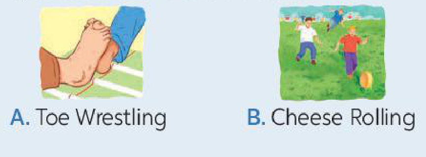
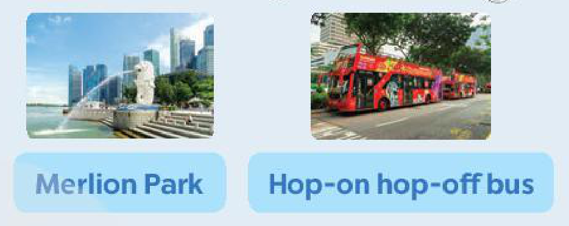

<!-- pdf:37 -->

# REVIEW 3

**(UNITS 7 - 8 - 9)**

## LANGUAGE

### Pronunciation

**1. Circle the word with the different underlined sound. Listen and check.**

1. A. tower   B. how   C. snow
2. A. symbol   B. opening   C. **postcard**
3. A. farther   B. earth   C. both
4. A. Saturday   B. racket   C. game
5. A. tennis   B. prepare   C. chess

### Vocabulary

**2. Choose A, B, or C to fill the gaps in the passage.**

Most children love (1) \_\_\_\_\_\_\_ activities when the weather is good. They play football, go skateboarding or go (2) \_\_\_\_\_\_\_. In countries with a lot of snow like (3) \_\_\_\_\_\_\_, children go skiing with their parents to practise skiing. When they are not skiing, they can stay at home and watch interesting (4) \_\_\_\_\_\_\_ on TV or visit (5) \_\_\_\_\_\_\_ in the area.

1. A. outdoor   B. indoor   C. school
2. A. tennis   B. karate   C. swimming
3. A. Sweden   B. India   C. Brazil
4. A. characters   B. viewers   C. programmes
5. A. sports   B. city   C. **landmarks**

**3. Complete the sentences with the words / phrase in the box.**

| football | city | **landmark** | television | summer sports |
| --- | --- | --- | --- | --- |
<!-- ocr-ok: đã đối chiếu ảnh trang gốc, hộp từ vựng 2 hàng bị OCR đọc theo cột dọc -->

1. The Eiffel Tower is a famous \_\_\_\_\_\_\_ in Paris.
<!-- term: Eiffel Tower -->
2. Pelé is a great \_\_\_\_\_\_\_ player from Brazil.
3. There are many educational programmes on \_\_\_\_\_\_\_.
4. I think no other \_\_\_\_\_\_\_ in the world is more interesting than Los Angeles.
5. \_\_\_\_\_\_\_ are very popular in countries with a lot of sunshine like Australia.

### Grammar

**4. Choose the correct answer A, B, or C.**

1. John, you are late. The match \_\_\_\_\_\_\_ ten minutes ago.
   A. starts   B. started   C. is starting
2. Ben wrote his parents a **postcard** \_\_\_\_\_\_\_ he was on holiday.
   A. because   B. and   C. while
3. Hong Kong is famous for \_\_\_\_\_\_\_ double-decker buses.
   A. its   B. it   C. it's
4. Sports and games \_\_\_\_\_\_\_ an important part in our lives.
   A. play   B. plays   C. played
5. The USA first \_\_\_\_\_\_\_ colour TV in 1953.
   A. has   B. have   C. had
6. We are now in the city museum. \_\_\_\_\_\_\_ any objects on display.
   A. Not touch   B. Don't touch   C. Don't touching

**5. Correct the underlined question word(s) if needed.**

1. *Who* sports do you like?
2. *What time* do you have English classes?
3. *What* do you like Hoi An?
4. *What* tall are the Twin Towers in Kuala Lumpur?
5. *When* is the Great Wall: in China or in Korea?

## SKILLS

### Reading

**STRANGE SPORTS**

**1. Read the two descriptions of strange sports and choose titles for them.**

A. Toe Wrestling   B. Cheese Rolling

<!-- pdf:38 -->

1. \_\_\_\_\_\_\_

It's a simple sport. Competitors roll a big round piece of cheese from the top of a hill. Competitors run after it and try to catch it. Very few people can catch it because it goes very fast, about 112 km an hour.

2. \_\_\_\_\_\_\_

It's a popular sport for children. This game started in Derbyshire in the North of England. Two children lock their toes together and try to push the other's foot to the ground. It's similar to arm wrestling.

**2. Use the information from the passages above to tick (✓) the correct box.**

| | Toe Wrestling | Cheese Rolling |
| --- | --- | --- |
| 1. You need a hill to play this sport. | | |
| 2. You use the lower part of the body for this sport. | | |
| 3. It travels at about 112 km/h. | | |
| 4. Not many people can catch it. | | |
| 5. It first started in England. | | |

### Speaking

**3. Work in groups. Interview your classmates about their likes. Take notes of their answers and report to the class.**

| Questions | Person 1 | Person 2 |
| --- | --- | --- |
| 1. What city would you like to visit? | | |
| 2. What sports do you like playing? | | |
| 3. What TV programme do you like watching? | | |

### Listening

**4. Listen to a talk about Singapore and fill the missing information.**
<!-- ocr-ok: đã đối chiếu ảnh trang gốc, OCR đọc dính chữ fillthe -->

| Merlion Park | Hop-on hop-off bus |
| --- | --- |

- Singapore attracts millions of (1) \_\_\_\_\_\_\_ every year.
- A hop-on hop-off bus goes (2) \_\_\_\_\_\_\_ around the city.
- The cost of the tour is (3) \_\_\_\_\_\_\_ dollars.
- The bus comes every (4) \_\_\_\_\_\_\_ minutes.
- This tour is good for people with (5) \_\_\_\_\_\_\_ time.

### Writing

**5. Look at the information on Mark's visit to India last summer. Write a paragraph of about 50 words about his visit.**

You can start with:
*Last summer, Mark visited Delhi in India. He \_\_\_\_\_\_\_.*

| | |
| --- | --- |
| **Country** | India |
| **Time** | 7 days |
| **City** | Delhi |
| **Activities** | - watch a snake performance - visit temples - eat **street food** |
| **People** | friendly |
| **Weather** | hot |

## 📷 Danh mục hình minh hoạ

| Mã hình | Trang PDF | Trang sách | Chú thích / Mô tả |
| --- | --- | --- | --- |
| H6-tieng_anh-r03-01 | 37 | 36 | Hai tranh minh hoạ môn thể thao kì lạ trong mục Reading: *A. Toe Wrestling* (vật ngón chân cái) và *B. Cheese Rolling* (lăn phô mai trên đồi) |
| H6-tieng_anh-r03-02 | 38 | 37 | Hai ảnh chụp địa điểm và phương tiện du lịch Singapore trong mục Listening: *Merlion Park* (Công viên Sư tử biển) và *Hop-on hop-off bus* (xe buýt du lịch hai tầng mui trần) |
