<!-- pdf:27 -->

# UNIT 9: CITIES OF THE WORLD

> **THIS UNIT INCLUDES:**
> - **Vocabulary:** Cities and landmarks
> - **Pronunciation:** Sounds: /əʊ/ and /aʊ/
> - **Grammar:**
>   - Possessive adjectives
>   - Possessive pronouns
> - **Skills:**
>   - Reading about a holiday postcard
>   - Talking about a city
>   - Listening to a description of a city
>   - Writing a holiday postcard
> - **Everyday English:** Expressing exclamations with *What*
<!-- ocr-ok: đã đối chiếu ảnh trang gốc, hộp THIS UNIT INCLUDES trình bày hai cột và chứa kí hiệu IPA /əʊ/, /aʊ/ -->

## GETTING STARTED

**What nice photos!**

**1. Listen and read.**

**Mai:** Tom, are these photos from your holidays?

**Tom:** Yes, they are. This is Sydney, a city in Australia.

**Mai:** What's it like?

**Tom:** It's exciting with a lot of beaches.

**Mai:** What a beautiful place!

**Tom:** Yes, its beaches are very clean.

**Mai:** Wonderful. Oh, this is London. Isn't it raining? What bad weather!

**Tom:** Yes, it rains all the time. Can you see Big Ben?

**Mai:** Yeah ... on the River Thames. It's a **landmark** of London.

**Tom:** It is. And this is **Times Square** in New York, **crowded** but interesting.

**Mai:** You're lucky to visit many places.

**Tom:** I am. What about your holidays?

**Mai:** Here are some photos of mine. This is ...

<!-- pdf:28 -->

**2. Write the names of the cities in the correct place.**

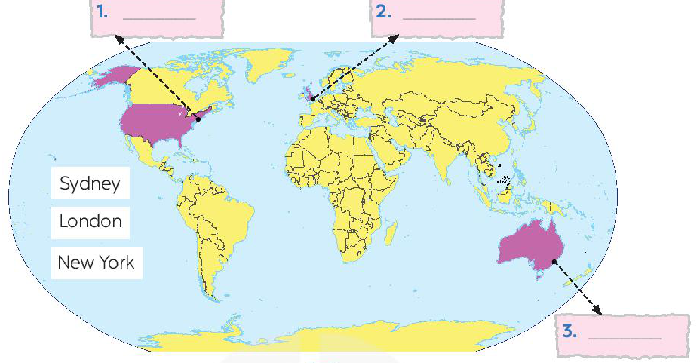

| Sydney | London | New York |
| --- | --- | --- |
| 1. \_\_\_\_\_\_\_ | 2. \_\_\_\_\_\_\_ | 3. \_\_\_\_\_\_\_ |
<!-- ocr-ok: đã đối chiếu ảnh trang gốc, các nhãn tên thành phố và ô trống 1, 2, 3 nằm trên hình bản đồ thế giới -->

**3. Read the conversation again and match the cities with the adjectives describing them.**

| | |
| --- | --- |
| 1. Sydney | a. rainy |
| 2. London | b. **crowded** |
| 3. New York | c. exciting |
| | d. beautiful |
| | e. interesting |
<!-- ocr-ok: đã đối chiếu ảnh trang gốc, các ô nối hai cột bài tập 3 bị OCR đọc trộn với bài tập 4 bên phải -->

**4. Match the cities with their landmarks.**

1. Ha Noi
2. London
3. New York
4. Sydney

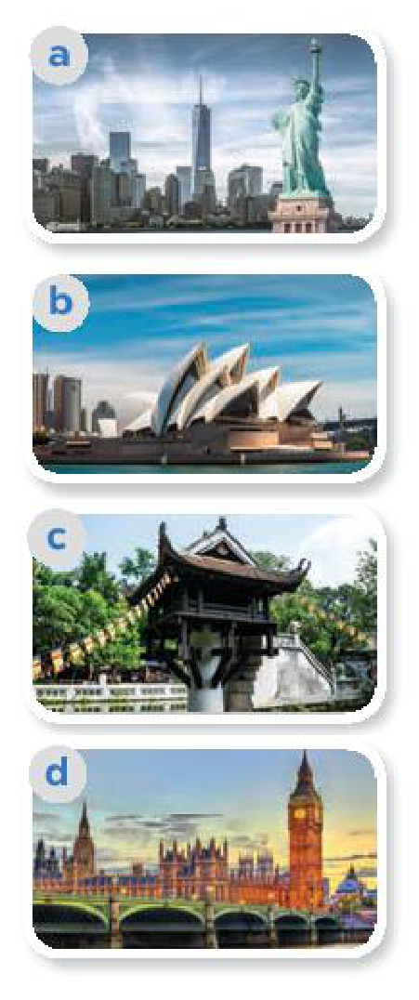

**5. GAME: What city is it?**
<!-- ocr-ok: đã đối chiếu ảnh trang gốc, chữ GAME in trong bốn ô màu trang trí -->

*Example:*

**A:** What's it like?
**B:** It has beautiful beaches.
**C:** Is it in Australia?
**B:** Yes, it is.
**A:** It's Sydney.
**B:** Right.
<!-- ocr-ok: đã đối chiếu ảnh trang gốc, OCR đọc dính chữ Whats, Ithas, lsitin, itis, lts -->

<!-- pdf:29 -->

## A CLOSER LOOK 1

### Vocabulary

**1. Fill each box with an adjective.**

| rainy | friendly | tasty |
| --- | --- | --- |
| old | exciting | **helpful** |
| delicious | sunny | |

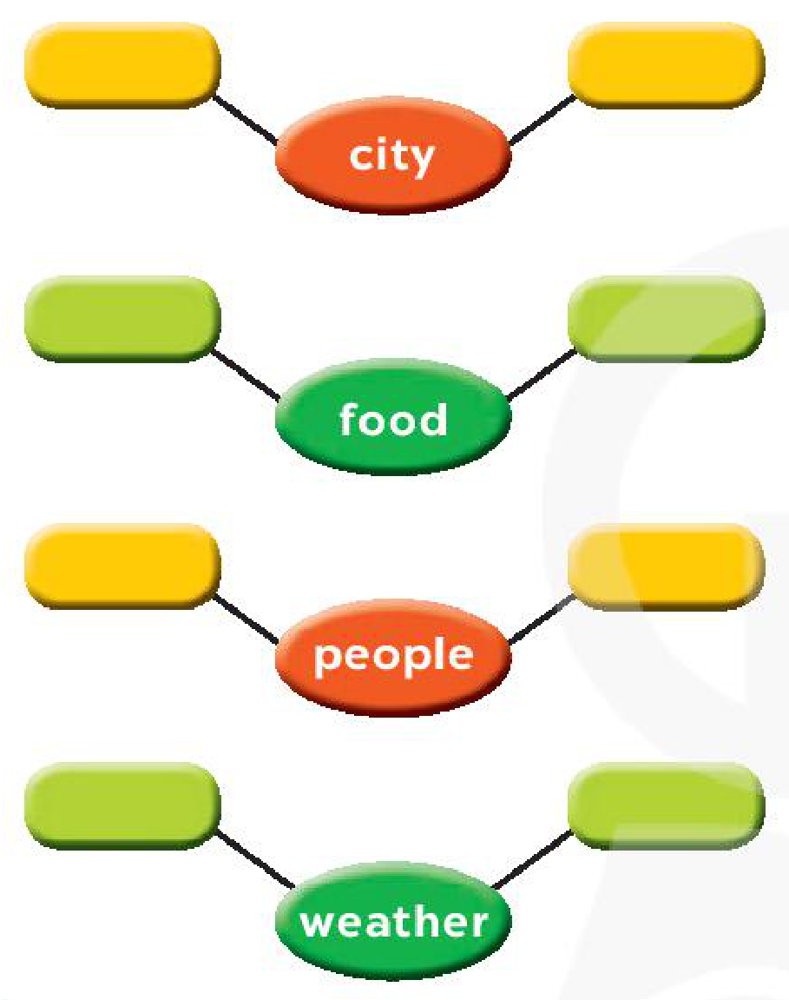

- *city*: \_\_\_\_\_\_\_, \_\_\_\_\_\_\_
- *food*: \_\_\_\_\_\_\_, \_\_\_\_\_\_\_
- *people*: \_\_\_\_\_\_\_, \_\_\_\_\_\_\_
- *weather*: \_\_\_\_\_\_\_, \_\_\_\_\_\_\_
<!-- ocr-ok: đã đối chiếu ảnh trang gốc, chữ city, food, people, weather nằm trong các ô màu của sơ đồ tư duy -->

**2. Complete the sentences with the words in 1.**

1. – What's the weather like in Sydney in summer?
   – It's \_\_\_\_\_\_\_ and dry.
2. I love the \_\_\_\_\_\_\_ buildings in Edinburgh. I feel that they can tell stories.
3. There are so many things to do in New York. It's very \_\_\_\_\_\_\_.
4. The people in my city are \_\_\_\_\_\_\_ and **helpful**.
5. Ha Noi is famous for its \_\_\_\_\_\_\_ **street food**.
<!-- ocr-ok: đã đối chiếu ảnh trang gốc, câu 5 bị OCR đọc hỏng thành rma forts -->

**3. Write the words / phrases below under the correct pictures.**

| **stall** | **street food** | **palace** | **floating market** |
| --- | --- | --- | --- |

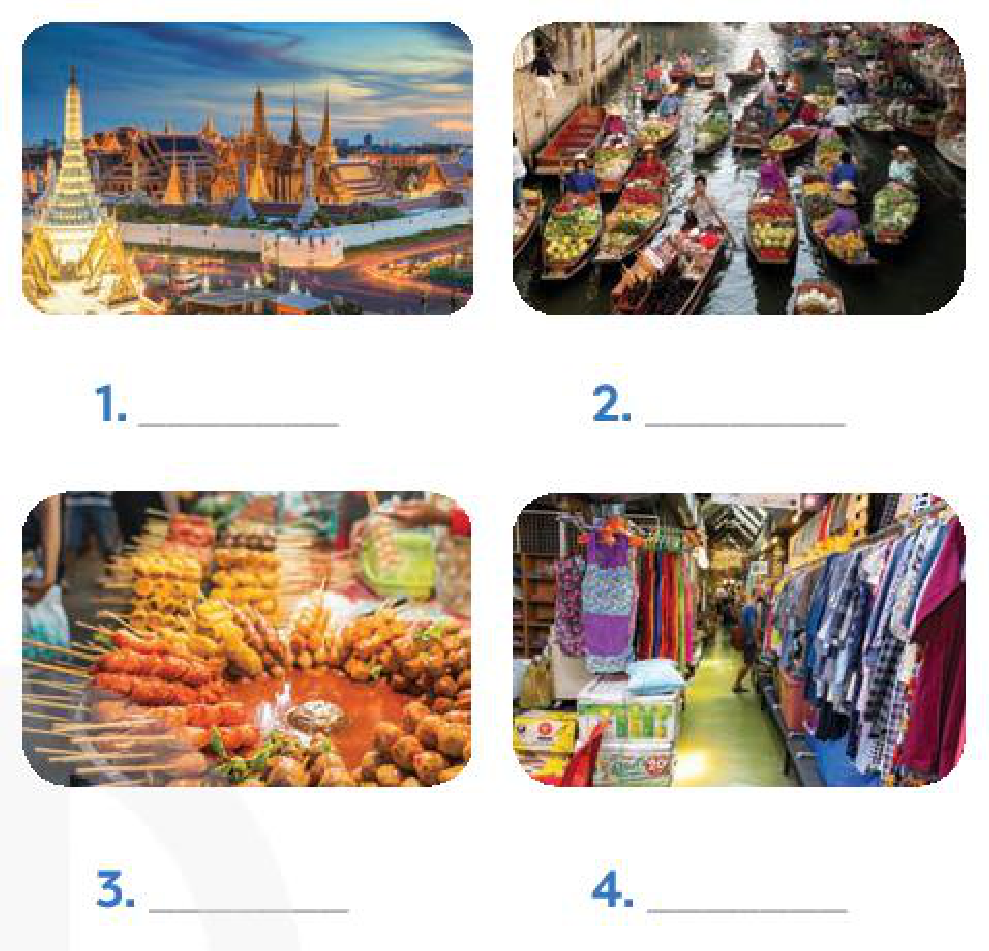

1. \_\_\_\_\_\_\_   2. \_\_\_\_\_\_\_   3. \_\_\_\_\_\_\_   4. \_\_\_\_\_\_\_

### Pronunciation

**/əʊ/ and /aʊ/**

**4. Listen and write the words in the correct column. Then listen and repeat.**

| boat | house | town | **tower** |
| --- | --- | --- | --- |
| **postcard** | **crowded** | coast | pagoda |

| /əʊ/ | /aʊ/ |
| --- | --- |
| | |

**5. Listen and repeat. Pay attention to the underlined words.**

1. The *town* is *crowded* at the weekend.
2. There's lots of *snow* in *Tokyo* in winter.
3. It's very *cold* on the *boat*.
4. He's running *around* the *house*.

<!-- pdf:30 -->

## A CLOSER LOOK 2

### Grammar

*Possessive adjectives*

**Remember!**

A possessive adjective is used only when there's a noun following it.
*Example:* *I* have a pen. → This is *my* pen.
<!-- term: Possessive adjectives -->

**1. Match the sentences with the pictures, paying attention to the underlined part in each sentence.**

1. Sue doesn't like *her new dress*.
2. Billy is riding *his bicycle*.
3. The cat is playing with *its ball*.
4. We love *our school*.
5. They are painting *their room* pink.
<!-- ocr-ok: đã đối chiếu ảnh trang gốc, cột câu 1-5 nằm sát tranh minh hoạ nên OCR bỏ sót cụm like her new dress -->

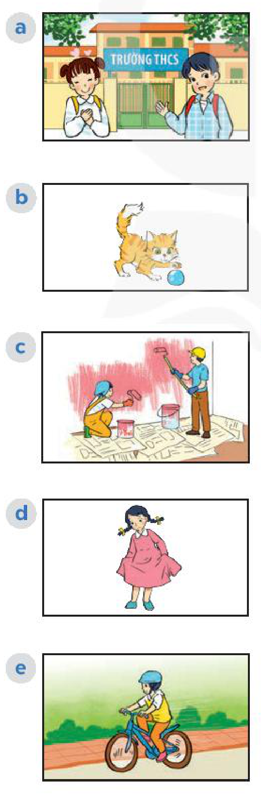

**2. Complete the sentences with the correct possessive adjectives.**

1. I love cartoons. \_\_\_\_\_\_\_ favourite cartoon is *Dragon Balls*.
2. This book has your name on it. Is it \_\_\_\_\_\_\_ book?
3. The lion has three cubs. \_\_\_\_\_\_\_ cubs are playing under a big tree.
4. Do you know my friend Anna? \_\_\_\_\_\_\_ house is close to the park.
5. We are from Switzerland. \_\_\_\_\_\_\_ country is famous for chocolate.

*Possessive pronouns*

**Remember!**

A possessive pronoun is used alone, without a noun following it.
*Example:* This book is *my book*, not *your book*. → This book is *mine*, not *yours*.
<!-- term: Possessive pronouns -->

**3. Complete the sentences with the correct possessive pronouns.**

1. I have a new bike. The bike is \_\_\_\_\_\_\_.
2. These are Mai's and Lan's maps. These maps are \_\_\_\_\_\_\_.
3. This is a present for you. It's \_\_\_\_\_\_\_.
4. My father has new shoes. They're \_\_\_\_\_\_\_.
5. This is our new house. The house is \_\_\_\_\_\_\_.
<!-- ocr-ok: đã đối chiếu ảnh trang gốc, OCR đọc dính chữ bikeis, Mais, Lans, foryou -->

<!-- pdf:31 -->

**4. Underline the correct word in brackets to complete each sentence.**

1. Australia is a strange country. All of (it's / its) big cities are along the coast.
2. Our city is very **crowded**. How about (your / yours)?
3. I love my football club. Does Phong like (his / him)?
4. (Our / Ours) street is short and narrow.
5. They cannot find (their / theirs) **city map** anywhere.

**5. Choose the correct word to complete each sentence.**

1. The book is \_\_\_\_\_\_\_, but you are welcome to read it.
   A. my   B. mine   C. yours
2. \_\_\_\_\_\_\_ bike is dirty, and I can't tell what colour it is.
   A. Your   B. Yours   C. You
3. Your country is much bigger than \_\_\_\_\_\_\_.
   A. our   B. ours   C. their
4. \_\_\_\_\_\_\_ dog is so friendly. It never barks.
   A. They   B. Their   C. Theirs
5. \_\_\_\_\_\_\_ not easy to find your way in a strange city.
   A. It   B. It's   C. Its

## COMMUNICATION

### Everyday English

**Expressing exclamations with What**

**1. Look at the picture. Listen and read the exclamations.**

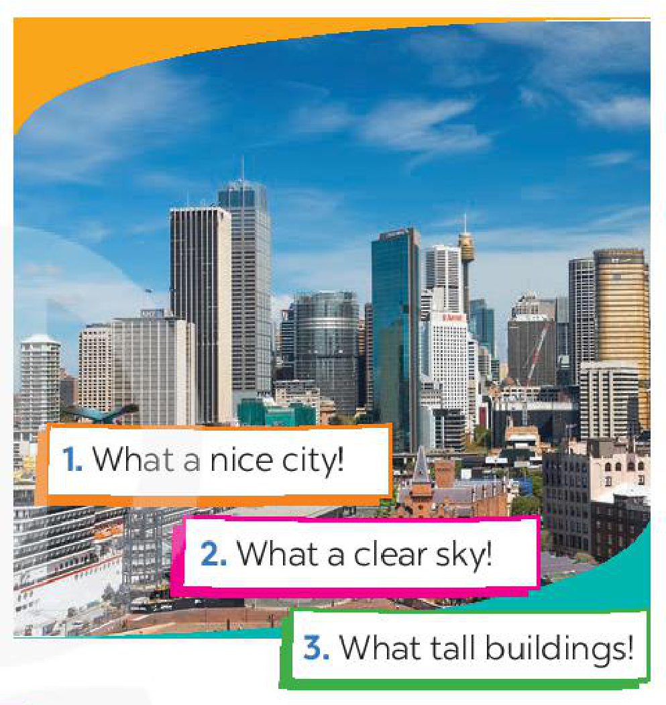

1. What a nice city!
2. What a clear sky!
3. What tall buildings!
<!-- ocr-ok: đã đối chiếu ảnh trang gốc, câu 1 bị nền ảnh toà nhà làm OCR bỏ sót -->

**2. Work in pairs. Look at the picture below and say what you think by using exclamations with *What*. You may use the suggestions below.**
<!-- term: Exclamations with What -->

- happy / beautiful children
- colourful / nice picture
- sunny / beautiful weather
- small / cute boy
- beautiful / colourful apple trees

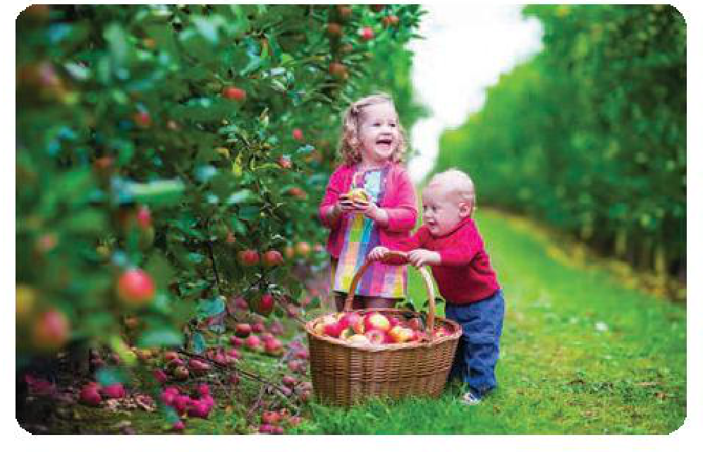

<!-- pdf:32 -->

**City landmarks**

**3. Work in pairs. Write the names of the landmarks under the correct pictures.**

| Eiffel Tower | Big Ben |
| --- | --- |
| Sydney Opera House | Merlion |

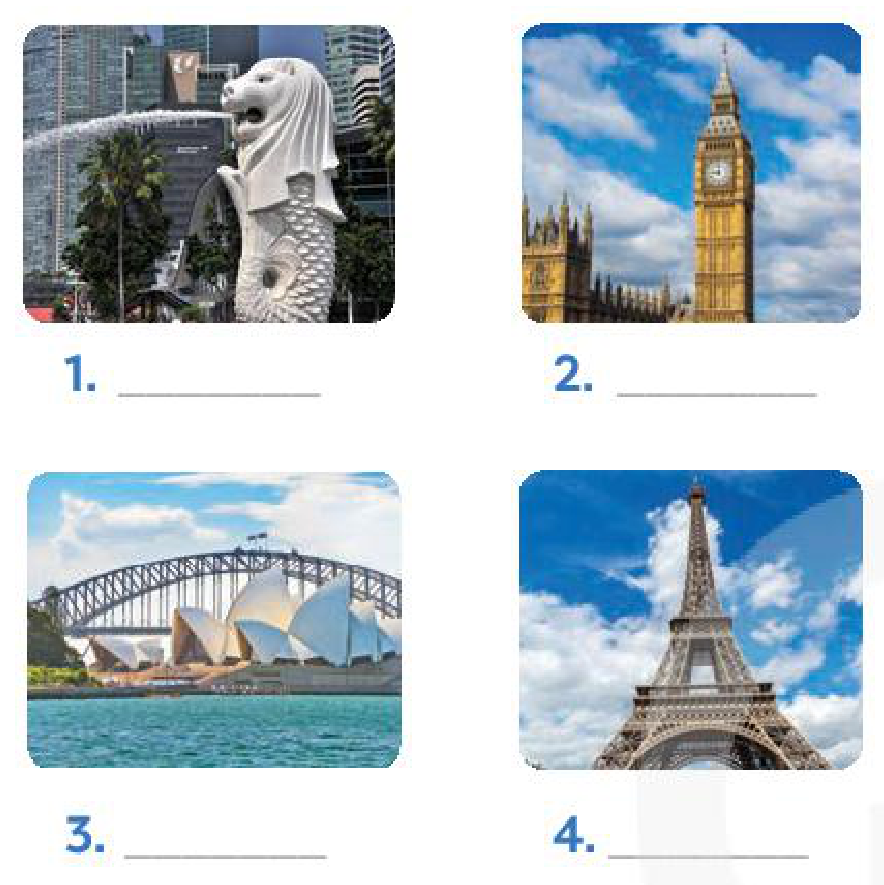

1. \_\_\_\_\_\_\_   2. \_\_\_\_\_\_\_   3. \_\_\_\_\_\_\_   4. \_\_\_\_\_\_\_

**4. Write the names of the landmarks in 3 for the descriptions.**
<!-- ocr-ok: đã đối chiếu ảnh trang gốc, số 3 in màu đỏ cam bị OCR đọc nhầm thành 5 -->

1. \_\_\_\_\_\_\_
   This **tower** is on the **bank** of the River Thames in London. In the tower, there's a big clock and a bell.
<!-- term: Big Ben -->

2. \_\_\_\_\_\_\_
   It's a theatre on Sydney Harbour. Its roofs are white and look like **shells**. Visitors from all over the world come to see it.
<!-- term: Sydney Opera House -->

3. \_\_\_\_\_\_\_
   This famous **tower** is in Paris. Every year, millions of visitors climb to its top to see the whole view of Paris.
<!-- term: Eiffel Tower -->

4. \_\_\_\_\_\_\_
   It has the head of a lion and the body of a fish. It's a famous **landmark** in Singapore.
<!-- term: Merlion -->

**5. QUIZ: Work in pairs. Read the questions and circle the correct answers.**

1. Which city is nearer to Ha Noi than the others?
   A. Berlin   B. Bangkok   C. Tokyo
2. The people of Quang Nam are proud of their ancient town, \_\_\_\_\_\_\_.
   A. Hoi An   B. Sa Pa   C. Bach Ma
3. Phnom Penh is the capital city of \_\_\_\_\_\_\_.
   A. Indonesia   B. the Philippines   C. Cambodia
4. For children, California is famous for its \_\_\_\_\_\_\_.
   A. Disneyland Park   B. Golden Gate Bridge   C. national parks

<!-- pdf:33 -->

## SKILLS 1

### Reading

**Love from Sweden**

**1. Work in groups. Look at the postcard and discuss.**

1. When do people write a **postcard**?
2. What do they often write on a postcard?

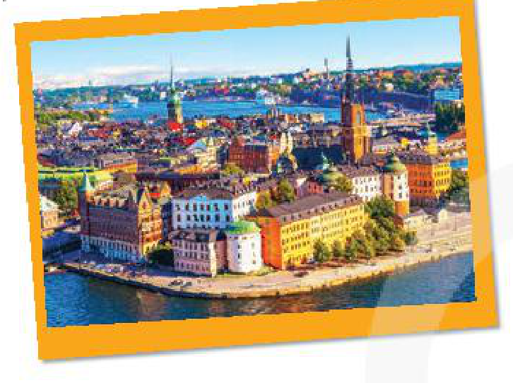

**2. Read the postcard and choose the correct answer to each of the questions.**

September 6

*Dear Grandpa and Grandma,*

Stockholm is fantastic! Its weather is perfect, sunny all the time! Our hotel is good. It has a swimming pool and a gym. It offers delicious breakfast. Yesterday Mum, Dad and I **rented** three bikes and cycled to the Old Town. My parents wore their **helmets** and I wore mine. We visited the **Royal Palace** first. What a beautiful place! Mum loved it. She said, "Swedish art is amazing." After that, we had "fika", a coffee break, in a traditional café. Everything is so wonderful!
<!-- term: coffee break -->

Wish you were here!

*Love,*
*Mai*

**To:** Grandpa & Grandma, Hoan Kiem, Ha Noi, Viet Nam

1. This postcard is about \_\_\_\_\_\_\_ in Stockholm.
   A. the weather   B. a holiday   C. landscapes
2. Guests can \_\_\_\_\_\_\_ in the hotel.
   A. exercise   B. cycle   C. see Swedish art
3. Mai and her parents rented bikes to \_\_\_\_\_\_\_.
   A. cycle around the hotel   B. visit the Old Town   C. go shopping
4. "Fika" is a \_\_\_\_\_\_\_.
   A. traditional café   B. **palace**   C. coffee break
<!-- ocr-ok: đã đối chiếu ảnh trang gốc, OCR đọc nhầm exercise thành exetcee và đọc dính isabout, Guestscan -->

**3. Read the text and match the places with the things they have.**

| | |
| --- | --- |
| 1. The hotel in Stockholm | a. the Royal Palace |
| 2. The Old Town | b. delicious breakfast |
| | c. swimming pool |
| | d. 'fika' |
| | e. Swedish art |
<!-- ocr-ok: đã đối chiếu ảnh trang gốc, hai khung màu xanh nối cột trái và phải bị OCR đọc lệch dòng -->

### Speaking

**4. Work in groups. Choose a city you know. Discuss and answer the questions below.**

- What city is it?
- What is it like? (the weather, the food ...)
- What can you see and do there?
- How do you feel about it?

**5. Share the information you have collected in 4 with your class.**

You may start your talk with:
*We're going to tell you about ...*

<!-- pdf:34 -->

## SKILLS 2

### Listening

**1. Work in groups. Discuss and answer the questions.**

1. Where is Bangkok?
2. What is Bangkok famous for?

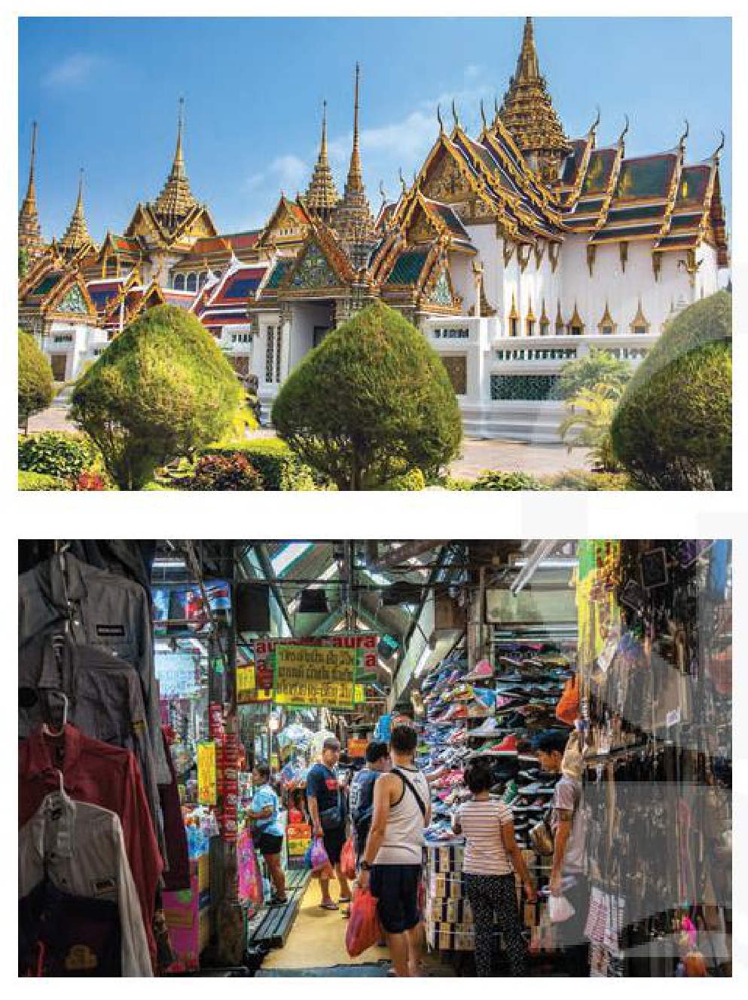

**2. Listen and tick (✓) T (True) or F (False).**

| | T | F |
| --- | --- | --- |
| 1. Bangkok is famous for **palaces**. | | |
| 2. Things at Chatuchak market are expensive. | | |
| 3. The **floating market** is on the sea. | | |
| 4. You can find food **stalls** all around Bangkok. | | |

**3. Listen again and fill each gap with ONE word / number.**

1. Chatuchak market has over \_\_\_\_\_\_\_ **stalls**.
2. Chatuchak market is about \_\_\_\_\_\_\_ minutes' walk from the station.
3. You can see part of Thai people's \_\_\_\_\_\_\_ at the market.
4. **Street food** in Bangkok is \_\_\_\_\_\_\_.

### Writing

**4. Work in groups. Talk about a city in your country, using the questions below as a guide.**

- What city is it?
- What is it like? (the weather, the people, the food)
- What can you see and do there?

**5. Write a postcard of about 50 words about your holiday in a city. Use the information in 4.**

Dear Mum and Dad,

\_\_\_\_\_\_\_\_\_\_\_\_\_\_\_\_\_\_\_\_\_\_\_\_\_\_\_\_\_\_\_

Love,
Trang

**To:** \_\_\_\_\_\_\_
<!-- ocr-ok: đã đối chiếu ảnh trang gốc, khung bưu thiếp có chữ viết tay mẫu Dear Mum and Dad, Love, Trang và To: -->

<!-- pdf:35 -->

## LOOKING BACK

### Vocabulary

**1. Choose the best two options to complete the sentences.**

1. The city is \_\_\_\_\_\_\_.
   A. exciting   B. amazing   C. long
2. The weather is \_\_\_\_\_\_\_.
   A. cold   B. quiet   C. sunny
3. The people are \_\_\_\_\_\_\_.
   A. friendly   B. wide   C. **helpful**
4. The buildings are \_\_\_\_\_\_\_.
   A. tall   B. beautiful   C. fast
5. The food is \_\_\_\_\_\_\_.
   A. cute   B. delicious   C. good

**2. Write the words / phrases in the box under their pictures.**

Write the words / phrases in the box under their pictures: **towers**, beach, **river bank**, **postcard**, **palace**, night market.
<!-- term: night market -->

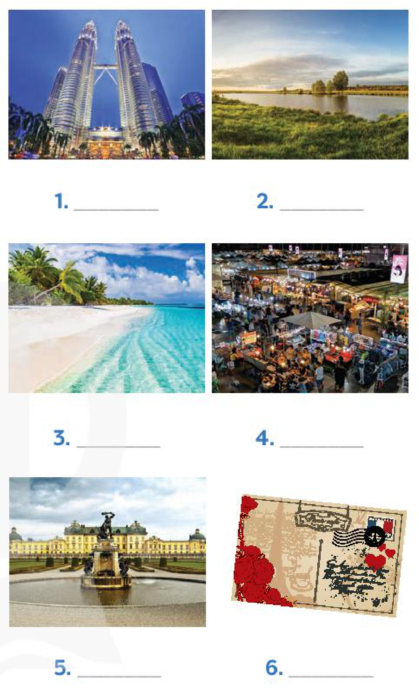

1. \_\_\_\_\_\_\_   2. \_\_\_\_\_\_\_   3. \_\_\_\_\_\_\_   4. \_\_\_\_\_\_\_   5. \_\_\_\_\_\_\_   6. \_\_\_\_\_\_\_
<!-- ocr-ok: đã đối chiếu ảnh trang gốc, các số thứ tự 1-6 đi kèm đường kẻ trống dưới ảnh -->

### Grammar

**3. Complete the sentences with the correct possessive pronouns in the box.**

| theirs | hers | yours | mine | ours |
| --- | --- | --- | --- | --- |

1. Hey Phong. You're wearing my hat. It's not \_\_\_\_\_\_\_.
2. We're looking for Mr and Mrs Smith's house. Is that \_\_\_\_\_\_\_?
3. This is my drawing. It's \_\_\_\_\_\_\_.
4. This is your room. \_\_\_\_\_\_\_ is next door. So call us if you need anything.
5. Sue doesn't need to borrow my pen. She's got \_\_\_\_\_\_\_.

**4. Read the sentences and correct the underlined words.**

1. Bangkok is an exciting city. I love *it's* people.
2. We are watching the sunrise at Angkor Wat with *ours* local friends.
3. Discover Beijing and Shanghai through *theirs* food tours.
4. Visit Hue and try *it* food.
5. Venice is your city and Jakarta is *our*.

<!-- pdf:36 -->

## PROJECT

**My journey around the world!**
<!-- ocr-ok: đã đối chiếu ảnh trang gốc, tiêu đề dự án nằm nghiêng trong đám mây trang trí bị OCR bỏ sót -->

**Work in groups.**

- Choose one city in the world you would like to visit.
- Find necessary information for your visit.

**Suggestions:**

- What city is it?
- Where is it?
- How can you go there?
- What's the weather like there?
- What would you like to see and do there?

**Make a report of your findings and present it to the class.**

### Now I can ...

- use the words related to cities and **landmarks**.
- pronounce the sounds /əʊ/ and /aʊ/ correctly.
- use possessive adjectives and possessive pronouns.
- express exclamations with *What*.
- read about a holiday **postcard**.
- talk about a city.
- listen to a description of a city.
- write a holiday **postcard**.

## 📷 Danh mục hình minh hoạ

| Mã hình | Trang PDF | Trang sách | Chú thích / Mô tả |
| --- | --- | --- | --- |
| H6-tieng_anh-u09-01 | 28 | 27 | Bản đồ thế giới đánh dấu vị trí 3 thành phố cần điền tên (*Sydney*, *London*, *New York*) tại Hoa Kỳ (1), Vương quốc Anh (2) và Úc (3) |
| H6-tieng_anh-u09-02 | 28 | 27 | Bốn bức ảnh công trình biểu tượng của các thành phố: (a) Tượng Nữ thần Tự do (New York), (b) Nhà hát Lớn Sydney, (c) Chùa Một Cột (Hà Nội), (d) Cung điện Westminster và tháp Big Ben (London) |
| H6-tieng_anh-u09-03 | 29 | 28 | Sơ đồ phân loại tính từ miêu tả theo 4 nhóm chủ đề: *city*, *food*, *people*, *weather* |
| H6-tieng_anh-u09-04 | 29 | 28 | Bốn bức ảnh từ vựng chủ đề thành phố: (1) cung điện (*palace*), (2) chợ nổi (*floating market*), (3) thức ăn đường phố (*street food*), (4) gian hàng (*stall*) |
| H6-tieng_anh-u09-05 | 30 | 29 | Năm tranh minh hoạ tính từ sở hữu: (a) hai học sinh trước cổng Trường THCS, (b) mèo chơi với bóng, (c) hai người sơn phòng màu hồng, (d) bé gái mặc váy mới màu hồng, (e) cậu bé đi xe đạp |
| H6-tieng_anh-u09-06 | 31 | 30 | Ảnh đường chân trời thành phố hiện đại kèm 3 câu cảm thán mẫu với *What*: *1. What a nice city!*, *2. What a clear sky!*, *3. What tall buildings!* |
| H6-tieng_anh-u09-07 | 31 | 30 | Ảnh hai em nhỏ tươi cười bên giỏ táo chín đỏ trong vườn táo xanh mát (dùng luyện đặt câu cảm thán với *What*) |
| H6-tieng_anh-u09-08 | 32 | 31 | Bốn bức ảnh công trình biểu tượng thế giới: (1) tượng Sư tử biển *Merlion*, (2) tháp đồng hồ *Big Ben*, (3) Nhà hát Lớn *Sydney Opera House*, (4) tháp *Eiffel Tower* |
| H6-tieng_anh-u09-09 | 33 | 32 | Ảnh mặt trước tấm bưu thiếp chụp toàn cảnh khu phố cổ bên mặt nước tại thủ đô Stockholm, Thuỵ Điển |
| H6-tieng_anh-u09-10 | 34 | 33 | Hai bức ảnh về thủ đô Bangkok (Thái Lan): Hoàng cung rực rỡ mái vàng và khu chợ Chatuchak đông đúc gian hàng |
| H6-tieng_anh-u09-11 | 35 | 34 | Sáu bức ảnh ôn tập từ vựng phần Looking Back: (1) *towers* (tháp đôi), (2) *river bank* (bờ sông), (3) *beach* (bãi biển), (4) *night market* (chợ đêm), (5) *palace* (cung điện), (6) *postcard* (bưu thiếp) |
