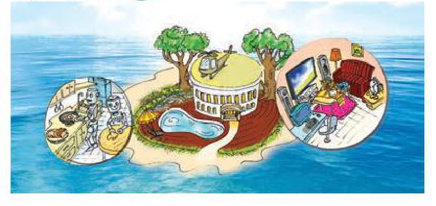
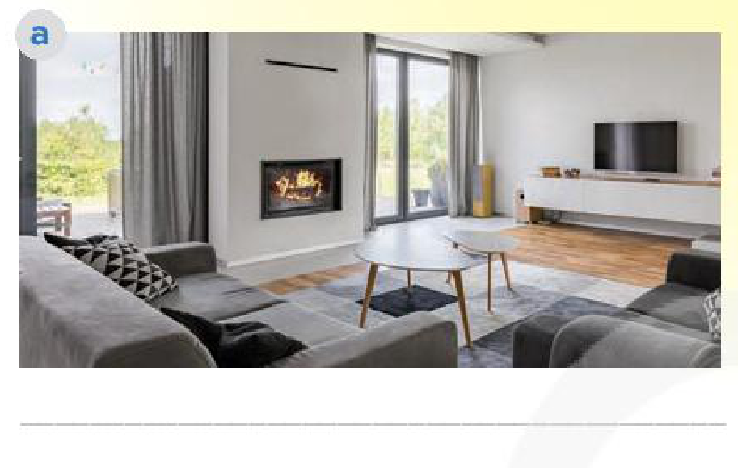
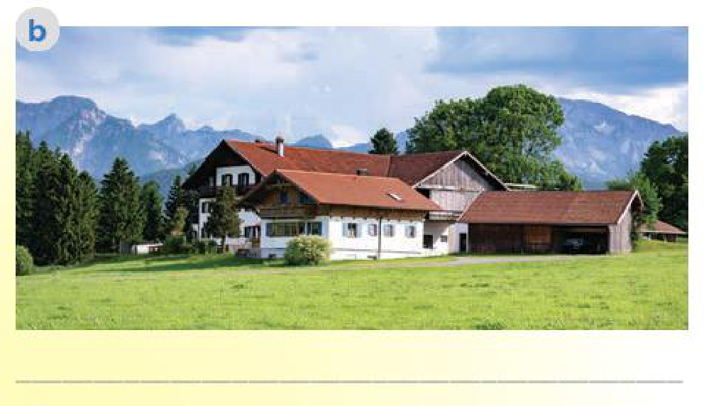
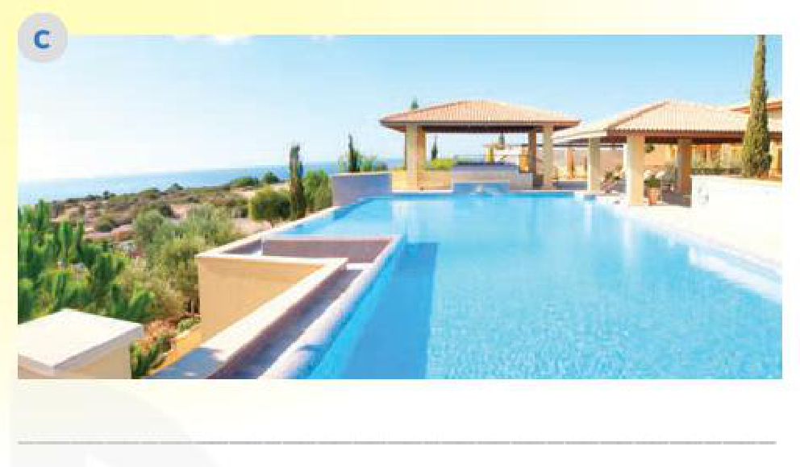
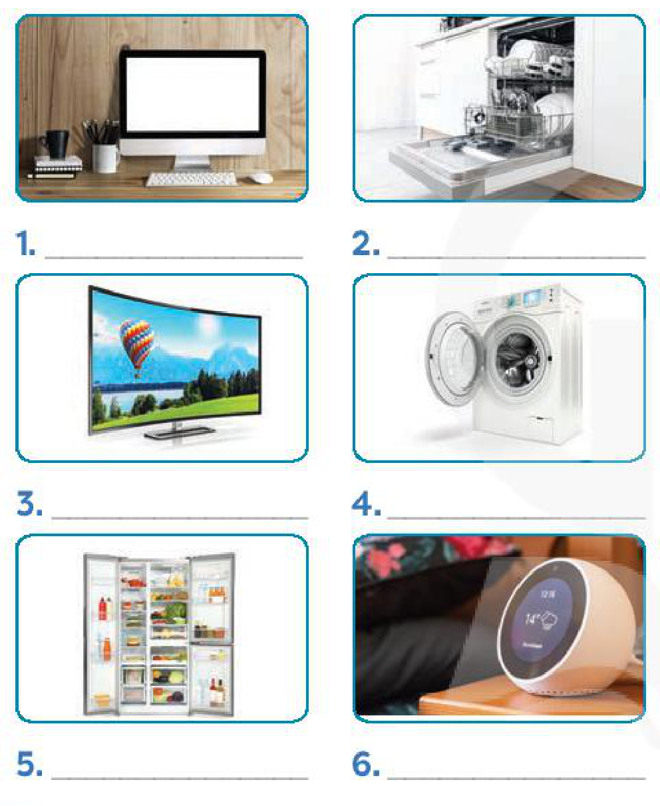

<!-- pdf:39 -->

# UNIT 10: OUR HOUSES IN THE FUTURE

> **THIS UNIT INCLUDES:**
> - **Vocabulary:** Types of houses and appliances in the house
> - **Pronunciation:** Stress in two-syllable words
> - **Grammar:**
>   - Future simple
>   - *Might* for future possibility
> - **Skills:**
>   - Reading about houses and appliances in the future
>   - Talking about different houses in the future
>   - Listening about dream houses
>   - Writing a paragraph about a dream house
> - **Everyday English:** Expressing surprise

## GETTING STARTED

**My future house**

**1. Listen and read.**

**Nick:** What are you doing, Phong?

**Phong:** I'm painting a picture of my house.

**Nick:** Your house! That's a **UFO**.

**Phong:** It looks like a UFO but it's my house in the future.

**Nick:** Where will it be?

**Phong:** It'll be in the mountains.

**Nick:** What will it be like?

**Phong:** It'll be a large house. It'll have twenty rooms.

**Nick:** Twenty rooms!

**Phong:** Yes, and it'll have **solar energy**.

**Nick:** Fantastic! Which room will you like best?

**Phong:** My bedroom, of course.

**Nick:** What **appliances** might the house have?

**Phong:** My house might have some smart TVs and ten robots.

**Nick:** Sounds great! And how much will ...

<!-- pdf:40 -->

**2. Read the conversation again. Find and write down the words or phrases that show:**

- **Type** of house: \_\_\_\_\_\_\_
- **Location**: \_\_\_\_\_\_\_
- **Appliances** in the house: \_\_\_\_\_\_\_

**3. Read the conversation again. Tick (✓) T (True) or F (False).**

| | T | F |
| --- | --- | --- |
| 1. Phong's house will be in the mountains. | | |
| 2. His house will be large. | | |
| 3. There'll be a lot of rooms in his house. | | |
| 4. He might have a smart TV and five robots. | | |

**4. Order the words to make a phrase about a place. Each group has one extra word.**

*Example:* ocean / in / on / the → in the **ocean**

1. sea / a / by / the → \_\_\_\_\_\_\_
2. on / in / the / city → \_\_\_\_\_\_\_
3. the / in / at / town → \_\_\_\_\_\_\_
4. the / on / in / mountains → \_\_\_\_\_\_\_
5. countryside / a / the / in → \_\_\_\_\_\_\_
6. Moon / in / the / on → \_\_\_\_\_\_\_
7. in / at / the / sky → \_\_\_\_\_\_\_

**5. In groups, describe to your classmates what you can see outside the window of your future house. Your group tries to guess where your house is.**

In groups, describe to your classmates what you can see **outside** the window of your future house. Your group tries to guess where your house is.

*Example:*

**A:** Outside my window I can see the beach and the water. Where's my house?

**B:** It's by the sea.

**A:** Correct!

<!-- pdf:41 -->

## A CLOSER LOOK 1

### Vocabulary

**1. Listen and repeat the words / phrases in the box. Then put them in the appropriate columns. You may use some more than once.**

| **electric cooker** | **dishwasher** |
| --- | --- |
| **washing machine** | **wireless** TV |
| fridge | electric fan |
| computer | smart clock |
<!-- ocr-ok: đã đối chiếu ảnh trang gốc, dòng đầu hộp từ vựng electric cooker và dishwasher bị OCR bỏ sót -->

| living room | bedroom | kitchen |
| --- | --- | --- |
| | | |

**2. Match the appliances in A with what they can help us to do in B.**

| A | B |
| --- | --- |
| 1. **electric cooker** | a. receive and send emails |
| 2. **dishwasher** | b. keep food fresh |
| 3. fridge | c. cook rice |
| 4. **washing machine** | d. wash and **dry** dishes |
| 5. computer | e. wash and **dry** clothes |

**3. Work in pairs. Ask and answer questions about appliances, using the information in 2.**

*Example:*

**A:** What can an **electric cooker** help us to do?

**B:** It can help us to cook rice.

### Pronunciation

**Stress in two-syllable words**
<!-- ocr-ok: đã đối chiếu ảnh trang gốc, dòng tiêu đề phụ Stress in two-syllable words dưới mục Pronunciation bị OCR bỏ sót -->

**4. Listen and repeat the words.**

| | | |
| --- | --- | --- |
| 'picture | 'robot | 'bedroom |
| 'kitchen | '**housework** | 'palace |
| 'village | 'mountains | |

**5. Listen and repeat the sentences. Pay attention to the stress of the underlined words.**

1. The *picture* is on the wall of the *bedroom*.
2. The *robot* helps me to do the **housework**.
3. There's a very big *kitchen* in the *palace*.
4. Their *village* is in the *mountains*.

<!-- pdf:42 -->

## A CLOSER LOOK 2

### Grammar

**The future simple**

**Remember!**

We use the future simple to talk about an action that happens in the future.
*Example:*
- My father *will travel* on the Moon in a **super** car in the future.
- We*'ll live* in that **cottage** next year. (*'ll* is the short form of *will*)
- We *won't live* in that cottage anytime soon. (*won't* is the short form of *will not*)
- *Will* they *live* on the Moon?
  Yes, they *will*.
  No, they *won't*.
<!-- term: Future simple -->

**1. Fill the blanks with *will ('ll)* or *won't* to make the sentences true for you.**

*Example:*

I think I*'ll* listen to music in the afternoon.

1. I think I \_\_\_\_\_\_\_ stay at home tonight.
2. My friends \_\_\_\_\_\_\_ go to the library this afternoon.
3. My mum \_\_\_\_\_\_\_ make a cake today.
4. I \_\_\_\_\_\_\_ have an English test tomorrow.
5. Our family \_\_\_\_\_\_\_ move to the new house next week.
<!-- ocr-ok: đã đối chiếu ảnh trang gốc, OCR đọc dính chữ Ithinkl stayathometonight, Ourfamiy và bỏ sót tomorrow -->

**2. Complete the conversation with *will ('ll)* or *won't*.**

**A:** Oh, no. The dog ran away again!
**B:** Don't worry – he (1) \_\_\_\_\_\_\_ come back.
**A:** Are you sure he (2) \_\_\_\_\_\_\_?
**B:** OK, he might not come back today. But I'm sure he (3) \_\_\_\_\_\_\_ come back tomorrow.
**A:** I don't believe you! He (4) \_\_\_\_\_\_\_ come back. We (5) \_\_\_\_\_\_\_ never see him again. I'm sure.
**B:** Oh, look ... Here he is!
<!-- ocr-ok: đã đối chiếu ảnh trang gốc, OCR đọc nhầm Oh, no. The dog ran away again! thành AO, ne. The doy ranaway again và dính chữ Areyousurehe -->

**3. Write sentences, using *will ('ll)* or *won't* and the words / phrases given.**

1. computer / do / housework
2. robot / water / flowers
3. smart TV / cook / meals
4. **washing machine** / iron / clothes
5. smartphone / take care / children

<!-- pdf:43 -->

*Might for future possibility*

**Remember!**

We use *might + V* to talk about actions that are possible in the future (we are not sure if they will happen or not).
*Example:*
- We *might live* in a **UFO**.
- They *might not travel* in cars.
<!-- term: Might for future possibility -->

**4. Read the two poems. Tick (✓) T (True) or F (False).**

**In the future**
We might go on holiday to the Moon.
We might stay there for a long time.
We might have a great time.
We might come home soon.
*Henry, aged 11*

**In the future**
We might live with robots.
They might clean our houses.
They might wash our clothes.
They might not talk to us.
*Jenny, aged 12*

| | T | F |
| --- | --- | --- |
| 1. Jenny thinks we might live with robots. | | |
| 2. Henry thinks we might travel to the Moon. | | |
| 3. Jenny thinks robots might not clean our houses. | | |
| 4. Henry thinks we will stay on the Moon for a short time. | | |
| 5. Jenny thinks robots might help us to do the housework. | | |
| 6. Henry thinks we might not have a great time on the Moon. | | |

**5. Work in groups. Think about what you might do or have in the future. Share your ideas with your classmates.**

*Example:*

I might have a smartphone to surf the internet.

<!-- pdf:44 -->

## COMMUNICATION

### Everyday English

**Expressing surprise**

**1. Listen and read the conversation. Pay attention to the highlighted sentences.**

**David:** John! Hello!

**John:** Oh, hi, David. *Wow! Is that your computer? It looks great!*

**David:** Yes, it's my new computer. My parents gave it to me for my birthday.

**2. Work in pairs. Express your surprise when you see your partner's new watch, TV, mobile phone, etc.**

**Houses and appliances in the future**

**3. Read the questions in the class survey below. Tick (✓) Y (Yes) or N (No).**

| | Y | N |
| --- | --- | --- |
| 1. Will you live in a **hi-tech** house? | | |
| 2. Will your house be in **space**? | | |
| 3. Will you have a lot of trees and flowers around your house? | | |
| 4. Will you have a fridge that can cook your meals? | | |
| 5. Will you have a robot that can **look after** your children? | | |
| 6. Will you have a car that can fly? | | |

**4. Work in pairs. Use the questions in 3 to interview your partner.**

*Example:*

**You:** Hi, Nam. Will you live in a **hi-tech** house in the future?

**Nam:** Yes, I will.

**You:** Will your house be in **space**?

**Nam:** Oh, no. It won't.

**You:** So where will it be?

**Nam:** I'm not sure. It might be by the sea.

**5. Tell the class about your interview.**

*Example:*

In the future, Nam will live in a hi-tech house.
It won't be in space. It might be by the sea.
He might have a robot to help him with his housework.

<!-- pdf:45 -->

## SKILLS 1

### Reading

**1. Look at the picture and discuss the questions with a partner.**

1. What **type** of house do you think it is?
2. Where do you think the house is?

**2. Read the text and match the beginnings in A with the endings in B.**

My future house will be on an island. It will be surrounded by tall trees and the blue sea. There will be a swimming pool in front of the house. There will be a **helicopter** on the roof. I can fly to school in it.

There will be some robots in the house. They will help me to clean the floors, cook meals, wash clothes and water the flowers. They will also help me to feed the dogs and cats.

There will be a **super** smart TV. It will help me to send and receive emails, and contact my friends on other planets. It will also help me to buy food from the supermarket.
<!-- term: smart TV -->

| A | B |
| --- | --- |
| 1. The house will have robots to | a. clean the floors. b. contact my friends. c. wash clothes. d. buy food from the supermarket. |
| 2. The house will have a super smart TV to | e. cook meals. f. send and receive emails. g. feed the dogs and cats. h. water the flowers. |

**3. Read the text again and circle the option (A, B, or C) to complete the sentences.**

1. The house will be \_\_\_\_\_\_\_.
   A. in the mountains   B. on an island   C. on the Moon
2. There will be a \_\_\_\_\_\_\_ in front of the house.
   A. garden   B. pond   C. swimming pool
3. The house will have \_\_\_\_\_\_\_ robots.
   A. many   B. some   C. a lot of
4. The \_\_\_\_\_\_\_ will help me to feed the dogs and cats.
   A. helicopter   B. robot   C. super smart TV

### Speaking

**4. Work in pairs. Ask your partner about his / her future house. Use the suggested questions.**

1. What type of future house do you think it will be?
2. Where will it be?
3. What will it look like?
4. How many rooms will it have?
5. What appliances will it have and what will they help you to do?

*Example:*

**A:** What type of future house do you think it will be?

**B:** It'll be a palace.

**5. Work in groups. Tell your partners about your future house. You can use the information in 4.**

*Example:*

My future house will be a palace.
It'll be on the Moon.
There'll be a super smart TV in the house.
It'll help me to talk to my friends on other planets.

<!-- pdf:46 -->

## SKILLS 2

### Listening

**1. Listen to Nick and Linda talking about their dream houses. Which house would each prefer? Write their names under the correct pictures.**
<!-- term: dream house -->

a. \_\_\_\_\_\_\_   b. \_\_\_\_\_\_\_   c. \_\_\_\_\_\_\_

**2. Listen to the conversation again. What is important to Linda? What is important to Nick? Tick (✓) the columns.**

| | Linda | Nick |
| --- | --- | --- |
| 1. park view | | |
| 2. city view | | |
| 3. sea view | | |
| 4. swimming pool | | |
| 5. garden | | |
<!-- ocr-ok: đã đối chiếu ảnh trang gốc, bảng kiểm tra Listening có cột Nick và số thứ tự 1-5 bị OCR bỏ sót -->

**3. Listen again and answer the questions about their dream houses.**

1. What type of house does Linda have?
2. Where is her house?
3. What is around her house?
4. What type of house does Nick have?
5. Where is it?

### Writing

**4. Work in pairs. Discuss your dream house and fill the table.**

*Example:*

**A:** What type of dream house is it?

**B:** It's a palace.

**A:** Where is it?

**B:** It's in the mountains.

...

| | |
| --- | --- |
| Type of house: | *palace* |
| Location: | *in the mountains* |
| Number of rooms: | \_\_\_\_\_\_\_ |
| Appliances in the house: | \_\_\_\_\_\_\_ |

**5. Use the information in 4 to write a paragraph of about 50 words about your dream house.**

*Example:*

My dream house is a big palace. It is in the mountains. \_\_\_\_\_\_\_
<!-- term: dream house -->

<!-- pdf:47 -->

## LOOKING BACK

### Vocabulary

**1. Write the words / phrases under the correct pictures.**

Write the words / phrases under the correct pictures: computer, fridge, smart clock, **dishwasher**, **wireless** TV, **washing machine**.
<!-- term: wireless TV -->
<!-- term: smart clock -->

1. \_\_\_\_\_\_\_   2. \_\_\_\_\_\_\_   3. \_\_\_\_\_\_\_   4. \_\_\_\_\_\_\_   5. \_\_\_\_\_\_\_   6. \_\_\_\_\_\_\_
<!-- ocr-ok: đã đối chiếu ảnh trang gốc, các số thứ tự 1-6 đi kèm đường kẻ trống dưới ảnh -->

**2. Think about what the appliances will do in the future. Fill the table.**

| | |
| --- | --- |
| 1. robots | *look after the house* |
| 2. **washing machines** | |
| 3. **wireless** TVs | |
| 4. **super** cars | |
| 5. smart clocks | |
| 6. **dishwashers** | |
| | **look after** |
<!-- ocr-ok: đã đối chiếu ảnh trang gốc, bảng 2 cột ôn tập chức năng của các thiết bị tương lai -->

### Grammar

**3. Complete the sentences with *will ('ll)* or *won't*.**

1. Tomorrow is Sunday, so I \_\_\_\_\_\_\_ have to get up early.
2. When I see Tom tomorrow, I \_\_\_\_\_\_\_ invite him to our party.
3. You must meet Anna. I am sure you \_\_\_\_\_\_\_ like her.
4. We \_\_\_\_\_\_\_ start our dinner until Jack arrives.
5. I \_\_\_\_\_\_\_ phone you when I get home from school.
6. Tony \_\_\_\_\_\_\_ pass his examination. He hasn't studied yet.
<!-- ocr-ok: đã đối chiếu ảnh trang gốc, OCR đọc tách dòng câu 2 sang cột trái và đọc dính chữ phoneyou -->

**4. Complete the sentences with *might* or *might not*.**

1. I am still not sure where to go for my holiday. I \_\_\_\_\_\_\_ go to Da Lat.
2. The weather is not very good. It \_\_\_\_\_\_\_ rain this afternoon.
3. There \_\_\_\_\_\_\_ be a meeting on Friday because the teacher is ill.
4. Ann \_\_\_\_\_\_\_ come to the party tonight because she is busy.
5. Phong is thinking about what he will do on Sunday. He \_\_\_\_\_\_\_ go to a judo club, or he \_\_\_\_\_\_\_ stay at home and study English.

<!-- pdf:48 -->

## PROJECT

**My future appliance**

1. Think about an **appliance** you would like to have in the future.
2. Make a poster for your future appliance.
3. Write details about the appliance on the poster.
4. Share your poster with your class.

*Example:*

I'll have a robot. It'll help me to water the flowers in the garden.
<!-- ocr-ok: đã đối chiếu ảnh trang gốc, chữ mẫu trên áp phích dự án bị nghiêng khiến OCR đọc nhầm I'll và It'll -->

### Now I can ...

- use the words related to **types** of houses and **appliances** in the house.
- pronounce the two-syllable words correctly.
- use the future simple and *might* for future possibility.
- express surprise.
- read about houses and appliances in the future.
- talk about different houses in the future.
- listen about dream houses.
- write a paragraph about a dream house.

## 📷 Danh mục hình minh hoạ

| Mã hình | Trang PDF | Trang sách | Chú thích / Mô tả |
| --- | --- | --- | --- |
| H6-tieng_anh-u10-01 | 45 | 44 | Tranh minh hoạ ngôi nhà tương lai trên đảo xanh có bể bơi phía trước, máy bay trực thăng trên mái nhà, rô-bốt làm việc trong bếp và tivi siêu thông minh |
| H6-tieng_anh-u10-02 | 46 | 45 | Ảnh (a) mục Listening: phòng khách căn hộ hiện đại có tầm nhìn ra công viên/thành phố qua khung cửa kính lớn |
| H6-tieng_anh-u10-03 | 46 | 45 | Ảnh (b) mục Listening: ngôi nhà lớn mái ngói nằm giữa bãi cỏ xanh dưới chân dãy núi |
| H6-tieng_anh-u10-04 | 46 | 45 | Ảnh (c) mục Listening: biệt thự nghỉ dưỡng có bể bơi rộng hướng thẳng ra biển xanh |
| H6-tieng_anh-u10-05 | 47 | 46 | Sáu bức ảnh thiết bị gia dụng phần Looking Back: (1) *computer* (máy tính), (2) *dishwasher* (máy rửa bát), (3) *wireless TV* (tivi không dây), (4) *washing machine* (máy giặt), (5) *fridge* (tủ lạnh), (6) *smart clock* (đồng hồ thông minh) |
