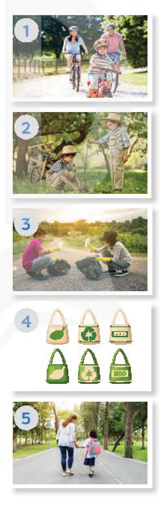
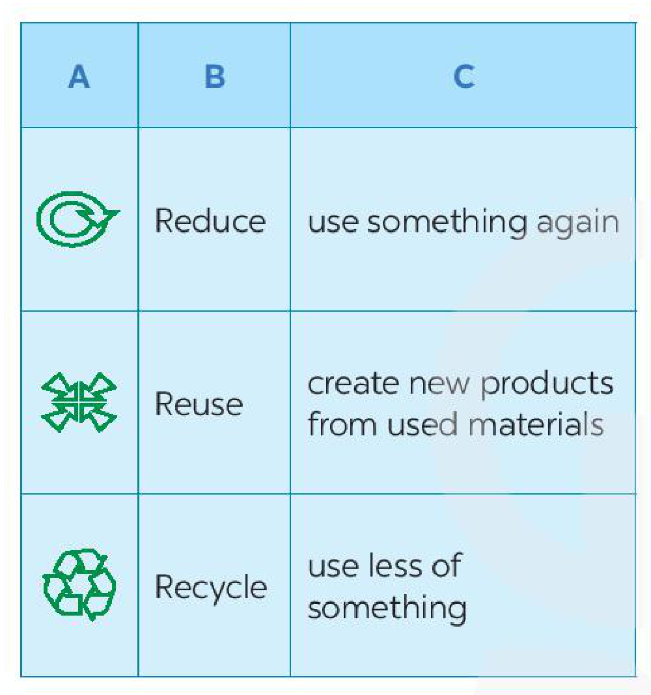
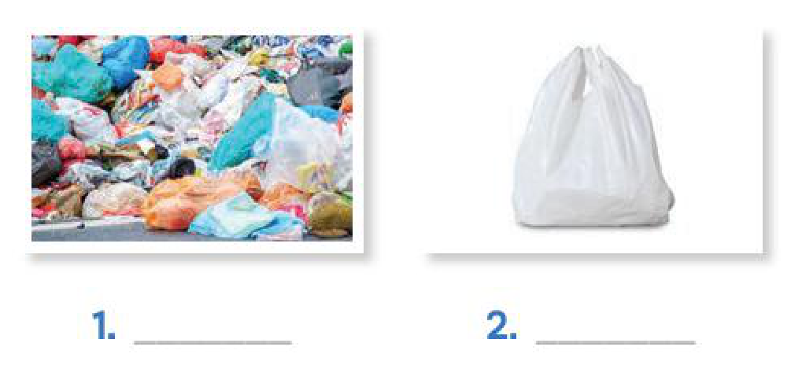
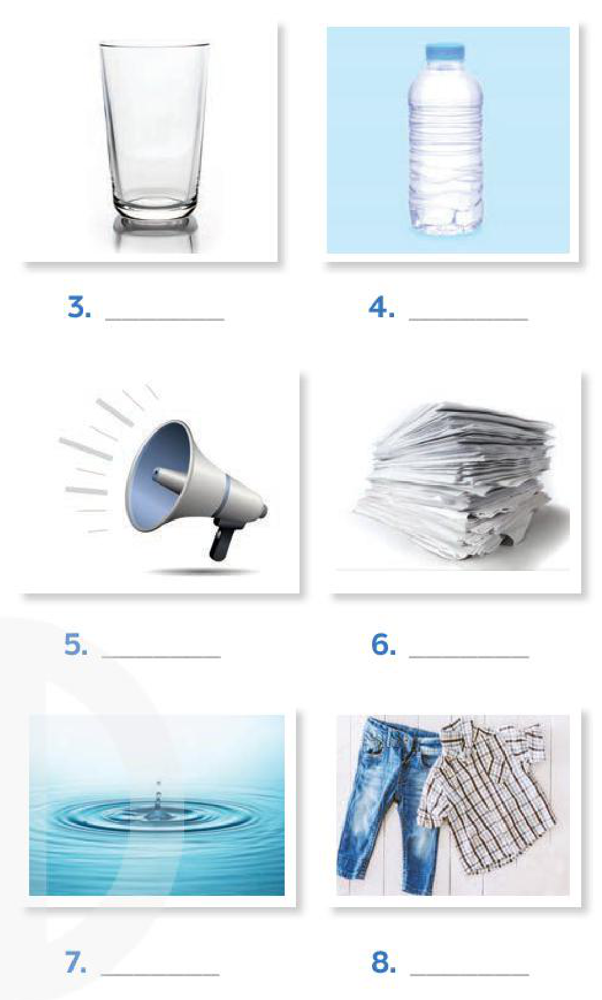
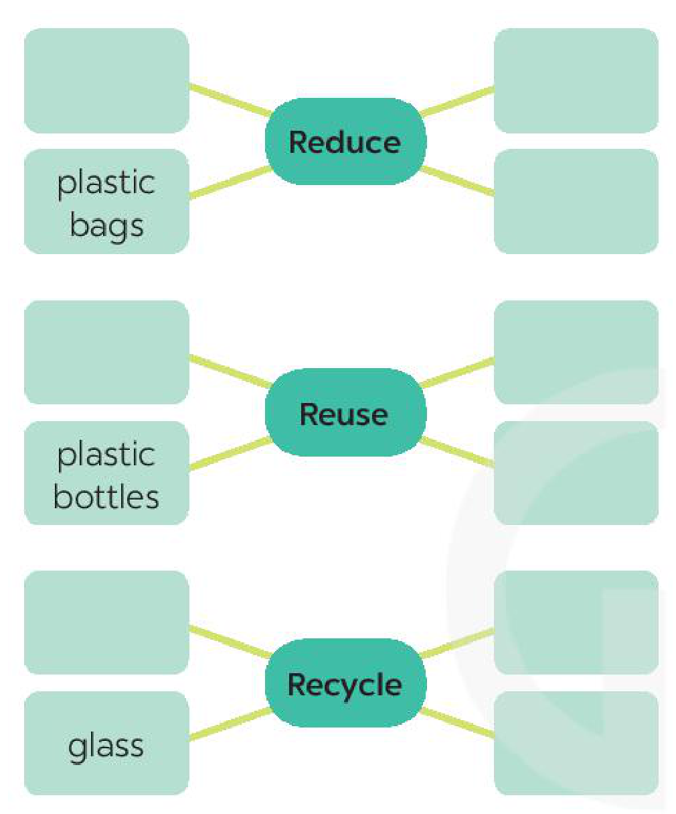
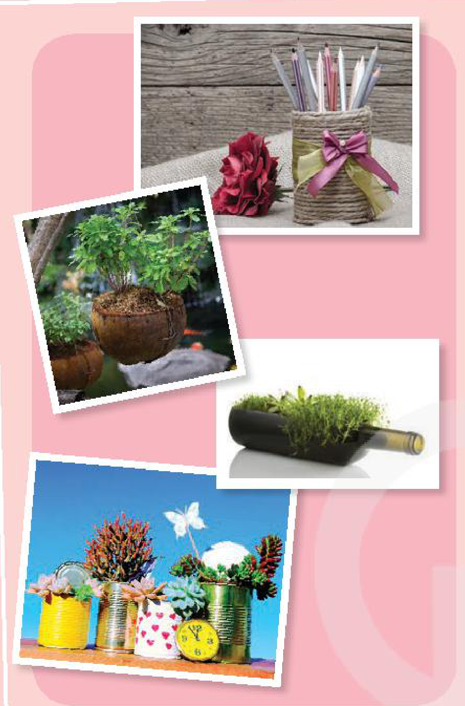

<!-- pdf:49 -->

# UNIT 11: OUR GREENER WORLD

> **THIS UNIT INCLUDES:**
> - **Vocabulary:** Things that can be reduced, reused and recycled
> - **Pronunciation:** Rhythm in sentences
> - **Grammar:**
>   - Articles
>   - First conditional
> - **Skills:**
>   - Reading about ways to go green
>   - Talking about tips for going green
>   - Listening about ideas for a green club
>   - Writing a paragraph about ideas for a green club
> - **Everyday English:** Giving warnings

## GETTING STARTED

**Let's go green!**

**1. Listen and read.**

**Mi:** Hi, Nick.

**Nick:** Hello, Mi.

**Mi:** You've bought a lot of things.

**Nick:** Yes. We're going on a picnic tomorrow. What are you doing at the supermarket, Mi?

**Mi:** I'm buying some eggs. Hey, what's this?

**Nick:** It's a **reusable** shopping bag.

**Mi:** Do you always use it?

**Nick:** Yes. It's better than a plastic one. If we all use this kind of bag, we will help the **environment**.

**Mi:** I see. I'll buy one for my mum. Where can I buy one?

**Nick:** At the check-out. By the way, you're also green. You're cycling.
<!-- term: check-out -->

**Mi:** You're right. If more people cycle, the air will be cleaner. Right?

**Nick:** Yes. Oh, it's 5 o'clock already. I have to go now. See you later.

**Mi:** See you, Nick. Bye.

<!-- pdf:50 -->

**2. Read the conversation again. Complete the following sentences. Use no more than three words in each blank.**

1. Nick is going on \_\_\_\_\_\_\_ tomorrow.
2. The green shopping bag is better than the \_\_\_\_\_\_\_.
3. People can buy green bags at \_\_\_\_\_\_\_.
4. Mi wants to buy \_\_\_\_\_\_\_ bag for her mum.
5. Nick thinks that Mi is green because \_\_\_\_\_\_\_.

**3. Based on the ideas in the conversation, match the first half of the sentence in column A with its second half in column B.**

| A | B |
| --- | --- |
| 1. Green bags are better | a. they will help the environment. |
| 2. The air will be cleaner | b. than plastic bags. |
| 3. If people use reusable bags for shopping, | c. if more people cycle. |
<!-- term: plastic bag -->
<!-- ocr-ok: đã đối chiếu ảnh trang gốc, OCR đọc nhầm bảng hai cột A-B bài 3 (5.lfpeople, Ear shopping) -->

**4. Match the pictures with the ways to help the environment.**

- a. planting trees and flowers
- b. **picking up** **rubbish**
- c. cycling
- d. walking to school
- e. using **reusable** bags when shopping

**5. GAME: Find someone who ...**
<!-- ocr-ok: đã đối chiếu ảnh trang gốc, chữ GAME nằm trong các ô màu trang trí nên OCR không nhận diện được -->

**Work in groups. Ask and answer to find someone who does the things in 4.**

**A:** Do you plant trees?

**B:** No, I don't.
<!-- ocr-ok: đã đối chiếu ảnh trang gốc, OCR đọc nhầm đại từ I thành dấu gạch đứng | -->

**A:** Do you **pick up** **rubbish**?

**B:** Yes, I do.

<!-- pdf:51 -->

## A CLOSER LOOK 1

### Vocabulary

**1. The three Rs stand for Reduce – Reuse – Recycle. Draw a line from a symbol in column A to its matching word in column B and its meaning in column C.**
<!-- term: 3Rs -->

| A | B | C |
| --- | --- | --- |
| *(biểu tượng mũi tên vòng tròn)* | **Reduce** | use something again |
| *(biểu tượng bốn mũi tên)* | **Reuse** | create new products from used materials |
| *(biểu tượng ba mũi tên tam giác)* | **Recycle** | use less of something |
<!-- ocr-ok: đã đối chiếu ảnh trang gốc, cột A là 3 biểu tượng đồ hoạ của 3Rs nên OCR đọc sai kí tự -->

**2. Write a word / phrase in the box under each picture.**

| **rubbish** | plastic bottle | glass |
| --- | --- | --- |
| noise | plastic bag | paper |
| water | clothes | |
<!-- term: plastic bottle -->
<!-- term: plastic bag -->

1. \_\_\_\_\_\_\_
2. \_\_\_\_\_\_\_
3. \_\_\_\_\_\_\_
4. \_\_\_\_\_\_\_
5. \_\_\_\_\_\_\_
6. \_\_\_\_\_\_\_
7. \_\_\_\_\_\_\_
8. \_\_\_\_\_\_\_
<!-- ocr-ok: đã đối chiếu ảnh trang gốc, các chỗ trống 1-8 nằm dưới từng hình minh hoạ -->

**3. Work in pairs. Put the words / phrases from 2 into groups. Some words / phrases can belong to more than one group.**

| Reduce | Reuse | Recycle |
| --- | --- | --- |
| | | |

**Can you add more words / phrases to each group?**

<!-- pdf:52 -->

### Pronunciation

*Rhythm in sentences*

> In a sentence, the stressed and unstressed syllables combine to make rhythm.

**4. Listen to these sentences, then repeat. Pay attention to the bold syllables.**

1. If you *cy*cle, it'll *help* the *Earth*.
2. *Wa*ter is *good* for your *bo*dy.
3. The *stu*dents are *plan*ting *trees* in the *gar*den.
4. Is it *bet*ter to *use* *pa*per *bags*?
5. We are *hap*py to *walk* to *school*.
<!-- ocr-ok: đã đối chiếu ảnh trang gốc, các âm tiết mang trọng âm được đánh dấu in nghiêng -->

**5. Listen to the conversation. Pay attention to the bold syllables. Then practise the conversation with a classmate.**

**Vy:** *What* are you *do*ing?
<!-- ocr-ok: đã đối chiếu ảnh trang gốc, các âm tiết mang trọng âm được đánh dấu in nghiêng -->

**Mi:** I'm *wri*ting an *ar*ticle about **going green**.
<!-- ocr-ok: đã đối chiếu ảnh trang gốc, các âm tiết mang trọng âm được đánh dấu in nghiêng -->

**Vy:** *Great*! I'm *wri*ting a *po*em about the *3Rs*.
<!-- term: 3Rs -->
<!-- ocr-ok: đã đối chiếu ảnh trang gốc, các âm tiết mang trọng âm được đánh dấu in nghiêng -->

**Mi:** *Let* me *read* it.

**Vy:** I'm *still* *wri*ting. *Wait* for a *mi*nute.
<!-- ocr-ok: đã đối chiếu ảnh trang gốc, các âm tiết mang trọng âm được đánh dấu in nghiêng -->

## A CLOSER LOOK 2

### Grammar

*Articles*

**Remember!**

> There are two kinds of articles in English: the indefinite article (a / an) and the definite article (the).
>
> **We use *a / an*:**
> - with singular countable nouns when we are talking about them in general.
>   *Example:* *An* ant is *a* tiny animal.
> - after the verbs *to be* and *to have*.
>   *Example:* I'm *a* student. / I have *an* eraser.
>
> **We use *the*:**
> - with singular or plural nouns when we already know them or when they are mentioned for the second time.
>   *Example:* *The* bike in front of her house is nice.
> - with nouns which are unique.
>   *Example:* *The* air is dirty.
<!-- term: Articles -->

**1. Write *a* or *an*.**
<!-- ocr-ok: đã đối chiếu ảnh trang gốc, OCR đọc dính aor -->

1. \_\_\_\_\_\_\_ egg
2. \_\_\_\_\_\_\_ friend
3. \_\_\_\_\_\_\_ sink
4. \_\_\_\_\_\_\_ arm
5. \_\_\_\_\_\_\_ mouth
6. \_\_\_\_\_\_\_ onion
7. \_\_\_\_\_\_\_ umbrella
8. \_\_\_\_\_\_\_ classmate
<!-- ocr-ok: đã đối chiếu ảnh trang gốc, OCR không nhận diện được số thứ tự 1-8 của bài tập -->

<!-- pdf:53 -->

**2. Write *a* / *an* or *the*.**

1. My father is \_\_\_\_\_\_\_ doctor.
2. \_\_\_\_\_\_\_ Sun keeps \_\_\_\_\_\_\_ Earth warm.
3. \_\_\_\_\_\_\_ dolphin is \_\_\_\_\_\_\_ intelligent animal.
4. I have \_\_\_\_\_\_\_ orange shirt too.
5. My brother likes \_\_\_\_\_\_\_ blue pen, not \_\_\_\_\_\_\_ red one.
<!-- ocr-ok: đã đối chiếu ảnh trang gốc, OCR đọc nhầm intelligent animal ở câu 3 -->

*First conditional*

> First conditional sentences describe things which are possible and likely to happen in the present or the future.
> - *If*-clause: If + subject + V (present simple),
> - main clause: subject + will / won't + V (base form)
>
> *Example:* If you *use* less paper, you *will save* a lot of trees.
<!-- term: First conditional -->

**3. Write the correct form of each verb in brackets.**

1. If it (be) \_\_\_\_\_\_\_ sunny next week, we (go) \_\_\_\_\_\_\_ on a picnic.
2. If we (recycle) \_\_\_\_\_\_\_ more, we (help) \_\_\_\_\_\_\_ the Earth.
3. We (save) \_\_\_\_\_\_\_ a lot of trees if we (not waste) \_\_\_\_\_\_\_ so much paper.
4. More people (have) \_\_\_\_\_\_\_ fresh water if we (use) \_\_\_\_\_\_\_ less water.
5. If the river (not be) \_\_\_\_\_\_\_ dirty, there (be) \_\_\_\_\_\_\_ more fish.
<!-- ocr-ok: đã đối chiếu ảnh trang gốc, OCR đọc nhầm (be) thành (oe), (go) thành (@o) và dính chữ quanh chỗ trống -->

**4. Combine each pair of sentences below to make a first conditional sentence.**
<!-- ocr-ok: đã đối chiếu ảnh trang gốc, OCR đọc dính tomakeafirstconditional -->

1. The air isn't fresh. People cough.
2. The water is dirty. A lot of fish die.
3. We cut down trees in the forest. There are more floods.
4. There is too much noise. People don't sleep.
5. There is no water. Plants die.

**5. GAME: Fun matching**

**Work in groups, A and B.**

Group A secretly writes five *if*-clauses on a sheet of paper.

Group B secretly writes five main clauses on another sheet of paper.

Match the *if*-clauses with the main clauses.

Do they match? Are there any funny sentences?

<!-- pdf:54 -->

## COMMUNICATION

### Everyday English

*Giving warnings*

**1. Listen and read the dialogue between Mi and Mike. Pay attention to the highlighted sentences.**

**Mi:** You are giving the goldfish too much food. *Don't do that.*

**Mike:** Why?

**Mi:** *If you give them too much food, they will die.*

**Mike:** I see. Thank you.
<!-- ocr-ok: đã đối chiếu ảnh trang gốc, OCR đọc nhầm đại từ I thành dấu gạch đứng | -->

**2. Work in pairs. Student A is watering flowers in the garden. Student B is giving some warnings. Act out the dialogue. Remember to use the highlighted language in 1.**
<!-- term: give warnings -->

**A survey on ways to go green**

3. The 3Rs Club in your school is **doing a survey**. Answer the following questions by choosing A, B, or C.

**3Rs Club SURVEY: How Green Are You?**

> 1. If you find a beautiful old glass, you will \_\_\_\_\_\_\_.
> - A. throw it away
> - B. decorate it
> - C. use it to keep pencils in
>
> 2. If you have a sheet of paper, how often will you write on both sides?
> - A. Sometimes.
> - B. Never.
> - C. Always.
>
> 3. If you bring your lunch to school, you will \_\_\_\_\_\_\_.
> - A. **wrap** the food in paper
> - B. put the food in a **reusable** box
> - C. **wrap** the food in a plastic bag
>
> 4. If you have old clothes, how often will you give them to those **in need**?
> - A. Sometimes.
> - B. Never.
> - C. Always.
>
> 5. If it's hot in your room, you will \_\_\_\_\_\_\_.
> - A. open the fridge and stand in front of it
> - B. go outside and enjoy the breeze
> - C. turn on both the fan and the air conditioner
>
> 6. If your school is one kilometre from your home, you will \_\_\_\_\_\_\_.
> - A. walk
> - B. ask your parent to drive you
> - C. cycle
<!-- term: plastic bag -->
<!-- ocr-ok: đã đối chiếu ảnh trang gốc, phiếu khảo sát trình bày 2 cột khiến OCR trộn thứ tự các câu 1-6 -->

**Check your answers with the key on page 57, count the points and see how green you are.**

**4. Interview a classmate, using the questions in 3. Compare your answers. How many different answers do you have?**

*Example:*

**A:** What's your answer to Question 1?

**B:** It's A. What's your answer?

...

<!-- pdf:55 -->

## SKILLS 1

### Reading

**1. A reporter is interviewing Nam, a member of the 3Rs Club. Read the interview. Find these words and phrases and underline them.**

| **instead of** | **exchange** | |
| --- | --- | --- |
| **recycling bins** | **reusable** | **charity** |
<!-- ocr-ok: đã đối chiếu ảnh trang gốc, khung từ vựng 5 mục đầu bài Reading -->

**Reporter:** Can you share with us some **tips** to make your school greener?

**Nam:** Sure. Firstly, we put **recycling bins** in every classroom.

**Reporter:** What about old books and uniforms?

**Nam:** We **exchange** them with our friends or give them to **charity**. We don't throw them away.
<!-- term: throw away -->

**Reporter:** Anything else?

**Nam:** We borrow books from the school library **instead of** buying new ones.

**Reporter:** Great! You can save much paper.

**Nam:** And there's another **tip**. We bring **reusable** water bottles to school.

**Reporter:** I see lots of trees in your school. Is planting trees a good **tip**?

**Nam:** Yeah. It makes our school greener.

**Reporter:** Thanks for sharing. Do you want to add anything?

**Nam:** Finally, we usually find creative ways to **reuse** old items before throwing them away.
<!-- term: throw away -->

...

**2. Match the words / phrases with their meanings.**

| | |
| --- | --- |
| 1. **instead of** | a. give something to a person and receive something from him / her |
| 2. **charity** | b. can be used again |
| 3. **exchange** | c. **containers** for things that can be recycled |
| 4. **reusable** | d. giving things to people **in need** |
| 5. **recycling bins** | e. in the place of somebody or something |

**3. Read the text again. Answer the questions.**

1. What is the interview about?
2. What will they put in every classroom?
3. What can they do with their old uniforms?
4. What do they do instead of buying new books?
5. What type of water bottles do they bring to school?

### Speaking

**4. Nam mentions the following tips in the interview. Work in groups and discuss to put the tips in order from the easiest to the most difficult.**

- [ ] a. Putting recycling bins in every classroom.
- [ ] b. Exchanging old books and uniforms with friends or giving them to charity.
- [ ] c. Borrowing books from the school library instead of buying new ones.
- [ ] d. Bringing reusable water bottles to school.
- [ ] e. Planting trees at school.
- [ ] f. Finding creative ways to reuse old items before throwing them away.

**Can you add more tips to the list?**

**5. Tip f tells you to find creative ways to reuse old items. Can you think of any ways to reuse**

- a. used gift wrap?
- b. used water bottles?
- c. used books?

<!-- pdf:56 -->

## SKILLS 2

### Listening

> **3Rs Club — TIME TO ELECT A NEW PRESIDENT**
> - Are you creative?
> - Do you want our school to be a green place?
> - What will you do if you become our **president**?
> - Raise your voice and become our **president**!!!

1. Listen to two students talking about what they will do if they become the **president** of the 3Rs Club. Fill each blank with a word or a number.

| Name | Mi |
| --- | --- |
| Class | (1) \_\_\_\_\_\_\_ |
| Idea 1 | Putting a (2) \_\_\_\_\_\_\_ bin in every classroom |
| Idea 2 | Having (3) \_\_\_\_\_\_\_ **fairs** |
<!-- ocr-ok: đã đối chiếu ảnh trang gốc, OCR đọc nhầm nhãn Class/Idea trong bảng ghi chú của Mi -->

| Name | Nam |
| --- | --- |
| Class | (4) \_\_\_\_\_\_\_ |
| Idea 1 | Encouraging students to use (5) \_\_\_\_\_\_\_ |
| Idea 2 | Organising (6) \_\_\_\_\_\_\_ **fairs** |
<!-- ocr-ok: đã đối chiếu ảnh trang gốc, OCR đọc nhầm nhãn Class/Idea trong hai bảng ghi chú của Mi và Nam -->

**2. Listen again and tick (✓) T (True) or F (False).**

| | T | F |
| --- | --- | --- |
| 1. Mi thinks they can recycle things in the bins. | | |
| 2. At book **fairs**, students can exchange their old books. | | |
| 3. Nam thinks students will save money if they go to school by bus. | | |
| 4. Students can exchange their used uniforms at uniform **fairs**. | | |

### Writing

**3. Interview a classmate. Ask him / her what two things he / she will do if he / she becomes the president of the 3Rs Club. Take notes below.**

- Name \_\_\_\_\_\_\_
- Idea 1 \_\_\_\_\_\_\_
- Idea 2 \_\_\_\_\_\_\_
<!-- ocr-ok: đã đối chiếu ảnh trang gốc, OCR bỏ sót chữ N trong Name -->

> **Study Skill – Writing:**
>
> Giving explanations and / or examples is an important writing skill.
> You should give explanations and / or examples to support your ideas.
>
> *Example:*
> Secondly, I'll organise some book fairs. At these events students can exchange their used books.

**4. Write a paragraph about your classmate's ideas in 3. Write about 50 words.**

My classmate is \_\_\_\_\_\_\_. If \_\_\_\_\_\_\_ becomes the president of the 3Rs Club, \_\_\_\_\_\_\_ will do two things. Firstly, \_\_\_\_\_\_\_

<!-- pdf:57 -->

## LOOKING BACK

### Vocabulary

**1. Add more words / phrases to the word webs below.**

- **Reduce**: plastic bags, \_\_\_\_\_\_\_, \_\_\_\_\_\_\_, \_\_\_\_\_\_\_
- **Reuse**: plastic bottles, \_\_\_\_\_\_\_, \_\_\_\_\_\_\_, \_\_\_\_\_\_\_
- **Recycle**: glass, \_\_\_\_\_\_\_, \_\_\_\_\_\_\_, \_\_\_\_\_\_\_
<!-- term: plastic bag -->
<!-- term: plastic bottle -->
<!-- ocr-ok: đã đối chiếu ảnh trang gốc, nội dung chép từ sơ đồ mạng từ word webs bài 1 -->

### Grammar

**2. Write *a* / *an* or *the*.**

1. If I see \_\_\_\_\_\_\_ dog, I will run away.
2. Does your town have \_\_\_\_\_\_\_ art gallery?
3. \_\_\_\_\_\_\_ Moon is bright tonight.
4. There is a big temple in the town. \_\_\_\_\_\_\_ temple is very old.
5. – Is your mother \_\_\_\_\_\_\_ teacher?
   – No, she isn't. She's \_\_\_\_\_\_\_ artist.
<!-- ocr-ok: đã đối chiếu ảnh trang gốc, OCR đọc dính chữ quanh chỗ trống (Iflsee, Iwilrun, temple isvery, lsyourmother) -->

**3. Write the correct form of each verb in brackets.**

1. If they (build) \_\_\_\_\_\_\_ an airport here, it (be) \_\_\_\_\_\_\_ very noisy.
2. People (save) \_\_\_\_\_\_\_ the environment if they (reuse) \_\_\_\_\_\_\_ old items.
3. If we (grow) \_\_\_\_\_\_\_ trees, our school (be) \_\_\_\_\_\_\_ greener.
4. If we (not have) \_\_\_\_\_\_\_ enough food, we (be) \_\_\_\_\_\_\_ hungry.
5. If we (be) \_\_\_\_\_\_\_ hungry, we (be) \_\_\_\_\_\_\_ tired.

**4. Combine each pair of sentences below to make a first conditional sentence.**

1. We walk or cycle. We are healthy.
2. We use the car all the time. We make the air dirty.
3. You reuse paper. You save trees.
4. You make noise. Your sister doesn't sleep.
5. I see a used bottle on the road. I put it in the bin.

<!-- pdf:58 -->

## PROJECT

**CREATIVE IDEAS ABOUT REUSING OLD THINGS**

**1. What can you see in each picture? What did people use to make the things in the pictures?**

**2. Now work in pairs or in groups to complete the project.**

- Choose a used object (a bottle, a sheet of paper, etc.).
- Make something new from it and decorate it.
- Bring it to class.
- Do a "show and tell" about it.

**3. Listen to other presentations and decide which is the best.**

> **3Rs Club SURVEY — Answers:**
> - **Q1:** A (0) B (2) C (2)
> - **Q2:** A (1) B (0) C (2)
> - **Q3:** A (0) B (2) C (0)
> - **Q4:** A (1) B (0) C (2)
> - **Q5:** A (0) B (2) C (0)
> - **Q6:** A (2) B (0) C (2)
> - **9 – 12 points:** You're green!
> - **5 – 8 points:** Try to be greener!
> - **1 – 4 points:** You aren't green at all!
<!-- ocr-ok: đã đối chiếu ảnh trang gốc, OCR bỏ sót hoàn toàn khung đáp án khảo sát 3Rs Club Survey -->

### Now I can ...

| Now I can ... | ✓ | ✓✓ | ✓✓✓ |
| --- | --- | --- | --- |
| - use the words for things that can be reduced, reused and recycled. | | | |
| - say sentences with correct rhythm. | | | |
| - use the articles correctly. | | | |
| - use the first conditional to talk about possibilities. | | | |
| - give warnings. | | | |
| - read about ways to go green. | | | |
| - talk about tips for going green. | | | |
| - listen about ideas for a green club. | | | |
| - write a paragraph about ideas for a green club. | | | |

## 📷 Danh mục hình minh hoạ

| Mã hình | Trang PDF | Trang sách | Chú thích / Mô tả |
| --- | --- | --- | --- |
| H6-tieng_anh-u11-01 | 50 | 49 | Năm bức tranh đánh số 1–5 minh hoạ các hành động bảo vệ môi trường (đạp xe, trồng cây, nhặt rác, dùng túi tái sử dụng, đi bộ đến trường) ở bài 4 phần Getting Started |
| H6-tieng_anh-u11-02 | 51 | 50 | Bảng nối biểu tượng 3Rs ở cột A với từ tương ứng (*Reduce*, *Reuse*, *Recycle*) ở cột B và nghĩa ở cột C tại bài 1 phần A Closer Look 1 |
| H6-tieng_anh-u11-03 | 51 | 50 | Hình 1 (rác thải) và hình 2 (túi ni-lông) của bài tập điền từ vựng số 2 phần A Closer Look 1 |
| H6-tieng_anh-u11-04 | 51 | 50 | Các hình 3–8 (cốc thuỷ tinh, chai nhựa, chiếc loa/tiếng ồn, chồng giấy, mặt nước, quần áo) của bài tập điền từ vựng số 2 phần A Closer Look 1 |
| H6-tieng_anh-u11-05 | 57 | 56 | Sơ đồ mạng từ (*word webs*) cho ba nhóm *Reduce* (*plastic bags*), *Reuse* (*plastic bottles*) và *Recycle* (*glass*) ở bài 1 phần Looking Back |
| H6-tieng_anh-u11-06 | 58 | 57 | Bốn bức ảnh minh hoạ ý tưởng sáng tạo tái sử dụng đồ vật cũ làm hộp bút và chậu cây cảnh ở bài 1 phần Project |
