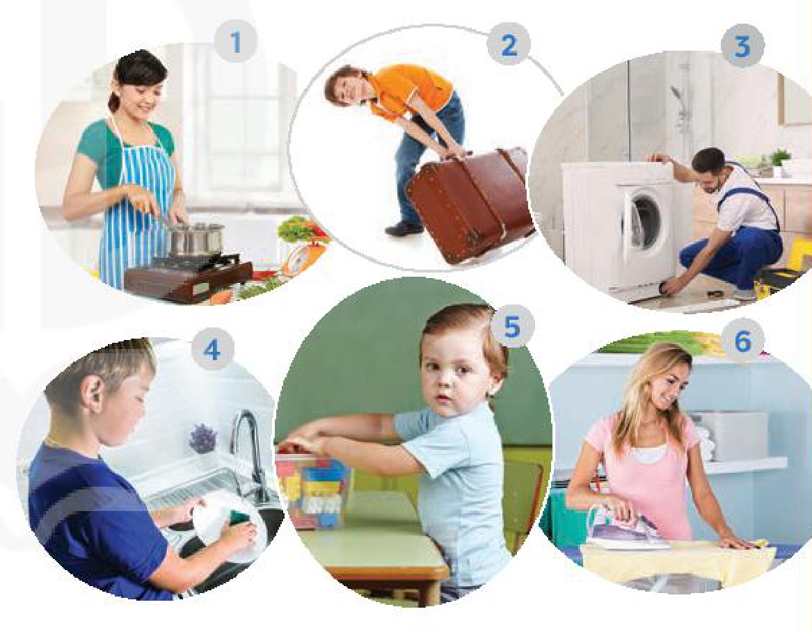
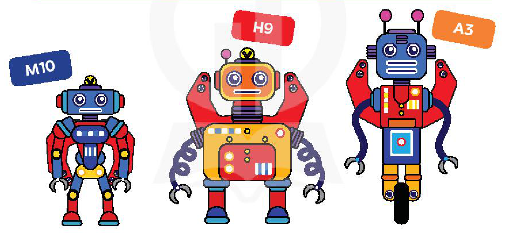
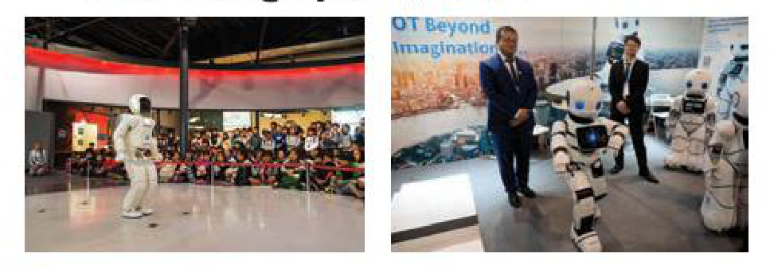
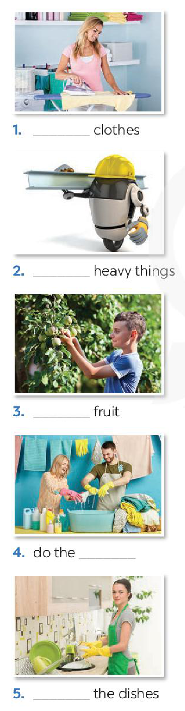

<!-- pdf:59 -->

# UNIT 12: ROBOTS

> **THIS UNIT INCLUDES:**
> - **Vocabulary:** Daily activities
> - **Pronunciation:** Falling tone in statements
> - **Grammar:** Superlative adjectives: short adjectives (*smallest*, *tallest*, etc.)
> - **Skills:**
>   - Reading about an international robot show
>   - Talking about what robots can do
>   - Listening about what robots can do
>   - Writing a paragraph about a robot someone would like to have
> - **Everyday English:** Expressing agreement and disagreement

## GETTING STARTED

**At an International Robot Show**

**1. Listen and read.**

**Nick:** Dr Adams! Can you tell us about the **robots** in the show, please?

**Dr Adams:** Sure. This is H8, a home robot. It can **do the dishes**, **iron** clothes, put toys away ...
<!-- term: home robot -->

**Nick:** It looks very **useful**!

**Dr Adams:** Yes, it can even make meals.
<!-- term: make meals -->

**Phong:** Look! That's the biggest **robot** in the show.

**Dr Adams:** Right, it's WB2, a worker robot. It's the strongest and fastest robot here.
<!-- term: worker robot -->

**Nick:** What can it do?

**Dr Adams:** It can move heavy things or **repair** **broken** machines.
<!-- term: move heavy things -->
<!-- term: worker robot -->

**Nick:** And what is this?

**Dr Adams:** It's Shifa, a doctor robot. It's the smartest robot. It can help sick people and do many things like humans.
<!-- term: doctor robot -->

<!-- pdf:60 -->

**2. Read the conversation again and tick (✓) T (True) or F (False).**

| | T | F |
| --- | --- | --- |
| 1. H8 is a very **useful** **robot**. | | |
| 2. WB2 can't **repair** **broken** machines. | | |
| 3. Shifa is a doctor robot. | | |
| 4. H8 is the fastest in the robot show. | | |
| 5. Shifa is very smart. | | |

**3. Complete the following sentences, using the adjectives in the box.**

| fast | smart | **useful** | heavy | strong |
| --- | --- | --- | --- | --- |
<!-- ocr-ok: đã đối chiếu ảnh trang gốc, OCR đọc nhầm strong thành sương -->

1. My dad bought me a very \_\_\_\_\_\_\_ home robot last week. It helps me to do many household chores.
2. This is a very \_\_\_\_\_\_\_ car. It can travel at a speed of 300 km per hour.
3. He's very \_\_\_\_\_\_\_. He can move a big car!
4. They're making a very \_\_\_\_\_\_\_ **robot**. It can understand 30 languages.
5. The table is too \_\_\_\_\_\_\_ for me to move on my own.

**4. Match the following activities with the pictures.**
<!-- ocr-ok: đã đối chiếu ảnh trang gốc, OCR đọc dính withthe -->

- a. **ironing** clothes
- b. making meals
- c. moving heavy things
- d. **doing the dishes**
- e. **repairing** a **broken** machine
- f. putting toys away

**5. GAME: Miming**

**Work in groups. A student mimes one of the activities in 4 and the others try to guess. Then swap.**

*Example:*

**A:** What am I doing?
<!-- ocr-ok: đã đối chiếu ảnh trang gốc, OCR đọc nhầm đại từ I thành dấu gạch đứng | -->

**B:** You're **doing the dishes**.

**A:** Yes, that's right. / No, try again.

<!-- pdf:61 -->

## A CLOSER LOOK 1

### Vocabulary

**1. Match the verbs in column A to the words or phrases in column B. Then listen, check and repeat them.**

| A | B |
| --- | --- |
| 1. understand | a. fruit |
| 2. **pick** | b. the washing |
| 3. do | c. our **feelings** |
| 4. **water** | d. as a **guard** |
| 5. work | e. plants |

**2. Work in pairs. Tell your partner the activities in 1 you can or can't do now.**

*Example:*

I can **pick** fruit but I can't understand your **feelings**.

**3. Work in pairs. Read the information about what V10, a robot, can or can't do. Ask and answer questions.**

| Skills of V10 | Can | Can't |
| --- | --- | --- |
| **repair** a **broken** machine | | ✓ |
| **do the washing** | ✓ | |
| work as a **guard** | ✓ | |
| read our moods | | ✓ |
| **water** plants | ✓ | |
| understand what we say | | ✓ |
<!-- ocr-ok: đã đối chiếu ảnh trang gốc, bảng Can / Can't của V10 có các dấu tích ở cột tương ứng -->

*Example:*

**A:** Can V10 **do the washing**?

**B:** Yes, it can.

### Pronunciation

*Falling tone in statements*

**4. Listen and repeat the following sentences.**

1. I often **water** plants after school.
2. Shifa can do many things like humans.
3. My dad makes delicious meals at weekends.
4. WB2 is the strongest of all the **robots**.
5. H8 is a home robot.
<!-- term: make meals -->

**Remember!**

> Our voice often goes down at the end of a statement.
>
> *Example:*
> We go to school every morning. ↘

**5. Practise saying the statements in the following paragraph. Then listen and repeat.**

My **robot** is Jimba. It's a home robot. It's very helpful. It can do the housework. It can also **water** plants and **pick** fruit. It can work as a **guard**. I love my **robot** very much.
<!-- term: work as a guard -->

<!-- pdf:62 -->

## A CLOSER LOOK 2

### Grammar

*Superlative adjectives: short adjectives*

**Remember!**

> We use superlative adjectives to compare three or more people or things.
>
> *Example:*
> - Tom is *the tallest* in his class.
> - This is *the biggest* of the three bags.
<!-- term: Superlative adjectives -->

**1. Write the superlative form of the adjectives in the table below.**

| Adjectives | Superlative form |
| --- | --- |
| fast | |
| tall | |
| noisy | |
| nice | |
| hot | |
| light | |
| quiet | |
| heavy | |
| large | |
<!-- ocr-ok: đã đối chiếu ảnh trang gốc, OCR bỏ sót tiêu đề bảng và dòng đầu tiên fast -->

**2. Complete the following sentences with superlative form of the adjectives in brackets. 1 is an example.**

1. Bonbon can move 10 tons; it's the *strongest* of all. (strong)
2. This **robot** can understand all of what we say. It's the \_\_\_\_\_\_\_ in the robot show. (smart)
3. He is the \_\_\_\_\_\_\_ in our class; he is about 1.8 m tall. (tall)
4. This is the \_\_\_\_\_\_\_ of all home robots; we can put it in our bag. (small)
5. This **robot** is only 200 dollars. It's the \_\_\_\_\_\_\_ in our shop. (cheap)

<!-- pdf:63 -->

**3. Complete the following sentences with comparative or superlative form of the adjectives in brackets.**

1. My brother's room is \_\_\_\_\_\_\_ than mine. (tidy)
2. The \_\_\_\_\_\_\_ desert of all is the Sahara and it's in Africa. (hot)
3. Travelling by plane is \_\_\_\_\_\_\_ than going by car. (fast)
4. Who is the \_\_\_\_\_\_\_ in your family? (tall)
5. I think dogs are \_\_\_\_\_\_\_ than cats. (smart)
<!-- ocr-ok: đã đối chiếu ảnh trang gốc, OCR đọc dính chữ quanh chỗ trống (roomis, planeis, Whoisthe) -->

**4. Work in pairs. Look at the information of the three robots: M10, H9, and A3 and talk about each of them, using superlative adjectives.**

| | M10 | H9 | A3 |
| --- | --- | --- | --- |
| **Age** | 5 | 7 | 10 |
| **Weight** | 20 kg | 45 kg | 50 kg |
| **Height** | 80 cm | 120 cm | 150 cm |
| **Price** | \$1,800 | \$1,000 | \$1,500 |
<!-- ocr-ok: đã đối chiếu ảnh trang gốc, OCR bỏ sót toàn bộ bảng thông tin ba người máy M10, H9, A3 -->

*Example:*

**A:** A3 is the tallest of the three **robots**.

**B:** M10 is the youngest of the three **robots**.

...

**5. GAME: Find someone who ...**
<!-- ocr-ok: đã đối chiếu ảnh trang gốc, chữ GAME nằm trong các ô màu trang trí nên OCR không nhận diện được -->

**Work in pairs. Ask your partner to find in your class someone who is**

- the tallest
- the oldest
- the smartest
- the shortest
- the biggest
- the smallest

<!-- pdf:64 -->

## COMMUNICATION

### Everyday English

*Expressing agreement and disagreement*

**1. Listen and read the dialogues. Pay attention to the highlighted sentences.**

**A:** I think **robots** can help us a lot in our daily life.

**B:** *I agree with you.*
<!-- ocr-ok: đã đối chiếu ảnh trang gốc, OCR đọc nhầm đại từ I thành dấu gạch đứng | -->

**A:** Peter says **robots** can do everything like humans.

**B:** *I don't agree with him.*

**2. Work in pairs. Express your opinions about the following statements. Use the highlighted sentences in the dialogues above as cues.**

- Home robots are the most **useful** of all types of **robots**.
- Some people can use **robots** to do bad things.
- **Robots** will use too much electricity in the future.

**My robot's abilities**

**3. Listen to the radio programme from *4Teen News*. Then fill the blanks with the words you hear.**

**Speaker:** Today we ask our friends: Tom from Australia, Linh from Viet Nam and Nobita from Japan to tell us about their **robots**. Tom, would you like to start?

**Tom:** Well, my **robot** can (1) \_\_\_\_\_\_\_ what I say. It can also understand my **feelings**. It's the (2) \_\_\_\_\_\_\_ **robot**.

**Speaker:** Linh?

**Linh:** My **robot** is my best friend. It does a lot for me: clean the floor, (3) \_\_\_\_\_\_\_ my toys away, and ...

**Speaker:** And Nobita?

**Nobita:** My **robot** is very **useful**. It helps me a lot. It can (4) \_\_\_\_\_\_\_ my plants and even work as a (5) \_\_\_\_\_\_\_.

**4. Interview three friends about what abilities they want their robots to have. Note their answers in the table below.**

| Friends | Abilities he / she wants his / her robot to have |
| --- | --- |
| 1. | |
| 2. | |
| 3. | |
<!-- ocr-ok: đã đối chiếu ảnh trang gốc, OCR đọc sai tiêu đề bảng và số thứ tự 1-3 -->

**5. Report your results to the class.**

<!-- pdf:65 -->

## SKILLS 1

### Reading

**1. Work in pairs. Look at the pictures and discuss the following questions.**

1. What types of **robots** are there?
2. What **robots** are children interested in?

**2. Read the text and choose the best answer to each of the questions.**

Today there is an international robot show in Ha Noi. People can see many types of **robots** there.

Home robots are **useful** for housework. They can do most of the housework: cook meals, clean the house, **do the washing**, and **iron** clothes.
<!-- term: home robot -->

Teacher robots are the best **choice** for children. They can help them to study. They can teach them English, literature, maths and other subjects. They can also help children to improve their English pronunciation.
<!-- term: teacher robot -->

People are also interested in other types of **robots** at the show. Worker robots can build houses and move heavy things; doctor robots can look after sick people; and space robots can build **space stations** on the Moon and on **planets**.
<!-- term: worker robot -->
<!-- term: move heavy things -->
<!-- term: doctor robot -->
<!-- term: space robot -->

1. What show is on in Ha Noi now?
   - A. A fashion show.
   - B. A robot show.
   - C. A pet show.
2. Which type of **robots** can help children in their study?
   - A. Home robots.
   - B. Worker robots.
   - C. Teacher robots.
3. Doctor robots can \_\_\_\_\_\_\_.
   - A. help children to study
   - B. build houses
   - C. take care of sick people
4. Which of the following sentences is NOT true according to the passage?
   - A. Worker robots can build houses and move heavy things.
   - B. Space robots can build **space stations** on the Moon.
   - C. Home robots can't do much of the housework.

**3. Read the text again and fill the table below.**

| Types of robots | What they can do |
| --- | --- |
| Home robots | *cook meals, ...* |
| Teacher robots | |
| Worker robots | |
| Doctor robots | |
| Space robots | |

### Speaking

**4. Work in pairs. Discuss what you think robots can do in the following places.**

| Places | What robots can do |
| --- | --- |
| Home | |
| School | |
| Factory | |
| Hospital | |
| Garden | |
<!-- ocr-ok: đã đối chiếu ảnh trang gốc, OCR đọc nhầm robots thành 1obots ở tiêu đề bảng -->

*Example:*

**A:** What can **robots** do at home?

**B:** They can take care of children.

**5. Work in groups. Take turns to talk about robots and what you think they can do. Can you think of other types of robots?**

<!-- pdf:66 -->

## SKILLS 2

### Listening

**1. Listen to the conversation between Khang and Dr Adams and tick (✓) the phrases you hear.**

- [ ] look after sick people
- [ ] understand what we say
- [ ] build the very high buildings
- [ ] teach many subjects
- [ ] move heavy things

**2. Listen to the conversation again and tick (✓) T (True) or F (False).**

| | T | F |
| --- | --- | --- |
| 1. **Robots** can't do many things today. | | |
| 2. Worker robots can build the very high buildings. | | |
| 3. Teacher robots can teach on the internet. | | |
| 4. **Robots** can talk to humans. | | |
| 5. **Robots** can do everything like humans. | | |

### Writing

**3. Imagine a robot you would like to have. Make notes about it.**

| | |
| --- | --- |
| 1. Name of your **robot** | \_\_\_\_\_\_\_ |
| 2. Type of **robot** | \_\_\_\_\_\_\_ |
| 3. Where it can work | \_\_\_\_\_\_\_ |
| 4. What it can do for you | \_\_\_\_\_\_\_ |

**4. Now write a paragraph of 50-60 words about the robot you would like to have. Use the information in 3 to help you.**

My robot's name is \_\_\_\_\_\_\_.
<!-- ocr-ok: đã đối chiếu ảnh trang gốc, phông chữ viết tay của đoạn gợi ý khiến OCR đọc sai dấu nháy đơn -->

It is a \_\_\_\_\_\_\_.

<!-- pdf:67 -->

## LOOKING BACK

### Vocabulary

**1. Write the correct words to complete the phrases.**

1. \_\_\_\_\_\_\_ clothes
2. \_\_\_\_\_\_\_ heavy things
3. \_\_\_\_\_\_\_ fruit
4. do the \_\_\_\_\_\_\_
5. \_\_\_\_\_\_\_ the dishes
<!-- ocr-ok: đã đối chiếu ảnh trang gốc, các cụm từ 1-5 nằm dưới từng hình minh hoạ -->

**2. Fill the blanks with the verbs from the box.**

| **water** | make | **repair** | work | understand |
| --- | --- | --- | --- | --- |

1. **Robots** can \_\_\_\_\_\_\_ as **guards** when we're away.
2. We rarely go to restaurants because my father can \_\_\_\_\_\_\_ delicious meals at home.
3. Can you \_\_\_\_\_\_\_ my **broken** clock?
4. Can **robots** \_\_\_\_\_\_\_ our **feelings**?
5. My father and I \_\_\_\_\_\_\_ the plants in our garden every morning.
<!-- ocr-ok: đã đối chiếu ảnh trang gốc, OCR đọc nhầm câu 1 (Robo can a5 guards) và dính chữ quanh chỗ trống -->

### Grammar

**3. Use the correct form of the adjectives in brackets to complete the paragraph.**

Welcome to our company. We've made the (1. smart) \_\_\_\_\_\_\_ **robot** in the world. It's the (2. small) \_\_\_\_\_\_\_ and the (3. light) \_\_\_\_\_\_\_ we've made but it can do many things in your house. It can even fly to clean the ceilings. It can teach children all school subjects. It's also the (4. strong) \_\_\_\_\_\_\_ in our lab because it can move more than 200 kg. It's not difficult to own a **robot** like this because it's one of the (5. cheap) \_\_\_\_\_\_\_ **robots** in the world.

**4. Complete the following sentences with superlative form of the adjectives in brackets.**

1. What is the (high) \_\_\_\_\_\_\_ mountain in the world?
2. What is the (large) \_\_\_\_\_\_\_ lake in Viet Nam?
3. What is the (long) \_\_\_\_\_\_\_ beach in Viet Nam?
4. What is the (wide) \_\_\_\_\_\_\_ river in the world?
5. What is the (hot) \_\_\_\_\_\_\_ desert in the world?
<!-- ocr-ok: đã đối chiếu ảnh trang gốc, OCR đọc dính Whatisthe ở các câu 2-5 -->

**Do you know the answers?**

<!-- pdf:68 -->

## PROJECT

**Robot Design Competition**

**1. You are taking part in a robot design competition. Work in groups, decide what your robot is like and complete this table.**

| | |
| --- | --- |
| Robot name | |
| Appearance (**weight**, **height**, etc.) | |
| Where it can work | |
| What it can do | |

**Draw your robot here**

**2. Present your design(s) to other groups. Vote on the best robot.**

### Now I can ...

| Now I can ... | ✓ | ✓✓ | ✓✓✓ |
| --- | --- | --- | --- |
| - use the words for daily activities. | | | |
| - say statements with correct tones. | | | |
| - compare people and things using superlative adjectives. | | | |
| - express agreement and disagreement about something. | | | |
| - read about an international robot show. | | | |
| - talk about what robots can do. | | | |
| - listen about what robots can do. | | | |
| - write a paragraph about a robot. | | | |

## 📷 Danh mục hình minh hoạ

| Mã hình | Trang PDF | Trang sách | Chú thích / Mô tả |
| --- | --- | --- | --- |
| H6-tieng_anh-u12-01 | 60 | 59 | Sáu bức tranh tròn đánh số 1–6 minh hoạ các hoạt động thường ngày và công việc của người máy (nấu ăn, khiêng vật nặng, sửa máy hỏng, rửa bát, cất đồ chơi, là quần áo) ở bài 4 phần Getting Started |
| H6-tieng_anh-u12-02 | 63 | 62 | Hình minh hoạ ba người máy M10, H9 và A3 dùng để thực hành so sánh nhất ở bài 4 phần A Closer Look 2 |
| H6-tieng_anh-u12-03 | 65 | 64 | Hai bức ảnh triển lãm người máy quốc tế dùng cho hoạt động thảo luận mở đầu bài 1 phần Skills 1 |
| H6-tieng_anh-u12-04 | 67 | 66 | Năm bức tranh đánh số 1–5 minh hoạ các cụm động từ chỉ hoạt động thường ngày ở bài 1 phần Looking Back |
