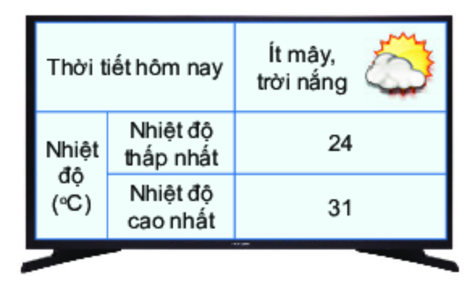
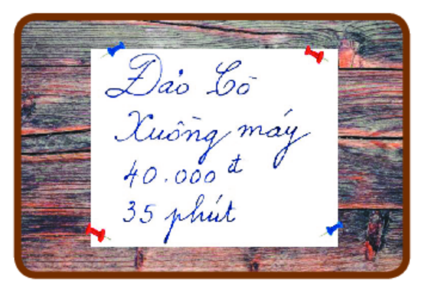
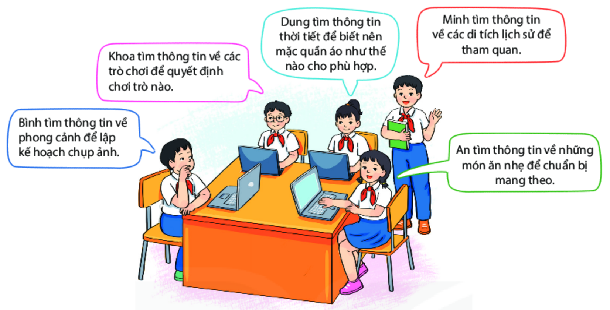

<!-- pdf:7 -->

# BÀI 1: THÔNG TIN VÀ DỮ LIỆU

## 🎯 Sau bài này em sẽ:

- Nhận biết được sự khác nhau giữa thông tin và dữ liệu.
- Phân biệt được thông tin và vật mang tin.
- Nêu được ví dụ minh hoạ tầm quan trọng của thông tin.
- Nêu được ví dụ minh hoạ mối quan hệ giữa thông tin và dữ liệu.

## 🔴 Khởi động

Trong cuộc sống hằng ngày, em nhìn thấy những con số, những dòng chữ, những hình ảnh trong sách; em nghe thấy tiếng chim hót, tiếng xe cộ đi lại trên đường. Tất cả những thứ đó được các giác quan của em thu nhận và xử lí để trở thành những hiểu biết của em về thế giới xung quanh.

## 1. THÔNG TIN VÀ DỮ LIỆU

> **Hoạt động 1: Thấy gì? Biết gì?**
>
> “Trên đường từ nhà đến trường, Minh phải đi qua nhiều ngã tư đông đúc. Để đi qua các ngã tư này, Minh phải chú ý quan sát các đèn giao thông. Khi thấy đèn có màu xanh, đợi các xe bên chiều đèn đỏ dừng lại hẳn, Minh biết có thể qua đường an toàn và quyết định nhanh chóng qua đường trước khi đèn chuyển sang màu đỏ.”
>
> Em hãy đọc đoạn văn trên và cho biết: Bạn Minh đã thấy những gì và biết được điều gì để quyết định nhanh chóng qua đường?

Trong đoạn văn ở Hoạt động 1, bạn Minh đã thấy đèn giao thông đổi sang màu xanh và các xe chiều đèn đỏ đã dừng lại. Nhờ đó bạn biết có thể qua đường an toàn. Những gì bạn Minh thấy là dữ liệu, điều bạn biết là thông tin. Cây đèn đường khi đó được gọi là vật mang tin.

Ta xét một ví dụ khác. Bạn An nghe thấy lời cô phát thanh viên mục dự báo thời tiết trên ti vi. Đó là dữ liệu xuất hiện dưới dạng con số, văn bản, hình ảnh và âm thanh. An biết rằng hôm nay trời nắng. Điều bạn biết là thông tin.

Những hiểu biết của chúng ta đều có được từ sự lắng nghe, quan sát và trải nghiệm. Vì vậy, thông tin có nguồn gốc từ dữ liệu.

> - **Thông tin** là những hiểu biết của con người về thế giới xung quanh và về chính bản thân mình.
> - **Dữ liệu** là những gì con người tiếp nhận để có được thông tin. Dữ liệu được thể hiện dưới dạng những con số, văn bản, hình ảnh, kí hiệu,...
> - **Vật mang tin** là phương tiện được dùng để lưu trữ và truyền tải thông tin, ví dụ như giấy viết, đĩa CD, thẻ nhớ,...

<!-- pdf:8 -->

**Mối quan hệ giữa thông tin và dữ liệu**

Vì dữ liệu đem lại thông tin nên đôi khi “dữ liệu” cũng được thay bằng “thông tin”. Chẳng hạn vật chứa dữ liệu còn được gọi là vật mang tin. Một ví dụ khác, máy tính chỉ xử lí dữ liệu nhưng đôi khi người ta cũng nói là máy tính xử lí thông tin. Tuy vậy, thông tin và dữ liệu vẫn có những điểm khác nhau.

<!-- term: Quan hệ giữa thông tin và dữ liệu -->
Với các học sinh lớp 6, khi đọc dữ liệu trong bản tin dự báo thời tiết sẽ hiểu được thông tin “hôm nay trời nắng”. Tuy nhiên, với một em bé 5 tuổi, chưa đọc được bản tin dự báo thời tiết thì dữ liệu thời tiết chưa có nhiều ý nghĩa. Khi đó, với em bé, dữ liệu đã cho không đem lại thông tin. Vì vậy, thông tin là dữ liệu được xử lí để trở thành có ý nghĩa. Thông tin luôn phụ thuộc vào con người.

<!-- term: Quan hệ giữa thông tin và dữ liệu -->
Một trung tâm dịch vụ muốn truyền đạt thông tin đến khách du lịch: “Giá vé đi ra Đảo Cò là 40 000 đồng và hành trình mất 35 phút bằng xuồng máy”, họ đã viết lên bảng *“Đảo Cò, xuồng máy, 40 000đ, 35 phút”*. Những số và chữ trên bảng là dữ liệu. Tấm bảng là vật mang tin. Vì vậy, thông tin được ghi lên các vật mang tin lại trở thành dữ liệu.

> ❓ **Câu hỏi**
>
> 1. Em hãy ghép mỗi mục ở cột A với một mục phù hợp ở cột B.
>
> | A | B |
> | --- | --- |
> | 1) Thông tin | a) Các số, văn bản, hình ảnh, âm thanh,... |
> | 2) Dữ liệu | b) Hiểu biết của con người về thế giới |
> | 3) Vật mang tin | c) Vật chứa dữ liệu |
>
> 2. Mỗi dòng sau đây là thông tin hay dữ liệu?
> - 16:00 &emsp; • 0123456789
> - Hãy gọi cho tôi lúc 16 giờ theo số điện thoại 0123456789.

## 2. TẦM QUAN TRỌNG CỦA THÔNG TIN

Bài học lịch sử về Chiến dịch Điện Biên Phủ có nhiều thông tin về địa điểm, thời gian, diễn biến trận đánh,... qua đó em biết được tinh thần dũng cảm của quân và dân ta, biết được truyền thống chiến đấu chống giặc ngoại xâm của dân tộc ta. Vì vậy, thông tin đem lại hiểu biết cho con người.

Chuẩn bị đi sang nhà bạn Minh để học nhóm, An nghe mẹ nói: “Trời sắp mưa đấy nhé”. Thông tin đó làm cho An quay vào nhà cầm theo chiếc ô. Như vậy, ta thấy thông tin có khả năng làm thay đổi hành động của con người.

<!-- term: Tầm quan trọng của thông tin -->
> - Thông tin đem lại hiểu biết cho con người. Mọi hoạt động của con người đều cần đến thông tin.
> - Thông tin đúng giúp con người đưa ra những lựa chọn tốt, giúp cho hoạt động của con người đạt hiệu quả.

<!-- pdf:9 -->

> **Hoạt động 2: Hỏi để có thông tin**
>
> Lớp em sắp tổ chức một buổi dã ngoại. Hãy thảo luận nhóm để đưa ra các câu hỏi giúp tìm thông tin để chuẩn bị cho buổi dã ngoại đó.

## ✏️ Luyện tập

Bảng 1.2 cho biết lượng mưa trung bình hàng tháng (theo đơn vị mm) của hai năm 2017, 2018 ở một số địa phương (theo Tổng cục Thống kê).

*Bảng 1.1. Lượng mưa trung bình hàng tháng*

| Thành phố \ Tháng | 1 | 2 | 3 | 4 | 5 | 6 | 7 | 8 | 9 | 10 | 11 | 12 |
| --- | :---: | :---: | :---: | :---: | :---: | :---: | :---: | :---: | :---: | :---: | :---: | :---: |
| Hà Nội | 43,8 | 11,2 | 73,2 | 39,0 | 157,2 | 200,7 | 438,6 | 298,3 | 248,3 | 177,1 | 23,8 | 65,9 |
| Huế | 201,0 | 126,6 | 34,1 | 119,2 | 127,9 | 134,2 | 258,7 | 78,2 | 216,6 | 325,9 | 484,5 | 560,5 |
| Đà Nẵng | 78,9 | 36,1 | 24,5 | 89,5 | 40,9 | 92,2 | 216,3 | 117,1 | 168,8 | 308,5 | 518,6 | 163,5 |
| Vũng Tàu | 58,5 | 0,4 | 1,2 | 22,4 | 166,8 | 287,7 | 203,5 | 167,6 | 267,9 | 297,1 | 143,0 | 24,9 |

Em hãy xem Bảng 1.1 và trả lời các câu hỏi sau:

a) Các con số trong cột tháng 9 là thông tin hay dữ liệu?

b) Phát biểu “Tháng 6, Đà Nẵng ít mưa nhất so với các thành phố khác” là thông tin hay dữ liệu?

c) Trả lời câu hỏi: “Huế ít mưa nhất vào tháng nào trong năm?”. Câu trả lời là thông tin hay dữ liệu?

d) Câu trả lời cho câu c) có ảnh hưởng đến việc lựa chọn thời gian và địa điểm du lịch không?

## 🚀 Vận dụng

1. Em hãy lấy ví dụ cho thấy thông tin giúp em:
   a) Có những lựa chọn trang phục tốt hơn.
   b) Đảm bảo an toàn khi tham gia giao thông.
2. Em hãy nêu ví dụ về vật mang tin giúp ích cho việc học tập của em.
3. Em hãy lấy một ví dụ về dữ liệu trong cuộc sống. Bổ sung tình huống cho dữ liệu đó để nó trở thành thông tin.

## 📷 Danh sách hình trong bài

| Mã hình | Trang PDF | Trang sách | Chú thích |
| --- | :---: | :---: | --- |
| H6-tin-b01-01 | 7 | 6 | (sách không đánh số, hình minh hoạ bản tin dự báo thời tiết trên màn hình ti vi) |
| H6-tin-b01-02 | 8 | 7 | (sách không đánh số, hình minh hoạ tấm bảng ghi thông tin đi Đảo Cò bằng xuồng máy) |
| H6-tin-b01-03 | 9 | 8 | (sách không đánh số, hình minh hoạ các bạn học sinh tìm thông tin chuẩn bị cho buổi dã ngoại ở Hoạt động 2) |
