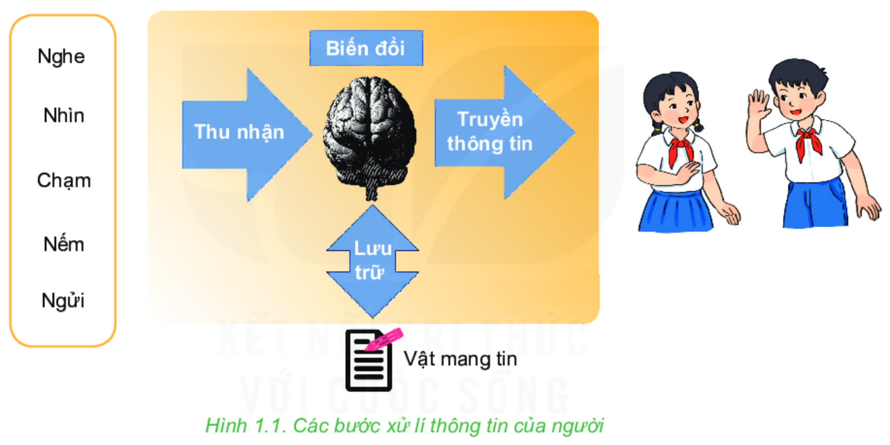
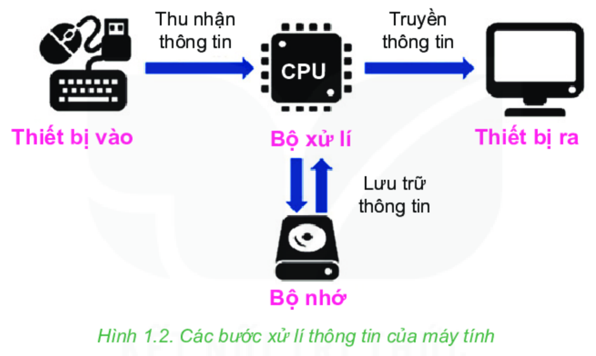

<!-- pdf:10 -->

# BÀI 2: XỬ LÍ THÔNG TIN

## 🎯 Sau bài này em sẽ:

- Nêu được các bước cơ bản trong xử lí thông tin.
- Giải thích được máy tính là công cụ hiệu quả để xử lí thông tin. Nêu được ví dụ minh hoạ cụ thể.

## 🔴 Khởi động

Hãy quan sát một cầu thủ bóng đá thực hiện quả phạt đền. Mắt liên tục xác định vị trí của thủ môn, anh phải đánh giá xem góc nào của cầu môn là sơ hở nhất. Sải bước, lấy đà, trong khoảnh khắc, anh khuất phục thủ môn bằng một cú sút má trong vào góc trên bên trái cầu môn.

## 1. XỬ LÍ THÔNG TIN

Trong trường hợp của cầu thủ bóng đá trên, bàn thắng xảy ra trong chớp mắt, nhưng trong thời gian rất ngắn đó, trí óc của cầu thủ đã thực hiện một loạt thao tác phức tạp như sau:

- Mắt theo dõi vị trí thủ môn và thông tin đó được chuyển lên não.
- Não phân tích, đánh giá, suy luận,... chuyển hoá thông tin thu được thành ý định của cầu thủ: sút bóng về phía góc trên bên trái cầu môn.
- Ý định đó được thực hiện bằng cách điều khiển chân sút thành công quả phạt.

Thực ra, não còn thực hiện một thao tác thông tin nữa. Đó là ghi nhớ kết quả của bước trước, để thực hiện các thao tác ở bước sau.

Không ai nhìn thấy bộ não hoạt động như thế nào, nhưng trong mọi hoạt động của con người, bộ não đều phải thực hiện một nhiệm vụ rất quan trọng: **xử lí thông tin**.

Vậy quá trình xử lí thông tin được diễn ra như thế nào nhỉ?

> **Hoạt động 1: Xử lí thông tin**
>
> Em hãy xem xét tình huống cầu thủ ghi bàn và trả lời các câu hỏi sau:
> 1. Bộ não của cầu thủ nhận được thông tin từ những giác quan nào?
> 2. Thông tin nào được bộ não cầu thủ ghi nhớ và sử dụng khi đá phạt?
> 3. Bộ não biến đổi thông tin nhận được thành thông tin nào?
> 4. Bộ não chuyển thông tin điều khiển thành thao tác nào của cầu thủ?
> 5. Quá trình xử lí thông tin của bộ não gồm những bước nào?

<!-- pdf:11 -->

Xử lí thông tin gồm bốn hoạt động thành phần, còn được gọi là **các bước xử lí thông tin cơ bản**:

- **Thu nhận thông tin**: Nhờ các giác quan, con người nhận được thông tin của thế giới bên ngoài như âm thanh, hình ảnh, màu sắc, ánh sáng, nhiệt độ, mùi vị,...
- **Lưu trữ thông tin**: Sau khi nhận được thông tin, bộ não ghi nhớ lại. Nếu não không ghi nhận được, thông tin sẽ bị mất và các thao tác khác sẽ không có nguyên liệu để thực hiện. Thông tin không chỉ được nhớ trong não mà còn được con người lưu trữ bằng cách ghi chép.
- **Biến đổi thông tin**: Bộ não liên kết các thông tin đã có, so sánh, phân tích, thống kê, suy luận, giải thích,... từ đó đưa ra kết luận, quyết định,... Đó là quá trình biến đổi thông tin ban đầu thành thông tin mới.
- **Truyền thông tin**: Thông tin được truyền đến các bộ phận cơ thể chuyển hoá thành hành vi hoặc được chia sẻ với người khác. Thông tin được nhân rộng qua quá trình chia sẻ.

*Hình 1.1. Các bước xử lí thông tin của người*

> **Các bước cơ bản trong xử lí thông tin** bao gồm:
> - Thu nhận thông tin.
> - Lưu trữ thông tin.
> - Biến đổi thông tin.
> - Truyền thông tin.

> ❓ **Câu hỏi**
>
> 1. Em hãy phân tích các hoạt động sau thành các bước xử lí thông tin:
>    a) Minh tìm hiểu một ứng dụng trên máy tính và hướng dẫn lại cho An.
>    b) Khoa lập thời gian biểu cho các hoạt động trong ngày.
> 2. Mỗi hoạt động dưới đây thuộc các bước nào trong xử lí thông tin? Giải thích tại sao?
>    a) Đài tiếng nói Việt Nam phát chương trình ca nhạc.
>    b) Bố em xem chương trình thời sự trên ti vi.
>    c) Em chép bài trên bảng vào vở.

<!-- pdf:12 -->

## 2. XỬ LÍ THÔNG TIN TRONG MÁY TÍNH

Ngày nay, thông tin không chỉ là sự hiểu biết của cá nhân mà đã trở thành tài nguyên của xã hội loài người, đem lại lợi ích to lớn. Chiếc máy kì diệu giúp con người xử lí nguồn tài nguyên đó chính là máy tính. Vậy em có muốn biết máy tính gồm những thành phần nào và hoạt động ra sao không?

Máy tính có đủ thành phần để có thể thực hiện được các thao tác: thu thập, lưu trữ, biến đổi và truyền thông tin:

- **Thiết bị vào** để thu nhận thông tin: bàn phím, chuột, máy quét,...
- **Thiết bị ra** để truyền hoặc chia sẻ thông tin: màn hình, máy in,...
- **Bộ xử lí** để biến đổi thông tin bằng cách thực hiện chương trình máy tính do con người viết ra.
- **Bộ nhớ** để lưu trữ thông tin: đĩa quang, đĩa từ, thẻ nhớ,...

*Hình 1.2. Các bước xử lí thông tin của máy tính*

> ❓ **Câu hỏi**
>
> 1. Máy tính gồm mấy thành phần để có thể thực hiện được các bước xử lí thông tin?
>    A. 3. &emsp; B. 4. &emsp; C. 5. &emsp; D. 6.
> 2. Chức năng của bộ nhớ máy tính là gì?
>    A. Thu nhận thông tin. &emsp; B. Hiển thị thông tin.
>    C. Lưu trữ thông tin. &emsp; D. Biến đổi thông tin.

> **Hoạt động 2: Hiệu quả thực hiện xử lí thông tin của máy tính**
>
> Chia lớp thành các nhóm và thảo luận để làm các bài tập sau:
> 1. Em hãy nêu một vài ví dụ về việc máy tính giúp con người trong các hoạt động sau:
>    a) Thu nhận thông tin. &emsp; b) Lưu trữ thông tin.
>    c) Biến đổi thông tin. &emsp; d) Truyền thông tin.
> 2. Em hãy so sánh hiệu quả thực hiện công việc đã nêu trong Câu 1 khi có sử dụng và khi không sử dụng máy tính.

<!-- pdf:13 -->

Máy tính là một công cụ hiệu quả để thu nhận, lưu trữ, xử lí và truyền thông tin.

Máy tính giúp con người thu nhận thông tin dễ dàng, đa dạng và nhanh chóng. Ví dụ, để chuẩn bị thông tin cho một bài trình bày, em có thể sử dụng máy quét, máy ảnh số, điện thoại thông minh,... hay tìm kiếm trên mạng để có được các thông tin dạng văn bản, hình ảnh, âm thanh, phim,...

Máy tính xử lí thông tin, thực hiện tính toán với tốc độ cao, chính xác, bền bỉ. Ngày nay, máy tính có thể thực hiện hàng tỉ phép tính trong một giây, có thể biểu diễn được gần đúng số Pi với hàng nghìn tỉ chữ số ở phần thập phân. Máy tính còn có thể làm việc liên tục không ngừng suốt ngày đêm.

Máy tính có thể lưu trữ lượng thông tin rất lớn. Ví dụ, chỉ với một chiếc thẻ nhớ nhỏ bằng đầu chiếc bút cũng có thể lưu trữ nội dung của hàng nghìn cuốn sách,...

Với khả năng kết nối mạng, máy tính không chỉ giúp em trao đổi thông tin với mọi người ở khắp nơi mà còn giúp em kết nối với kho tri thức khổng lồ. Ví dụ, em có thể dùng điện thoại thông minh truy cập vào Internet để tìm thông tin về bất cứ lĩnh vực nào.

<!-- term: Hiệu quả xử lí thông tin của máy tính -->
> - Máy tính có đủ bốn thành phần thực hiện các bước xử lí thông tin: Thiết bị vào (thu nhận thông tin), bộ nhớ (lưu trữ thông tin), bộ xử lí (xử lí và biến đổi thông tin) và thiết bị ra (truyền, chia sẻ thông tin).
> - Máy tính là thiết bị hỗ trợ con người xử lí thông tin một cách hiệu quả do nó có thể thực hiện nhanh các mệnh lệnh, tính toán chính xác, xử lí nhiều dạng dữ liệu, lưu trữ dữ liệu với dung lượng lớn và hoạt động bền bỉ.

> ❓ **Câu hỏi**
>
> Em hãy chọn phương án trả lời đúng nhất.
> Máy tính giúp con người nâng cao hiệu quả trong bước nào của quá trình xử lí thông tin?
> A. Thu thập thông tin. &emsp; B. Lưu trữ thông tin. &emsp; C. Biến đổi thông tin.
> D. Truyền thông tin. &emsp; E. Tất cả bốn bước trên.

## ✏️ Luyện tập

1. Vật mang tin xuất hiện trong bước nào của quá trình xử lí thông tin? Bộ nhớ có là vật mang tin không?
2. Em hãy phân loại những hoạt động sau đây theo các bước xử lí thông tin.
   a) Quan sát đường đi của một chiếc tàu biển.
   b) Ghi chép các sự kiện của một chuyến tham quan.
   c) Chuyển thể một bài văn xuôi thành văn vần.
   d) Thuyết trình chủ đề tình bạn trước lớp.

## 🚀 Vận dụng

1. Giả sử em được đi chơi xa nhà, em hãy phân tích các bước xử lí thông tin liên quan đến việc lên kế hoạch cho chuyến đi.
2. Em hãy liệt kê những lợi ích của máy tính ở một trong các lĩnh vực sau đây để thấy rõ hiệu quả của việc xử lí thông tin bằng máy tính.
   a) Y tế. &emsp; b) Giáo dục. &emsp; c) Âm nhạc. &emsp; d) Hội hoạ.
   e) Xây dựng. &emsp; f) Nông nghiệp. &emsp; g) Thương mại. &emsp; h) Du lịch.

## 📷 Danh sách hình trong bài

| Mã hình | Trang PDF | Trang sách | Chú thích |
| --- | :---: | :---: | --- |
| H6-tin-b02-01 | 11 | 10 | Hình 1.1. Các bước xử lí thông tin của người |
| H6-tin-b02-02 | 12 | 11 | Hình 1.2. Các bước xử lí thông tin của máy tính |
