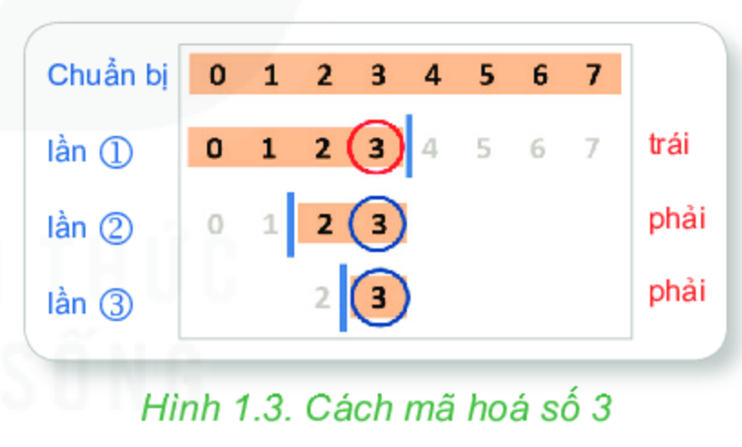
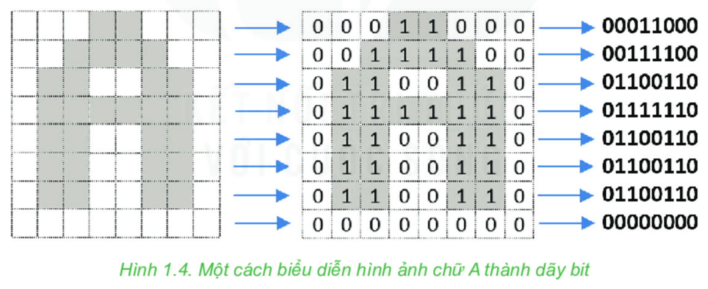
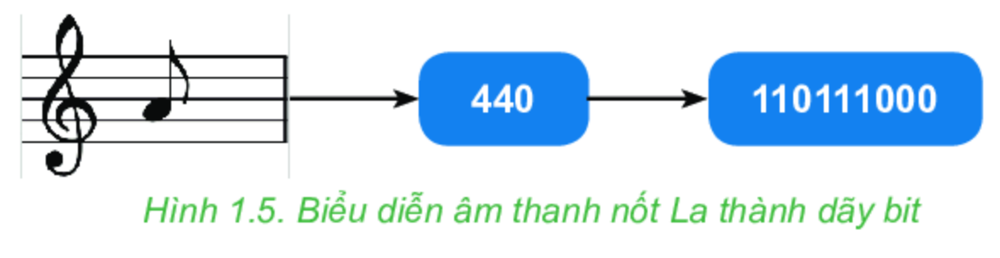
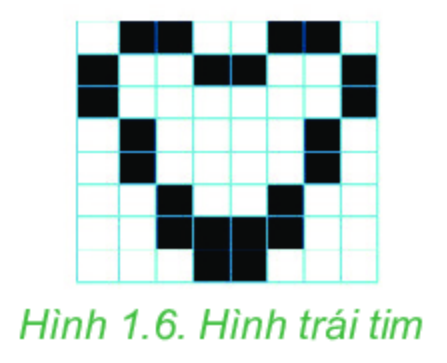
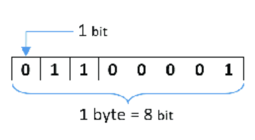
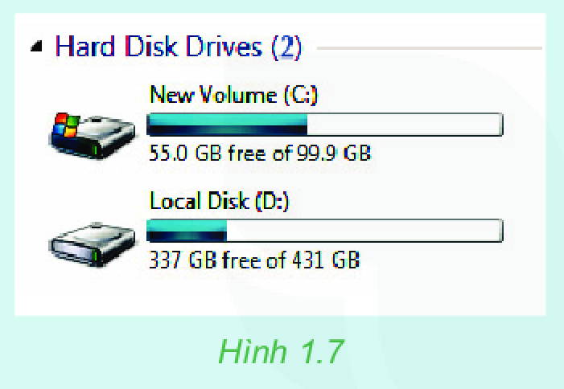
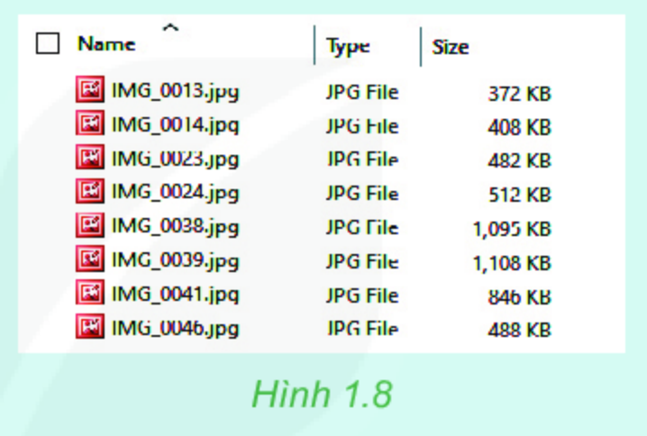

<!-- pdf:14 -->

# BÀI 3: THÔNG TIN TRONG MÁY TÍNH

## 🎯 Sau bài này em sẽ:

- Giải thích được việc có thể biểu diễn thông tin chỉ với hai kí hiệu 0 và 1.
- Biết được bit là đơn vị nhỏ nhất trong lưu trữ thông tin.
- Nêu được tên và độ lớn của các đơn vị cơ bản đo dung lượng thông tin.
- Ước lượng được khả năng lưu trữ của các thiết bị nhớ thông dụng như đĩa quang, đĩa từ, thẻ nhớ,...

## 🔴 Khởi động

Trong bài trước, chúng ta đã biết rằng máy tính có thể xử lí được thông tin nhưng làm thế nào để máy tính có thể hiểu được những dữ liệu chúng ta chuyển cho nó xử lí?

Con người dùng mười chữ số, nhiều chữ cái và kí hiệu để diễn đạt suy nghĩ của mình cho người khác hiểu, tuy nhiên máy tính lại không hiểu được. Máy tính thông dụng hiện nay chỉ hiểu hai kí hiệu là 0 và 1.

> **Hoạt động 1: Mã hoá**
>
> Quan sát Hình 1.3 và đọc hướng dẫn để biết cách mã hoá số 3 thành dãy các kí tự 0 và 1.
> **Hướng dẫn:**
> 1. Viết các số từ 0 đến 7 thành dãy tăng dần từ trái sang phải.
> 2. Thực hiện các bước sau nhiều lần cho đến khi chỉ còn lại số 3:
>    - Chia dãy số thành hai nửa (trái, phải) đều nhau.
>    - Kiểm tra xem số 3 thuộc nửa trái hay phải.
>    - Ghi lại vị trí của số 3 (*trái* hoặc *phải*).
>    - Giữ lại nửa có số 3.
> 3. Chuyển dãy vị trí thành dãy 0, 1 theo quy tắc: trái thành 0, phải thành 1.
>    - **Kết quả:** Ta có số 3 được ghi lại thành “trái-phải-phải” và được mã hoá thành 011.
>    - **Yêu cầu:** Hãy mã hoá số 2 và số 6 theo cách như trên. Hai dãy kí hiệu nhận được có giống nhau không?

*Hình 1.3. Cách mã hoá số 3*

## 1. BIỂU DIỄN THÔNG TIN TRONG MÁY TÍNH

**Biểu diễn số**

Trong Hoạt động 1, mỗi số từ 0 đến 7 có thể được chuyển thành một dãy các kí hiệu 0 và 1 như sau:

| 0 | 1 | 2 | 3 | 4 | 5 | 6 | 7 |
| :---: | :---: | :---: | :---: | :---: | :---: | :---: | :---: |
| 000 | 001 | 010 | 011 | 100 | 101 | 110 | 111 |

Với những số lớn hơn thì có thể cần dãy nhiều hơn các kí hiệu 0 và 1 để mã hoá.

<!-- term: Mã hoá thông tin -->
Mỗi dãy các kí hiệu 0 và 1 như vậy được gọi là **dãy bit**. Mỗi kí hiệu của dãy bit được gọi là một **bit** (viết tắt từ Binary digIT). Bằng cách tương tự, người ta có thể chuyển một số bất kì thành một dãy bit.

<!-- pdf:15 -->

**Biểu diễn văn bản**

Văn bản gồm các chữ cái (cả chữ hoa và chữ thường), các chữ số, dấu câu, kí hiệu,... được gọi chung là các **kí tự**. Văn bản được chuyển thành dãy bit bằng cách chuyển từng kí tự một. Bảng 1.2 cho thấy một phần của bảng mã. Theo bảng mã từ CAFE được chuyển thành dãy bit như sau:

*Bảng 1.2. Một phần bảng mã*

| Kí tự | Dãy bit biểu diễn |
| :---: | :---: |
| A | 01000001 |
| B | 01000010 |
| C | 01000011 |
| D | 01000100 |
| E | 01000101 |
| F | 01000110 |
<!-- ocr-ok: đã đối chiếu ảnh trang gốc 15, cột Kí tự A–F của Bảng 1.2 bị OCR đọc lỗi -->

**Biểu diễn hình ảnh**

Hình ảnh cũng cần được chuyển đổi thành dãy bit để máy tính có thể xử lí được và có thể hiển thị trên màn hình. Hình ảnh kĩ thuật số được tạo thành từ các **điểm ảnh** (**pixel**). Mỗi pixel trong một ảnh đen trắng được biểu thị bằng một bit.

Để chuyển hình ảnh thành dãy bit, trước hết phải kẻ một lưới chữ nhật, với số ô mỗi chiều được định trước, mỗi ô vuông là một pixel và được tô một màu (đen hoặc trắng). Chẳng hạn, ta cần chuyển hình ảnh chữ cái A trong một lưới 8 × 8 thành dãy bit. Ta kí hiệu màu đen là 1 và màu trắng là 0. Khi đó, hình ảnh đen trắng của chữ A được chuyển thành dãy bit như trong hình dưới đây. Với ảnh màu, mỗi pixel được biểu diễn bằng nhiều bit hơn.

*Hình 1.4. Một cách biểu diễn hình ảnh chữ A thành dãy bit*
<!-- ocr-ok: đã đối chiếu ảnh trang gốc 15, chú thích Hình 1.4 in nghiêng màu xanh lá -->

**Biểu diễn âm thanh**

Tương tự văn bản và hình ảnh, âm thanh cũng cần phải được chuyển đổi thành dãy bit để máy tính có thể xử lí được. Âm thanh phát ra nhờ sự rung lên của màng loa, của dây đàn, của thanh quản,... Khi dây đàn rung lên, nó rung càng nhanh âm thanh phát ra sẽ càng cao. Chẳng hạn, nếu một sợi dây của cây đàn rung 440 lần mỗi giây thì nó sẽ phát ra nốt La chuẩn. Tốc độ rung này được ghi lại dưới dạng giá trị số, từ đó chuyển thành dãy bit.

*Hình 1.5. Biểu diễn âm thanh nốt La thành dãy bit*
<!-- ocr-ok: đã đối chiếu ảnh trang gốc 15, chú thích Hình 1.5 in nghiêng màu xanh lá -->

<!-- pdf:16 -->

<!-- term: Biểu diễn thông tin trong máy tính -->
Như vậy, trong máy tính, thông tin dưới mọi dạng văn bản, hình ảnh, âm thanh,... đều được chuyển thành dãy bit. Thông tin càng lớn, số lượng bit càng nhiều. Vì vậy, bit được sử dụng làm đơn vị để đo dung lượng bộ nhớ và dung lượng thông tin lưu trữ trong máy tính. Bit cũng là đơn vị nhỏ nhất để đo dung lượng thông tin.

> 📌 **Em có biết?**
>
> **Số nhị phân** là số được viết từ chỉ hai kí hiệu 0 và 1, chẳng hạn 101110101010.
<!-- ocr-ok: đã đối chiếu ảnh trang gốc 16, ghi chú giấy nhớ EM CÓ BIẾT? in nghiêng bên phải -->

> **Hoạt động 2: Viết dãy bit**
>
> Trong hình vuông mỗi chiều 8 ô, vẽ hình một trái tim như Hình 1.6.
> 1. Em hãy chuyển mỗi dòng trong hình vẽ thành một dãy bit.
> 2. Em hãy chuyển cả hình vẽ thành dãy bit bằng cách nối các dãy bit của các dòng lại với nhau (từ trên xuống dưới).

*Hình 1.6. Hình trái tim*

<!-- term: Biểu diễn thông tin trong máy tính -->
> - Thông tin được biểu diễn trong máy tính bằng dãy các bit. Mỗi **bit** là một kí hiệu 0 hoặc 1, hay còn được gọi là **chữ số nhị phân**.
> - Bit là đơn vị đo thông tin nhỏ nhất trong máy tính.

> ❓ **Câu hỏi**
>
> 1. Dãy bit là gì?
>    A. Là dãy những kí hiệu 0 và 1. &emsp; B. Là âm thanh phát ra từ máy tính.
>    C. Là một dãy chỉ gồm chữ số 2. &emsp; D. Là dãy những chữ số từ 0 đến 9.
> 2. Máy tính sử dụng dãy bit để làm gì?
>    A. Biểu diễn các số.
>    B. Biểu diễn văn bản.
>    C. Biểu diễn hình ảnh, âm thanh.
>    D. Biểu diễn số, văn bản, hình ảnh, âm thanh.

## 2. ĐƠN VỊ ĐO THÔNG TIN

Thông tin trong máy tính được tổ chức dưới dạng các **tệp** (tệp văn bản, tệp hình ảnh, tệp video,...). Các tệp được lưu trữ trong các thiết bị nhớ như thẻ nhớ, đĩa cứng,...

Trong thực tế, người ta thường đo dung lượng thông tin (tệp, các thiết bị lưu trữ,...) bằng đơn vị **byte** (bằng 8 bit) và các đơn vị lớn hơn như sau:

*Bảng 1.3. Một số đơn vị cơ bản đo dung lượng thông tin*

| Đơn vị | Cách đọc | Kí hiệu | Giá trị | Tương đương |
| --- | --- | --- | --- | --- |
| byte | Bai | B | 1 B | |
| kilobyte | Ki-lô-bai | KB | 1024 B | 1 nghìn byte |
| megabyte | Mê-ga-bai | MB | 1024 KB | 1 triệu byte |
| gigabyte | Gi-ga-bai | GB | 1024 MB | 1 tỉ byte |
| terabyte | Tê-ra-bai | TB | 1024 GB | 1 nghìn tỉ byte |

<!-- pdf:17 -->

Tuỳ theo chức năng của các bộ nhớ, dung lượng của chúng cũng khác nhau. Ví dụ, **bộ nhớ trong** của máy tính cá nhân, thông thường có dung lượng từ 2 GB đến 16 GB. Những máy tính chuyên dùng cho đồ hoạ hoặc phim ảnh có dung lượng bộ nhớ trong lớn hơn.

Ngoài bộ nhớ trong, máy tính còn trao đổi dữ liệu với các **bộ nhớ ngoài** như thẻ nhớ, đĩa quang, đĩa cứng,... **Đĩa quang** loại compact (**CD**) thường có dung lượng khoảng 700 MB. Đĩa quang kĩ thuật số (**DVD**) thường được dùng để lưu trữ video, có dung lượng từ 4,7 GB đến 17 GB.

Các **ổ đĩa cứng** hiện nay có dung lượng từ vài trăm GB đến vài TB được dùng để lưu trữ dữ liệu đa dạng. **Thẻ nhớ** là loại bộ nhớ được người sử dụng ưa thích vì chúng nhỏ gọn mà lưu trữ được nhiều dữ liệu. Ví dụ, thẻ nhớ có thể lưu trữ được hàng trăm GB hoặc cao hơn.

> ❓ **Câu hỏi**
>
> 1. Em hãy quan sát Hình 1.7 và cho biết thông tin về dung lượng của từng ổ đĩa.
> 2. Em hãy quan sát Hình 1.8 và cho biết mỗi tệp có dung lượng là bao nhiêu.

*Hình 1.7*

*Hình 1.8*

## ✏️ Luyện tập

1. Một GB tương đương với khoảng bao nhiêu byte?
   A. Một nghìn byte. &emsp; B. Một triệu byte.
   C. Một tỉ byte. &emsp; D. Một nghìn tỉ byte.
2. Giả sử một bức ảnh được chụp bằng một máy ảnh chuyên nghiệp có dung lượng khoảng 12 MB. Vậy một thẻ nhớ 16 GB có thể chứa bao nhiêu bức ảnh như vậy?
3. Giả sử mỗi phút âm thanh chiếm 1 MB, mỗi bài hát trung bình có độ dài 6 phút. Một chiếc điện thoại thông minh còn trống 8 GB sẽ chứa được bao nhiêu bài hát như vậy?
4. Giả sử mỗi giờ phim chiếm khoảng 4 GB, mỗi bộ phim có thời gian trung bình khoảng 1,5 giờ. Vậy một đĩa cứng 2 TB chứa được bao nhiêu bộ phim?

## 🚀 Vận dụng

1. Em hãy kiểm tra dung lượng các ổ đĩa của máy tính mà em đang sử dụng.
2. Thực hiện tương tự như Hoạt động 1 với dãy các số từ 0 đến 15 để tìm mã hoá của các số từ 8 đến 15 và đưa ra nhận xét.

## 📷 Danh sách hình trong bài

| Mã hình | Trang PDF | Trang sách | Chú thích |
| --- | :---: | :---: | --- |
| H6-tin-b03-01 | 14 | 13 | Hình 1.3. Cách mã hoá số 3 |
| H6-tin-b03-02 | 15 | 14 | (sách không đánh số, sơ đồ chuyển từ CAFE thành dãy bit) |
| H6-tin-b03-03 | 15 | 14 | Hình 1.4. Một cách biểu diễn hình ảnh chữ A thành dãy bit |
| H6-tin-b03-04 | 15 | 14 | Hình 1.5. Biểu diễn âm thanh nốt La thành dãy bit |
| H6-tin-b03-05 | 16 | 15 | Hình 1.6. Hình trái tim |
| H6-tin-b03-06 | 16 | 15 | (sách không đánh số, sơ đồ minh hoạ 1 bit và 1 byte = 8 bit) |
| H6-tin-b03-07 | 17 | 16 | Hình 1.7 |
| H6-tin-b03-08 | 17 | 16 | Hình 1.8 |
