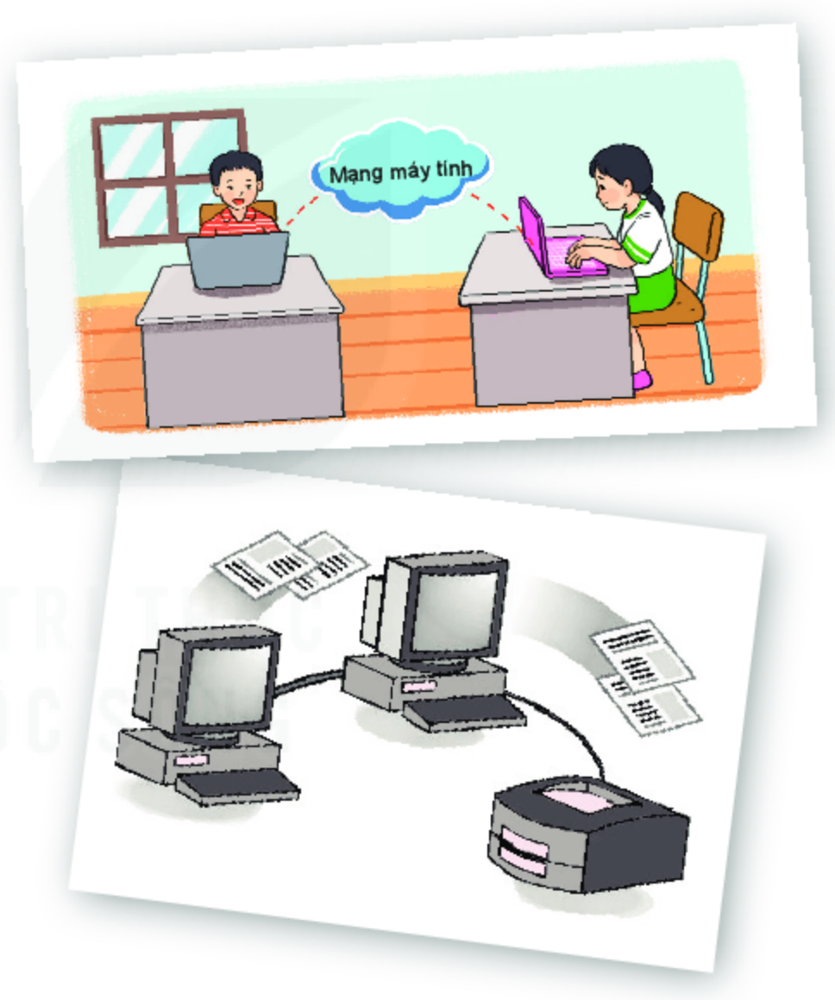
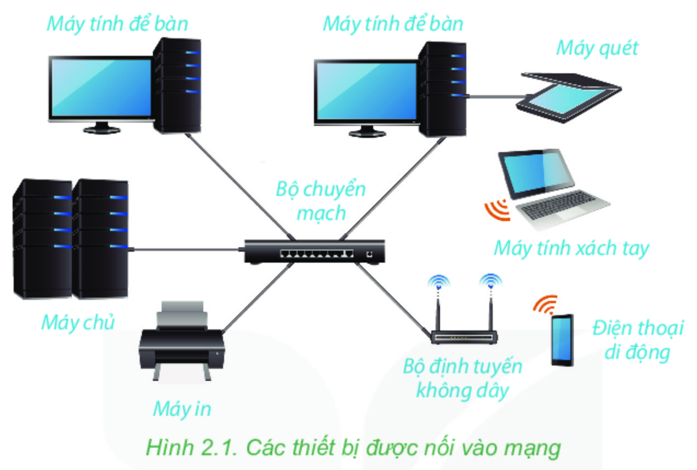
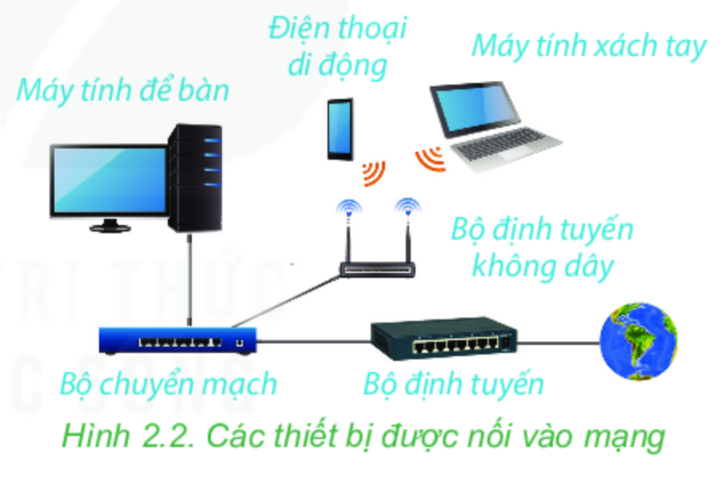
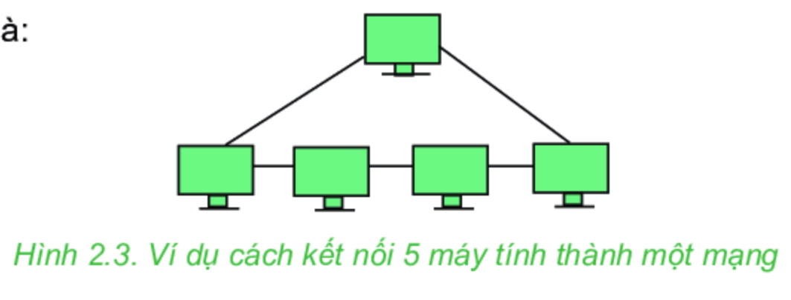

<!-- pdf:19 -->

# BÀI 4: MẠNG MÁY TÍNH

## 🎯 Sau bài này em sẽ:

- Biết được mạng máy tính là gì và lợi ích của nó trong cuộc sống.
- Kể được tên những thành phần chính của một mạng máy tính.
- Nêu được ví dụ cụ thể về trường hợp mạng không dây tiện dụng hơn mạng có dây.

## 🔴 Khởi động

**An:** Tại sao những nơi có đường đi qua thường trù phú hơn những nơi khác?

**Khoa:** Đường làm nên sự kì diệu. Đường nối các ngôi nhà, làng mạc, thành phố,... với nhau, làm xa trở nên gần. Đường đưa mọi người đến với nhau, làm cho thế giới trở nên thân thiện hơn.

**An:** Như vậy, đường không chỉ là nơi đi lại mà còn là sự kết nối, phải không?

**Khoa:** Các con đường đan với nhau thành mạng lưới. Nhiều mạng nhỏ được nối với nhau thành mạng lớn hơn,... Cứ như thế, mạng giao thông mở rộng ra khắp nơi trên Trái Đất. Hơn thế nữa, còn có cả những đường không nhìn thấy như đường của máy bay trên không trung và đường của tàu trên sông, biển.

**An:** Thế thì làm sao để giao thông được thông suốt?

**Khoa:** Nơi giao nhau của những con đường có biển báo, có đèn giao thông, thậm chí phải có cảnh sát giao thông điều khiển xe trên các tuyến đường.

**An:** Tớ hiểu rồi! Mỗi người một cách đi nhưng nếu có kỉ luật thì ai cũng sẽ đến được đích của mình. Giao thông có kỉ luật thật là tuyệt vời!

> **Hoạt động 1: Mạng lưới**
>
> 1. Em hãy kể ra một số mạng lưới, giống như mạng giao thông đường bộ.
> 2. Mỗi mạng lưới đó vận chuyển gì?
> 3. Em hãy chọn các phương án trả lời đúng.
>    Điểm chung của những mạng lưới đó là gì?
>    A. Có nhiều thành viên. &emsp; B. Chia sẻ tài nguyên.
>    C. Kết nối các thành viên. &emsp; D. Có nhiều đường cắt nhau.

<!-- pdf:20 -->

## 1. MẠNG MÁY TÍNH LÀ GÌ?

Không chỉ đường bộ mà nhiều loại đường khác cũng được nối thành **mạng lưới** như mạng đường sắt, mạng đường thuỷ, mạng ống nước, mạng tải điện, mạng điện thoại,... Đặc điểm chung của các mạng lưới là:

- **Kết nối:** Nếu một đoạn đường bị sạt lở thì giao thông sẽ bị ngưng trệ. Điều đó có nghĩa là mạng sẽ chỉ hoạt động nếu được kết nối.
- **Chia sẻ:** Đường giúp em đi đến trường, đường cũng giúp các bạn khác đến trường. Điều đó có nghĩa là mạng chia sẻ tài nguyên cho nhiều người.

> **Hoạt động 2: Mạng máy tính**
>
> 1. Mạng máy tính chia sẻ những gì?
> 2. Em hãy nêu một số ví dụ về lợi ích của mạng

Giống như mạng giao thông, các máy tính cũng được kết nối với nhau để tạo thành mạng máy tính. Chỉ cần hai máy tính kết nối với nhau là có một mạng máy tính.

Người sử dụng mạng có thể trao đổi dữ liệu với nhau. Chẳng hạn, bạn Minh có thể gửi một tệp ảnh từ máy tính của mình đến máy tính của bạn An nếu hai máy tính đó được kết nối với nhau. Đó là trao đổi dữ liệu.

Các thiết bị trên mạng có thể được chia sẻ. Chẳng hạn, chỉ có một máy in nhưng nếu có kết nối mạng thì ta có thể in từ một máy tính bất kì trong mạng. Điều đó có nghĩa là máy in đó được chia sẻ và chúng ta có thể dùng chung.

> **MẠNG MÁY TÍNH:**
> - Hai hay nhiều máy tính và các thiết bị được kết nối để truyền thông tin cho nhau tạo thành một **mạng máy tính**.
> - **Lợi ích của mạng máy tính**: Người sử dụng có thể liên lạc với nhau để trao đổi thông tin, chia sẻ dữ liệu và dùng chung các thiết bị trên mạng.

> ❓ **Câu hỏi**
>
> Em hãy thảo luận với bạn về lợi ích của mạng máy tính.

<!-- pdf:21 -->

## 2. CÁC THÀNH PHẦN CỦA MẠNG MÁY TÍNH

> **Hoạt động 3: Thành phần mạng**
>
> 1. Quan sát Hình 2.1 và cho biết những thiết bị nào đang được nối vào mạng?
> 2. Các thiết bị đó được nối với nhau như thế nào? Qua các thiết bị trung gian nào?

*Hình 2.1. Các thiết bị được nối vào mạng*

Một mạng máy tính thường gồm những thành phần chủ yếu sau:

- **Các thiết bị đầu cuối** giống như điểm xuất phát hoặc đích đến trong mạng giao thông. Các thiết bị đầu cuối có thể là máy tính để bàn, máy tính xách tay, điện thoại thông minh, máy ảnh, máy in, máy quét,...
- **Các thiết bị kết nối** được dùng để nối các thiết bị đầu cuối lại với nhau giống như con đường, nhà ga, sân bay,... Các thiết bị này bao gồm đường truyền (có dây và không dây), bộ chia (Hub), bộ chuyển mạch (Switch), bộ định tuyến (Router), bộ định tuyến không dây (Access Point, Wifi Router),...
- **Phần mềm mạng** có vai trò như hệ thống duy trì luật lệ giao thông để các phương tiện có thể đi đến nơi cần đến. Phần mềm mạng gồm ứng dụng truyền thông trên các thiết bị đầu cuối và phần mềm điều khiển quá trình truyền dữ liệu trên các thiết bị kết nối.

> 📌 Máy tính được nói tới trong mạng máy tính bao gồm cả những thiết bị có thể xử lí thông tin như máy tính bảng, điện thoại thông minh, máy ảnh,...
<!-- ocr-ok: đã đối chiếu ảnh trang gốc 21, ghi chú giấy nhớ in nghiêng bên phải -->

> **CÁC THÀNH PHẦN CHÍNH CỦA MẠNG MÁY TÍNH:**
> Mạng máy tính gồm
> - Các thiết bị đầu cuối (máy tính, điện thoại, máy in, máy ảnh,...).
> - Các thiết bị kết nối (đường truyền dữ liệu, bộ chia, bộ chuyển mạch, bộ định tuyến,...)
> - Phần mềm mạng (ứng dụng truyền thông và phần mềm điều khiển truyền dữ liệu).

<!-- pdf:22 -->

**Đường truyền dữ liệu** giống như đường vận chuyển trong mạng giao thông, có đường nhìn thấy và không nhìn thấy. Đường truyền dữ liệu nhìn thấy sử dụng dây dẫn mạng. Đường truyền dữ liệu không nhìn thấy sử dụng sóng vô tuyến như wifi, bluetooth,...

**Kết nối không dây** thường được sử dụng trong các thiết bị di động như máy tính xách tay, điện thoại thông minh, tai nghe không dây,... Kết nối không dây giúp cho việc kết nối mạng trở nên thuận tiện hơn. Các thiết bị trong mạng có thể linh hoạt thay đổi vị trí mà vẫn duy trì kết nối mạng. Chẳng hạn, khi đang di chuyển trên xe khách, hành khách có thể sử dụng điện thoại di động để truy cập Internet mà không cần dây nối. Kết nối không dây có thể thực hiện ở mọi địa hình, không gian. Việc lắp đặt và mở rộng mạng rất dễ dàng vì không cần phải đi dây và khoan đục tường. Việc không sử dụng dây trong kết nối mạng còn tránh được những sự cố như đứt dây do mưa bão hay đơn giản hơn là chuột cắn làm đường dây bị hư hại. Ngày nay, **mạng không dây** (có phí hoặc miễn phí) được cung cấp ở rất nhiều nơi, đặc biệt là những nơi cộng cộng như sân bay, nhà ga, trung tâm thương mại, trường học,... Người sử dụng có thể truy cập mạng một cách nhanh chóng và dễ dàng.

> ❓ **Câu hỏi**
>
> 1. Em hãy quan sát Hình 2.1 và cho biết:
>    a) Tên các thiết bị đầu cuối.
>    b) Tên các thiết bị kết nối.
> 2. Em hãy kể tên một số cách kết nối không dây mà em biết.
> 3. Em hãy nêu ví dụ cho thấy kết nối không dây thuận tiện hơn kết nối có dây.

## ✏️ Luyện tập

1. Em hãy chọn các phương án đúng.
   Máy tính kết nối với nhau để:
   A. Chia sẻ các thiết bị.
   B. Tiết kiệm điện.
   C. Trao đổi dữ liệu.
   D. Thuận lợi cho việc sửa chữa.
2. Em hãy chọn các phương án đúng.
   Thiết bị có kết nối không dây ở Hình 2.2 là:
   A. Máy tính để bàn.
   B. Máy tính xách tay.
   C. Điện thoại di động.
   D. Bộ định tuyến.

*Hình 2.2. Các thiết bị được nối vào mạng*
<!-- ocr-ok: đã đối chiếu ảnh trang gốc 22, chú thích Hình 2.2 in nghiêng màu xanh lá -->

*Hình 2.3. Ví dụ cách kết nối 5 máy tính thành một mạng*

## 🚀 Vận dụng

1. Phòng thư viện của trường có 5 máy tính cần kết nối thành một mạng. Có thể có nhiều cách kết nối, ví dụ như Hình 2.3.
   Em hãy vẽ hai cách khác để kết nối chúng thành một mạng. So sánh cách của em với các bạn khác.
2. Nhà bạn An có điện thoại di động của bố, của mẹ và một máy tính xách tay đang cùng truy cập mạng Internet. Theo em, các thiết bị đó có đang được kết nối thành một mạng máy tính không? Nếu có, em hãy chỉ ra các thiết bị đầu cuối và thiết bị kết nối.

## 📷 Danh sách hình trong bài

| Mã hình | Trang PDF | Trang sách | Chú thích |
| --- | :---: | :---: | --- |
| H6-tin-b04-01 | 20 | 19 | (sách không đánh số, hình minh hoạ trao đổi dữ liệu và dùng chung máy in trong mạng máy tính) |
| H6-tin-b04-02 | 21 | 20 | Hình 2.1. Các thiết bị được nối vào mạng |
| H6-tin-b04-03 | 22 | 21 | Hình 2.2. Các thiết bị được nối vào mạng |
| H6-tin-b04-04 | 22 | 21 | Hình 2.3. Ví dụ cách kết nối 5 máy tính thành một mạng |
