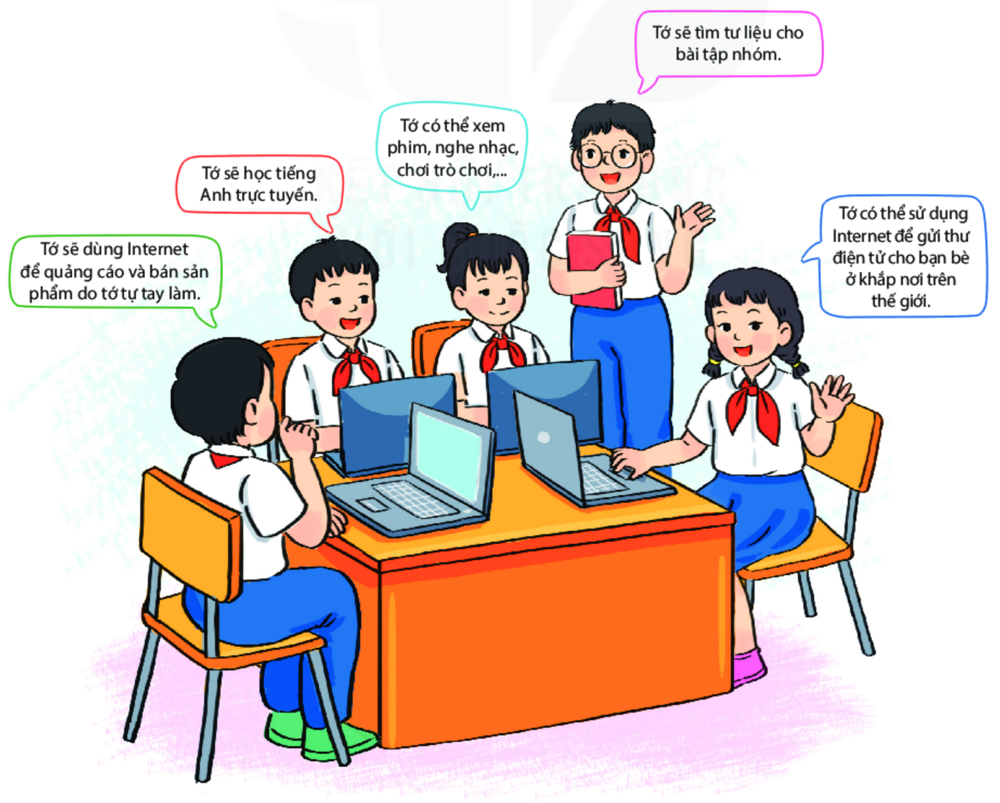

<!-- pdf:23 -->

# BÀI 5: INTERNET

## 🎯 Sau bài này em sẽ:

- Biết Internet là gì.
- Biết một số đặc điểm chính của Internet.
- Biết một số lợi ích chính của Internet.

## 🔴 Khởi động

**An:** Mẹ tớ có việc gấp cần đi công tác ngay nhưng bận quá chưa đến phòng vé máy bay được.

**Minh:** Quá đơn giản! Mẹ bạn có thể đặt vé trên Internet mà không cần phải đến phòng vé.

**An:** Vậy sao?

**Minh:** Các hãng hàng không đăng tin về các chuyến bay, giờ bay, giá vé trên Internet. Nếu có kết nối Internet, mẹ bạn có thể tìm thông tin, đặt vé và thanh toán.

**An:** Thật tuyệt! Tớ sẽ nói với mẹ ngay.

## 1. INTERNET

> **Hoạt động 1: Internet**
>
> 1. Em hiểu Internet là gì?
> 2. Người sử dụng có thể làm được những gì khi truy cập Internet?

- Các tổ chức và cá nhân trên khắp thế giới có thể cung cấp và tiếp nhận thông tin bằng cách kết nối máy tính của họ thành một mạng. **Internet** là một mạng toàn cầu được tạo ra để liên kết những mạng máy tính như thế.
- Muốn truy cập Internet thì máy tính của người sử dụng cần có kết nối với Internet. Người sử dụng cần đăng kí với **nhà cung cấp dịch vụ Internet** (Internet Service Provider - **ISP**) để được hỗ trợ cài đặt và cấp quyền truy cập Internet.
- Người sử dụng truy cập Internet để tìm kiếm, chia sẻ và trao đổi thông tin.
- Các **dịch vụ thông tin** phổ biến trên Internet gồm: mạng thông tin toàn cầu (WWW), tìm kiếm, thư điện tử, điện thoại, phát thanh, truyền hình, mạng xã hội, lưu trữ, trao đổi dữ liệu, kinh doanh,...

> 📌 Internet là mạng của các mạng máy tính.
<!-- ocr-ok: đã đối chiếu ảnh trang gốc 23, ghi chú giấy nhớ in nghiêng bên phải -->

<!-- pdf:24 -->

> - **Internet** là mạng liên kết các mạng máy tính trên khắp thế giới.
> - Máy tính có thể được kết nối với Internet thông qua một nhà cung cấp dịch vụ Internet.
> - Người sử dụng truy cập Internet để tìm kiếm, chia sẻ, lưu trữ và trao đổi thông tin.
> - Có nhiều dịch vụ thông tin khác nhau trên Internet: WWW, tìm kiếm, thư điện tử,...

> ❓ **Câu hỏi**
>
> Em hãy thay các số trong mỗi câu bằng một từ hoặc cụm từ thích hợp.
> chia sẻ &emsp; liên kết &emsp; thông tin &emsp; dịch vụ &emsp; mạng
> a) Internet là mạng ...(1)... các ...(2)... máy tính trên khắp thế giới.
> b) Người sử dụng truy cập Internet để tìm kiếm, ...(3)... lưu trữ và trao đổi ...(4).....
> c) Có nhiều ...(5)... thông tin khác nhau trên Internet.

## 2. ĐẶC ĐIỂM CỦA INTERNET

> **Hoạt động 2: Đặc điểm của Internet**
>
> Theo em Internet có những đặc điểm gì?

Internet có các đặc điểm chính sau:

- **Tính toàn cầu**: Hiện nay có khoảng hơn một phần ba dân số trên thế giới ở hầu hết các quốc gia đang sử dụng Internet.
- **Tính tương tác**: Người sử dụng có thể tức thời nhận và gửi thông tin, khác với cách truyền thông một chiều của sách báo, phát thanh, truyền hình truyền thống.
- **Tính dễ tiếp cận**: Người sử dụng có thể tìm kiếm, lưu trữ, trao đổi và chia sẻ thông tin một cách thuận lợi, nhanh chóng ở mọi lúc, mọi nơi trên thế giới.
- **Tính không chủ sở hữu**: Internet là một mạng máy tính công cộng toàn cầu, không thuộc sở hữu hay do bất kì một tổ chức hoặc cá nhân nào điều hành.

Ngoài những đặc điểm chính kể trên, Internet còn có một số đặc điểm khác như:

- **Tính cập nhật**: Thông tin được cập nhật thường xuyên.
- **Tính lưu trữ**: Thông tin được lưu trữ thường trực, có thể sao chép nhanh và dễ dàng.
- **Tính đa dạng**: Truyền tải thông tin dạng văn bản, âm thanh, hình ảnh, video,...
- **Tính ẩn danh**: Người sử dụng truy cập Internet có thể dùng bí danh thay cho tên thật.

<!-- pdf:25 -->

> **Đặc điểm chính của Internet**: tính toàn cầu, tính tương tác, tính dễ tiếp cận, tính không chủ sở hữu.

> ❓ **Câu hỏi**
>
> 1. Em hãy chọn các phương án trả lời đúng.
>    Internet có những đặc điểm chính nào dưới đây:
>    A. Tính toàn cầu. &emsp; B. Tính tương tác. &emsp; C. Tính lưu trữ.
>    D. Tính dễ tiếp cận. &emsp; E. Tính đa dạng. &emsp; F. Tính không chủ sở hữu.
> 2. Trong các đặc điểm của Internet, em thích đặc điểm nào nhất?

## 3. MỘT SỐ LỢI ÍCH CỦA INTERNET

> **Hoạt động 3: Lợi ích của Internet**
>
> 1. Em thường truy cập Internet để làm những việc gì?
> 2. Internet có những lợi ích gì?

<!-- pdf:26 -->

Ngày nay, Internet có vai trò rất quan trọng trong mọi hoạt động của xã hội, từ các lĩnh vực sản xuất, kinh doanh cho đến khoa học kĩ thuật, y tế, giáo dục, văn hoá, giải trí,... Có được vai trò quan trọng đó vì Internet cung cấp nhiều dịch vụ thông tin như: WWW, tìm kiếm, thư điện tử, điện thoại, phát thanh, truyền hình, mạng xã hội, lưu trữ, trao đổi dữ liệu, kinh doanh,... Ngoài ra, Internet còn cung cấp môi trường làm việc từ xa như: viết sách báo, học tập, dạy học, hội họp,... Nhờ vậy, Internet góp phần thúc đẩy xã hội phát triển.

> 📌 Không nên truy cập Internet liên tục trong nhiều giờ.
<!-- ocr-ok: đã đối chiếu ảnh trang gốc 26, ghi chú giấy nhớ in nghiêng bên phải -->

<!-- term: Lợi ích của Internet -->
> LỢI ÍCH CỦA INTERNET
> - Trao đổi thông tin nhanh chóng, hiệu quả.
> - Học tập và làm việc trực tuyến.
> - Cung cấp nguồn tài liệu phong phú.
> - Cung cấp các tiện ích phục vụ đời sống.
> - Là phương tiện vui chơi, giải trí.

> ❓ **Câu hỏi**
>
> Em hãy chọn những việc mà em có thể làm với Internet.
> a) Học ngoại ngữ trực tuyến với người nước ngoài.
> b) Nghe nhạc, xem phim trực tuyến.
> c) Chơi đá bóng để nâng cao sức khỏe.
> d) Tìm kiếm tư liệu học tập.
> e) Gửi thư điện tử.

## ✏️ Luyện tập

1. Em hãy chọn phương án đúng.
   Internet là mạng:
   A. Kết nối hai máy tính với nhau.
   B. Kết nối các máy tính trong một nước.
   C. Kết nối nhiều mạng máy tính trên phạm vi toàn cầu.
   D. Kết nối các máy tính trong một thành phố.
2. Để máy tính kết nối được Internet ta cần làm gì?

## 🚀 Vận dụng

1. Em hãy lấy ví dụ cho thấy Internet mang lại lợi ích cho việc học tập và giải trí.
2. Em hãy giải thích tại sao Internet lại được sử dụng rộng rãi và ngày càng phát triển.

## 📷 Danh sách hình trong bài

| Mã hình | Trang PDF | Trang sách | Chú thích |
| --- | :---: | :---: | --- |
| H6-tin-b05-01 | 25 | 24 | (sách không đánh số, hình minh hoạ các bạn học sinh nêu lợi ích của Internet ở Hoạt động 3) |
