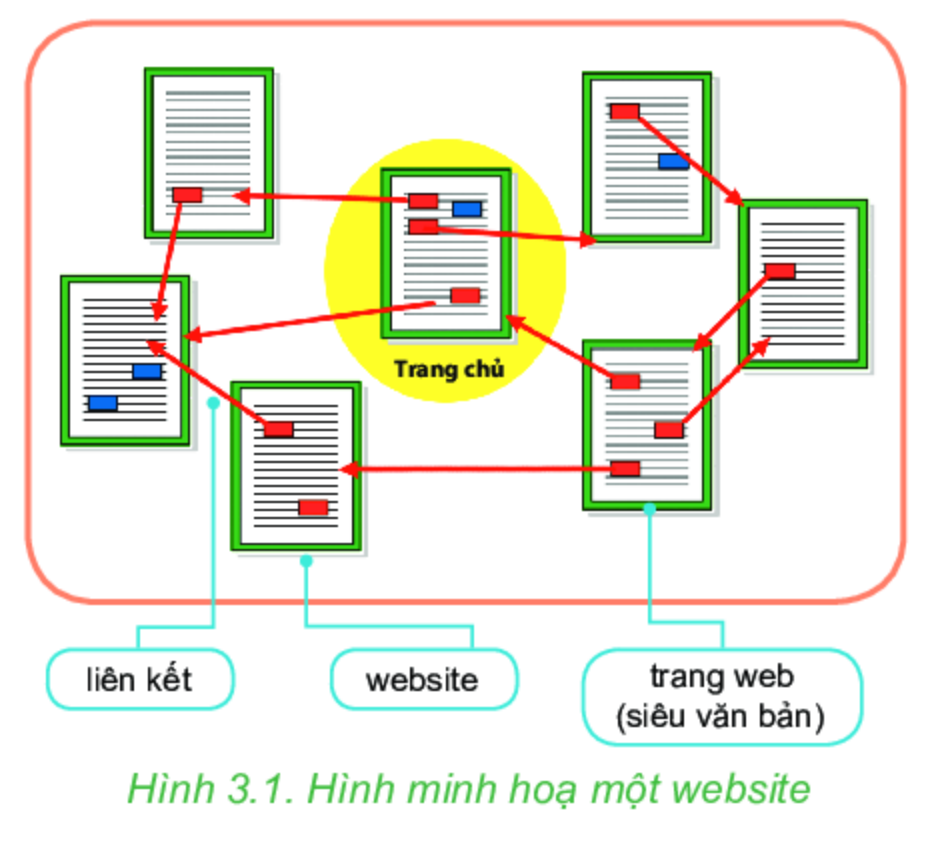
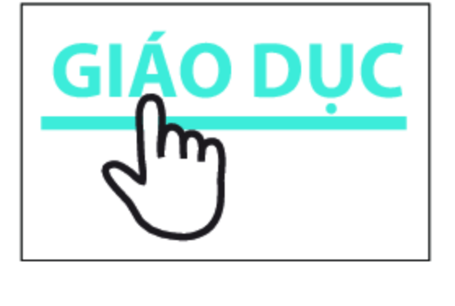
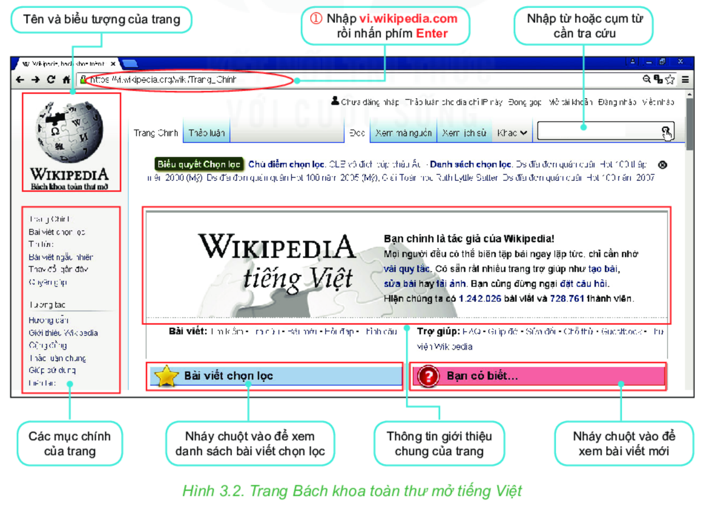
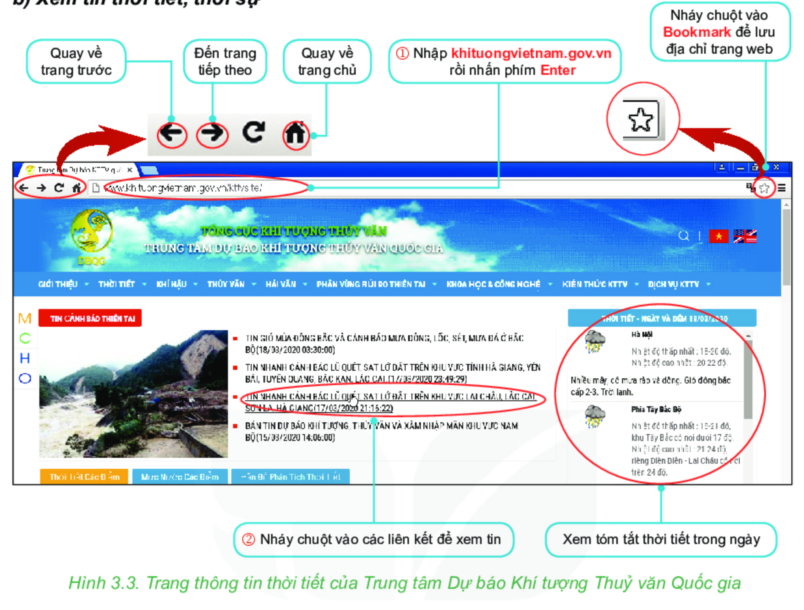
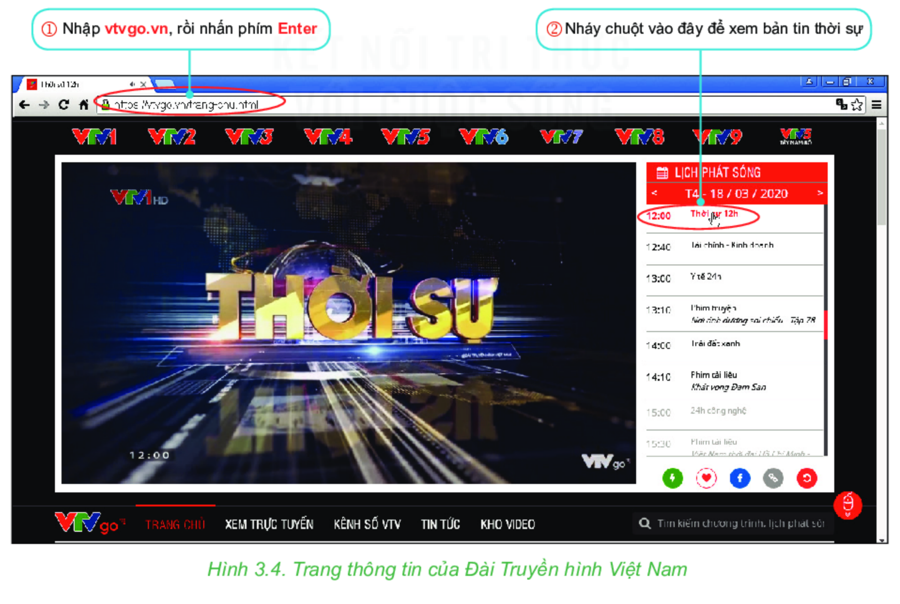

<!-- pdf:28 -->

# BÀI 6: MẠNG THÔNG TIN TOÀN CẦU

## 🎯 Sau bài này em sẽ:

- Trình bày sơ lược được các khái niệm World Wide Web (WWW), website, địa chỉ của website, trình duyệt.
- Xem và nêu được các thông tin chính trên trang web cho trước.
- Khai thác được thông tin trên một số trang web thông dụng: tra từ điển, xem tin thời tiết, thời sự,...

## 🔴 Khởi động

> Khi truy cập Internet, em sẽ bước vào một thế giới thông tin vô cùng rộng lớn. Các trang thông tin trên Internet sẽ đưa tâm trí em đi từ những câu chuyện hấp dẫn đến những bản nhạc du dương, từ những hình ảnh đẹp đến những kho tri thức quý giá. Các trang thông tin được nối với nhau tạo thành một mạng giống như một mạng nhện khổng lồ bao trùm lên cả thế giới nên nó được gọi là World Wide Web (WWW) hay mạng thông tin toàn cầu. Đối với người sử dụng, mạng thông tin toàn cầu là một dịch vụ trên Internet.

## 1. TỔ CHỨC THÔNG TIN TRÊN INTERNET

> **Hoạt động 1: Tìm hiểu cách tổ chức thông tin**
>
> Thảo luận với bạn:
> 1. Thông tin trong một cuốn sách được tổ chức như thế nào?
> 2. Em đã xem thông tin trên Internet chưa? Trên Internet có những dạng thông tin gì?

Kho thông tin khổng lồ trên Internet được tạo nên từ nhiều trang web.

- **Trang siêu văn bản** là trang văn bản đặc biệt, tích hợp nhiều dạng dữ liệu khác nhau như văn bản, hình ảnh, âm thanh, video,... và các **liên kết** trỏ đến vị trí khác trong trang hay các trang web khác.
- Mỗi **trang web** là một trang siêu văn bản được gán cho một địa chỉ.
- Mỗi **website** là tập hợp các trang web liên quan và được truy cập thông qua một địa chỉ.

*Hình 3.1. Hình minh hoạ một website*
<!-- ocr-ok: đã đối chiếu ảnh trang gốc 28, chú thích hình in nghiêng màu xanh lá bị OCR bỏ sót -->

<!-- pdf:29 -->

- Mỗi website do một người hoặc một tổ chức quản lí. **Trang chủ** (homepage) của website là trang được mở ra đầu tiên khi truy cập website đó. Địa chỉ của trang chủ chính là **địa chỉ của website**.
- Hệ thống các website trên Internet tạo thành **Mạng thông tin toàn cầu** (**World Wide Web**, viết tắt là **WWW**).

Ví dụ:

http://thieunien.vn là địa chỉ của website báo Thiếu niên Tiền phong.

https://vi.wikipedia.org là địa chỉ trang chủ của website Bách khoa toàn thư mở tiếng Việt.

https://vi.wikipedia.org/wiki/Internet là địa chỉ của trang web về Internet trong website Bách khoa toàn thư mở tiếng Việt.

> 💡 **EM CÓ BIẾT?**
>
> **web** có nguồn gốc từ spider–web, nghĩa là mạng nhện trong tiếng Anh.
<!-- ocr-ok: đã đối chiếu ảnh trang gốc 29, giấy ghi chú màu vàng in nghiêng góc bị OCR bỏ sót -->

> - Thông tin trên Internet được tạo nên từ nhiều trang web kết nối với nhau bởi các liên kết. Mỗi trang web có địa chỉ truy cập riêng.
> - Website là một tập hợp các trang web liên quan được truy cập thông qua một địa chỉ. Địa chỉ của trang chủ là địa chỉ của website.
> - World Wide Web (WWW) là mạng thông tin toàn cầu, liên kết các website trên Internet.

> ❓ **Câu hỏi**
>
> 1. Em hãy chọn phương án đúng.
>    Trang siêu văn bản là
>    A. Trang văn bản thông thường không chứa liên kết.
>    B. Trang văn bản đặc biệt tích hợp nhiều dạng dữ liệu khác nhau và chứa các liên kết.
>    C. Trang văn bản đặc biệt tích hợp nhiều dạng dữ liệu khác nhau không chứa liên kết.
> 2. Hãy nêu địa chỉ một số website có nội dung phục vụ việc học tập.

## 2. TRÌNH DUYỆT

- Người sử dụng muốn truy cập các website thì cần phải sử dụng một phần mềm ứng dụng được gọi là **trình duyệt** (web browser).
- Một số trình duyệt được dùng phổ biến là Mozilla Firefox, Google Chrome, Safari, Cốc cốc, Microsoft Edge,...
- Các trình duyệt có các chức năng chính và cách sử dụng tương tự nhau. Người sử dụng có thể cài đặt và sử dụng nhiều trình duyệt trên một máy tính.
- Để truy cập một trang web, ta có thể nhập địa chỉ của trang đó vào thanh địa chỉ của trình duyệt.
- Trang web có chứa các liên kết chỉ dẫn tới các trang web khác. Nháy chuột vào liên kết để chuyển tới trang web được xác định bởi liên kết đó. Hoạt động di chuyển theo các liên kết được gọi là **duyệt web**. Quá trình này cho phép người sử dụng xem các trang web để lấy thông tin.
- Khi di chuyển con trỏ chuột vào liên kết, biểu tượng con trỏ chuột thường chuyển thành hình bàn tay như hình dưới đây:

<!-- pdf:30 -->

> - Trình duyệt là phần mềm giúp người dùng truy cập các trang web trên Internet.
> - Người sử dụng có thể theo các liên kết để khai thác thông tin từ các trang web.

> ❓ **Câu hỏi**
>
> 1. Em hãy kể tên một số trình duyệt mà em biết.
> 2. Để truy cập một trang web ta cần làm thế nào?

## 3. THỰC HÀNH: KHAI THÁC THÔNG TIN TRÊN TRANG WEB

**Nhiệm vụ**

- Sử dụng trình duyệt truy cập vào trang Bách khoa toàn thư mở tiếng Việt có địa chỉ https://vi.wikipedia.org để xem và tra cứu thông tin.
- Khai thác thông tin trên một số trang web thông dụng.

**Hướng dẫn**

*(Các hướng dẫn sau đây sử dụng trình duyệt Google Chrome để minh hoạ.)*

### a) Mở trình duyệt

- Nháy đúp chuột vào biểu tượng trình duyệt.
- Nhập địa chỉ trang web vào ô địa chỉ.
- Nhấn phím **Enter**.

Trang Bách khoa toàn thư mở được hiển thị như Hình 3.2.

*Hình 3.2. Trang Bách khoa toàn thư mở tiếng Việt*

<!-- pdf:31 -->

### b) Xem tin thời tiết, thời sự

*Hình 3.3. Trang thông tin thời tiết của Trung tâm Dự báo Khí tượng Thuỷ văn Quốc gia*
<!-- ocr-ok: đã đối chiếu ảnh trang gốc 31, chú thích hình in nghiêng màu xanh lá bị OCR bỏ sót -->

*Hình 3.4. Trang thông tin của Đài Truyền hình Việt Nam*
<!-- ocr-ok: đã đối chiếu ảnh trang gốc 31, chú thích hình in nghiêng màu xanh lá bị OCR bỏ sót -->

<!-- pdf:32 -->

<!-- term: Thanh Bookmark -->
Lưu ý:
- Em có thể lưu địa chỉ trang web vào thanh Bookmark của trình duyệt để truy cập lại khi cần.
- Khi muốn truy cập lại trang web, nháy chuột vào tên trang web đó trên thanh Bookmark.

## ✏️ Luyện tập

1. Thông tin trên Internet được tổ chức như thế nào?
   A. Tương tự như thông tin trong cuốn sách.
   B. Thành từng văn bản rời rạc.
   C. Thành các siêu văn bản kết nối với nhau bởi các liên kết.
   D. Một cách tuỳ ý.

2. Em hãy ghép mỗi nội dung ở cột A với một nội dung phù hợp ở cột B.

| A | B |
| --- | --- |
| 1) Website là tập hợp | a) sử dụng trình duyệt web. |
| 2) Khi duyệt web, muốn chuyển đến một nội dung hoặc một trang web khác thì ta nháy chuột vào | b) website trên Internet. |
| 3) Để truy cập các trang web ta cần | c) các trang web liên quan. |
| 4) WWW là hệ thống các | d) liên kết trỏ đến đó. |

## 🚀 Vận dụng

1. Có điểm gì khác nhau giữa cách tổ chức thông tin trong cuốn sách với cách tổ chức thông tin trên Internet?
2. Em hãy sử dụng trình duyệt web để truy cập vào trang web có địa chỉ:
   http://hoahoctro.tienphong.vn và http://vtv7.vtv.vn để xem thông tin có trên trang web (tên, biểu tượng, các mục chính,...) và theo các liên kết trỏ đến các trang web khác.
   Lưu địa chỉ các trang web em thích vào thanh Bookmark.

## 📷 Danh sách hình trong bài

| Mã hình | Trang PDF | Trang sách | Chú thích |
| --- | --- | --- | --- |
| H6-tin-b06-01 | 28 | 27 | Hình 3.1. Hình minh hoạ một website |
| H6-tin-b06-02 | 29 | 28 | Minh hoạ biểu tượng con trỏ chuột hình bàn tay khi di chuyển vào liên kết |
| H6-tin-b06-03 | 30 | 29 | Hình 3.2. Trang Bách khoa toàn thư mở tiếng Việt |
| H6-tin-b06-04 | 31 | 30 | Hình 3.3. Trang thông tin thời tiết của Trung tâm Dự báo Khí tượng Thuỷ văn Quốc gia |
| H6-tin-b06-05 | 31 | 30 | Hình 3.4. Trang thông tin của Đài Truyền hình Việt Nam |
