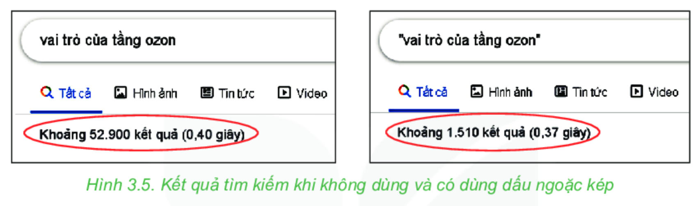
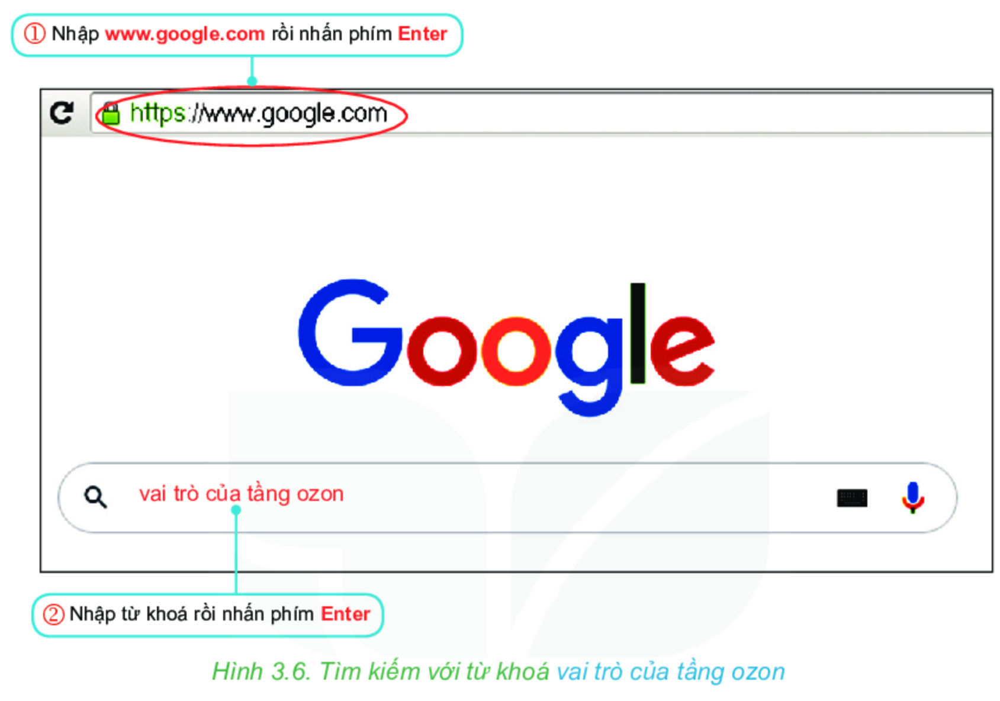
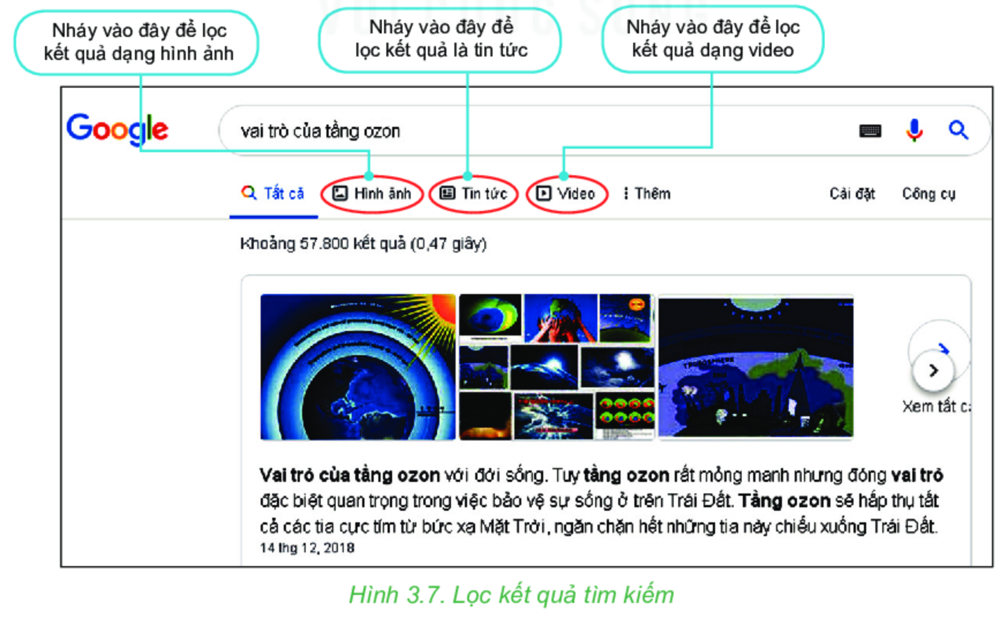
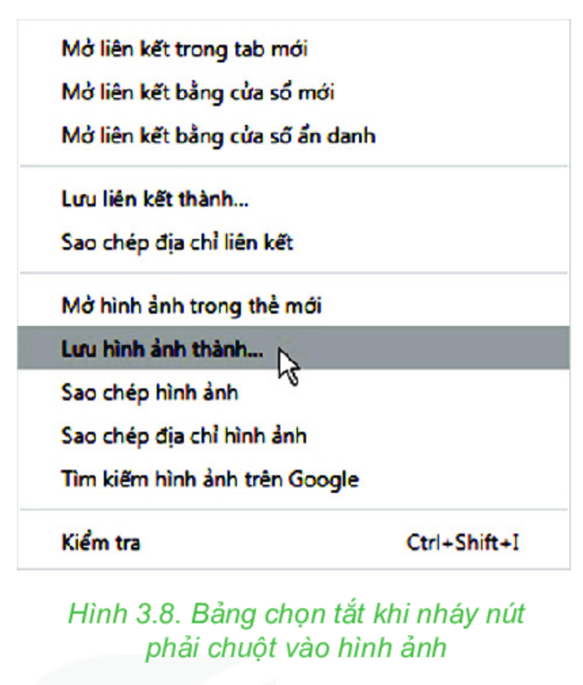

<!-- pdf:33 -->

# BÀI 7: TÌM KIẾM THÔNG TIN TRÊN INTERNET

## 🎯 Sau bài này em sẽ:

- Nêu được công dụng của máy tìm kiếm.
- Xác định được từ khoá ứng với mục đích tìm kiếm cho trước.
- Thực hiện được việc tìm kiếm và khai thác thông tin trên Internet.

## 🔴 Khởi động

> Mặc dù WWW là kho thông tin khổng lồ nhưng việc tìm kiếm trên đó có thể được thực hiện rất nhanh chóng và thuận tiện. Chẳng hạn, em chỉ cần nhớ vài câu trong một bài hát, em sẽ tìm thấy cả bài hát đó trên Internet với những video trình diễn của nhiều ca sĩ khác nhau. Bài học này sẽ giới thiệu với em máy tìm kiếm trên Internet và cách sử dụng nó.

## 1. TÌM KIẾM THÔNG TIN TRÊN INTERNET

> **Hoạt động 1: Tìm kiếm thông tin trên Internet**
>
> 1. Em đã bao giờ tìm kiếm thông tin trên Internet chưa? Em đã tìm gì? Kết quả có như em mong muốn không?
> 2. Em biết gì về máy tìm kiếm? Sử dụng máy tìm kiếm để tìm kiếm thông tin em thấy có thuận lợi và khó khăn gì?

Tìm kiếm thông tin là một trong các dịch vụ phổ biến của Internet.

**Máy tìm kiếm**

Người sử dụng có thể tìm kiếm thông tin trên Internet bằng cách dùng chức năng của một số website đặc biệt gọi là **máy tìm kiếm** (search engine).

Có nhiều máy tìm kiếm như www.yahoo.com, www.google.com, www.bing.com, coccoc.com,... Nhìn chung, cách dùng các máy tìm kiếm tương tự như nhau.
<!-- ocr-ok: đã đối chiếu ảnh trang gốc 33, các địa chỉ máy tìm kiếm in màu xanh bị OCR bỏ sót -->

Nhờ máy tìm kiếm, người sử dụng dễ dàng tìm được thông tin dựa vào các từ khoá. **Kết quả tìm kiếm** là danh sách liên kết trỏ đến các trang web có chứa từ khoá đó.

> - Internet là xa lộ thông tin giống như đường cao tốc nên khi sử dụng cần phải tuân thủ một số quy định của pháp luật.
> - Trên Internet có thông tin bổ ích và có cả thông tin độc hại. Vì vậy, em cần hỏi ý kiến bố mẹ trước khi truy cập Internet.
> - Không cung cấp thông tin cá nhân khi truy cập Internet.
<!-- ocr-ok: đã đối chiếu ảnh trang gốc 33, giấy ghi chú màu vàng in nghiêng góc bị OCR bỏ sót -->

<!-- pdf:34 -->

**Từ khoá**

**Từ khoá** là một từ hoặc cụm từ liên quan đến nội dung cần tìm kiếm do người sử dụng cung cấp.

<!-- term: Thu hẹp phạm vi tìm kiếm -->
Chọn từ khoá phù hợp sẽ giúp cho việc tìm kiếm đạt hiệu quả. Có thể đặt từ khoá trong dấu ngoặc kép (“ ”) để thu hẹp phạm vi tìm kiếm.

Ví dụ: Để tìm kiếm thông tin về vai trò của tầng ozon, nếu ta nhập từ khoá vai trò của tầng ozon thì kết quả sẽ là danh sách với số lượng rất nhiều các liên kết. Còn nếu ta nhập từ khoá “vai trò của tầng ozon”, kết quả hiển thị là danh sách với số lượng các liên kết ít hơn.

> Có thể dùng dấu cộng (+) hoặc trừ (–) để thêm hoặc bớt từ khoá (gia tăng hoặc thu hẹp phạm vi tìm kiếm thông tin).
<!-- ocr-ok: đã đối chiếu ảnh trang gốc 34, giấy ghi chú màu vàng in nghiêng góc bị OCR đọc sót -->

*Hình 3.5. Kết quả tìm kiếm khi không dùng và có dùng dấu ngoặc kép*

> - Máy tìm kiếm là một website đặc biệt, giúp người sử dụng tìm kiếm thông tin trên Internet một cách nhanh chóng, hiệu quả thông qua các từ khoá.
> - Kết quả tìm kiếm là danh sách các liên kết. Các liên kết có thể là văn bản, hình ảnh hoặc video.
> - Từ khoá tìm kiếm rất quan trọng. Lựa chọn từ khoá phù hợp sẽ giúp tìm kiếm thông tin nhanh và chính xác.

> ❓ **Câu hỏi**
>
> 1. Em hãy thay các số trong mỗi câu bằng một cụm từ thích hợp.
>    từ khoá   liên kết   tìm kiếm thông tin
>    a) Máy tìm kiếm là công cụ hỗ trợ ...(1)... trên Internet theo yêu cầu của người sử dụng.
>    b) Kết quả tìm kiếm là danh sách các ...(2)....
>    c) Cần chọn ...(3)... phù hợp.
> 2. Sử dụng máy tìm kiếm em sẽ nhận được kết quả là gì?
>    A. Danh sách liên kết trỏ đến các trang web có chứa từ khoá.
>    B. Nội dung thông tin cần tìm trên một trang web.
>    C. Danh sách địa chỉ các trang web có chứa thông tin cần tìm.
>    D. Danh sách liên kết dạng văn bản.

<!-- pdf:35 -->

## 2. THỰC HÀNH: TÌM KIẾM VÀ KHAI THÁC THÔNG TIN TRÊN INTERNET

**Nhiệm vụ**

Tìm kiếm thông tin và hình minh hoạ về vai trò của tầng ozon.

**Hướng dẫn**

*(Các hướng dẫn sau đây sử dụng máy tìm kiếm www.google.com để minh hoạ.)*

*Hình 3.6. Tìm kiếm với từ khoá vai trò của tầng ozon*
<!-- ocr-ok: đã đối chiếu ảnh trang gốc 35, chú thích hình in nghiêng màu xanh lá bị OCR bỏ sót -->

Thực hiện tìm kiếm lần lượt với từ khoá vai trò của tầng ozon và từ khoá “vai trò của tầng ozon”.

Các kết quả tìm kiếm được hiển thị dưới dạng danh sách liên kết. So sánh hai kết quả tìm được.

*Hình 3.7. Lọc kết quả tìm kiếm*
<!-- ocr-ok: đã đối chiếu ảnh trang gốc 35, chú thích hình in nghiêng màu xanh lá bị OCR bỏ sót -->

<!-- pdf:36 -->

Lưu ý: Các trang web có nội dung liên quan nhất đến từ khoá thường xuất hiện ở đầu danh sách kết quả. Em cần chọn lọc những thông tin chính xác, phù hợp để sử dụng.

Nháy chuột vào một liên kết dạng tin tức để xem nội dung và sao chép thông tin dạng văn bản về máy tính.
- Chọn nội dung cần sao chép, nhấn tổ hợp phím **Ctrl + C**.
- Mở tệp văn bản, nhấn tổ hợp phím **Ctrl + V**.

Nháy chuột vào một liên kết dạng hình ảnh để xem và lưu về máy tính.
- Nháy nút phải chuột vào hình ảnh trên trang web, xuất hiện **bảng chọn tắt**, chọn lệnh **Lưu hình ảnh thành...** để lưu hình ảnh thành tệp trên máy tính.

*Hình 3.8. Bảng chọn tắt khi nháy nút phải chuột vào hình ảnh*
<!-- ocr-ok: đã đối chiếu ảnh trang gốc 36, chú thích hình in nghiêng màu xanh lá bị OCR đọc sót -->

## ✏️ Luyện tập

1. Khi tìm kiếm bằng máy tìm kiếm, kết quả là danh sách liên kết dưới dạng nào?
   A. Văn bản.
   B. Hình ảnh.
   C. Video.
   D. Văn bản, hình ảnh, video.

2. Để tìm kiếm thông tin về lớp vỏ Trái Đất, em sử dụng từ khoá nào sau đây để thu hẹp phạm vi tìm kiếm?
   A. Trái Đất.
   B. Lớp vỏ Trái Đất.
   C. “lớp vỏ Trái Đất”.
   D. “lớp vỏ” + “Trái Đất”.

## 🚀 Vận dụng

1. Em hãy tìm thông tin về Văn Miếu – Quốc Tử Giám trên mạng Internet.
2. Gia đình em có kế hoạch đi du lịch thành phố Hạ Long. Mẹ nhờ em tìm thông tin về thời tiết và một số địa danh ở đó để tham quan. Em hãy sử dụng máy tìm kiếm để:
   a) Em hãy tìm thông tin về thời tiết ở thành phố Hạ Long trong tuần này.
   b) Em hãy tìm những điểm tham quan đẹp ở thành phố Hạ Long.
   c) Em hãy sao chép và lưu các thông tin, hình ảnh vào một tệp văn bản để giới thiệu với các thành viên trong gia đình.

## 📷 Danh sách hình trong bài

| Mã hình | Trang PDF | Trang sách | Chú thích |
| --- | --- | --- | --- |
| H6-tin-b07-01 | 34 | 33 | Hình 3.5. Kết quả tìm kiếm khi không dùng và có dùng dấu ngoặc kép |
| H6-tin-b07-02 | 35 | 34 | Hình 3.6. Tìm kiếm với từ khoá vai trò của tầng ozon |
| H6-tin-b07-03 | 35 | 34 | Hình 3.7. Lọc kết quả tìm kiếm |
| H6-tin-b07-04 | 36 | 35 | Hình 3.8. Bảng chọn tắt khi nháy nút phải chuột vào hình ảnh |
