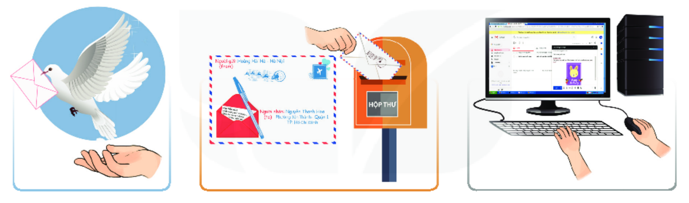
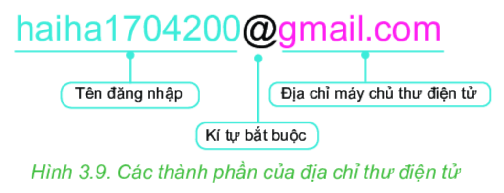
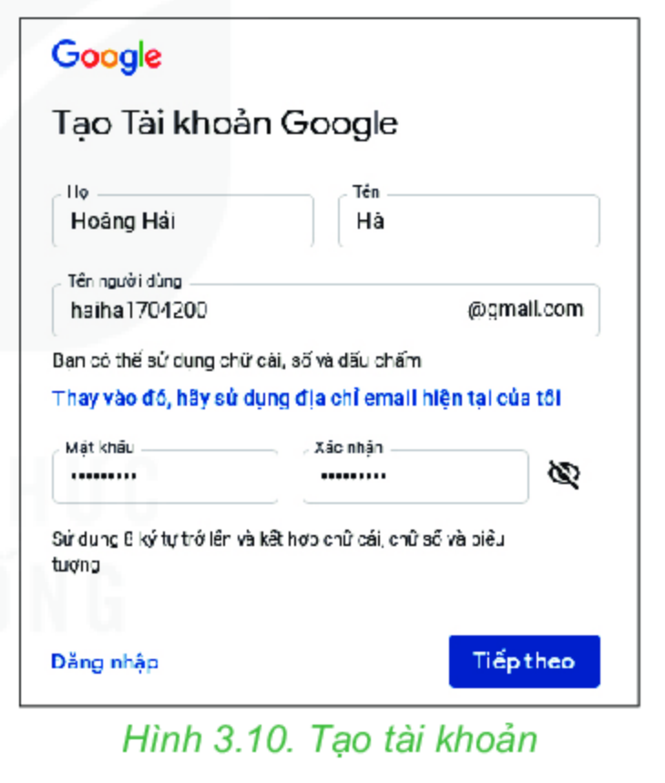
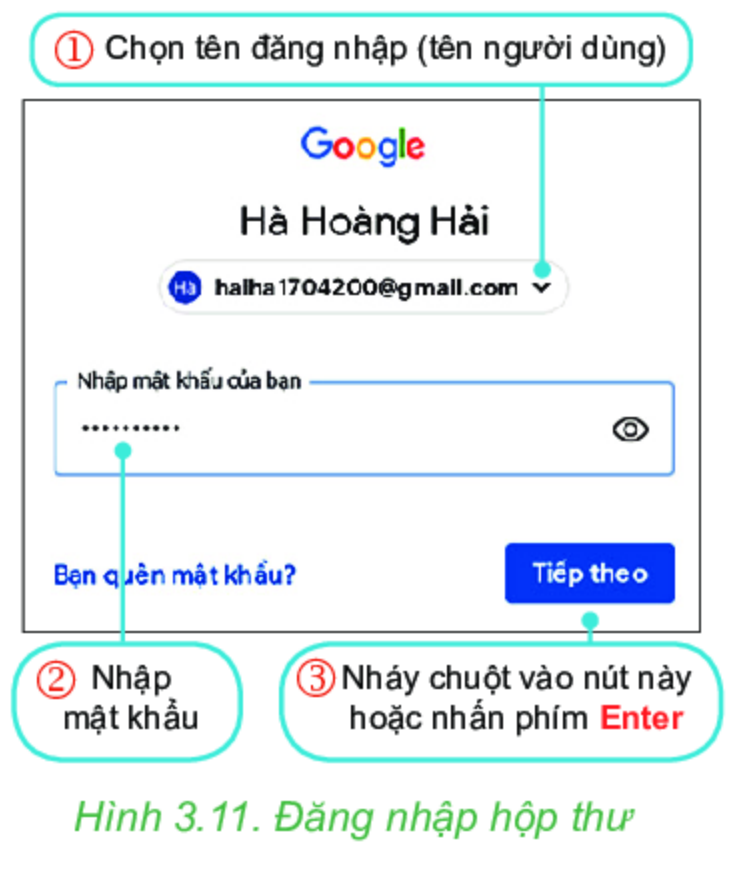
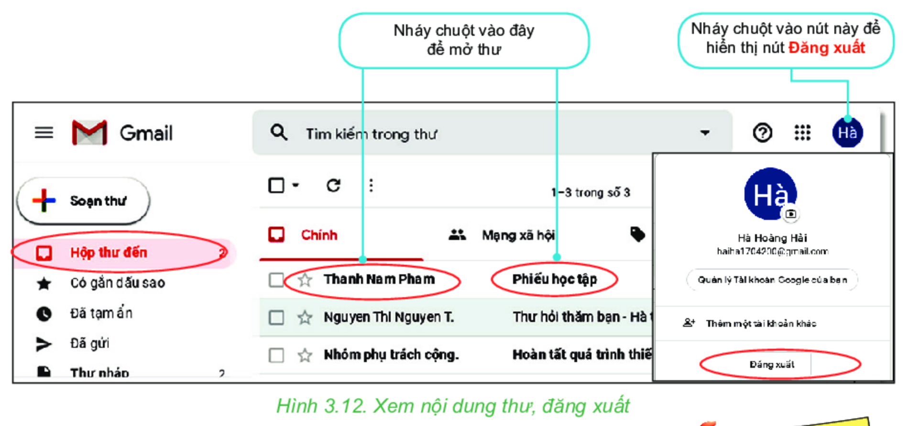
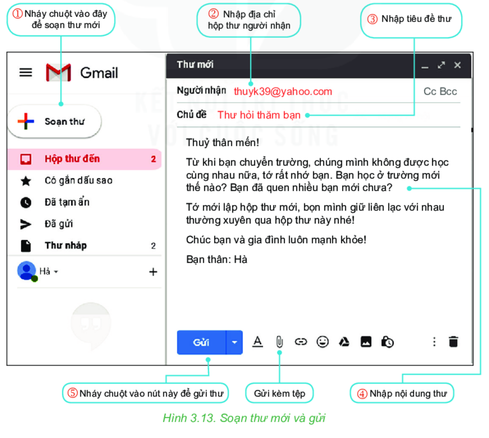
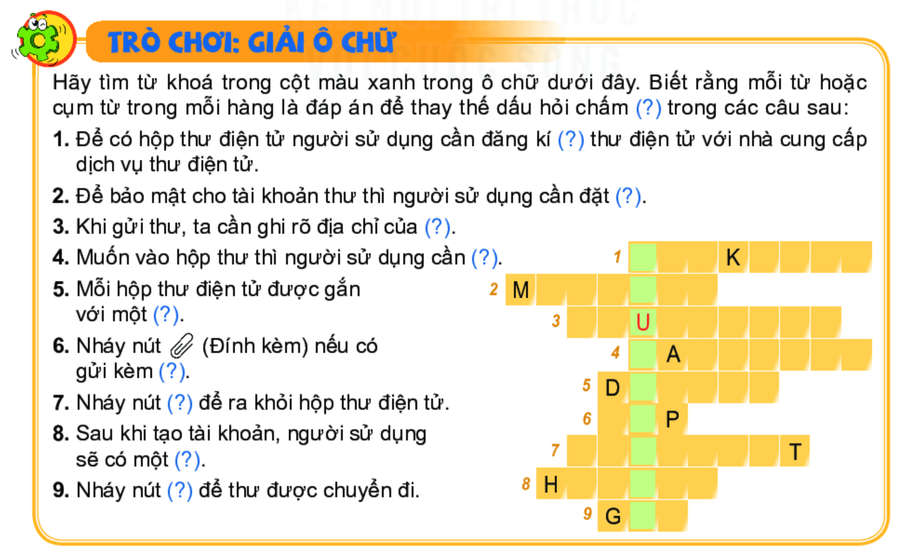

<!-- pdf:37 -->

# BÀI 8: THƯ ĐIỆN TỬ

## 🎯 Sau bài này em sẽ:

- Biết thư điện tử là gì; biết ưu điểm và nhược điểm cơ bản của dịch vụ thư điện tử so với các phương thức liên lạc khác.
- Biết tài khoản thư điện tử, hộp thư điện tử, thành phần của địa chỉ thư điện tử.
- Biết cách đăng kí tài khoản thư điện tử và thực hiện được việc đăng nhập, soạn, gửi, đăng xuất hộp thư điện tử.

## 🔴 Khởi động

> Ba hình ảnh sau cho em biết điều gì?

## 1. THƯ ĐIỆN TỬ. TÀI KHOẢN THƯ ĐIỆN TỬ

> **Hoạt động 1: Thư điện tử**
>
> 1. Để soạn và gửi một bức thư qua đường bưu điện đến tay người nhận thì cần những gì và thực hiện như thế nào?
> 2. Em biết gì về thư điện tử? Tài khoản thư điện tử?

- **Thư điện tử** (email hay e-mail) là thư được gửi và nhận bằng phương tiện điện tử trên mạng máy tính. Thư điện tử là một trong những hình thức trao đổi thông tin được rất nhiều người sử dụng.
- **Dịch vụ thư điện tử** là dịch vụ cung cấp các chức năng soạn thảo, gửi, nhận, chuyển tiếp, lưu trữ và quản lí thư điện tử cho người sử dụng.
- Người sử dụng đăng kí với nhà cung cấp dịch vụ thư điện tử để mở **tài khoản thư điện tử**. Người sử dụng có thể dùng dịch vụ thư điện tử trả phí hoặc miễn phí. Một số nhà cung cấp dịch vụ thư điện tử miễn phí: Google, Yahoo, Microsoft,...

<!-- pdf:38 -->

Khi có tài khoản thư điện tử, người sử dụng sẽ được cấp một **hộp thư điện tử** trên **máy chủ thư điện tử** cùng tên đăng nhập và mật khẩu. Hộp thư được gắn với một **địa chỉ thư điện tử**. Địa chỉ thư điện tử có dạng: `<tên đăng nhập>@<địa chỉ máy chủ thư điện tử>`.

Lưu ý:
- `<`**Tên đăng nhập**`>`: Do người sử dụng tự chọn khi đăng kí tài khoản thư điện tử.
- `<Địa chỉ máy chủ thư điện tử>`: Do nhà cung cấp dịch vụ quy định.
- `<`**Mật khẩu**`>`: Do người sử dụng tự chọn khi đăng kí.

> Mỗi địa chỉ thư điện tử là duy nhất trên toàn cầu.
<!-- ocr-ok: đã đối chiếu ảnh trang gốc 38, giấy ghi chú màu vàng in nghiêng góc bị OCR đọc sót -->

*Hình 3.9. Các thành phần của địa chỉ thư điện tử*

> - Thư điện tử là thư được gửi và nhận bằng phương tiện điện tử.
> - Khi đăng kí tài khoản thư điện tử, người sử dụng có một hộp thư điện tử cùng địa chỉ thư và mật khẩu.
> - Địa chỉ thư điện tử có dạng: `<tên đăng nhập>@<địa chỉ máy chủ thư điện tử>`.
> - Dịch vụ thư điện tử cung cấp các chức năng để soạn, gửi, nhận, chuyển tiếp, lưu trữ và quản lí thư điện tử cho người sử dụng.

> ❓ **Câu hỏi**
>
> 1. Dịch vụ thư điện tử là gì?
> 2. Địa chỉ thư điện tử nào sau đây không đúng? Tại sao?
>    A. khoa123@gmail.com
>    B. minhtuan.gmail.com
>    C. nmha@hnmu.edu.vn
>    D. thuyk39@yahoo.com

## 2. ƯU ĐIỂM VÀ NHƯỢC ĐIỂM CỦA DỊCH VỤ THƯ ĐIỆN TỬ

> **Hoạt động 2: Ưu điểm và nhược điểm của dịch vụ thư điện tử**
>
> Theo em dịch vụ thư điện tử có những ưu điểm và nhược điểm gì so với các phương thức liên lạc khác?

Từ khi ra đời, dịch vụ thư điện tử được nhiều cá nhân và các tổ chức sử dụng. So với các phương thức liên lạc khác, dịch vụ này có nhiều ưu điểm và cũng có một số nhược điểm.

<!-- term: Ưu điểm của dịch vụ thư điện tử -->
- *Ưu điểm:*
  - Thời gian gửi và nhận nhanh, kịp thời.
  - Có thể gửi thư cùng lúc cho nhiều người.
  - Có thể gửi kèm được các tệp thông tin khác nhau như văn bản, âm thanh, hình ảnh,...
  - Lưu trữ và tìm kiếm các thư đã gửi hoặc nhận một cách dễ dàng.
  - Chi phí thấp, có nhiều dịch vụ thư điện tử miễn phí.

<!-- term: Nhược điểm của dịch vụ thư điện tử -->
- *Nhược điểm:*
  - Phải kết nối mạng mới sử dụng được
  - Có thể kèm theo virus máy tính.
  - Có thể bị làm phiền với các thư rác.
  - Có thể bị lừa đảo bởi các thư giả mạo.

<!-- pdf:39 -->

> - Ưu điểm của dịch vụ thư điện tử: chi phí thấp, tiết kiệm thời gian, thuận tiện,...
> - Nhược điểm của dịch vụ thư điện tử: phải sử dụng phương tiện điện tử kết nối mạng, có thể gặp một số nguy cơ, phiền toái.

> ❓ **Câu hỏi**
>
> Em hãy nêu các ưu điểm và hạn chế của dịch vụ thư truyền thống. Các điểm đó đã thay đổi thế nào khi ta sử dụng dịch vụ thư điện tử?

## 3. THỰC HÀNH: ĐĂNG KÍ TÀI KHOẢN, ĐĂNG NHẬP, ĐĂNG XUẤT VÀ GỬI THƯ ĐIỆN TỬ

Hiện nay có nhiều website cung cấp miễn phí dịch vụ thư điện tử cho người sử dụng. Các thao tác cần thực hiện để tạo tài khoản và sử dụng hộp thư trên các website là tương tự nhau.

**Nhiệm vụ:** Tạo một tài khoản thư điện tử mới trên website mail.google.com (hay gmail.com). Đăng nhập hộp thư, xem nội dung, soạn thư mới và gửi thư.

**Hướng dẫn:**

### a) Tạo tài khoản thư điện tử

1. Truy cập trang mail.google.com.
2. Nháy chuột vào nút **Tạo tài khoản**.
3. Nhập đầy đủ thông tin vào các dòng trên cửa sổ theo hướng dẫn.
4. Nháy chuột vào nút **Tiếp theo**.
5. Xác nhận số điện thoại (nếu có).
6. Thực hiện theo hướng dẫn.
   Lưu ý: Theo quy định của Google, trẻ vị thành niên cần có sự đồng ý, trợ giúp và quản lí của phụ huynh nếu muốn đăng kí tài khoản thư điện tử.
7. Cuối cùng xuất hiện thông báo **Chào mừng bạn!**.

*Hình 3.10. Tạo tài khoản*

> Bạn cần ghi nhớ tên đăng nhập (tên người dùng) và mật khẩu truy cập.
<!-- ocr-ok: đã đối chiếu ảnh trang gốc 39, giấy ghi chú màu vàng in nghiêng góc bị OCR đọc sót -->

### b) Đăng nhập hộp thư điện tử, xem nội dung thư, đăng xuất

1. Truy cập vào trang mail.google.com.
2. **Đăng nhập** vào hộp thư.
3. Hộp thư mở ra với danh sách các thư trong Hộp thư đến.

*Hình 3.11. Đăng nhập hộp thư*

<!-- pdf:40 -->

*Hình 3.12. Xem nội dung thư, đăng xuất*
<!-- ocr-ok: đã đối chiếu ảnh trang gốc 40, chú thích hình in nghiêng màu xanh lá bị OCR bỏ sót -->

4. Nháy chuột vào Tên người gửi hoặc Tiêu đề thư để mở thư.
5. Nháy chuột vào nút **Đăng xuất** để ra khỏi hộp thư điện tử.

> Đăng xuất khi không dùng hộp thư điện tử để tránh bị người khác sử dụng.
<!-- ocr-ok: đã đối chiếu ảnh trang gốc 40, giấy ghi chú màu vàng in nghiêng góc bị OCR đọc sót -->

### c) Soạn thư mới và gửi

*Hình 3.13. Soạn thư mới và gửi*
<!-- ocr-ok: đã đối chiếu ảnh trang gốc 40, chú thích hình in nghiêng màu xanh lá bị OCR bỏ sót -->

<!-- pdf:41 -->

## ✏️ Luyện tập

1. Thư điện tử có hạn chế nào dưới đây so với các hình thức gửi thư khác?
   A. Không đồng thời gửi được cho nhiều người.
   B. Thời gian gửi thư lâu.
   C. Phải phòng tránh virus, thư rác.
   D. Chi phí thấp.

2. Một người có thể mở được nhiều tài khoản thư điện tử không?

3. Khi tạo tài khoản thư điện tử em không cần khai báo gì?
   A. Họ và tên.
   B. Ngày sinh.
   C. Địa chỉ nhà.
   D. Hộp thư của phụ huynh.

## 🚀 Vận dụng

1. Em hãy xác định xem thư nào có thể là thư rác trong các thư điện tử với tiêu đề như sau:
   A. Cơ hội đầu tư kiếm được nhiều tiền hơn.
   B. Danh sách học sinh tham gia thi học sinh giỏi môn Tin học.
   C. Quà tặng miễn phí, hãy nháy chuột nhanh.
   D. Bạn đã trúng một chuyến đi miễn phí đến Mĩ.
   E. Ảnh tập thể lớp 6A ngày khai trường.
   F. Khuyến mãi, ưu đãi giá rẻ cho bạn.

2. Em hãy soạn một thư điện tử có gửi kèm ảnh (hoặc tệp văn bản, thiệp chúc mừng,...) cho bạn hoặc người thân của em.

> **TRÒ CHƠI: GIẢI Ô CHỮ**
>
> Hãy tìm từ khoá trong cột màu xanh trong ô chữ dưới đây. Biết rằng mỗi từ hoặc cụm từ trong mỗi hàng là đáp án để thay thế dấu hỏi chấm (?) trong các câu sau:
> 1. Để có hộp thư điện tử người sử dụng cần đăng kí (?) thư điện tử với nhà cung cấp dịch vụ thư điện tử.
> 2. Để bảo mật cho tài khoản thư thì người sử dụng cần đặt (?).
> 3. Khi gửi thư, ta cần ghi rõ địa chỉ của (?).
> 4. Muốn vào hộp thư thì người sử dụng cần (?).
> 5. Mỗi hộp thư điện tử được gắn với một (?).
> 6. Nháy nút 📎 (Đính kèm) nếu có gửi kèm (?).
> 7. Nháy nút (?) để ra khỏi hộp thư điện tử.
> 8. Sau khi tạo tài khoản, người sử dụng sẽ có một (?).
> 9. Nháy nút (?) để thư được chuyển đi.

## 📷 Danh sách hình trong bài

| Mã hình | Trang PDF | Trang sách | Chú thích |
| --- | --- | --- | --- |
| H6-tin-b08-01 | 37 | 36 | Minh hoạ các hình thức gửi thư: chim bồ câu đưa thư, gửi thư qua bưu điện và gửi thư điện tử |
| H6-tin-b08-02 | 38 | 37 | Hình 3.9. Các thành phần của địa chỉ thư điện tử |
| H6-tin-b08-03 | 39 | 38 | Hình 3.10. Tạo tài khoản |
| H6-tin-b08-04 | 39 | 38 | Hình 3.11. Đăng nhập hộp thư |
| H6-tin-b08-05 | 40 | 39 | Hình 3.12. Xem nội dung thư, đăng xuất |
| H6-tin-b08-06 | 40 | 39 | Hình 3.13. Soạn thư mới và gửi |
| H6-tin-b08-07 | 41 | 40 | Ô chữ trò chơi Giải ô chữ |
