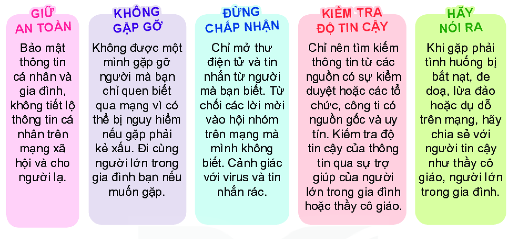

<!-- pdf:43 -->

# BÀI 9: AN TOÀN THÔNG TIN TRÊN INTERNET

## 🎯 Sau bài này em sẽ:

- Biết một số tác hại và nguy cơ khi sử dụng Internet. Nêu và thực hiện được một số biện pháp phòng ngừa.
- Trình bày được tầm quan trọng của sự an toàn và hợp pháp của thông tin cá nhân và tập thể.
- Bảo vệ được thông tin và tài khoản cá nhân.
- Nêu được một vài cách thông dụng để chia sẻ thông tin của bản thân và tập thể sao cho an toàn và hợp pháp.
- Nhận diện được một số thông điệp lừa đảo hoặc mang nội dung xấu.

## 🔴 Khởi động

> Một buổi sáng, Minh đến lớp với vẻ mặt buồn thiu tìm An để nói chuyện.
>
> **Minh:** Bạn biết không, tối qua tớ làm hỏng máy tính rồi. Tớ lo là các tệp ảnh chụp hôm đi dã ngoại trong máy bị mất.
>
> **An:** Bạn đã làm gì để xảy ra sự cố này?
>
> **Minh:** Tớ tải một phần mềm trò chơi trên mạng và cài đặt, máy tính khởi động lại rồi bị treo luôn.
>
> **An:** Máy tính của bạn có cài phần mềm chống virus không?
>
> **Minh:** Có! Nhưng vì háo hức muốn chơi nên tớ đã bỏ qua cảnh báo khi cài đặt.
>
> **An:** Vấn đề là ở chỗ ấy đấy! Máy tính nhà bạn có thể đã bị nhiễm virus hoặc mã độc rồi. Bạn nên mang máy tính đi kiểm tra xem sao.

## 1. TÁC HẠI VÀ NGUY CƠ KHI SỬ DỤNG INTERNET

> **Hoạt động 1: Tác hại và nguy cơ**
>
> 1. Bạn Minh đã gặp rắc rối gì?
> 2. Thảo luận nhóm: Tác hại và nguy cơ khi dùng Internet.

Internet có thể là một công cụ tuyệt vời và hữu ích khi chúng ta biết cách sử dụng và khai thác nhưng cũng có thể có một số tác hại và nguy cơ như sau:

<!-- term: Thông tin cá nhân -->
- *Thông tin cá nhân bị lộ hoặc bị đánh cắp:* Khi sử dụng Internet, nếu không biết cách bảo mật thì thông tin cá nhân có thể bị lộ hoặc bị kẻ xấu đánh cắp và lợi dụng. Kẻ xấu có thể dùng những thông tin đó để bôi nhọ danh dự, để dụ dỗ, lừa đảo, tống tiền, khống chế chính bản thân người sử dụng.

<!-- term: Máy tính bị nhiễm virus hay mã độc -->
- *Máy tính bị nhiễm virus hay mã độc:* Dữ liệu trên máy tính bị mất hoặc bị sai lệch.

<!-- pdf:44 -->

<!-- term: Bắt nạt trên mạng -->
- *Bị lừa đảo, dụ dỗ, đe doạ, bắt nạt trên mạng:* Kẻ xấu lừa đảo, dụ dỗ trên mạng với nhiều mục đích khác nhau. Chẳng hạn, có những kẻ dụ dỗ tiếp xúc với các nội dung khiêu dâm; kẻ muốn lôi kéo người khác vào con đường phạm tội thì cho xem nội dung bạo lực, ma tuý,... Có những trường hợp kẻ xấu dụ dỗ rồi đe doạ, bắt nạt nạn nhân khiến họ cảm thấy xấu hổ hoặc sợ hãi, ảnh hưởng đến sức khoẻ và tâm lí.
- *Thông tin không chính xác:* Thông tin trên mạng đến từ nhiều nguồn khác nhau, có nhiều thông tin không được kiểm duyệt nên không chính xác. Có những kẻ lợi dụng mạng để đưa các tài liệu mang tính bạo lực, khuyến khích các hoạt động bất hợp pháp,... nhằm phục vụ cho lợi ích của chúng. Vì vậy chúng ta phải luôn cảnh giác và sáng suốt trong việc lựa chọn thông tin trên mạng.

<!-- term: Nghiện Internet, nghiện trò chơi trên mạng -->
- *Nghiện Internet, nghiện trò chơi trên mạng:* Nhiều bạn trẻ bỏ rất nhiều thời gian vào mạng xã hội và chơi trò chơi trên mạng làm ảnh hưởng xấu đến tâm lí, sức khoẻ và hành vi dẫn đến bị căng thẳng, lo lắng, trầm cảm, bỏ bê việc học tập,...

<!-- term: Tác hại và nguy cơ khi sử dụng Internet -->
> **TÁC HẠI, NGUY CƠ KHI DÙNG INTERNET**
>
> - Thông tin cá nhân bị lộ hoặc bị đánh cắp.
> - Máy tính bị nhiễm virus hay mã độc.
> - Bị lừa đảo, dụ dỗ, đe doạ, bắt nạt trên mạng.
> - Tiếp nhận thông tin không chính xác.
> - Nghiện Internet, nghiện trò chơi trên mạng.

> ❓ **Câu hỏi**
>
> 1. Em hãy tìm phương án **sai**.
>    Khi dùng Internet có thể:
>    A. Bị lôi kéo vào các hoạt động không lành mạnh.
>    B. Máy tính bị nhiễm virus hoặc mã độc.
>    C. Tin tưởng mọi nguồn thông tin trên mạng.
>    D. Bị lừa đảo hoặc lợi dụng.
> 2. Việc làm nào được khuyến khích khi sử dụng các dịch vụ trên Internet?
>    A. Mở thư điện tử do người lạ gửi.
>    B. Tải các phần mềm miễn phí trên Internet không có kiểm duyệt.
>    C. Liên tục vào các trang xã hội để cập nhật thông tin.
>    D. Vào trang web tìm kiếm để tìm tư liệu làm bài tập về nhà.

## 2. MỘT SỐ QUY TẮC AN TOÀN KHI SỬ DỤNG INTERNET

> **Hoạt động 2: Quy tắc an toàn**
>
> 1. Em đã từng sử dụng Internet chưa? Em đã bao giờ gặp phải một trong những nguy cơ như trên chưa? Nếu gặp phải, em sẽ làm gì?
> 2. Thảo luận nhóm: Em cần làm gì để phòng tránh những nguy cơ và tác hại có thể gặp phải khi sử dụng Internet?

<!-- pdf:45 -->

<!-- term: Năm quy tắc an toàn khi sử dụng Internet -->
- **GIỮ AN TOÀN:** Bảo mật thông tin cá nhân và gia đình, không tiết lộ thông tin cá nhân trên mạng xã hội và cho người lạ.
- **KHÔNG GẶP GỠ:** Không được một mình gặp gỡ người mà bạn chỉ quen biết qua mạng vì có thể bị nguy hiểm nếu gặp phải kẻ xấu. Đi cùng người lớn trong gia đình bạn nếu muốn gặp.
- **ĐỪNG CHẤP NHẬN:** Chỉ mở thư điện tử và tin nhắn từ người mà bạn biết. Từ chối các lời mời vào hội nhóm trên mạng mà mình không biết. Cảnh giác với virus và tin nhắn rác.
- **KIỂM TRA ĐỘ TIN CẬY:** Chỉ nên tìm kiếm thông tin từ các nguồn có sự kiểm duyệt hoặc các tổ chức, công ti có nguồn gốc và uy tín. Kiểm tra độ tin cậy của thông tin qua sự trợ giúp của người lớn trong gia đình hoặc thầy cô giáo.
- **HÃY NÓI RA:** Khi gặp phải tình huống bị bắt nạt, đe doạ, lừa đảo hoặc dụ dỗ trên mạng, hãy chia sẻ với người tin cậy như thầy cô giáo, người lớn trong gia đình.

> Thông tin phải giữ *AN TOÀN*.
> Chớ nên *GẶP GỠ* bạn vừa mới quen.
> Không *CHẤP NHẬN*, chớ có quên.
> Tăng độ *TIN CẬY*, điều nên giữ gìn.
> *NÓI RA* với người bạn tin.
> Năm *quy tắc* đó nên in vào lòng.

> **Góc cha mẹ:** Hãy làm bạn với con trong thế giới thông tin trên mạng Internet.
<!-- ocr-ok: đã đối chiếu ảnh trang gốc 45, giấy ghi chú màu vàng in nghiêng góc bị OCR bỏ sót -->

> ❓ **Câu hỏi**
>
> 1. Em có thể đưa ra một số giải pháp để giữ bí mật thông tin cá nhân không?
> 2. Trong 5 quy tắc trên, em thấy quy tắc nào quan trọng nhất? Tại sao?

## 3. AN TOÀN THÔNG TIN

> **Hoạt động 3: Bảo vệ thông tin cá nhân**
>
> 1. Sau giờ thực hành ở phòng máy, bạn Minh quên đăng xuất tài khoản thư điện tử của mình và một ai đó đã dùng tài khoản thư điện tử của Minh để gửi nội dung không hay cho những người khác. Theo em, điều gì có thể xảy ra với Minh?
> 2. Nếu thấy đường liên kết hoặc thư điện tử có chủ đề gây tò mò được gửi từ một người không quen biết thì em sẽ làm gì?
> 3. Em hãy nêu một vài cách để bảo vệ tài khoản thư điện tử.

<!-- pdf:46 -->

<!-- term: Thông tin cá nhân -->
- *Tầm quan trọng của sự an toàn và hợp pháp của thông tin cá nhân và tập thể.* Trong tình huống ở Hoạt động 3, tài khoản cá nhân của Minh đã bị người khác sử dụng với mục đích xấu. Cá nhân, tập thể có thể bị lợi dụng hoặc gặp nguy hiểm nếu thông tin của họ rơi vào tay kẻ xấu. Em cần biết thông tin cá nhân, tập thể được pháp luật bảo vệ, nếu cần thiết em có thể yêu cầu pháp luật can thiệp.
- *Bảo vệ thông tin và tài khoản cá nhân với sự giúp đỡ của người lớn.* Để bảo vệ thông tin cá nhân, em cần thực hiện một số biện pháp như: Đăng xuất các tài khoản khi đã dùng xong. Đặt **mật khẩu mạnh** (đủ dài, gồm chữ cái viết hoa và viết thường, chữ số, kí tự đặc biệt) để khó bị phát hiện bởi các chương trình máy tính hay bị người khác đoán biết. Bảo vệ mật khẩu khi nhập, tránh bị người khác nhìn thấy hoặc đánh cắp. Nhờ người lớn hoặc chuyên gia cài đặt chương trình diệt virus cho máy tính. Tránh dùng mạng công cộng vì các mạng này thường bảo mật không tốt. Không truy cập vào các liên kết lạ; không mở thư điện tử và tệp đính kèm gửi từ những người không quen; không kết bạn và nhắn tin cho người lạ; không đồng ý tham gia các câu lạc bộ chưa rõ nguồn gốc trên mạng.

<!-- term: Thông điệp lừa đảo -->
- *Nhận diện một số thông điệp lừa đảo hoặc mang nội dung xấu.* Để bảo vệ thông tin và tài khoản cá nhân, em cần biết một số thông điệp lừa đảo hoặc mang nội dung xấu. Những kẻ lừa đảo qua mạng thường dùng thư điện tử, tin nhắn giả mạo, yêu cầu kết bạn hoặc mời tham gia các câu lạc bộ,... để dụ dỗ em chia sẻ thông tin cá nhân, đánh cắp tài khoản và mật khẩu.

> **Hoạt động 4: Chia sẻ thông tin an toàn**
>
> 1. Một bạn quen trên mạng xin số điện thoại và địa chỉ của em để gặp nhau nói chuyện. Em có nên cho không?
> 2. Em được một bạn gửi qua mạng cho một số thông tin không tốt về một bạn khác cùng lớp. Em có nên đăng lên mạng để mọi người cùng biết không?

*Thông tin cá nhân chỉ nên chia sẻ cho người mình biết rõ và tin tưởng ở thế giới thực trong các trường hợp cần thiết.* Một trong các đặc điểm của Internet là **tính ẩn danh**, không ai có thể biết được thực chất người đứng sau một tài khoản trên mạng là ai. Ngay cả khi em nhận được tin nhắn qua mạng hỏi thông tin cá nhân từ tài khoản của người mình tin tưởng thì cũng cần xác nhận lại xem có đúng là người đó hỏi không bằng cách gọi điện thoại hoặc gặp trực tiếp chứ không nên chia sẻ ngay.

Nên chặn tài khoản của kẻ xấu và thông báo với bố mẹ hoặc thầy cô giáo để nhận được sự giúp đỡ.

*Thông tin trên mạng đến từ nhiều nguồn khác nhau, không có ai kiểm chứng.* Em cần tiếp nhận thông tin có chọn lọc, không chia sẻ thông tin từ những nguồn không tin tưởng. Chỉ nên chia sẻ thông tin từ các cơ quan, tổ chức chính thống. Không chia sẻ và lan truyền tin giả làm tổn thương đến người khác.

<!-- pdf:47 -->

<!-- term: Biện pháp bảo vệ thông tin, tài khoản cá nhân và chia sẻ thông tin an toàn -->
> **MỘT SỐ BIỆN PHÁP BẢO VỆ THÔNG TIN, TÀI KHOẢN CÁ NHÂN VÀ CHIA SẺ THÔNG TIN AN TOÀN.**
>
> - Cài đặt và cập nhật phần mềm chống virus.
> - Đặt mật khẩu mạnh. Bảo vệ mật khẩu.
> - Đăng xuất các tài khoản khi đã dùng xong.
> - Tránh dùng mạng công cộng.
> - Không truy cập vào các liên kết lạ; không mở thư điện tử và tệp đính kèm gửi từ những người không quen; không kết bạn và nhắn tin cho người lạ.
> - Không chia sẻ thông tin cá nhân và những thông tin chưa được kiểm chứng trên Internet; không lan truyền tin giả làm tổn thương người khác.

> ❓ **Câu hỏi**
>
> 1. Lời khuyên nào **sai** khi em muốn bảo vệ máy tính của mình?
>    A. Đừng bao giờ mở thư điện tử và mở tệp đính kèm thư từ những người không quen biết.
>    B. Luôn nhớ đăng xuất khi sử dụng xong máy tính, thư điện tử.
>    C. Chẳng cần làm gì vì máy tính đã được cài đặt sẵn các thiết bị bảo vệ từ nhà sản xuất.
>    D. Nên cài đặt phần mềm bảo vệ máy tính khỏi virus và thường xuyên cập nhật phần mềm bảo vệ.

## ✏️ Luyện tập

1. Khi sử dụng Internet, những việc làm nào sau đây có thể khiến em gặp nguy cơ bị hại?
   A. Tải phần mềm, tệp miễn phí trên Internet.
   B. Mở liên kết được cung cấp trong thư điện tử không biết rõ nguồn gốc.
   C. Định kì thay đổi mật khẩu của tài khoản cá nhân trên mạng xã hội và thư điện tử.
   D. Khi có kẻ đe doạ mình trên mạng không cho bố mẹ hoặc thầy cô giáo biết.
   E. Làm theo các lời khuyên và bài hướng dẫn sử dụng thuốc trên mạng.

2. Theo em, những tình huống nào sau đây là rủi ro khi sử dụng Internet?
   A. Máy tính bị hỏng do nhiễm virus hoặc mã độc.
   B. Thông tin cá nhân hoặc tập thể bị đánh cắp.
   C. Tài khoản ngân hàng bị mất tiền.
   D. Bị bạn quen trên mạng lừa đảo.
   E. Nghiện mạng xã hội, nghiện trò chơi trên mạng.
   F. Hoàn thành chương trình học ngoại ngữ trực tuyến.

## 🚀 Vận dụng

1. Em hãy đưa ra một số cách nhận diện những trò lừa đảo trên Internet.
2. Em sẽ làm gì khi phát hiện bạn bè hoặc người thân có nguy cơ bị hại khi truy cập mạng?
3. Em nên làm gì để bảo vệ thông tin và tài khoản cá nhân.

## 📷 Danh sách hình trong bài

| Mã hình | Trang PDF | Trang sách | Chú thích |
| --- | --- | --- | --- |
| H6-tin-b09-01 | 45 | 44 | Năm quy tắc an toàn khi sử dụng Internet |
