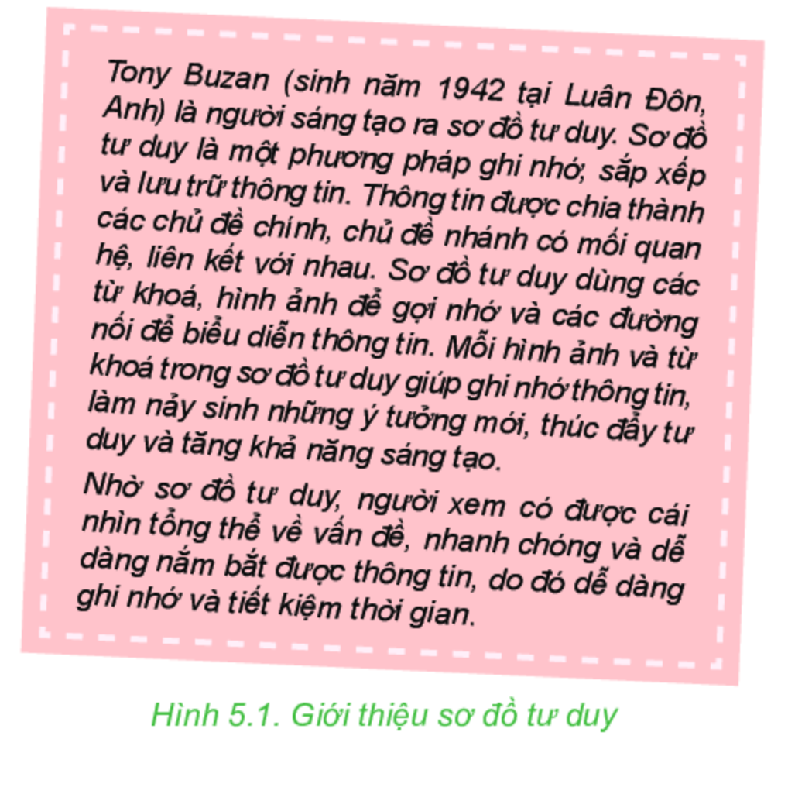
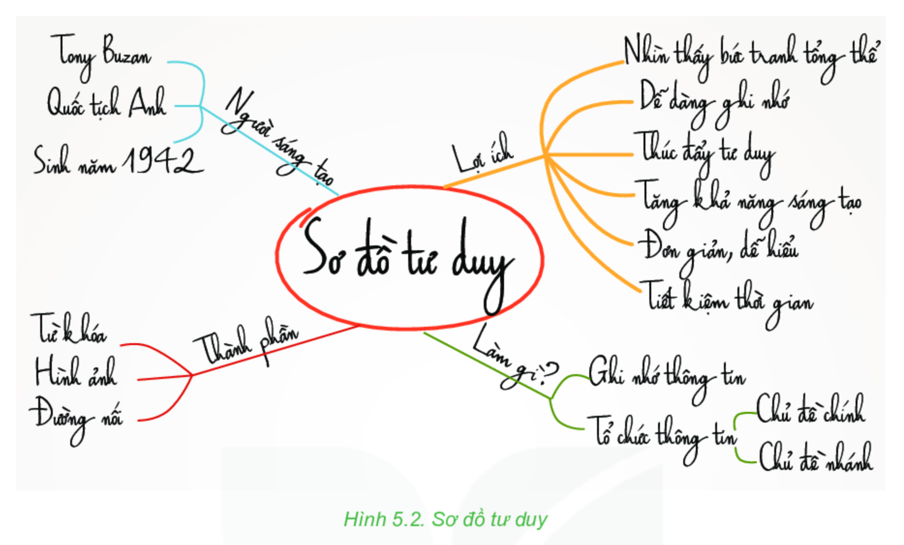
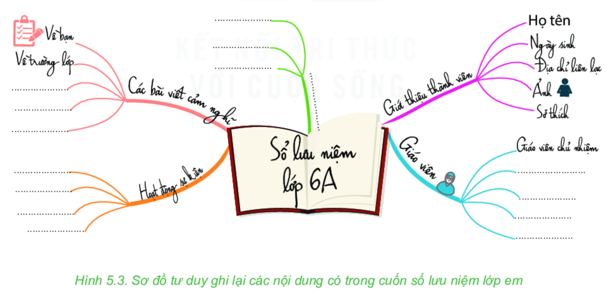
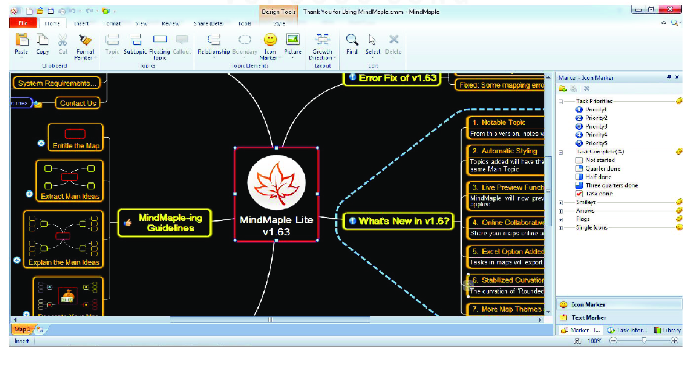
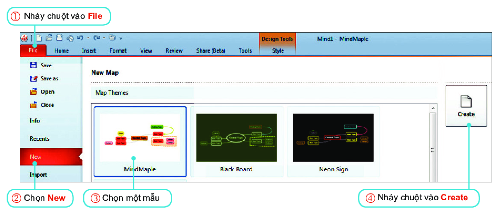
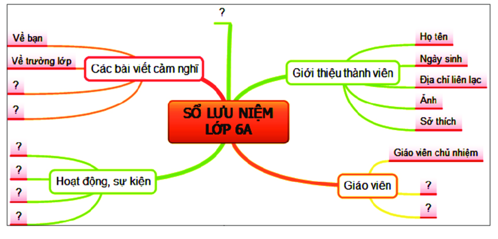
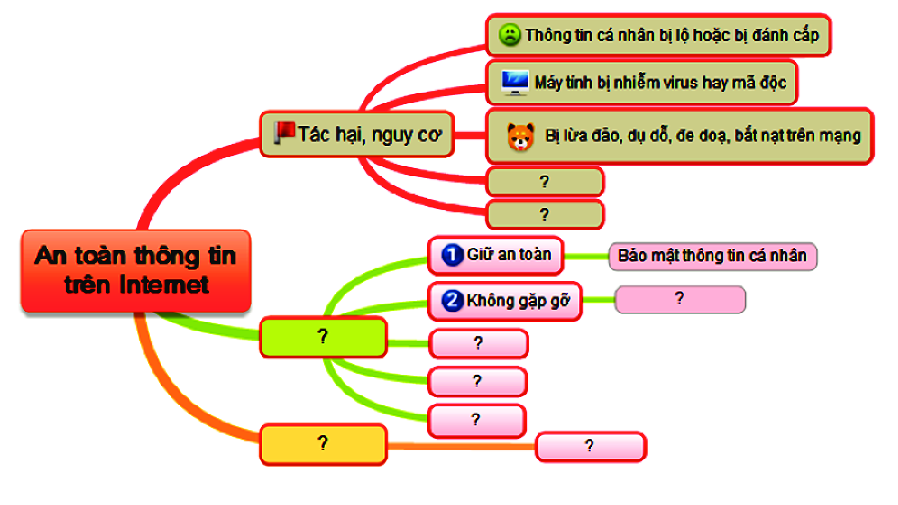

<!-- pdf:49 -->

# BÀI 10: SƠ ĐỒ TƯ DUY

## 🎯 Sau bài này em sẽ:

- Biết sắp xếp một cách logic và trình bày dưới dạng sơ đồ tư duy các ý tưởng, khái niệm.
- Giải thích được lợi ích của sơ đồ tư duy, nêu được nhu cầu sử dụng phần mềm sơ đồ tư duy trong học tập và trao đổi thông tin.
- Tạo được sơ đồ tư duy đơn giản bằng phần mềm.

## 🔴 Khởi động

> Chiếc máy thời gian đưa An, Minh và Khoa gặp nhau ở tương lai, khi cả ba bạn đã 50 tuổi.
>
> **Minh:** Ngày xưa chúng ta cũng nghịch ra trò đấy nhỉ.
>
> **An:** Nghịch thế nhưng việc học hành cũng vẫn rất ổn đấy chứ.
>
> **Khoa:** Này các bạn, nhiều lúc nhớ về những kỉ niệm xưa, khi chúng ta học cùng nhau, tớ lục tìm tư liệu mà chẳng lưu giữ được gì. Giá hồi đó lớp mình làm một cuốn sổ lưu niệm của lớp, ghi lại các hình ảnh, thông tin, kỉ niệm,... thì tốt quá!

> **Hoạt động 1: Sổ lưu niệm của lớp**
>
> 1. Hãy tưởng tượng khi 50 tuổi, em tìm thấy cuốn sổ lưu niệm đã cũ của lớp mình. Hãy viết ra ba điều mà cuốn sổ lưu niệm làm em thích thú, một điều làm em hạnh phúc và một điều gợi lại cho em kỉ niệm buồn.
> 2. Theo em sổ lưu niệm sẽ gồm những thông tin gì?

## 1. SƠ ĐỒ TƯ DUY

Để ghi lại thông tin về một chủ đề nào đó, chúng ta có rất nhiều cách, ví dụ như: liệt kê bằng văn bản, dùng bảng biểu, dùng sơ đồ,... Một trong các cách đó là dùng sơ đồ tư duy.

Nội dung văn bản ở Hình 5.1 được biểu diễn bằng sơ đồ tư duy ở Hình 5.2.

*Hình 5.1. Giới thiệu sơ đồ tư duy*
<!-- ocr-ok: đã đối chiếu ảnh trang 49, chú thích xanh lá in nghiêng dưới Hình 5.1 bị OCR bỏ sót -->

> Tony Buzan (sinh năm 1942 tại Luân Đôn, Anh) là người sáng tạo ra sơ đồ tư duy. Sơ đồ tư duy là một phương pháp ghi nhớ, sắp xếp và lưu trữ thông tin. Thông tin được chia thành các **chủ đề chính**, **chủ đề nhánh** có mối quan hệ, liên kết với nhau. Sơ đồ tư duy dùng các từ khoá, hình ảnh để gợi nhớ và các đường nối để biểu diễn thông tin. Mỗi hình ảnh và từ khoá trong sơ đồ tư duy giúp ghi nhớ thông tin, làm nảy sinh những ý tưởng mới, thúc đẩy tư duy và tăng khả năng sáng tạo.
<!-- ocr-ok: đã đối chiếu ảnh trang 49, chữ in nghiêng xoay nhẹ trong khung hồng Hình 5.1 bị OCR đọc lỗi -->
>
> Nhờ sơ đồ tư duy, người xem có được cái nhìn tổng thể về vấn đề, nhanh chóng và dễ dàng nắm bắt được thông tin, do đó dễ dàng ghi nhớ và tiết kiệm thời gian.

<!-- pdf:50 -->

*Hình 5.2. Sơ đồ tư duy*

> **Hoạt động 2: Sơ đồ tư duy**
>
> Em hãy quan sát sơ đồ tư duy ở Hình 5.2 và trả lời các câu hỏi sau:
>
> 1. Cách biểu diễn nào (văn bản, sơ đồ tư duy) dễ hiểu, dễ nhớ và thú vị hơn?
> 2. Sử dụng sơ đồ tư duy có ích lợi gì?
> 3. Tên của chủ đề chính là gì? Tên của các chủ đề nhánh (triển khai từ chủ đề chính) là gì?
> 4. Các ý chi tiết của chủ đề nhánh “Thành phần” là gì?

> - **Sơ đồ tư duy** là phương pháp trình bày thông tin một cách trực quan bằng cách sử dụng văn bản, hình ảnh và các đường nối.
> - Sơ đồ tư duy tận dụng tối đa khả năng ghi nhận hình ảnh của bộ não, giúp chúng ta dễ dàng ghi nhớ chi tiết, tổng hợp hay phân tích vấn đề.

> ❓ **Câu hỏi**
>
> Em hãy chọn các phương án đúng:
>
> 1. Sơ đồ tư duy giúp chúng ta:
>    A. Ghi nhớ tốt hơn.
>    B. Giải các bài toán.
>    C. Sáng tạo hơn.
>    D. Nhìn thấy bức tranh tổng thể.
> 2. Sơ đồ tư duy là:
>    A. Một công cụ tổ chức thông tin phù hợp với quá trình tư duy.
>    B. Một phương pháp chuyển tải thông tin.
>    C. Một cách ghi chép sáng tạo.
>    D. Một công cụ soạn thảo văn bản.

<!-- pdf:51 -->

## 2. CÁCH TẠO SƠ ĐỒ TƯ DUY

<!-- term: Cách tạo sơ đồ tư duy -->
Để tạo sơ đồ tư duy, em có thể vẽ thủ công hoặc sử dụng phần mềm trên máy tính. Dù thực hiện theo cách nào thì việc tạo sơ đồ tư duy cũng thực hiện theo các bước sau đây:

<!-- term: Cách tạo sơ đồ tư duy -->
- Viết chủ đề chính ở giữa tờ giấy. Dùng hình chữ nhật, elip hay bất cứ hình gì em muốn bao xung quanh chủ đề chính.
- Từ chủ đề chính, vẽ các chủ đề nhánh.
- Phát triển thông tin chi tiết cho mỗi chủ đề nhánh, lưu ý sử dụng từ khoá hoặc hình ảnh.
- Có thể tạo thêm nhánh con khi bổ sung thông tin vì sơ đồ tư duy có thể mở rộng về mọi phía.

> Nên sử dụng màu sắc khi tạo sơ đồ tư duy vì màu sắc có tác dụng kích thích não bộ.
<!-- ocr-ok: đã đối chiếu ảnh trang 51, ghi chú giấy nhớ màu vàng xoay nghiêng bị OCR bỏ sót -->

> **Hoạt động 3: Nội dung cuốn sổ lưu niệm**
>
> 1. Em và các bạn cùng thảo luận nhóm để bàn về nội dung cuốn sổ lưu niệm của lớp, sau đó tạo sơ đồ tư duy trên giấy để ghi lại kết quả thảo luận theo gợi ý trong Hình 5.3.
> 2. Theo em vẽ sơ đồ tư duy thủ công trên giấy có hạn chế gì?

*Hình 5.3. Sơ đồ tư duy ghi lại các nội dung có trong cuốn sổ lưu niệm lớp em*

<!-- pdf:52 -->

> ❓ **Câu hỏi**
>
> Em hãy chọn câu trả lời đúng.
>
> Ưu điểm của việc tạo sơ đồ tư duy thủ công trên giấy là gì?
>
> A. Dễ sắp xếp, bố trí, thay đổi, thêm bớt nội dung.
>
> B. Sản phẩm tạo ra dễ dàng sử dụng cho các mục đích khác nhau như: đưa vào bài trình chiếu, gửi cho bạn qua thư điện tử,...
>
> C. Sản phẩm tạo ra nhanh chóng, dễ dàng chia sẻ cho nhiều người ở các địa điểm khác nhau.
>
> D. Có thể thực hiện ở bất cứ đâu, chỉ cần giấy và bút. Thể hiện được phong cách riêng của người tạo.

## 3. THỰC HÀNH: TẠO SƠ ĐỒ TƯ DUY BẰNG PHẦN MỀM MÁY TÍNH

Có nhiều cách giúp chúng ta tạo sơ đồ tư duy trên máy tính như: sử dụng các công cụ chèn hình khối, sơ đồ trong phần mềm soạn thảo văn bản, công cụ vẽ hình trong các phần mềm xử lí ảnh,... Tuy nhiên, có nhiều phần mềm chuyên dùng cho việc tạo sơ đồ tư duy như: MindMaple Lite, FreeMind, iMindMap, Mindmaple, Mind Manager,... Các phần mềm này cho phép chúng ta tạo sơ đồ tư duy dễ dàng, chính xác và nhanh chóng.

**Nhiệm vụ**

Sử dụng **phần mềm sơ đồ tư duy** để tạo sơ đồ tư duy ghi lại các nội dung có trong cuốn sổ lưu niệm của lớp đã được hoàn thành ở Hoạt động 3.

**Hướng dẫn**

*(Hướng dẫn sau đây sử dụng phần mềm MindMaple Lite để minh hoạ. Thao tác với các phần mềm tạo sơ đồ tư duy khác cũng tương tự.)*

### a) Khởi động phần mềm

– Sau khi khởi động, giao diện phần mềm được mở ra như hình sau:

<!-- pdf:53 -->

### b) Tạo sơ đồ tư duy

– Thực hiện các bước tạo sơ đồ tư duy theo hướng dẫn trong hình sau:

Sơ đồ tư duy được tạo ra với chủ đề chính là một khung `Central Topic`. Nháy chuột vào khung để nhập tên chủ đề chính `SỔ LƯU NIỆM LỚP 6A`.

### c) Tạo các chủ đề nhánh

– Nháy chuột vào ô `SỔ LƯU NIỆM LỚP 6A` để chọn chủ đề chính.

– Chọn **Insert/Subtopic**.

Một chủ đề nhánh được tạo ra và nối với chủ đề chính vừa chọn.

> Chú ý: Tạo chủ đề nhánh cho chủ đề nào thì nháy chuột chọn chủ đề đó trước khi tạo.
<!-- ocr-ok: đã đối chiếu ảnh trang 53, ghi chú giấy nhớ màu vàng xoay nghiêng bị OCR bỏ sót -->

– Nháy chuột vào chủ đề nhánh vừa tạo để nhập tên.

– Thực hiện tương tự để tạo các chủ đề nhánh khác của sơ đồ tư duy.

<!-- pdf:54 -->

### d) Ghi lại kết quả

– Thực hiện các bước cần thiết để hoàn thành sơ đồ tư duy ghi lại nội dung cuốn sổ lưu niệm của lớp em.

– Sau khi tạo xong chọn **File/Save** và lưu tệp với tên `SoLuuNiem.emm`.

Sau khi vẽ sơ đồ tư duy thủ công trên giấy và thực hành tạo sơ đồ tư duy bằng phần mềm máy tính, em có thể so sánh và thấy ngay được ưu điểm của việc tạo sơ đồ tư duy bằng phần mềm máy tính. Phần mềm máy tính giúp em tạo sơ đồ tư duy dễ dàng, nhanh chóng; dễ sửa chữa và điều chỉnh; nhanh chóng chia sẻ và trao đổi.

Em có thể sử dụng phần mềm tạo sơ đồ tư duy để ghi lại nội dung kiến thức các môn học như Toán, Ngữ văn, Lịch sử và Địa lí,... hoặc kế hoạch hoạt động ngoại khoá, kế hoạch đi du lịch,... Nhờ các sơ đồ tư duy đó em có thể ghi nhớ thông tin nhanh hơn, lâu hơn,... và dễ dàng nhớ lại khi cần thiết. Em có thể in sơ đồ tư duy trong máy tính ra giấy, có thể chia sẻ, trao đổi sơ đồ tư duy với thầy cô và bạn bè qua Internet.

## ✏️ Luyện tập

Em hãy thực hiện các công việc sau đây cho sơ đồ tư duy ghi lại nội dung cuốn sổ lưu niệm của lớp em:

a) Bổ sung các nhánh nội dung cho sơ đồ tư duy (nếu cần).

b) Chỉnh sửa màu sắc và kiểu đường nối. Bổ sung hình ảnh, biểu tượng,... để tăng hiệu quả trình bày cho sơ đồ tư duy.

c) Chia sẻ sơ đồ tư duy cho thầy cô giáo và các bạn để cả lớp trao đổi, thống nhất nội dung của cuốn sổ lưu niệm.

## 🚀 Vận dụng

Em hãy dùng sơ đồ tư duy (vẽ trên giấy hoặc tạo bằng phần mềm) trình bày tóm tắt nội dung Bài 9. An toàn thông tin trên Internet.

## 📷 Danh sách hình trong bài

| Mã hình | Trang PDF | Trang sách | Chú thích |
| --- | --- | --- | --- |
| H6-tin-b10-01 | 49 | 48 | Hình 5.1. Giới thiệu sơ đồ tư duy |
| H6-tin-b10-02 | 50 | 49 | Hình 5.2. Sơ đồ tư duy |
| H6-tin-b10-03 | 51 | 50 | Hình 5.3. Sơ đồ tư duy ghi lại các nội dung có trong cuốn sổ lưu niệm lớp em |
| H6-tin-b10-04 | 52 | 51 | Giao diện phần mềm MindMaple Lite (Mục 3.a) |
| H6-tin-b10-05 | 53 | 52 | Các bước tạo sơ đồ tư duy trong phần mềm MindMaple Lite (Mục 3.b) |
| H6-tin-b10-06 | 53 | 52 | Tạo chủ đề nhánh nối với chủ đề chính (Mục 3.c) |
| H6-tin-b10-07 | 53 | 52 | Nhập tên cho chủ đề nhánh vừa tạo (Mục 3.c) |
| H6-tin-b10-08 | 53 | 52 | Các chủ đề nhánh của sơ đồ tư duy Sổ lưu niệm lớp 6A (Mục 3.c) |
| H6-tin-b10-09 | 54 | 53 | Sơ đồ tư duy gợi ý tóm tắt Bài 9. An toàn thông tin trên Internet (Vận dụng) |
