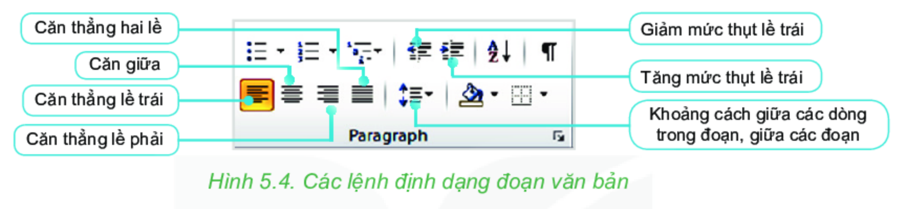
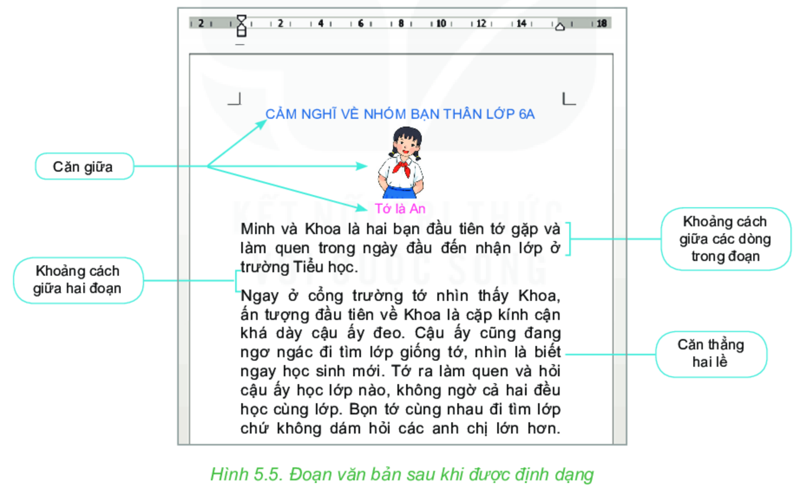
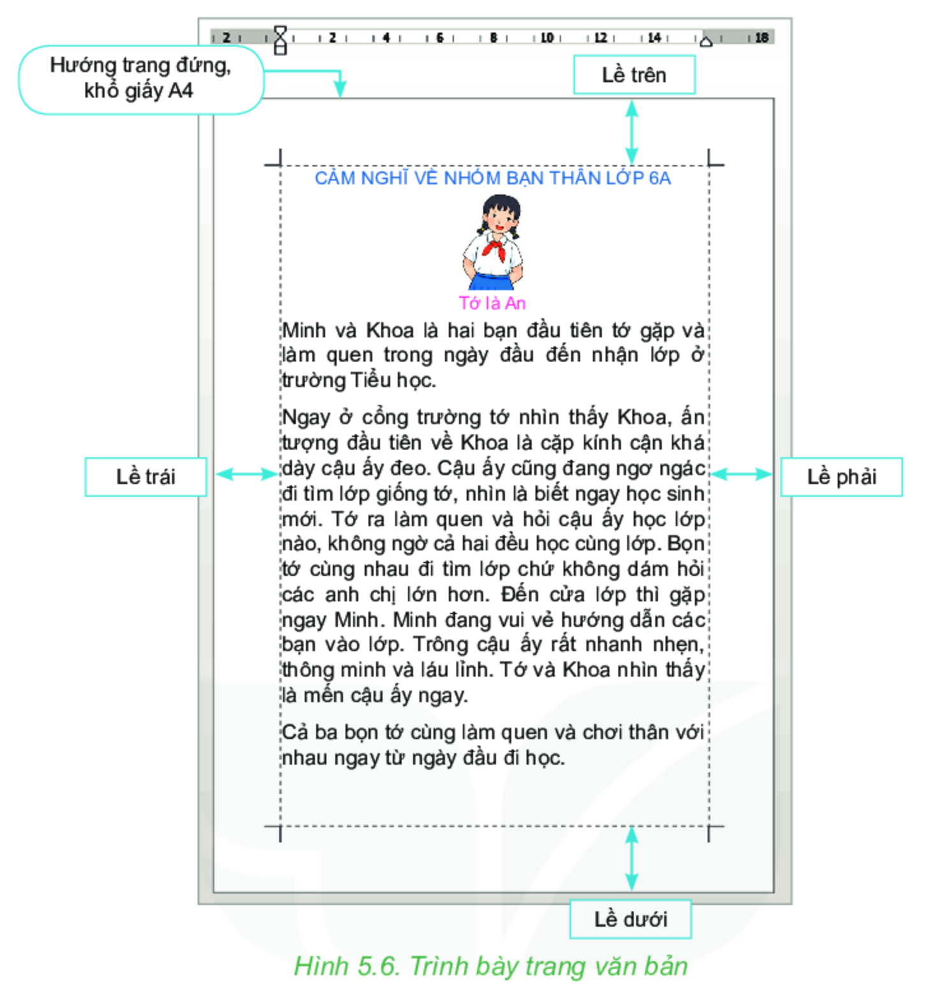
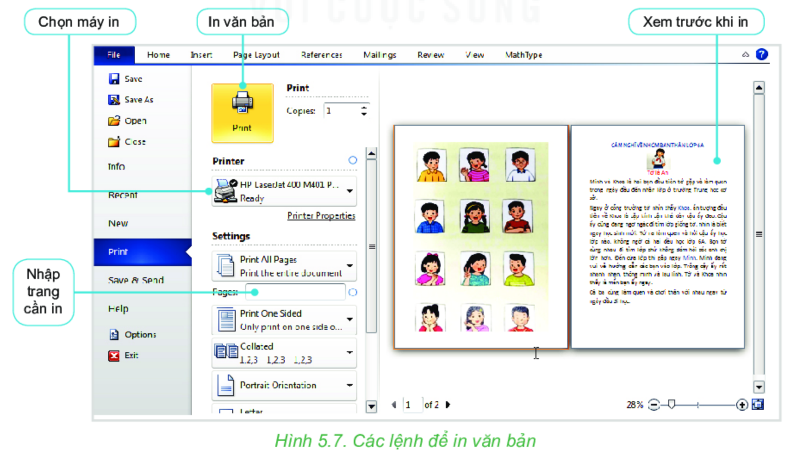
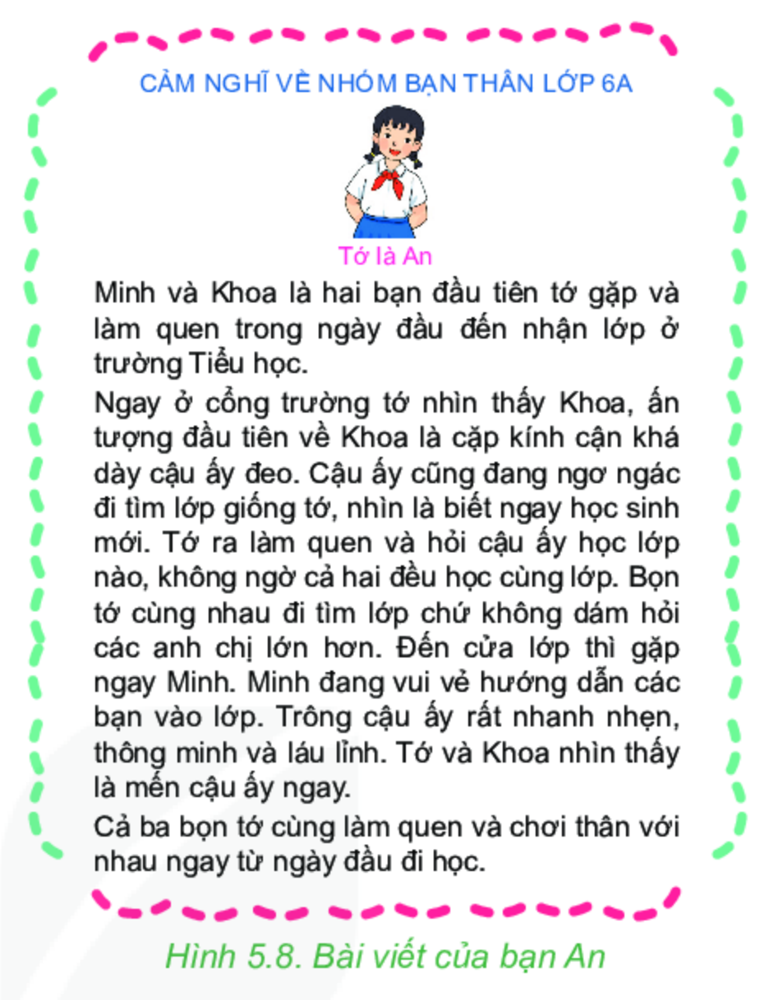
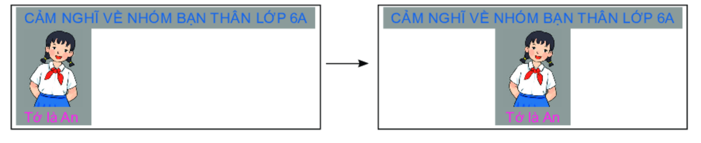
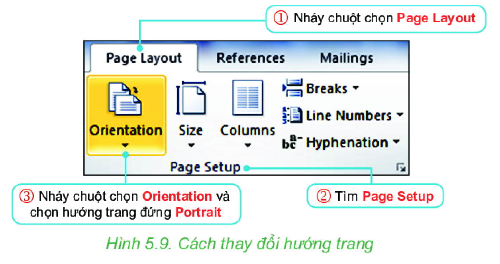
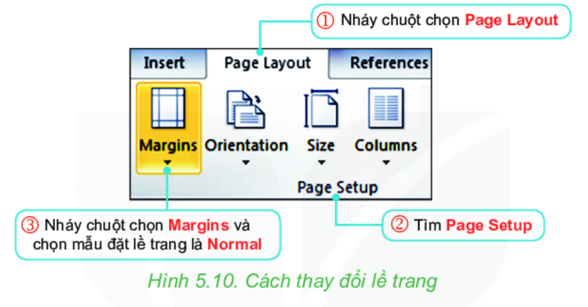

<!-- pdf:55 -->

# BÀI 11: ĐỊNH DẠNG VĂN BẢN

## 🎯 Sau bài này em sẽ:

- Nêu được các chức năng đặc trưng của những phần mềm soạn thảo văn bản.
- Trình bày được tác dụng của công cụ căn lề, định dạng văn bản.
- Thực hiện được việc định dạng văn bản, trình bày trang văn bản và in.

## 🔴 Khởi động

> Ba bạn An, Minh và Khoa đã bàn về nội dung cuốn sổ lưu niệm của lớp. Nhưng còn một câu hỏi phải trả lời là dùng công cụ gì để làm cuốn sổ này.
>
> **An:** Nội dung cuốn sổ gồm những bài viết cảm nghĩ, ảnh chụp, danh sách các bạn trong lớp,... Tớ nghĩ mình mua một cuốn sổ để viết và dán ảnh vào đó.
>
> **Minh:** Thử cân nhắc làm trên máy tính xem sao. Những năm ở Tiểu học, chúng mình đã học sử dụng nhiều phần mềm trên máy tính.
>
> **Khoa:** Nếu làm trên máy tính, mình có thể gửi cho thầy cô và các bạn xem trước để góp ý, khi cần sửa lại cũng thuận tiện. Hơn nữa, ngoài cuốn sổ lưu niệm in ra cho mỗi bạn, mình vẫn còn bản mềm lưu trữ để phòng khi cuốn in bị hỏng hoặc thất lạc.

## 1. PHẦN MỀM SOẠN THẢO VĂN BẢN

> **Hoạt động 1: Phần mềm soạn thảo văn bản**
>
> 1. Dựa vào sơ đồ tư duy trình bày nội dung cuốn sổ lưu niệm ở Bài 10, em hãy lựa chọn các phần mềm cần sử dụng để tạo nội dung cho cuốn sổ trên máy tính.
> 2. Các phần mềm đó cần có chức năng gì để giúp em hoàn thành công việc?

<!-- term: Phần mềm soạn thảo văn bản -->
Phần mềm soạn thảo văn bản có thể được cài đặt trên máy tính hoặc chạy trực tuyến trên Internet,... Có nhiều loại phần mềm soạn thảo văn bản khác nhau, chúng đều có các chức năng cơ bản sau đây:

<!-- term: Phần mềm soạn thảo văn bản -->
- Tạo và định dạng văn bản.
- Biên tập, chỉnh sửa nội dung.
- Lưu trữ văn bản.
- In văn bản.

Để nâng cao hiệu quả sử dụng, phần mềm soạn thảo còn có một số chức năng nâng cao khác:

<!-- term: Phần mềm soạn thảo văn bản -->
- Xem lại và theo dõi sự thay đổi của tài liệu.
- Lưu trữ tài liệu trên đám mây để có thể đồng bộ và lấy tài liệu từ máy tính, điện thoại di động hay máy tính bảng.
- Làm việc cộng tác với người khác trên cùng một tài liệu mọi lúc mọi nơi.

Với những chức năng này, chúng ta có thể sử dụng phần mềm soạn thảo văn bản để tạo ra các tài liệu khác nhau như cuốn sách, bài viết, báo cáo, bản tin, tờ rơi,...

> ❓ **Câu hỏi**
>
> Em sẽ sử dụng những chức năng nào của phần mềm soạn thảo văn bản để tạo nội dung cho cuốn sổ lưu niệm?

<!-- pdf:56 -->

## 2. ĐỊNH DẠNG VĂN BẢN VÀ IN

<!-- term: Định dạng văn bản -->
<!-- term: Định dạng kí tự -->
Ở cấp Tiểu học, chúng ta đã học cách tạo văn bản chứa chữ và định dạng kí tự. Để văn bản được trình bày đẹp, dễ đọc, dễ nhớ thì ngoài việc định dạng kí tự, chúng ta cần định dạng đoạn và định dạng trang văn bản.

### a) Định dạng đoạn văn bản

<!-- term: Định dạng đoạn văn bản -->
Trong phần mềm soạn thảo văn bản, **đoạn** là phần văn bản thường được phân cách bởi **dấu ngắt đoạn**. Dấu ngắt đoạn xuất hiện khi chúng ta nhấn phím **Enter**. Việc định dạng giúp chúng ta thay đổi cách trình bày của đoạn trong văn bản. Ví dụ: tăng, giảm lề của đoạn, căn chỉnh lề, đặt khoảng cách giữa các dòng trong đoạn,... Các lệnh định dạng đoạn nằm trong thẻ **Home**, ở nhóm lệnh **Paragraph**.

*Hình 5.4. Các lệnh định dạng đoạn văn bản*

*Hình 5.5. Đoạn văn bản sau khi được định dạng*
<!-- ocr-ok: đã đối chiếu ảnh trang 56, chú thích xanh lá in nghiêng dưới Hình 5.5 bị OCR bỏ sót -->

### b) Định dạng trang văn bản

<!-- term: Định dạng trang văn bản -->
Mỗi cuốn sách có hình dạng và kích thước khác nhau phụ thuộc vào việc định dạng trang văn bản. Để văn bản đẹp và có bố cục hài hoà, em cần định dạng trang văn bản. Các lệnh định dạng trang văn bản nằm trong thẻ **Page Layout**, ở nhóm lệnh **Page Setup**. Các yêu cầu cơ bản khi trình bày trang văn bản gồm:

<!-- term: Định dạng trang văn bản -->
- Chọn **hướng trang** (**Orientation**): trang đứng (Portrait) hay trang ngang (Landscape).
- Đặt **lề trang** (**Margins**): lề trái (Left), lề phải (Right), lề trên (Top) và lề dưới (Bottom).
- Lựa chọn **khổ giấy** (**Size**): khổ giấy phổ biến là khổ A4.

<!-- pdf:57 -->

*Hình 5.6. Trình bày trang văn bản*
<!-- ocr-ok: đã đối chiếu ảnh trang 57, chú thích xanh lá in nghiêng dưới Hình 5.6 bị OCR bỏ sót -->

### c) In văn bản

<!-- term: In văn bản -->
Sau khi hoàn thành việc tạo văn bản, em có thể in văn bản ra giấy. Để thực hiện công việc này, trong thẻ **File**, em chọn lệnh **Print**.

*Hình 5.7. Các lệnh để in văn bản*
<!-- ocr-ok: đã đối chiếu ảnh trang 57, chú thích xanh lá in nghiêng dưới Hình 5.7 bị OCR đọc lỗi -->

<!-- pdf:58 -->

## 3. THỰC HÀNH: ĐỊNH DẠNG VĂN BẢN

**Nhiệm vụ**

Cuốn sổ lưu niệm của lớp chứa những bài viết cảm nghĩ về bạn bè, thầy cô và mái trường. Hình 5.8 là bài viết *Cảm nghĩ về nhóm bạn thân lớp 6A* của bạn An. Em hãy tham khảo bài viết này để soạn một bài viết cảm nghĩ của em trên phần mềm soạn thảo văn bản. Bài viết của em sẽ là một trang trong cuốn sổ lưu niệm của lớp.

Một số công việc em cần làm:

– Nhập nội dung văn bản, chèn hình ảnh.

– Căn lề các đoạn văn bản.

– Chọn hướng trang, chọn lề trang.

– Xem trang in để điều chỉnh lại việc căn lề đoạn và căn lề trang (nếu cần).

– Lưu tệp văn bản.

*Hình 5.8. Bài viết của bạn An*

**Hướng dẫn**

*(Hướng dẫn sau đây sử dụng phần mềm Microsoft Word để minh hoạ.)*

### a) Khởi động phần mềm và nhập nội dung

– Nháy đúp chuột vào biểu tượng phần mềm trên màn hình nền.

– Nhập nội dung văn bản.

– Chọn **Insert/Picture** để mở hộp thoại **Insert Picture** và chèn ảnh.

### b) Căn lề đoạn văn bản

Trong bài viết của An, phần tiêu đề, hình ảnh và giới thiệu tên của An được căn lề giữa, phần văn bản còn lại được căn đều hai bên. Để thực hiện căn lề, em làm như sau:

– Chọn dòng tiêu đề *Cảm nghĩ về nhóm bạn thân lớp 6A*, hình ảnh và dòng *Tớ là An*.

– Nháy chuột vào thẻ **Home** và chọn `≡` để căn lề giữa.

Ta có kết quả như sau:

– Thực hiện tương tự để căn lề cho các đoạn văn trong bài viết.

### c) Chọn hướng trang, lề trang

Giả sử em muốn chọn hướng trang bài viết *Cảm nghĩ về nhóm bạn thân lớp 6A* của bạn An là hướng đứng (Portrait), mẫu đặt lề trang là **Normal**, khi đó em thực hiện theo các bước sau:

<!-- pdf:59 -->

**Chọn hướng trang (Orientation)**

*Hình 5.9. Cách thay đổi hướng trang*
<!-- ocr-ok: đã đối chiếu ảnh trang 59, chú thích xanh lá in nghiêng dưới Hình 5.9 bị OCR bỏ sót -->

**Chọn lề trang (Margins)**

*Hình 5.10. Cách thay đổi lề trang*
<!-- ocr-ok: đã đối chiếu ảnh trang 59, chú thích xanh lá in nghiêng dưới Hình 5.10 bị OCR bỏ sót -->

### d) Lưu tệp

– Chọn **File/Save** để lưu tệp văn bản với tên là `CamNghiVeBan.docx`.

## ✏️ Luyện tập

1. Em hãy chọn hướng trang phù hợp cho các văn bản sau:
   a) Đơn xin nghỉ học.
   b) Báo cáo tổng kết năm học của lớp.
   c) Sổ lưu niệm của lớp.
   d) Sách ảnh chứa ảnh phong cảnh.
2. Em chọn loại căn lề nào khi trình bày nội dung bài thơ lục bát trên phần mềm soạn thảo văn bản? Tại sao?
3. Em hãy soạn thảo *Đơn xin nghỉ học* và thực hiện các thao tác định dạng hợp lí.

## 🚀 Vận dụng

Trong bài học trước, em đã cùng các bạn sử dụng sơ đồ tư duy để trình bày kết quả thảo luận về nội dung cuốn sổ lưu niệm của lớp. Em hãy thực hiện các công việc sau:

a) Soạn thảo thêm nội dung cho cuốn sổ lưu niệm (bài viết cảm nghĩ, bài viết giới thiệu hoạt động, sự kiện,...).

b) Chèn thêm hình ảnh minh hoạ.

c) Căn lề và định dạng trang để có được bố cục hợp lí và đẹp.

d) Lưu lại tệp để dùng cho việc tạo cuốn sổ lưu niệm của lớp.

## 📷 Danh sách hình trong bài

| Mã hình | Trang PDF | Trang sách | Chú thích |
| --- | --- | --- | --- |
| H6-tin-b11-01 | 56 | 55 | Hình 5.4. Các lệnh định dạng đoạn văn bản |
| H6-tin-b11-02 | 56 | 55 | Hình 5.5. Đoạn văn bản sau khi được định dạng |
| H6-tin-b11-03 | 57 | 56 | Hình 5.6. Trình bày trang văn bản |
| H6-tin-b11-04 | 57 | 56 | Hình 5.7. Các lệnh để in văn bản |
| H6-tin-b11-05 | 58 | 57 | Hình 5.8. Bài viết của bạn An |
| H6-tin-b11-06 | 58 | 57 | Kết quả căn lề giữa cho tiêu đề, hình ảnh và dòng giới thiệu tên (Mục 3.b) |
| H6-tin-b11-07 | 59 | 58 | Hình 5.9. Cách thay đổi hướng trang |
| H6-tin-b11-08 | 59 | 58 | Hình 5.10. Cách thay đổi lề trang |
