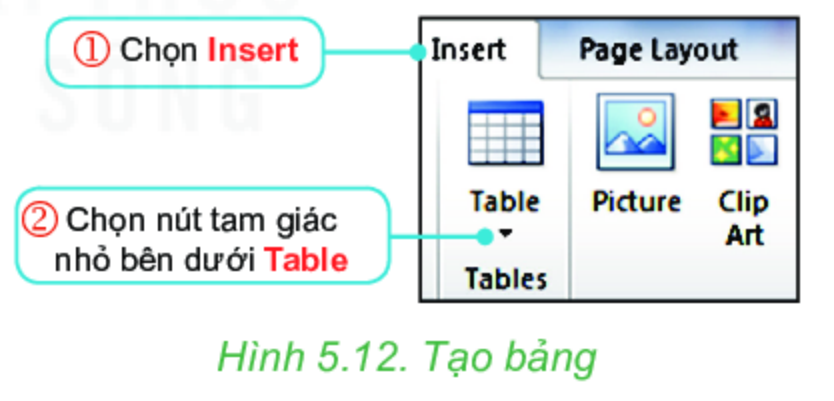
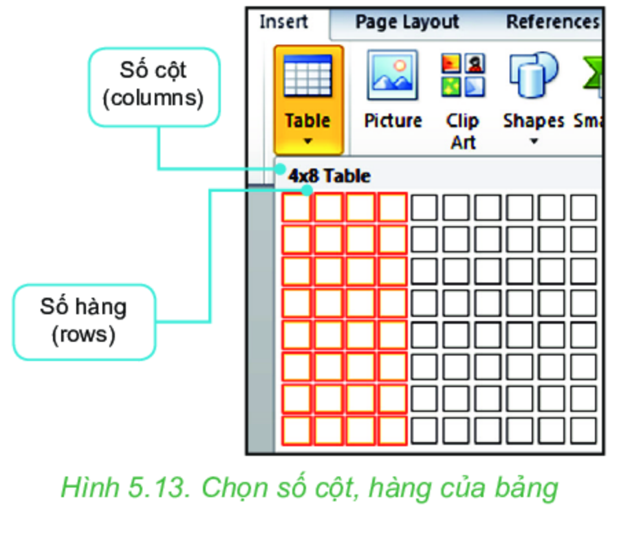
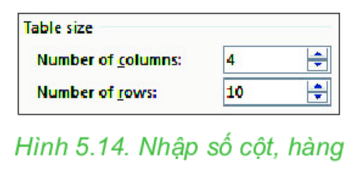
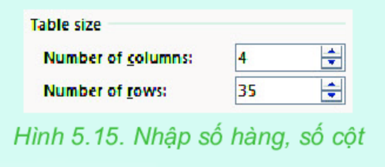
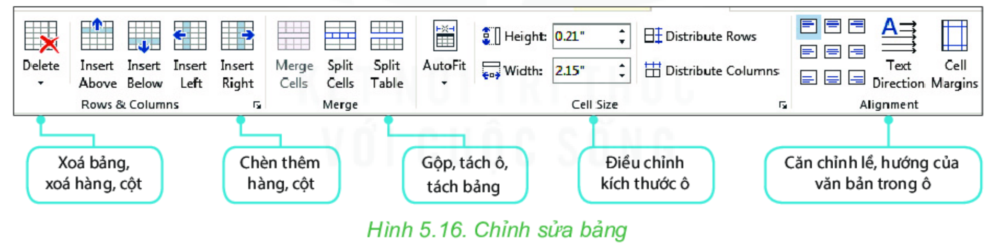
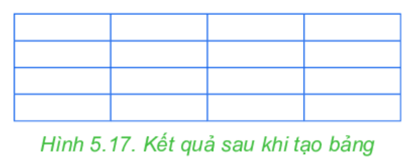
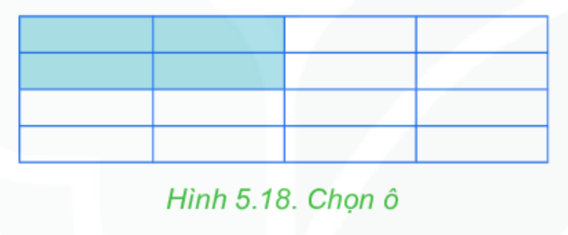
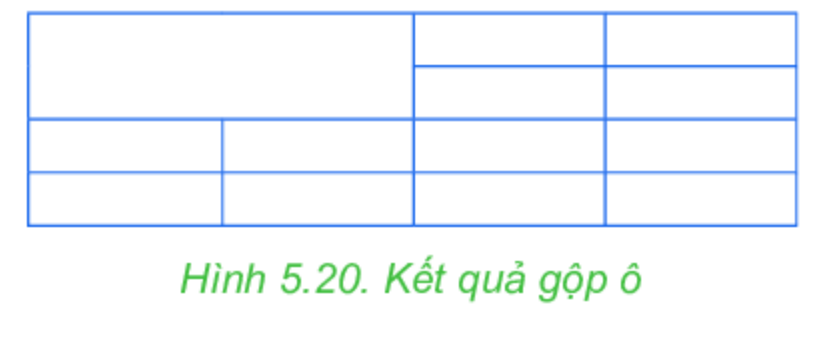
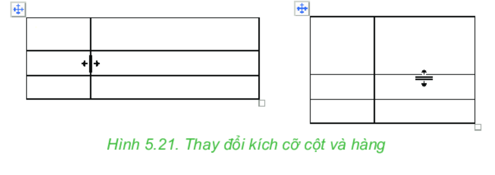

<!-- pdf:60 -->

# BÀI 12: TRÌNH BÀY THÔNG TIN Ở DẠNG BẢNG

## 🎯 Sau bài này em sẽ:

- Biết được ưu điểm của việc trình bày thông tin ở dạng bảng.
- Trình bày được thông tin ở dạng bảng bằng phần mềm soạn thảo văn bản.

## 🔴 Khởi động

> Cuốn sổ lưu niệm mà ba bạn An, Minh và Khoa đang làm cần bổ sung danh sách gồm ảnh và thông tin ngắn về các bạn trong lớp. Ba bạn đang băn khoăn không biết nên trình bày như thế nào cho đẹp và khoa học.
>
> **An:** Tớ đã mất khá nhiều công để soạn thảo danh sách trên mấy trang văn bản. Các bạn xem thế đã được chưa?
>
> **Minh:** Tớ có tham khảo cách trình bày của một số cuốn sổ lưu niệm. Họ để danh sách vào một bảng, nhìn rất đầy đủ mà cô đọng.
>
> **Khoa:** Nhưng bảng vừa chứa hình ảnh, vừa chứa chữ có được không? Có lẽ chúng ta phải nhờ thầy cô hướng dẫn thêm.

*Hình 5.11. Danh sách lớp*
<!-- ocr-ok: đã đối chiếu ảnh trang 60, chú thích xanh lá in nghiêng dưới Hình 5.11 bị OCR bỏ sót -->

> **Hoạt động 1: Danh sách học sinh**
>
> 1. Hình 5.11 cho thấy hai cách trình bày danh sách học sinh trong cuốn sổ lưu niệm. Trang bên trái sử dụng bảng, trang bên phải liệt kê lần lượt danh sách các thành viên. Em hãy nhận xét về hai cách trình bày.
> 2. Em sẽ lựa chọn cách nào để trình bày danh sách học sinh trong cuốn sổ lưu niệm của lớp em? Tại sao?

<!-- pdf:61 -->

## 1. TRÌNH BÀY THÔNG TIN Ở DẠNG BẢNG

Một phiếu khảo sát về sở thích đối với các trò chơi tập thể đã được phát cho học sinh trong lớp. Kết quả trả lời của các phiếu khảo sát được thống kê trong bảng sau:

| STT | Tên trò chơi | Số bạn nam thích | Số bạn nữ thích |
| --- | --- | --- | --- |
| 1 | Kéo co | 19 | 16 |
| 2 | Ném bóng trúng đích | 12 | 15 |
| 3 | Trao tín gậy | 16 | 18 |
| 4 | Trốn tìm | 8 | 10 |

> Họ tên: Nguyễn Thu An
> Nam ☐ Nữ ☑
> Chọn những trò chơi tập thể mà bạn thích:
> 1. Kéo co ☑
> 2. Ném bóng trúng đích ☐
> 3. Trao tín gậy ☑
> 4. Trốn tìm ☑

> **Hoạt động 2: Bảng**
>
> Dựa vào bảng thống kê kết quả, em hãy trả lời các câu hỏi sau:
>
> 1. Bảng trên gồm mấy cột, mấy hàng?
> 2. Trò chơi nào được các bạn nam yêu thích nhất? Trò chơi nào được các bạn nữ yêu thích nhất? Trò chơi nào được học sinh của lớp yêu thích nhất?
> 3. Nếu không dùng bảng biểu diễn thì việc so sánh và tìm kiếm có dễ không?

> Chúng ta có thể sử dụng **bảng** để trình bày thông tin một cách cô đọng. Bảng cũng thường được sử dụng để ghi lại dữ liệu của công việc thống kê, điều tra, khảo sát,... Từ **bảng dữ liệu**, em có thể dễ dàng tìm kiếm, so sánh, tổng hợp được thông tin.

## 2. TẠO BẢNG

Trong phần mềm soạn thảo văn bản, các lệnh tạo bảng nằm trong thẻ **Insert** ở nhóm lệnh **Table**. Cách mở cửa sổ **Insert Table** được thực hiện như Hình 5.12:

*Hình 5.12. Tạo bảng*

<!-- term: Cột -->
<!-- term: Hàng -->
– Di chuyển chuột bắt đầu từ góc trên, bên trái của cửa sổ **Insert Table** vừa mở ra để chọn số cột, số hàng cho bảng. Sau khi nháy chuột, bảng sẽ được chèn vào vị trí của con trỏ soạn thảo.

<!-- term: Ô -->
– Để đưa dữ liệu vào bảng, em đặt con trỏ soạn thảo vào ô và nhập dữ liệu. Ô của bảng có thể chứa tất cả các loại dữ liệu như: văn bản, hình ảnh,...

– Để di chuyển con trỏ soạn thảo, em sử dụng các phím mũi tên $\uparrow, \downarrow, \rightarrow, \leftarrow$ trên bàn phím hoặc sử dụng chuột.

– Căn chỉnh lề cho dữ liệu trong ô cũng tương tự như căn lề cho văn bản.

*Hình 5.13. Chọn số cột, hàng của bảng*

<!-- pdf:62 -->

*Lưu ý:* Cách tạo bảng như trên chỉ tạo được bảng có tối đa 10 cột, 8 hàng. Nếu muốn tạo bảng có nhiều hàng, cột hơn, em thực hiện như sau:

- Chọn **Insert/Table/Insert Table**.
- Nhập số cột, số hàng của bảng. Ví dụ, bảng có 4 cột, 10 hàng.

*Hình 5.14. Nhập số cột, hàng*

> ❓ **Câu hỏi**
>
> 1. Em hãy sắp xếp lại thứ tự các bước để được thao tác tạo bảng đúng:
>    a) Chọn mũi tên nhỏ bên dưới Table.
>    b) Di chuyển chuột để chọn số hàng, số cột.
>    c) Chọn Insert.
> 2. Bạn An đã nhập số hàng, số cột như Hình 5.15 để tạo bảng. Bảng được tạo sẽ có:
>    A. 4 cột, 35 hàng.
>    B. 35 cột, 35 hàng.
>    C. 35 cột, 4 hàng.
>    D. 4 cột, 4 hàng.

*Hình 5.15. Nhập số hàng, số cột*

## 3. CHỈNH SỬA BẢNG

<!-- term: Chỉnh sửa bảng -->
Khi em đặt con trỏ soạn thảo trong bảng, nhóm thẻ **Table Tools** sẽ xuất hiện giúp em định dạng bảng. Để chỉnh sửa bảng, em chọn thẻ **Layout**. Các nhóm lệnh để chỉnh sửa bảng được chú thích trong Hình 5.16.

*Hình 5.16. Chỉnh sửa bảng*
<!-- ocr-ok: đã đối chiếu ảnh trang 62, chú thích xanh lá in nghiêng dưới Hình 5.16 bị OCR bỏ sót -->

> ❓ **Câu hỏi**
>
> Muốn xoá một số hàng trong bảng, sau khi chọn các hàng cần xoá, em thực hiện lệnh nào sau đây?
>
> A. Delete Cells.
>
> B. Delete Columns.
>
> C. Delete Rows.
>
> D. Delete Table.

## 4. THỰC HÀNH: TẠO BẢNG

**Nhiệm vụ**

– Tạo bảng danh sách thành viên của lớp như minh hoạ trong Hình 5.11.

– Nhập dữ liệu gồm: Họ tên, ngày sinh và ảnh của giáo viên chủ nhiệm và từng thành viên trong lớp.

– Chỉnh sửa, định dạng bảng.

<!-- pdf:63 -->

**Hướng dẫn**

### a) Tạo bảng

– Xác định số cột, số hàng của bảng: trong minh hoạ ở Hình 5.11, bảng chứa thông tin của giáo viên chủ nhiệm và các học sinh trong lớp, bảng này gồm 4 cột và 4 hàng.

– Em có thể ước tính số cột, số hàng của bảng dựa trên số thành viên của lớp. Cũng có thể tạo hai bảng, bảng danh sách giáo viên và bảng danh sách học sinh. Phần hướng dẫn thực hành sau đây tạo bảng 4 hàng 4 cột như minh hoạ trong Hình 5.11.

*Hình 5.17. Kết quả sau khi tạo bảng*
<!-- ocr-ok: đã đối chiếu ảnh trang 63, chú thích xanh lá in nghiêng dưới Hình 5.17 bị OCR bỏ sót -->

### b) Chỉnh sửa bảng

– Ở Hình 5.11, phần chứa thông tin của giáo viên chủ nhiệm được trình bày trong một ô to, được gộp từ 4 ô nhỏ của bảng. Do đó, cần chỉnh sửa lại bảng để tạo một ô to từ các ô nhỏ.

– Kéo thả chuột để chọn bốn ô của bảng.

*Hình 5.18. Chọn ô*
<!-- ocr-ok: đã đối chiếu ảnh trang 63, chú thích xanh lá in nghiêng dưới Hình 5.18 bị OCR bỏ sót -->

– Trong nhóm thẻ **Table Tools**, chọn thẻ **Layout**.
– Trong nhóm lệnh **Merge**, chọn **Merge Cells**.

*Hình 5.19. Chọn lệnh gộp ô*
<!-- ocr-ok: đã đối chiếu ảnh trang 63, chú thích xanh lá in nghiêng dưới Hình 5.19 bị OCR bỏ sót -->

– Kết quả:

*Hình 5.20. Kết quả gộp ô*
<!-- ocr-ok: đã đối chiếu ảnh trang 63, chú thích xanh lá in nghiêng dưới Hình 5.20 bị OCR bỏ sót -->

<!-- term: Cột -->
<!-- term: Hàng -->
<!-- term: Chỉnh sửa bảng -->
– Để chỉnh sửa độ rộng của cột hay độ cao của hàng, di chuyển con trỏ chuột vào đường biên của cột (hay hàng) cần thay đổi cho đến khi con trỏ chuyển thành dạng mũi tên hai chiều thì kéo thả chuột để điều chỉnh.

*Hình 5.21. Thay đổi kích cỡ cột và hàng*
<!-- ocr-ok: đã đối chiếu ảnh trang 63, chú thích xanh lá in nghiêng dưới Hình 5.21 bị OCR bỏ sót -->

<!-- pdf:64 -->

### c) Nhập thông tin

– Nhập thông tin của các thành viên vào ô của bảng, thông tin gồm: ảnh, họ tên, ngày sinh.

– Em có thể bổ sung thêm thông tin khác cho các thành viên như địa chỉ, sở thích,...

– Em có thể chèn thêm hàng, cột để tạo bảng chứa đầy đủ các thành viên trong lớp.

## ✏️ Luyện tập

1. Em hãy soạn thảo bảng kết quả khảo sát trò chơi tập thể yêu thích ở Mục 1. Nếu cần bổ sung cột **Tổng số** để điền số học sinh cả lớp thích trò chơi tương ứng (bằng số học sinh nam cộng số học sinh nữ cùng thích trò chơi này) thì em sẽ chèn cột này vào vị trí nào của bảng? Em hãy chèn và điền số liệu cho cột **Tổng số** này.
2. Bản tin sau đây nói về kết quả thực hiện phong trào đọc sách của học sinh khối 6.

> ***Bản tin “Phong trào đọc sách”***
>
> Trong những năm gần đây, số học sinh khối 6 của nhà trường yêu thích đọc sách đã tăng lên rõ rệt. Kết quả khảo sát của năm 2017 cho thấy, số học sinh yêu thích đọc sách là 230 em, chiếm 52% tổng số học sinh của khối. Số liệu này của các năm 2018 và 2019 lần lượt là 256 em (chiếm 64%) và 345 em (chiếm 78%). Phong trào đọc sách đang ngày càng được nhiều học sinh tích cực hưởng ứng.

a) Em hãy tạo một bảng để trình bày cô đọng nội dung của bản tin trên.

b) Hãy bổ sung thông tin sau vào bảng: *“Năm 2016, kết quả khảo sát học sinh khối 6 của nhà trường cho thấy có 175 em học sinh yêu thích đọc sách, chiếm 45% tổng số học sinh của khối.”*

## 🚀 Vận dụng

1. Em hãy trình bày các văn bản sau dưới dạng bảng:
   a) Thời khoá biểu của lớp.
   b) Thời gian biểu hoạt động các ngày trong tuần của em.
2. Em hãy xem lại nội dung cuốn sổ lưu niệm và cân nhắc xem phần nội dung nào nên được trình bày ở dạng bảng thì hợp lí hơn. Hãy trình bày lại nội dung đó.

## 📷 Danh sách hình trong bài

| Mã hình | Trang PDF | Trang sách | Chú thích |
| --- | --- | --- | --- |
| H6-tin-b12-01 | 60 | 59 | Hình 5.11. Danh sách lớp |
| H6-tin-b12-02 | 61 | 60 | Hình 5.12. Tạo bảng |
| H6-tin-b12-03 | 61 | 60 | Hình 5.13. Chọn số cột, hàng của bảng |
| H6-tin-b12-04 | 62 | 61 | Hình 5.14. Nhập số cột, hàng |
| H6-tin-b12-05 | 62 | 61 | Hình 5.15. Nhập số hàng, số cột |
| H6-tin-b12-06 | 62 | 61 | Hình 5.16. Chỉnh sửa bảng |
| H6-tin-b12-07 | 63 | 62 | Hình 5.17. Kết quả sau khi tạo bảng |
| H6-tin-b12-08 | 63 | 62 | Hình 5.18. Chọn ô |
| H6-tin-b12-09 | 63 | 62 | Hình 5.19. Chọn lệnh gộp ô |
| H6-tin-b12-10 | 63 | 62 | Hình 5.20. Kết quả gộp ô |
| H6-tin-b12-11 | 63 | 62 | Hình 5.21. Thay đổi kích cỡ cột và hàng |
| H6-tin-b12-12 | 64 | 63 | Bảng danh sách thành viên lớp sau khi nhập thông tin (Mục 4.c) |
