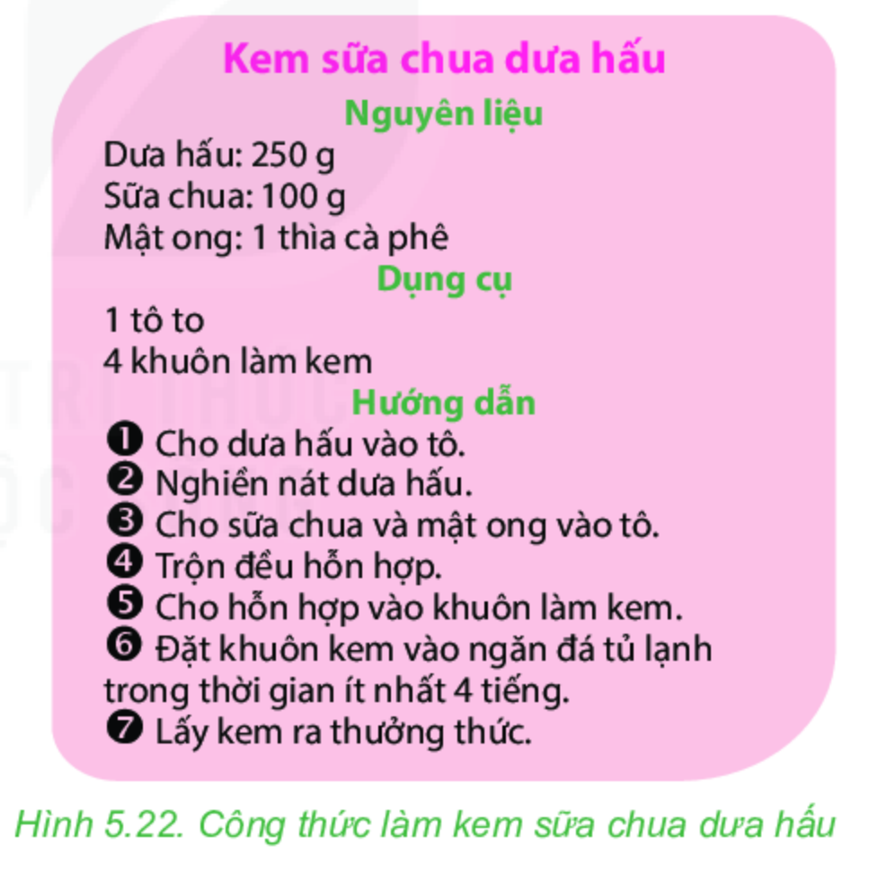
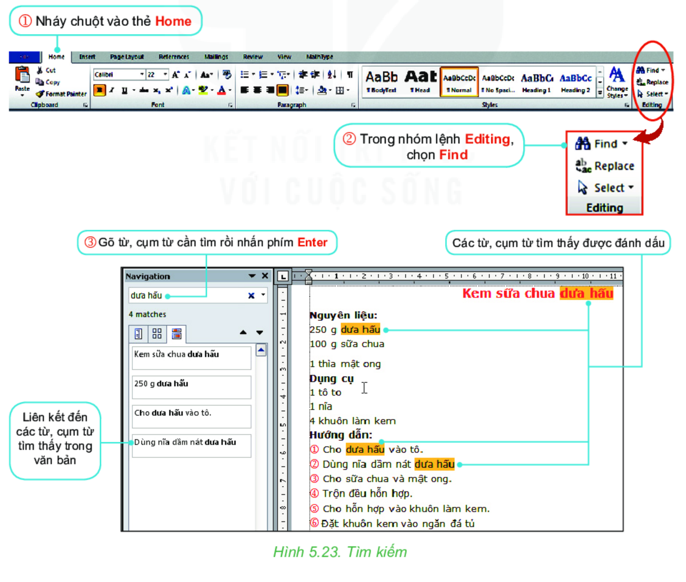
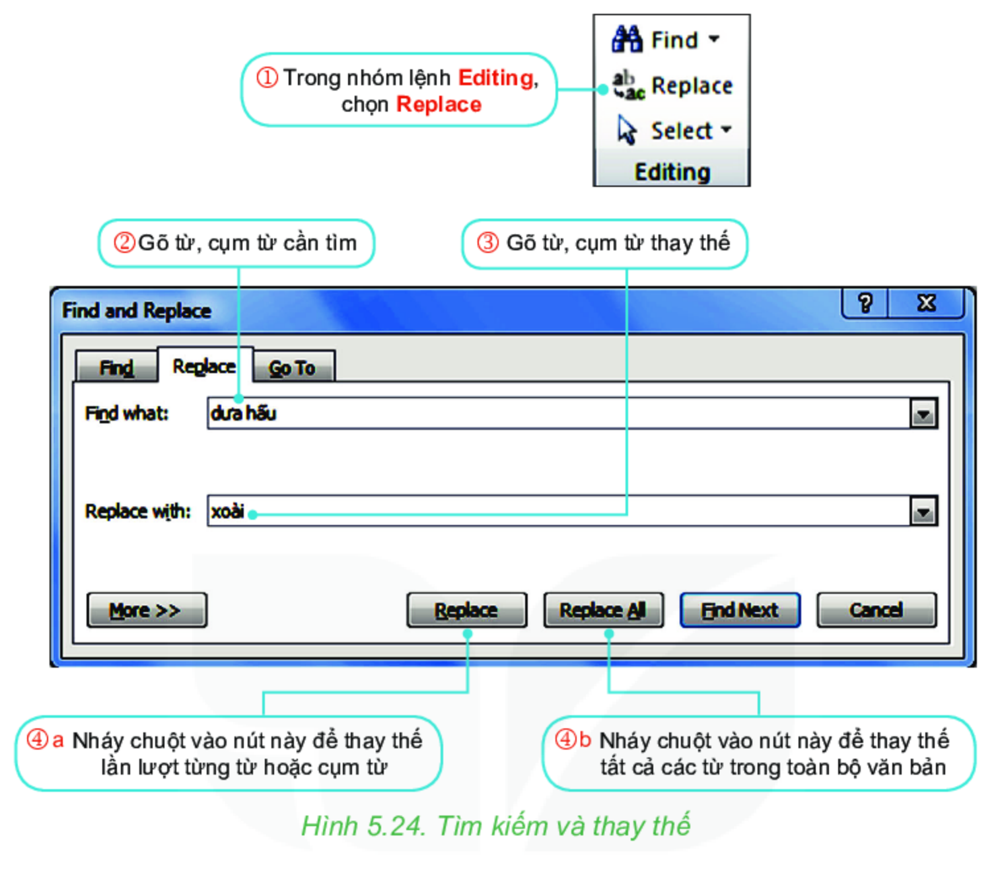

<!-- pdf:65 -->

# BÀI 13: TÌM KIẾM VÀ THAY THẾ

## 🎯 Sau bài này em sẽ:

- Trình bày được tác dụng của công cụ tìm kiếm, thay thế trong phần mềm soạn thảo văn bản.
- Sử dụng được công cụ tìm kiếm và thay thế của phần mềm.

## 🔴 Khởi động

> An đã học được cách làm kem sữa chua dưa hấu rất ngon. An đã làm thành công món kem này để mời hai bạn Khoa, Minh cùng thưởng thức. Minh xin An công thức làm kem nhưng muốn đổi thành món kem sữa chua xoài. Em giúp An sửa công thức làm kem sữa chua dưa hấu thành công thức làm kem sữa chua xoài nhé.

## 1. TẠI SAO PHẢI TÌM KIẾM VÀ THAY THẾ VĂN BẢN?

> **Hoạt động 1: Đổi công thức làm kem**
>
> 1. Từ công thức làm kem sữa chua dưa hấu, muốn thành công thức làm kem sữa chua xoài em làm thế nào?
> 2. Trong phần mềm soạn thảo văn bản, em thực hiện những thao tác nào để giúp An chỉnh sửa tệp văn bản công thức làm kem?
> 3. Em có biết cách nào chỉnh sửa tệp văn bản nhanh hơn không?

*Hình 5.22. Công thức làm kem sữa chua dưa hấu*

> **Kem sữa chua dưa hấu**
>
> **Nguyên liệu**
> Dưa hấu: 250 g
> Sữa chua: 100 g
> Mật ong: 1 thìa cà phê
>
> **Dụng cụ**
> 1 tô to
> 4 khuôn làm kem
>
> **Hướng dẫn**
> 1. Cho dưa hấu vào tô.
> 2. Nghiền nát dưa hấu.
> 3. Cho sữa chua và mật ong vào tô.
> 4. Trộn đều hỗn hợp.
> 5. Cho hỗn hợp vào khuôn làm kem.
> 6. Đặt khuôn kem vào ngăn đá tủ lạnh trong thời gian ít nhất 4 tiếng.
> 7. Lấy kem ra thưởng thức.

Trong quá trình soạn thảo văn bản, nhu cầu tìm kiếm một từ hoặc cụm từ, hay thay thế một từ hoặc cụm từ này bằng một từ hoặc cụm từ khác thường xảy ra. Với các văn bản ngắn thì việc tìm kiếm và thay thế dễ dàng và nhanh chóng. Tuy nhiên, với các văn bản dài, hàng trăm trang, thì việc tìm kiếm và thay thế không còn dễ dàng và nhanh chóng nữa.

Các phần mềm soạn thảo văn bản có công cụ **Tìm kiếm** và **Thay thế** (**Find and Replace**) để tìm kiếm và thay thế các từ hoặc cụm từ trong văn bản. Công cụ này giúp chúng ta thực hiện tìm kiếm, thay thế nhanh chóng và chính xác, vì vậy tiết kiệm thời gian và quan trọng là không bỏ sót bất cứ từ nào. Ví dụ, cần thay “dưa hấu” bằng “xoài” trong công thức làm kem, sử dụng công cụ Tìm kiếm và Thay thế, tất cả các từ “dưa hấu” xuất hiện trong văn bản sẽ được thay bằng từ “xoài”.

<!-- pdf:66 -->

> **TÌM KIẾM VÀ THAY THẾ**
>
> **Công cụ Tìm kiếm và Thay thế** giúp tìm kiếm, thay thế từ hoặc cụm từ theo yêu cầu một cách nhanh chóng và chính xác.

## 2. SỬ DỤNG CÔNG CỤ TÌM KIẾM VÀ THAY THẾ

**Nhiệm vụ**

Nhập nội dung công thức làm kem sữa chua dưa hấu của An và định dạng văn bản như Hình 5.22 rồi lưu lại với tên `kemsuachua-duahau.docx`. Thực hành tìm kiếm cụm từ “dưa hấu” và thay thế bằng từ “xoài” trong công thức rồi lưu lại tệp với tên `kemsuachua-xoai.docx`.

**Hướng dẫn**

– Khởi động phần mềm Microsoft Word, nhập nội dung công thức làm kem sữa chua dưa hấu.

– Thực hiện các thao tác định dạng để có kết quả như Hình 5.22 (xem hướng dẫn cụ thể ở phần thực hành của Bài 11).

– Lưu lại tệp bằng tên `kemsuachua-duahau.docx`.

### a) Tìm kiếm

Thao tác **tìm kiếm** được thực hiện theo ba bước sau đây:

*Hình 5.23. Tìm kiếm*

<!-- pdf:67 -->

### b) Thay thế

Trong văn bản, **thay thế** cụm từ “dưa hấu” bằng từ “xoài” được thực hiện theo bốn bước như sau:

*Hình 5.24. Tìm kiếm và thay thế*
<!-- ocr-ok: đã đối chiếu ảnh trang 67, chú thích xanh lá in nghiêng dưới Hình 5.24 bị OCR bỏ sót -->

## ✏️ Luyện tập

1. Tệp văn bản chứa các bài viết cảm nghĩ của An về trường, lớp, thầy cô và các bạn gồm nhiều trang. An muốn xem lại nội dung bài viết về nhóm bạn thân lớp 6A, nhưng không nhớ rõ ở trang nào. Vì vậy, An thực hiện thao tác tìm kiếm cụm từ “nhóm bạn thân” trong tệp văn bản. An phải thực hiện thao tác gì để xem lần lượt các kết quả tìm thấy?
2. Em hãy sắp xếp lại các bước sau đây theo thứ tự đúng để thực hiện thao tác thay thế một từ hoặc cụm từ trong phần mềm soạn thảo văn bản.
   a) Gõ từ, cụm từ cần thay thế.
   b) Nháy chuột vào thẻ **Home**.
   c) Trong nhóm lệnh **Editing**, chọn **Replace**.
   d) Gõ từ, cụm từ cần tìm.
   e) Nháy chuột vào nút **Replace** để thay thế lần lượt từng từ hoặc cụm từ.

## 🚀 Vận dụng

Trong các bài học trước, em đã tạo ra một số tệp văn bản cho cuốn sổ lưu niệm. Em hãy xem lại các tệp văn bản này để rà soát lỗi chính tả. Em có thể sử dụng chức năng Tìm kiếm và Thay thế để chỉnh sửa các lỗi chính tả, thay thế các từ viết tắt,... để các tệp văn bản hoàn chỉnh hơn.

## 📷 Danh sách hình trong bài

| Mã hình | Trang PDF | Trang sách | Chú thích |
| --- | --- | --- | --- |
| H6-tin-b13-01 | 65 | 64 | Hình 5.22. Công thức làm kem sữa chua dưa hấu |
| H6-tin-b13-02 | 66 | 65 | Hình 5.23. Tìm kiếm |
| H6-tin-b13-03 | 67 | 66 | Hình 5.24. Tìm kiếm và thay thế |
