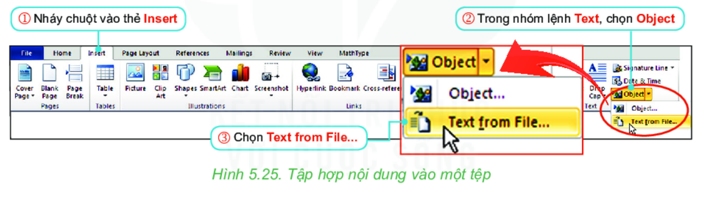
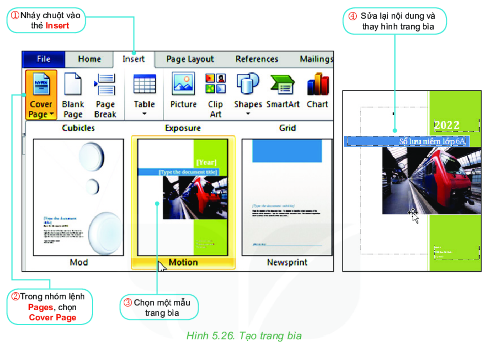
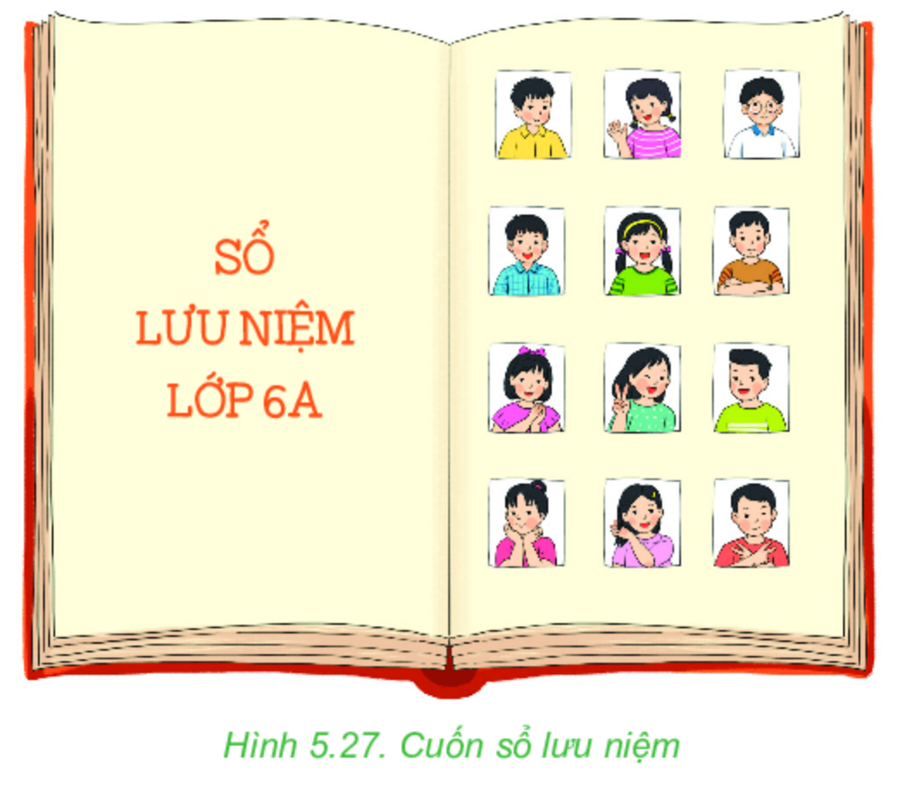

<!-- pdf:68 -->

# BÀI 14: THỰC HÀNH TỔNG HỢP: HOÀN THIỆN SỔ LƯU NIỆM

**NHIỆM VỤ**

Từ các kết quả thực hành trong chủ đề này, các nhóm (từ 3 – 5 em) hãy tập hợp và bổ sung thêm nội dung để hoàn thiện cuốn sổ lưu niệm của lớp.

**HƯỚNG DẪN**

**Bước 1. Tập hợp các nội dung đã có**

– Trong các bài học trước, các em đã tạo các tệp văn bản chứa nội dung cuốn sổ lưu niệm của lớp như: bài viết cảm nghĩ, danh sách thành viên,... Các em hãy tập hợp các nội dung đó vào một tệp văn bản có tên `Soluuniem.docx`.

– Để thực hiện nhiệm vụ này, em hãy khởi tạo tệp văn bản mới và thực hiện các bước sau đây:

*Hình 5.25. Tập hợp nội dung vào một tệp*
<!-- ocr-ok: đã đối chiếu ảnh trang 68, chú thích xanh lá in nghiêng dưới Hình 5.25 bị OCR bỏ sót -->

**Bước 2. Bổ sung thêm nội dung**

– Xem lại sơ đồ tư duy trình bày nội dung cuốn sổ lưu niệm các em đã tạo ở Bài 10 để rà soát lại nội dung xem đã đầy đủ chưa. Phân công các bạn trong nhóm thu thập thông tin, hình ảnh để bổ sung, đặc biệt là thông tin về các thầy cô giáo, các hoạt động mà lớp đã thực hiện như: hoạt động thể thao, văn hoá, văn nghệ, tham quan,...

– Soạn thảo các nội dung bổ sung. Chú ý thực hiện các thao tác định dạng để văn bản được trình bày cô đọng với bố cục hợp lí và đẹp mắt:

<!-- term: Định dạng kí tự -->
- Định dạng chữ (màu sắc, cỡ chữ,...).
- Căn chỉnh lề đoạn văn bản.
- Định dạng hướng trang, lề trang.
- Bổ sung hình ảnh.
- Chèn bảng (nếu cần).
- Sử dụng chức năng Tìm kiếm và Thay thế để chỉnh sửa văn bản (nếu cần).

<!-- pdf:69 -->

**Bước 3. Tạo trang bìa cho cuốn sổ**

Để tạo trang bìa cho cuốn sổ lưu niệm, em thực hiện theo các bước sau:

*Hình 5.26. Tạo trang bìa*
<!-- ocr-ok: đã đối chiếu ảnh trang 69, chú thích xanh lá in nghiêng dưới Hình 5.26 bị OCR bỏ sót -->

**Bước 4. Xem lại nội dung**

Hãy tưởng tượng các em đã là người lớn. Cả lớp gặp lại nhau trong một lần họp lớp ở tương lai 50 năm sau. Hãy cùng xem lại cuốn sổ lưu niệm và nghĩ về câu hỏi “Tại sao chúng ta lại đưa nội dung này vào sổ?”. Các nhóm hãy chia sẻ với cả lớp sản phẩm của mình và cả lớp cùng thảo luận để cuốn sổ lưu niệm chung của cả lớp có nội dung đầy đủ và trình bày đẹp nhất.

*Hình 5.27. Cuốn sổ lưu niệm*
<!-- ocr-ok: đã đối chiếu ảnh trang 69, chú thích xanh lá in nghiêng dưới Hình 5.27 bị OCR bỏ sót -->

## 📷 Danh sách hình trong bài

| Mã hình | Trang PDF | Trang sách | Chú thích |
| --- | --- | --- | --- |
| H6-tin-b14-01 | 68 | 67 | Hình 5.25. Tập hợp nội dung vào một tệp |
| H6-tin-b14-02 | 69 | 68 | Hình 5.26. Tạo trang bìa |
| H6-tin-b14-03 | 69 | 68 | Hình 5.27. Cuốn sổ lưu niệm |
