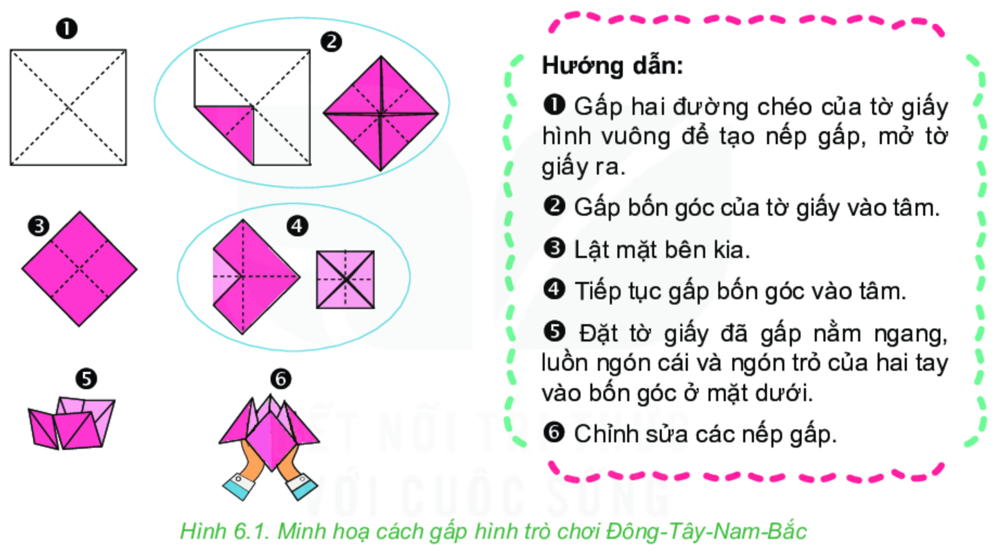
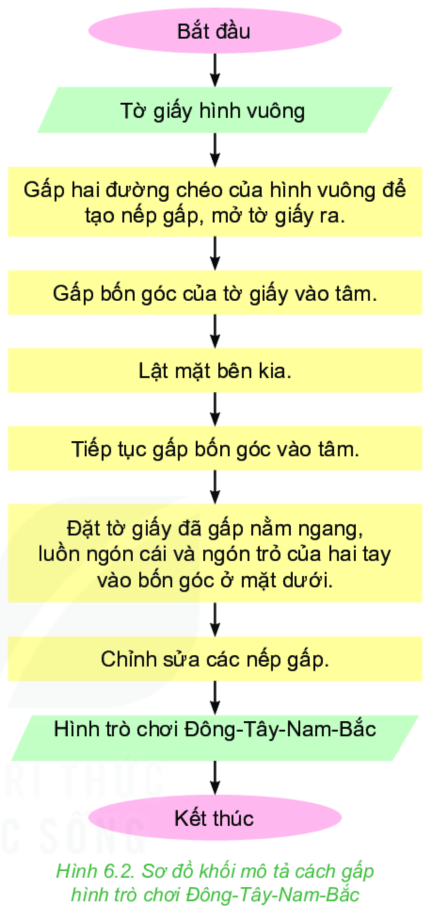
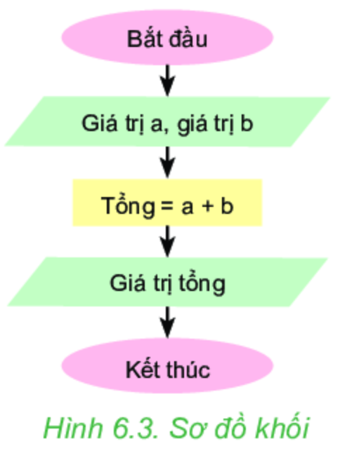
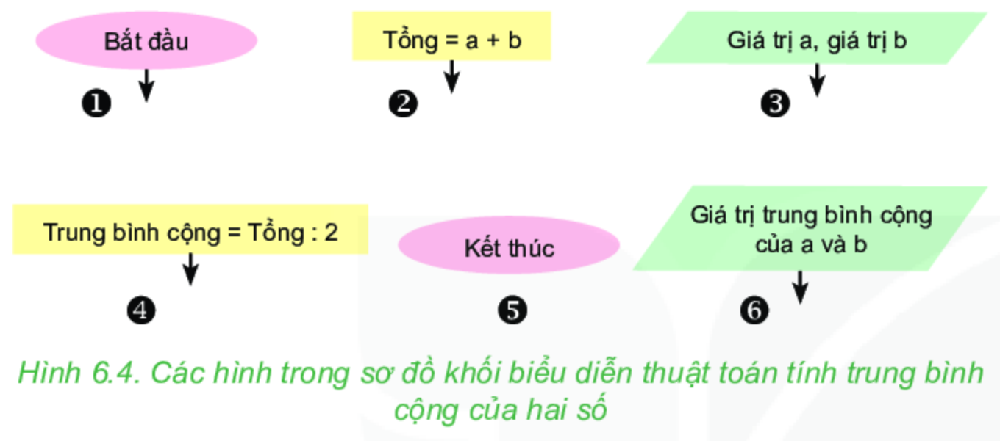
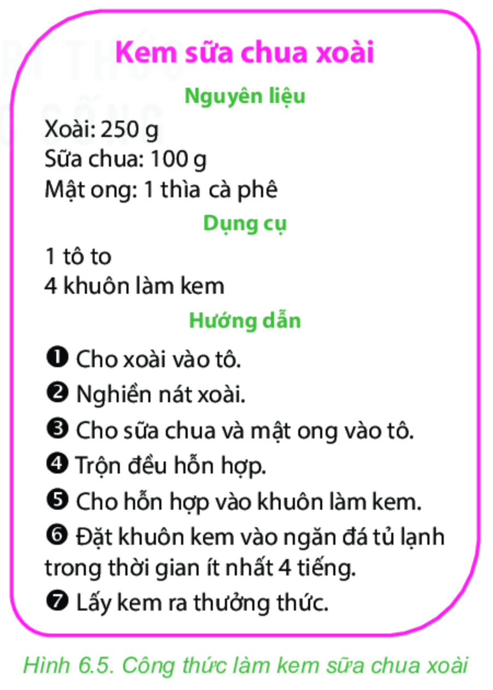

<!-- pdf:71 -->

# BÀI 15: THUẬT TOÁN

## 🎯 Sau bài này em sẽ:

- Diễn tả được sơ lược khái niệm thuật toán, nêu được một vài ví dụ minh hoạ.
- Biết thuật toán có thể được mô tả dưới dạng liệt kê hoặc sơ đồ khối.

## 🔴 Khởi động

> Gấp hình trò chơi Đông-Tây-Nam-Bắc.
>
> **Hướng dẫn:**
> 1. Gấp hai đường chéo của tờ giấy hình vuông để tạo nếp gấp, mở tờ giấy ra.
> 2. Gấp bốn góc của tờ giấy vào tâm.
> 3. Lật mặt bên kia.
> 4. Tiếp tục gấp bốn góc vào tâm.
> 5. Đặt tờ giấy đã gấp nằm ngang, luồn ngón cái và ngón trỏ của hai tay vào bốn góc ở mặt dưới.
> 6. Chỉnh sửa các nếp gấp.

*Hình 6.1. Minh hoạ cách gấp hình trò chơi Đông-Tây-Nam-Bắc*

## 1. THUẬT TOÁN

> **Hoạt động 1: Khái niệm thuật toán**
>
> 1. Nếu đảo thứ tự của bước 3 và bước 4 trong hướng dẫn trên thì em có gấp được hình trò chơi Đông-Tây-Nam-Bắc không? Tại sao?
> 2. Trước khi thực hiện theo hướng dẫn trên, em cần có gì? Sau khi thực hiện lần lượt sáu bước theo hướng dẫn, em nhận được kết quả là gì?

Từ một tờ giấy hình vuông, thực hiện lần lượt sáu bước như hướng dẫn ở phần khởi động, em sẽ có kết quả là hình gấp trò chơi Đông-Tây-Nam-Bắc. Một bạn khác thực hiện đúng các bước đó cũng được kết quả giống em. Khi thực hiện, nếu em bỏ qua một bước hoặc thay đổi thứ tự các bước thì kết quả sẽ khác. Chỉ khi thực hiện đúng trình tự các bước thì em mới nhận được kết quả là hình gấp trò chơi.

<!-- pdf:72 -->

Hướng dẫn gấp hình trò chơi Đông-Tây-Nam-Bắc gồm sáu bước chính là một thuật toán. Trong thuật toán này, tờ giấy hình vuông được gọi là **đầu vào** (Input); hình gấp trò chơi Đông-Tây-Nam-Bắc được gọi là **đầu ra** (Output). Trình tự các bước rất quan trọng. Nếu thực hiện không đúng trình tự sẽ không nhận được kết quả đúng.

Trong cuộc sống hằng ngày, nếu để ý em sẽ thấy các thuật toán có ở khắp nơi. Một quy trình để chế biến món ăn là một thuật toán, cách giải một bài toán là một thuật toán, quy trình gấp một chiếc áo là một thuật toán.

> **Thuật toán** là một dãy các chỉ dẫn rõ ràng, có trình tự sao cho khi thực hiện những chỉ dẫn này người ta giải quyết được vấn đề hoặc nhiệm vụ đã cho.

> ❓ **Câu hỏi**
>
> 1. Thuật toán là gì?
>    A. Một dãy các cách giải quyết một nhiệm vụ.
>    B. Một dãy các kết quả nhận được khi giải quyết một nhiệm vụ.
>    C. Một dãy các chỉ dẫn rõ ràng, có trình tự sao cho khi thực hiện những chỉ dẫn này người ta giải quyết được vấn đề hoặc nhiệm vụ đã cho.
>    D. Một dãy các dữ liệu đầu vào để giải quyết một nhiệm vụ.
> 2. Em hãy chọn các câu đúng.
>    A. Thuật toán có đầu ra là kết quả nhận được sau khi thực hiện các bước của thuật toán.
>    B. Thuật toán có đầu vào là các dữ liệu ban đầu.
>    C. Thuật toán có đầu vào là kết quả nhận được sau khi thực hiện các bước của thuật toán.
>    D. Thuật toán có đầu ra là các dữ liệu ban đầu.

## 2. MÔ TẢ THUẬT TOÁN

> **Hoạt động 2: Mô tả thuật toán**
>
> Ngoài cách trình bày thuật toán bằng ngôn ngữ tự nhiên, em còn biết cách nào khác không? Cách đó có hiệu quả không? Vì sao?

Ngoài cách mô tả thuật toán bằng việc dùng ngôn ngữ tự nhiên để liệt kê các bước, người ta còn mô tả thuật toán bằng cách sử dụng sơ đồ khối. Hướng dẫn cách gấp hình trò chơi Đông-Tây-Nam-Bắc theo các bước ở phần khởi động là mô tả thuật toán ở dạng liệt kê bằng ngôn ngữ tự nhiên. Sơ đồ khối của thuật toán gồm một số hình mô tả các bước và đường có mũi tên để chỉ trình tự thực hiện các bước của thuật toán.

<!-- pdf:73 -->

Hình 6.2 là sơ đồ khối mô tả thuật toán gấp hình trò chơi Đông-Tây-Nam-Bắc.

<!-- term: Quy ước kí hiệu trong sơ đồ khối -->
> **Quy ước:**
> - *(Hình elip)*: Bắt đầu hoặc Kết thúc
> - *(Hình bình hành)*: Đầu vào hoặc Đầu ra
> - *(Hình chữ nhật)*: Bước xử lí
> - *(Hình thoi)*: Bước kiểm tra điều kiện
> - *(Mũi tên)* $\downarrow$: Trình tự thực hiện
<!-- ocr-ok: đã đối chiếu ảnh trang gốc 73, hộp Quy ước dùng các hình khối kí hiệu màu -->

*Hình 6.2. Sơ đồ khối mô tả cách gấp hình trò chơi Đông-Tây-Nam-Bắc*

> **MÔ TẢ THUẬT TOÁN**
>
> - Có hai cách để **mô tả thuật toán** là liệt kê các bước bằng ngôn ngữ tự nhiên và sử dụng sơ đồ khối.
> - **Sơ đồ khối** của thuật toán là một sơ đồ gồm các hình mô tả các bước và đường có mũi tên để chỉ thứ tự thực hiện các bước của thuật toán.

> ❓ **Câu hỏi**
>
> 1. Câu nào sau đây **sai** khi nói về vai trò của mũi tên trong sơ đồ khối của thuật toán?
>    A. Hướng mũi tên cho thấy hướng đi trong sơ đồ khối.
>    B. Mũi tên được sử dụng để biểu diễn trình tự thực hiện.
>    C. Mũi tên được sử dụng chỉ để kết nối các hình khối trong sơ đồ khối.
> 2. Em hãy ghép mỗi mục ở cột bên phải với một mục phù hợp ở cột bên trái khi nói về sơ đồ khối của thuật toán.
>
> | Hình | Ý nghĩa |
> | --- | --- |
> | 1) *(Hình elip)* | a) Bắt đầu hoặc Kết thúc |
> | 2) *(Hình bình hành)* | b) Trình tự thực hiện |
> | 3) *(Hình chữ nhật)* | c) Đầu vào hoặc Đầu ra |
> | 4) $\downarrow$ | d) Bước xử lí |

<!-- pdf:74 -->

## ✏️ Luyện tập

1. Em hãy tìm đầu vào, đầu ra của các thuật toán sau đây:
   a) Thuật toán tính trung bình cộng của hai số a, b.
   b) Thuật toán tìm ước chung lớn nhất của hai số tự nhiên a và b.
2. Em hãy quan sát sơ đồ khối ở Hình 6.3 và cho biết sơ đồ khối mô tả thuật toán gì? Xác định đầu vào và đầu ra của thuật toán. Mô tả lại thuật toán dưới dạng liệt kê.

*Hình 6.3. Sơ đồ khối*

3. Em hãy sắp xếp các phần được đánh số trong Hình 6.4 để được thuật toán tính trung bình cộng của hai số a và b.

*Hình 6.4. Các hình trong sơ đồ khối biểu diễn thuật toán tính trung bình cộng của hai số*
<!-- ocr-ok: đã đối chiếu ảnh trang gốc 74, chú thích Hình 6.4 chữ xanh lá nghiêng bị OCR bỏ sót -->

## 🚀 Vận dụng

1. Bạn An đã sửa công thức làm kem sữa chua dưa hấu thành công thức làm kem sữa chua xoài như Hình 6.5.
   a) Phần hướng dẫn làm kem sữa chua xoài gồm 7 bước là một thuật toán. Em hãy xác định đầu vào và đầu ra của thuật toán làm kem sữa chua xoài.
   b) Em hãy dùng sơ đồ khối để thể hiện thuật toán đó.

*Hình 6.5. Công thức làm kem sữa chua xoài*

2. Em hãy mô tả thuật toán tính trung bình cộng của hai số a và b theo hai cách: liệt kê các bước và sơ đồ khối.
3. Em hãy nêu ví dụ về thuật toán giải quyết một nhiệm vụ trong thực tế. Hãy xác định đầu vào, đầu ra và các bước thực hiện

## 📷 Danh sách hình trong bài

| Mã hình | Trang PDF | Trang sách | Chú thích |
| --- | --- | --- | --- |
| H6-tin-b15-01 | 71 | 70 | Hình 6.1. Minh hoạ cách gấp hình trò chơi Đông-Tây-Nam-Bắc |
| H6-tin-b15-02 | 73 | 72 | Hình 6.2. Sơ đồ khối mô tả cách gấp hình trò chơi Đông-Tây-Nam-Bắc |
| H6-tin-b15-03 | 74 | 73 | Hình 6.3. Sơ đồ khối |
| H6-tin-b15-04 | 74 | 73 | Hình 6.4. Các hình trong sơ đồ khối biểu diễn thuật toán tính trung bình cộng của hai số |
| H6-tin-b15-05 | 74 | 73 | Hình 6.5. Công thức làm kem sữa chua xoài |
