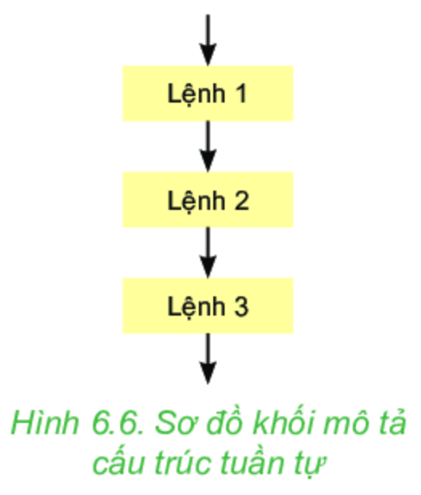
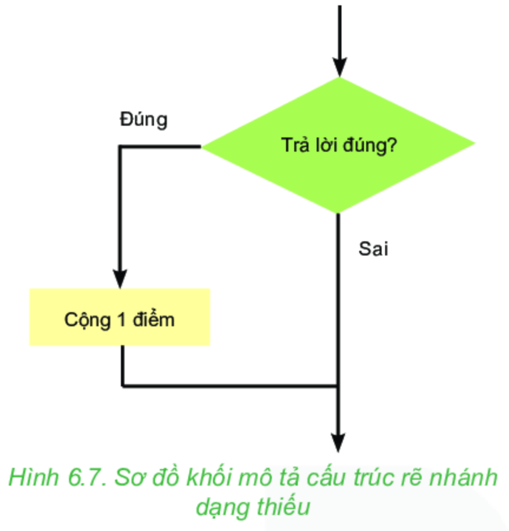
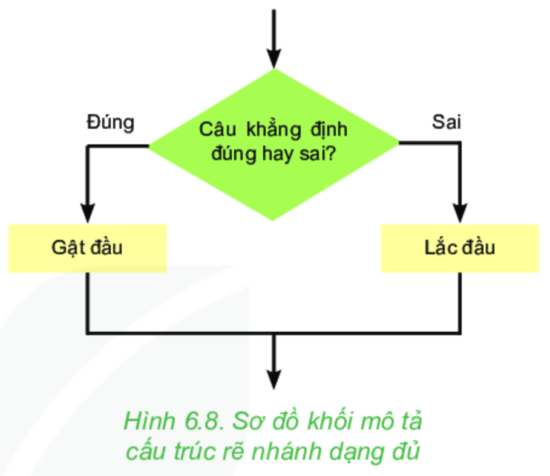
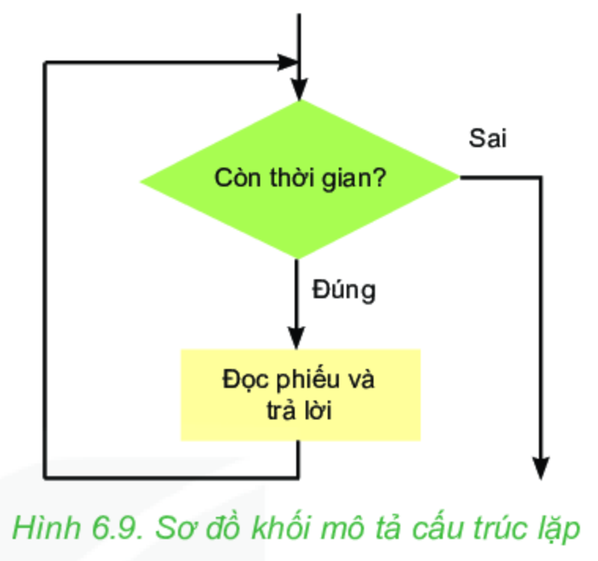
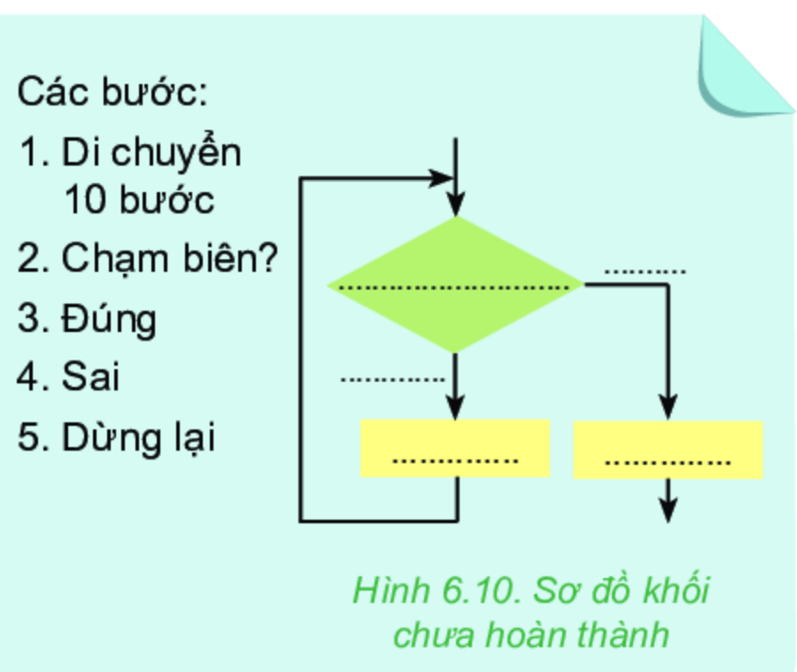
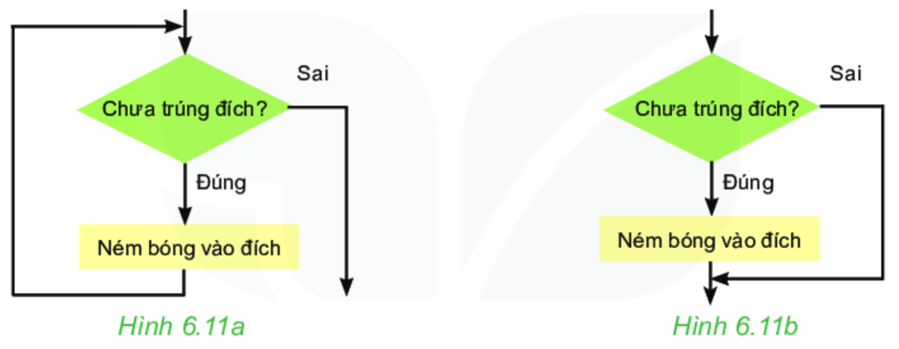
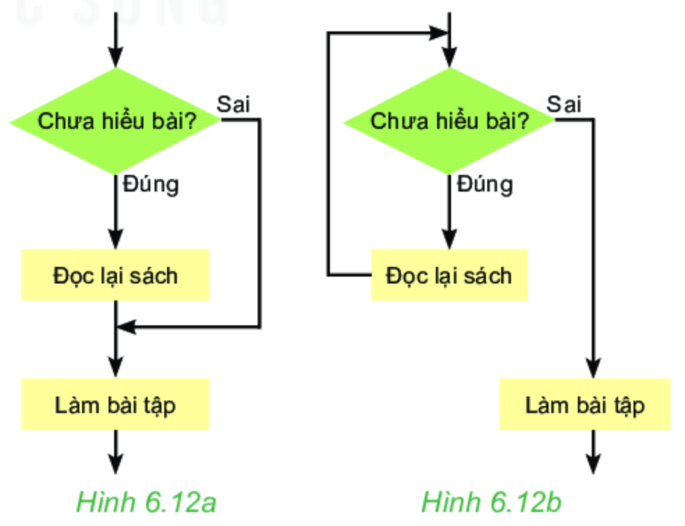

<!-- pdf:75 -->

# BÀI 16: CÁC CẤU TRÚC ĐIỀU KHIỂN

## 🎯 Sau bài này em sẽ:

- Biết các cấu trúc: tuần tự, rẽ nhánh và lặp.
- Mô tả được thuật toán đơn giản có các cấu trúc tuần tự, rẽ nhánh và lặp dưới dạng liệt kê hoặc sơ đồ khối.

## 🔴 Khởi động

> **TRÒ CHƠI: ĐÚNG HAY SAI?**
>
> **Chuẩn bị:** Giáo viên chuẩn bị một số phiếu thuộc hai chủ đề: Sinh học và Toán. Mỗi phiếu ghi một câu khẳng định, có thể đúng hoặc sai, ví dụ “Voi thuộc loài ăn thịt” là một câu sai. Chọn ra 2 hoặc 4 bạn chơi.
>
> **Cách chơi:** Mỗi lượt chơi là hai bạn và được chọn một trong hai chủ đề. Trong thời gian một phút, hai bạn sẽ bốc phiếu thuộc chủ đề mình lựa chọn và trả lời. Với mỗi phiếu, hai bạn thực hiện các công việc sau đây:
> 1. Bạn thứ nhất đọc câu ghi trong phiếu.
> 2. Bạn thứ hai trả lời bằng cách gật đầu là đồng ý hoặc lắc đầu là không đồng ý.
>
> Câu trả lời của mỗi lượt được ghi lại.
>
> **Kết quả:** Kết thúc trò chơi, cả lớp tổ chức đánh giá kết quả của mỗi lượt. Mỗi câu trả lời đúng được một điểm. Hai bạn thắng cuộc là hai bạn có số điểm cao nhất.

## 1. CẤU TRÚC TUẦN TỰ, CẤU TRÚC RẼ NHÁNH

> **Hoạt động 1: Đánh giá kết quả chơi**
>
> Làm việc theo nhóm:
> 1. Trong trò chơi ở phần khởi động, điều kiện để cặp chơi được cộng một điểm là gì?
> 2. Việc đánh giá điểm gồm những bước nào? Em hãy viết các bước đó ra giấy.

Chúng ta đã biết, thuật toán là một dãy các chỉ dẫn rõ ràng, có trình tự sao cho khi thực hiện những chỉ dẫn này người ta giải quyết được vấn đề hoặc nhiệm vụ đã cho. Các bước của thuật toán gấp hình trò chơi Đông-Tây-Nam-Bắc ở Bài 15 được thực hiện lần lượt từng bước theo chiều đi từ bắt đầu đến kết thúc là **cấu trúc tuần tự**. Hình 6.6 minh hoạ cho cấu trúc tuần tự.

*Hình 6.6. Sơ đồ khối mô tả cấu trúc tuần tự*

Trong trò chơi ở phần khởi động, khi đánh giá kết quả của một cặp, với mỗi phiếu, nếu bạn thứ hai của cặp chơi trả lời đúng thì được cộng một điểm. Như vậy ở bước này, tuỳ vào kết quả kiểm tra là đúng hay sai mà bước xử lí tiếp theo sẽ rẽ theo “nhánh” tương ứng. Cấu trúc như vậy được gọi là **cấu trúc rẽ nhánh** (hay **cấu trúc lựa chọn**).

<!-- pdf:76 -->

Hình thoi được dùng để mô tả điều kiện trong cấu trúc rẽ nhánh, khi đó sơ đồ khối mô tả việc đánh giá kết quả như Hình 6.7:

*Hình 6.7. Sơ đồ khối mô tả cấu trúc rẽ nhánh dạng thiếu*

Cấu trúc rẽ nhánh mô tả việc đánh giá ở Hình 6.7 chỉ thực hiện một công việc (cộng điểm) sau khi kiểm tra điều kiện. Cấu trúc này gọi là **cấu trúc rẽ nhánh dạng thiếu**.

Chúng ta xem xét tiếp quyết định của bạn thứ hai sau khi nghe được câu khẳng định trong phiếu từ bạn thứ nhất. Nếu thấy câu khẳng định đó là đúng thì bạn thứ hai sẽ gật đầu đồng ý, còn không thì lắc đầu. Như vậy, cả hai trường hợp đúng hay sai của điều kiện đều được bạn thứ hai thực hiện bằng hành động tương ứng. Cấu trúc rẽ nhánh này gọi là **cấu trúc rẽ nhánh dạng đủ**.

*Hình 6.8. Sơ đồ khối mô tả cấu trúc rẽ nhánh dạng đủ*

> - **Cấu trúc tuần tự** (`Lệnh 1` $\rightarrow$ `Lệnh 2` $\rightarrow$ `Lệnh 3`): Cấu trúc tuần tự thực hiện lần lượt các lệnh theo trình tự từ bắt đầu đến kết thúc.
> - **Cấu trúc rẽ nhánh dạng thiếu**: Nếu Điều kiện đúng thì thực hiện Lệnh.
> - **Cấu trúc rẽ nhánh dạng đủ**: Nếu Điều kiện đúng thì thực hiện Lệnh 1, nếu sai thì thực hiện Lệnh 2.
<!-- ocr-ok: đã đối chiếu ảnh trang gốc 76, hộp kiến thức chia 3 cột kèm sơ đồ khối minh hoạ -->

> ❓ **Câu hỏi**
>
> 1. Em hãy kể hai công việc trong cuộc sống được thực hiện tuần tự theo các bước. Em hãy mô tả một công việc bằng sơ đồ khối.
> 2. Câu “Nếu trời mưa thì em không đi đá bóng” có chứa cấu trúc nào? Em hãy mô tả câu này bằng sơ đồ khối.

<!-- pdf:77 -->

## 2. CẤU TRÚC LẶP

> **Hoạt động 2: Cấu trúc lặp**
>
> 1. Trong trò chơi ở phần khởi động, hoạt động nào được lặp lại?
> 2. Điều kiện để dừng trò chơi là gì?

Chúng ta cùng xem lại trò chơi ở phần khởi động, mỗi lần bạn thứ nhất đọc câu khẳng định trong phiếu, bạn thứ hai phải sử dụng hiểu biết của mình để trả lời xem câu khẳng định đó đúng hay sai và đưa ra dấu hiệu tương ứng. Hoạt động đọc phiếu và trả lời được *lặp lại* cho đến khi hết thời gian quy định. Đây là một ví dụ về công việc được lặp lại nhiều lần. Việc lặp này được biểu diễn bởi **cấu trúc lặp**. Sơ đồ khối mô tả cấu trúc lặp được trình bày trong Hình 6.9.

*Hình 6.9. Sơ đồ khối mô tả cấu trúc lặp*

Trong cấu trúc lặp, bao giờ cũng có khâu kiểm tra điều kiện kết thúc quá trình lặp.

Ở sơ đồ khối trong Hình 6.9, tại mỗi bước lặp, thuật toán thực hiện việc kiểm tra điều kiện “còn thời gian” hay không để trò chơi tiếp tục lặp lại hoặc kết thúc.

> - **Cấu trúc lặp** dùng để mô tả các bước của thuật toán được thực hiện lặp lại nhiều lần.
> - Trong cấu trúc lặp, bao giờ cũng có bước kiểm tra điều kiện kết thúc quá trình lặp.
>
> Ba cấu trúc tuần tự, rẽ nhánh và lặp là đủ để mô tả mọi thuật toán.

> ❓ **Câu hỏi**
>
> 1. Em hãy kể hai công việc trong cuộc sống mà việc thực hiện gồm các bước được lặp lại nhiều lần.
> 2. Bạn Khoa đang lập trình bằng Scratch, Khoa muốn các chú cá di chuyển 10 bước một liên tục cho đến khi chạm biên thì dừng lại.
>    a) Điều kiện để chú cá dừng lại là gì?
>    b) Hình 6.10 là sơ đồ khối mô tả thuật toán thực hiện yêu cầu của bạn Khoa. Em hãy vẽ sơ đồ khối đó vào vở và điền các bước để hoàn thành sơ đồ khối.
>
>    Các bước: 1. Di chuyển 10 bước; 2. Chạm biên?; 3. Đúng; 4. Sai; 5. Dừng lại.

*Hình 6.10. Sơ đồ khối chưa hoàn thành*

<!-- pdf:78 -->

## ✏️ Luyện tập

1. Em hãy trình bày các câu sau đây dưới dạng sơ đồ khối cấu trúc rẽ nhánh.
   a) Nếu có kẻ trên mạng đe doạ thì em cần nói cho cha mẹ biết.
   b) Nếu nhận được thư điện tử có đính kèm tệp từ địa chỉ không quen biết thì em không nên mở tệp đính kèm.
   c) Nếu có tin nhắn từ người không quen biết yêu cầu gửi thông tin cá nhân thì em không nên gửi.
2. Trong các câu sau đây, câu nào có thể biểu diễn bằng sơ đồ khối có cấu trúc lặp? Hãy mô tả câu đó bằng sơ đồ khối.
   a) Nếu sáng mai trời mưa, em sẽ mang theo áo mưa.
   b) Nếu vẫn chưa làm hết bài tập, em phải làm bài tập đến khi nào hết.
   c) Nếu được nghỉ ba ngày vào dịp Tết Dương lịch thì gia đình em sẽ đi du lịch, còn không sẽ có kế hoạch khác.
3. Em hãy quan sát hai sơ đồ khối trong Hình 6.11a, Hình 6.11b và cho biết mỗi sơ đồ khối mô tả cấu trúc nào?

*Hình 6.11a — Hình 6.11b*

## 🚀 Vận dụng

1. Bạn An cho rằng: "Sơ đồ khối ở Hình 6.12a thể hiện rằng nếu chưa hiểu bài thì việc đọc lại sách chỉ thực hiện một lần rồi làm bài tập. Còn sơ đồ khối ở Hình 6.12b thể hiện rằng nếu chưa hiểu bài thì việc đọc lại sách và làm bài tập sẽ thực hiện nhiều lần".

   Em có đồng ý với ý kiến bạn An không? Nếu phải sửa nhận xét đó, em sẽ sửa như thế nào?

*Hình 6.12a — Hình 6.12b*
<!-- ocr-ok: đã đối chiếu ảnh trang gốc 78, chú thích Hình 6.12a và Hình 6.12b chữ xanh lá nghiêng bị OCR bỏ sót -->

2. Trong trò chơi ở phần khởi động, việc tính điểm cho mỗi cặp chơi là một hoạt động lặp. Hãy chỉ rõ công việc được lặp lại và vẽ sơ đồ khối cấu trúc lặp của hoạt động này.
3. Cô giáo điểm danh bằng cách gọi tên từng bạn trong danh sách lớp. Nếu bạn nào trả lời có thì cô giáo gọi tên bạn tiếp theo, còn không thì cô giáo đánh dấu vắng mặt và gọi tên bạn tiếp theo.

   Việc điểm danh của cô giáo có thể mô tả bằng những cấu trúc nào? Em hãy vẽ sơ đồ khối mô tả các cấu trúc đó.

## 📷 Danh sách hình trong bài

| Mã hình | Trang PDF | Trang sách | Chú thích |
| --- | --- | --- | --- |
| H6-tin-b16-01 | 75 | 74 | Hình 6.6. Sơ đồ khối mô tả cấu trúc tuần tự |
| H6-tin-b16-02 | 76 | 75 | Hình 6.7. Sơ đồ khối mô tả cấu trúc rẽ nhánh dạng thiếu |
| H6-tin-b16-03 | 76 | 75 | Hình 6.8. Sơ đồ khối mô tả cấu trúc rẽ nhánh dạng đủ |
| H6-tin-b16-04 | 77 | 76 | Hình 6.9. Sơ đồ khối mô tả cấu trúc lặp |
| H6-tin-b16-05 | 77 | 76 | Hình 6.10. Sơ đồ khối chưa hoàn thành |
| H6-tin-b16-06 | 78 | 77 | Hình 6.11a — Hình 6.11b |
| H6-tin-b16-07 | 78 | 77 | Hình 6.12a — Hình 6.12b |
