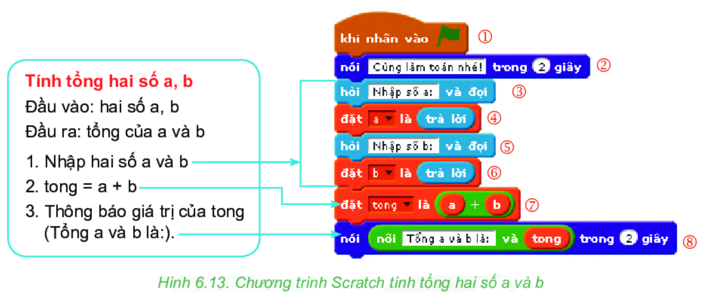
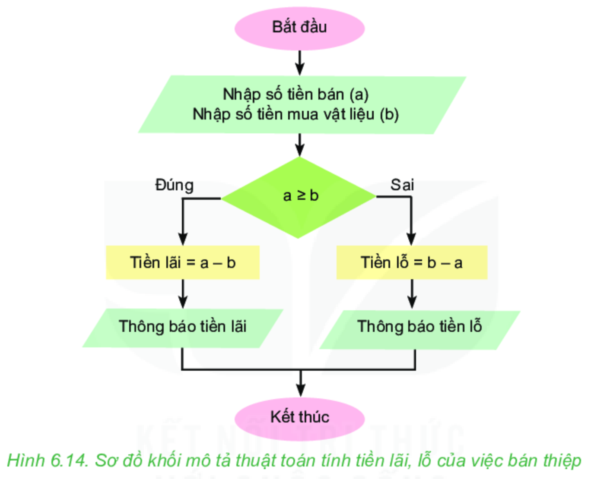
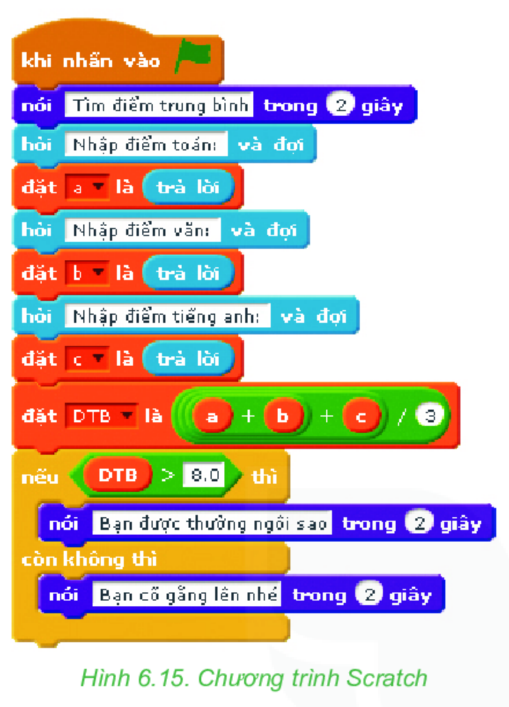
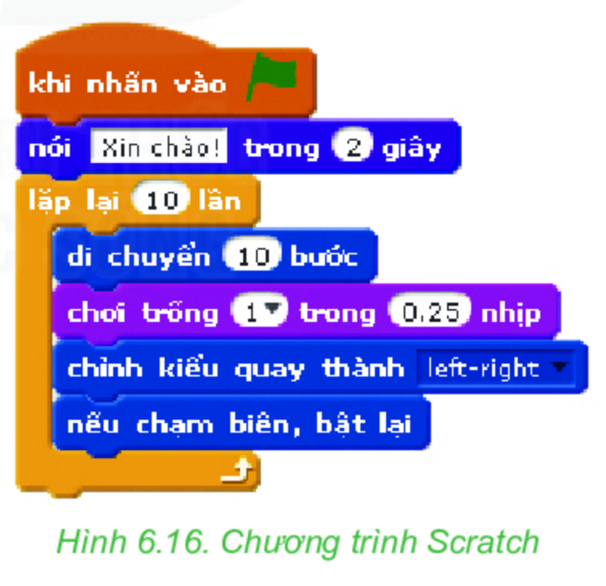

<!-- pdf:79 -->

# BÀI 17: CHƯƠNG TRÌNH MÁY TÍNH

## 🎯 Sau bài này em sẽ:

- Biết được chương trình là mô tả một thuật toán để máy tính “hiểu” và thực hiện được.

## 🔴 Khởi động

> Để rèn luyện kĩ năng mô tả thuật toán bằng ngôn ngữ tự nhiên, hai bạn An và Khoa đã chơi trò chơi “Làm theo chỉ dẫn”. An chuẩn bị một bức tranh đơn giản vẽ đồ vật và không cho Khoa biết nội dung bức tranh. Khoa cũng không được nhìn bức tranh. An lần lượt đưa ra chỉ dẫn để Khoa vẽ lại bức tranh.
>
> Sau khi hoàn thành công việc, hai bạn so sánh bức tranh Khoa vẽ với bức tranh An đã chuẩn bị để xem các chỉ dẫn của An có rõ ràng không và Khoa có thực hiện đúng theo chỉ dẫn không.

## 1. CHƯƠNG TRÌNH MÁY TÍNH

> **Hoạt động 1: Thực hiện thuật toán**
>
> Trong trò chơi “Làm theo chỉ dẫn”, Khoa cần hiểu và thực hiện được chỉ dẫn của An để hoàn thành việc vẽ bức tranh. Các chỉ dẫn của An cũng cần phải rõ ràng, dễ hiểu để Khoa thực hiện được. Đó chính là một ví dụ về việc thực hiện thuật toán theo các bước được liệt kê bằng ngôn ngữ tự nhiên.
>
> Nếu thuật toán được chuyển giao cho máy tính thực hiện thì theo em, làm thế nào để máy tính có thể hiểu và thực hiện được?

Từ khi máy tính ra đời, nhiều công việc có máy tính trợ giúp nên được thực hiện nhanh, chính xác và hiệu quả hơn.

Muốn máy tính giúp giải quyết công việc thì ta phải chỉ dẫn cho máy tính cách thực hiện. Máy tính không thể hiểu được những chỉ dẫn bằng ngôn ngữ tự nhiên hay sơ đồ khối. Do đó cần sử dụng một ngôn ngữ mà máy tính hiểu được. **Ngôn ngữ lập trình** chính là ngôn ngữ được dùng để tạo ra chương trình chỉ dẫn cho máy tính hiểu cách thực hiện công việc.

**Chương trình** là tập hợp các lệnh viết bằng ngôn ngữ lập trình nào đó, chỉ dẫn theo từng bước của thuật toán để máy tính thực hiện. Nói cách khác, chương trình là một cách mô tả khác của thuật toán để máy tính có thể “hiểu” và thực hiện được.

<!-- pdf:80 -->

**Chương trình máy tính** dựa trên các dữ liệu đầu vào, tiến hành các bước xử lí để trả lại kết quả đầu ra.

Em cũng có thể chỉ dẫn máy tính thực hiện công việc bằng cách sử dụng ngôn ngữ lập trình. **Scratch** là **ngôn ngữ lập trình trực quan** em đã được học ở Tiểu học. Ví dụ dưới đây là chương trình chỉ dẫn máy tính thực hiện công việc tính tổng hai số a và b bằng ngôn ngữ lập trình trực quan Scratch:

*Hình 6.13. Chương trình Scratch tính tổng hai số a và b*

> **CHƯƠNG TRÌNH**
>
> - Máy tính thực hiện công việc theo chương trình.
> - **Chương trình** là mô tả thuật toán để máy tính “hiểu” và thực hiện được.
> - Chương trình dựa trên các dữ liệu đầu vào, tiến hành các bước xử lí để trả lại kết quả đầu ra.

> ❓ **Câu hỏi**
>
> Dựa vào chương trình tính tổng hai số bằng ngôn ngữ tự nhiên và chương trình Scratch ở Hình 6.13, em hãy bổ sung nội dung vào các dấu hỏi chấm trong bảng sau:
>
> | Công việc | Mô tả thuật toán bằng ngôn ngữ tự nhiên | Chương trình máy tính viết bằng Scratch (số thứ tự của câu lệnh) |
> | --- | --- | --- |
> | Nhập dữ liệu đầu vào | (?) | (?) |
> | Xử lí | (?) | (?) |
> | Thông báo đầu ra | (?) | (?) |

## 2. THỰC HÀNH: CHƯƠNG TRÌNH MÁY TÍNH

**Nhiệm vụ**

Ba bạn An, Minh, Khoa đã làm những tấm thiệp chúc mừng ngày Nhà giáo Việt Nam để bán lấy tiền mua sách tặng các bạn học sinh vùng khó khăn. Gọi số tiền bán được là a, số tiền mua vật liệu là b, cần tính toán số tiền lãi thu được hoặc số tiền bị lỗ. Em hãy mô tả thuật toán giải quyết yêu cầu trên bằng sơ đồ khối và chương trình Scratch.

<!-- pdf:81 -->

**Hướng dẫn**

### a) Xác định đầu vào, đầu ra của bài toán

Yêu cầu bài toán là tính số tiền lãi thu được hoặc số tiền lỗ. Để đơn giản bài toán, trong trường hợp tiền mua vật liệu bằng tiền bán được, ta coi như tiền lãi bằng 0. Như vậy, nếu số tiền bán được lớn hơn hoặc bằng tiền mua vật liệu thì tiền lãi = a – b, còn không thì tiền lỗ = b – a.

Đầu vào: hai số a, b.

Đầu ra: số tiền lãi hoặc lỗ.

### b) Trình bày thuật toán bằng sơ đồ khối

*Hình 6.14. Sơ đồ khối mô tả thuật toán tính tiền lãi, lỗ của việc bán thiệp*

### c) Chương trình Scratch tính tiền lãi, lỗ của việc bán thiệp

| Sơ đồ khối | Chương trình Scratch |
| --- | --- |
| `Bắt đầu` $\rightarrow$ | `khi nhấn vào [lá cờ xanh]` |
| `Nhập số tiền bán (a)` / `Nhập số tiền mua vật liệu (b)` $\rightarrow$ | `hỏi [Nhập số tiền bán:] và đợi` / `đặt [a] là (trả lời)` / `hỏi [Nhập số tiền mua vật liệu:] và đợi` / `đặt [b] là (trả lời)` |
| Kiểm tra `a ≥ b`: `Đúng` $\rightarrow$ `Tiền lãi = a – b` $\rightarrow$ `Thông báo tiền lãi`; `Sai` $\rightarrow$ `Tiền lỗ = b – a` $\rightarrow$ `Thông báo tiền lỗ` | `nếu <<(a) > (b)> hoặc <(a) = (b)>> thì` $\rightarrow$ `nói (nối [Số tiền lãi là:] và ((a) - (b))) trong (10) giây`; `còn không thì` $\rightarrow$ `nói (nối [Số tiền lỗ là:] và ((b) - (a))) trong (10) giây` |
<!-- ocr-ok: đã đối chiếu ảnh trang gốc 81, bảng đối chiếu sơ đồ khối và các khối lệnh màu của Scratch -->

<!-- pdf:82 -->

## ✏️ Luyện tập

1. *Tìm câu **sai**.*
   a) Chương trình máy tính là một dãy các lệnh mà máy tính có thể hiểu và thực hiện được.
   b) Chương trình máy tính được viết bằng ngôn ngữ lập trình.
   c) Máy tính có thể thực hiện các lệnh trong chương trình theo trình tự tuỳ ý.
2. Cho chương trình Scratch như ở Hình 6.15. Em hãy trả lời các câu hỏi sau:
   a) Chương trình đó thực hiện thuật toán nào?
   b) Xác định đầu vào, đầu ra của thuật toán đó.
   c) Hãy cho ví dụ cụ thể giá trị dữ liệu đầu vào và cho biết kết quả đầu ra tương ứng.
   d) Hãy trình bày thuật toán bằng sơ đồ khối.

*Hình 6.15. Chương trình Scratch*

3. Cho chương trình Scratch như ở Hình 6.16. Em hãy trả lời các câu hỏi sau:
   a) Chương trình đó thực hiện công việc gì?
   b) Các cấu trúc điều khiển tuần tự, rẽ nhánh và lặp có được sử dụng trong chương trình không? Hãy nêu các câu lệnh trong chương trình thể hiện cấu trúc đó.
   c) Hãy thực hành tạo chương trình bằng Scratch.

*Hình 6.16. Chương trình Scratch*

## 🚀 Vận dụng

1. Em hãy vẽ sơ đồ khối mô tả thuật toán tìm số lớn hơn trong hai số a và b. Từ sơ đồ khối, hãy viết chương trình Scratch thực hiện thuật toán.
2. Em hãy viết chương trình Scratch thực hiện thuật toán tính trung bình cộng của ba số.

## 📷 Danh sách hình trong bài

| Mã hình | Trang PDF | Trang sách | Chú thích |
| --- | --- | --- | --- |
| H6-tin-b17-01 | 80 | 79 | Hình 6.13. Chương trình Scratch tính tổng hai số a và b |
| H6-tin-b17-02 | 81 | 80 | Hình 6.14. Sơ đồ khối mô tả thuật toán tính tiền lãi, lỗ của việc bán thiệp |
| H6-tin-b17-03 | 82 | 81 | Hình 6.15. Chương trình Scratch |
| H6-tin-b17-04 | 82 | 81 | Hình 6.16. Chương trình Scratch |
