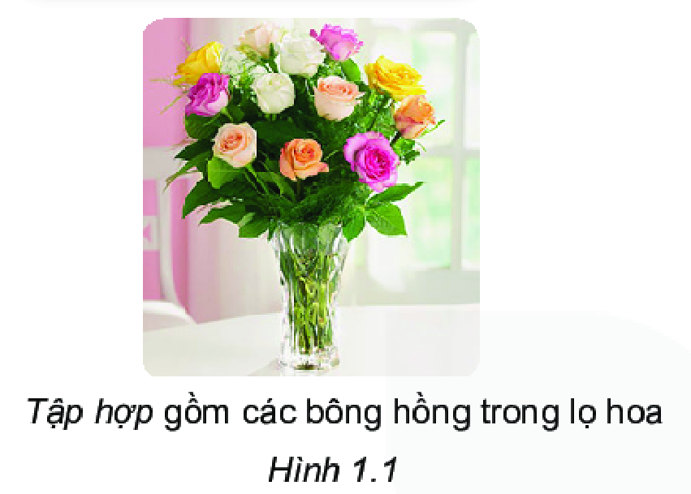
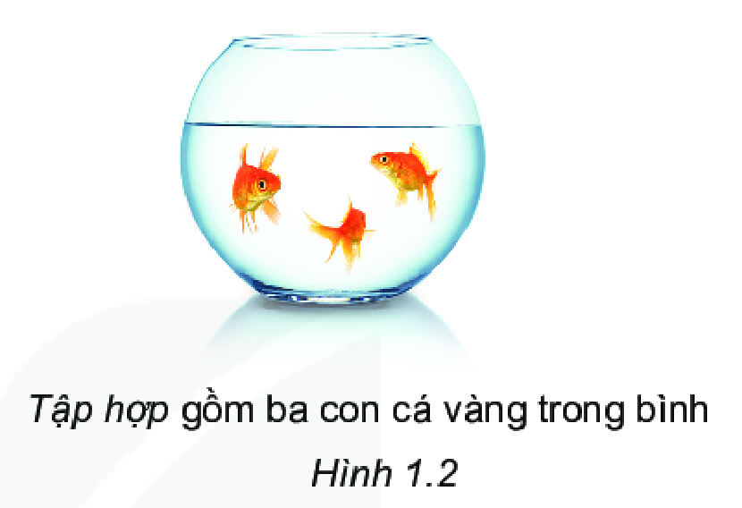
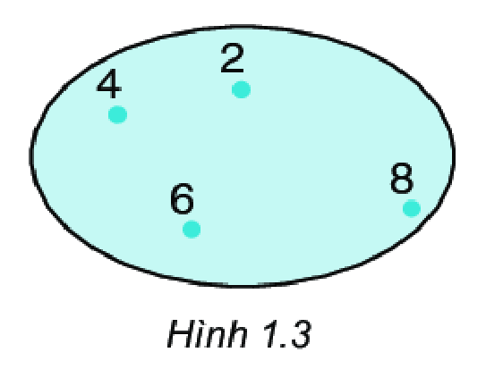
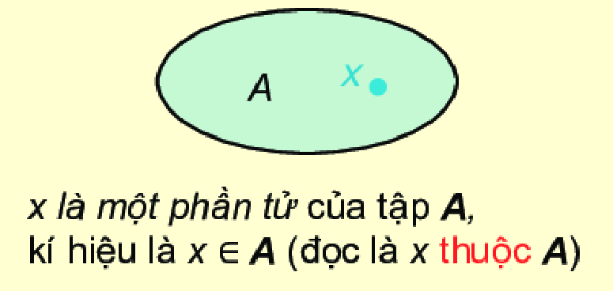
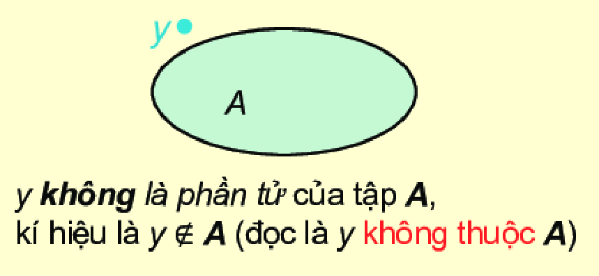
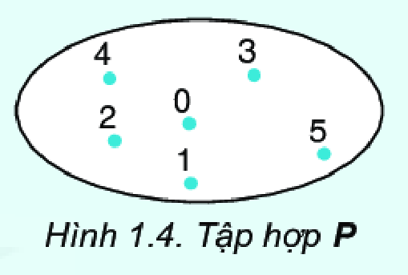
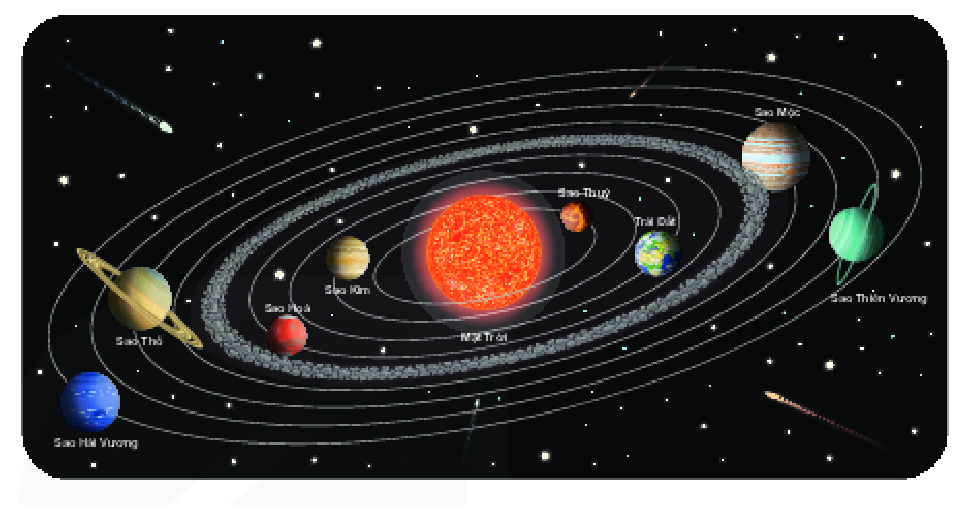
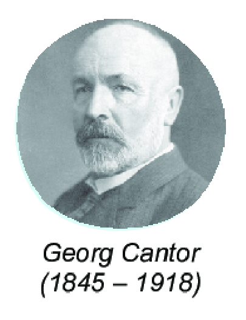
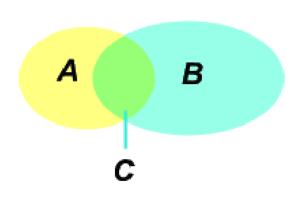

<!-- pdf:7 -->
<!-- Trang mở đầu Chương I (PDF 6): SỐ HỌC — CHƯƠNG I: TẬP HỢP CÁC SỐ TỰ NHIÊN. Giới thiệu lịch sử xuất hiện các hệ đếm giúp con người tính toán với các số lớn và hệ (đếm) thập phân. -->

# BÀI 1: TẬP HỢP

## 🔤 Khái niệm, thuật ngữ

- Tập hợp, phần tử
- Tập rỗng

## 🎯 Kiến thức, kĩ năng

- Nhận biết tập hợp và các phần tử của nó.
- Mô tả một tập hợp (cho một tập hợp).
- Sử dụng kí hiệu và cách diễn đạt toán học nhờ tập hợp.

## 🔴 Mở đầu

*Tập hợp gồm các bông hồng trong lọ hoa — Hình 1.1*

*Tập hợp gồm ba con cá vàng trong bình — Hình 1.2*

Bài này sẽ giúp các em tìm hiểu về tập hợp, một khái niệm cơ bản của Toán học.

## 1. TẬP HỢP VÀ PHẦN TỬ CỦA TẬP HỢP

**Tập hợp**

**HĐ:** Quan sát các hình 1.1, 1.2 rồi trả lời câu hỏi: Hình 1.3 gợi cho em *tập hợp* gồm các số nào trong hình quả trứng?

*Hình 1.3*

> Một **tập hợp** (gọi tắt là **tập**) bao gồm những đối tượng nhất định. Chúng được gọi là những **phần tử** của tập hợp đó.
> - $x$ là *một phần tử* của tập $A$, kí hiệu là $x \in A$ (đọc là $x$ **thuộc** $A$)
> - $y$ *không* là phần tử của tập $A$, kí hiệu là $y \notin A$ (đọc là $y$ **không thuộc** $A$)

**Chú ý:** Khi $x$ thuộc $A$, ta còn nói “$x$ nằm trong $A$”, hay “$A$ chứa $x$”.
<!-- ocr-ok: đã đối chiếu ảnh trang PDF 7, câu chứa nhiều kí hiệu toán học $x, A$ -->

> Người ta thường đặt tên tập hợp bằng chữ cái in hoa.

**Ví dụ 1:**

Gọi $C$ là tập hợp các chữ cái trong từ TẬP HỢP. Khi đó $\text{T} \in C$, $\text{M} \notin C$.

<!-- pdf:8 -->

**Luyện tập 1:**

Gọi $B$ là tập hợp các bạn trong lớp em có tên bắt đầu bằng chữ cái H. Em hãy nêu tên một bạn thuộc $B$ và một bạn không thuộc $B$.

## 2. MÔ TẢ MỘT TẬP HỢP

Mô tả một tập hợp là cho biết cách xác định các phần tử của tập hợp đó. Ta thường dùng hai cách mô tả tập hợp sau:

<!-- term: Hai cách mô tả một tập hợp -->
> *Hai cách mô tả một tập hợp*
> - *Cách 1. Liệt kê các phần tử của tập hợp*, tức là viết các phần tử trong dấu ngoặc $\{ \}$ theo *thứ tự tuỳ ý* nhưng *mỗi phần tử chỉ được viết một lần*.
>   Ví dụ, với tập $P$ gồm các số $0, 1, 2, 3, 4, 5$ ở hình 1.4 (h.1.4), ta viết:
>   $P = \{0; 1; 2; 3; 4; 5\}$.
> - *Cách 2. Nêu dấu hiệu đặc trưng cho các phần tử của tập hợp*
>   Ví dụ, với tập $P$ (h.1.4) ta cũng có thể viết:
>   $P = \{n \mid n$ là một trong sáu số tự nhiên đầu tiên$\}$.

*Hình 1.4. Tập hợp $P$*

> **Tập rỗng**
> Tập hợp không chứa phần tử nào gọi là **tập rỗng**, kí hiệu là $\varnothing$.
> Ví dụ, tập hợp những người sống trên Mặt Trăng là tập rỗng.

> ❓ Khi mô tả tập hợp $L$ các chữ cái trong từ NHA TRANG bằng cách liệt kê các phần tử, bạn Nam viết:
> $L = \{\text{N}, \text{H}, \text{A}, \text{T}, \text{R}, \text{A}, \text{N}, \text{G}\}$.
> Theo em, bạn Nam viết đúng hay sai?

> Ta viết các phần tử của một tập hợp cách nhau bởi dấu "," hoặc dấu ";" (nếu có phần tử là số).

**Ví dụ 2:**

Gọi $\mathbb{N}$ là **tập hợp các số tự nhiên**. Ta có thể viết tập $\mathbb{N}$ như sau:
- Liệt kê các phần tử: $\mathbb{N} = \{0; 1; 2; 3; \dots\}$.
- Nêu dấu hiệu đặc trưng cho các phần tử: $\mathbb{N} = \{m \mid m$ là một số tự nhiên$\}$.

**Luyện tập 2:**

a) Cho tập hợp $A = \{x \mid x$ là một trong những đồ dùng học tập của em$\}$. Hãy nêu một vài phần tử của $A$.

b) Gọi $\mathbb{N}^*$ là **tập hợp các số tự nhiên khác 0**. Hãy viết tập $\mathbb{N}^*$ bằng cách liệt kê các phần tử.

**Chú ý:** Ta viết $n \in \mathbb{N}$ có nghĩa $n$ là một **số tự nhiên**. Chẳng hạn, tập $P$ các số tự nhiên nhỏ hơn $6$ có thể viết là:

$P = \{n \mid n \in \mathbb{N}, n < 6\}$ hoặc $P = \{n \in \mathbb{N} \mid n < 6\}$.

**Luyện tập 3:**

Viết các tập hợp sau bằng cách liệt kê các phần tử của chúng:

$A = \{x \in \mathbb{N} \mid x < 5\}$;

$B = \{x \in \mathbb{N}^* \mid x < 5\}$.

<!-- pdf:9 -->

## BÀI TẬP

1.1. Cho hai tập hợp:
<!-- ocr-ok: đã đối chiếu ảnh trang PDF 9, OCR đọc sai số bài 1.1 màu xanh -->

$A = \{a, b, c, x, y\}$ và $B = \{b, d, y, t, u, v\}$.

Dùng kí hiệu “$\in$” hoặc “$\notin$” để trả lời câu hỏi: Mỗi phần tử $a, b, x, u$ thuộc tập hợp nào và *không* thuộc tập hợp nào?

1.2. Cho tập hợp $U = \{x \in \mathbb{N} \mid x$ chia hết cho $3\}$.

Trong các số $3, 5, 6, 0, 7$, số nào thuộc và số nào không thuộc tập $U$?

1.3. Bằng cách liệt kê các phần tử, hãy viết các tập hợp sau:

a) Tập hợp $K$ các số tự nhiên nhỏ hơn $7$;

b) Tập hợp $D$ tên các tháng (dương lịch) có $30$ ngày;

c) Tập hợp $M$ các chữ cái tiếng Việt trong từ “ĐIỆN BIÊN PHỦ”.

1.4. Bằng cách nêu dấu hiệu đặc trưng, hãy viết các tập hợp $A$ các số tự nhiên nhỏ hơn $10$.

1.5. Hệ Mặt Trời gồm có Mặt Trời ở trung tâm và $8$ thiên thể quay quanh Mặt Trời gọi là các hành tinh. Đó là Sao Thuỷ, Sao Kim, Trái Đất, Sao Hoả, Sao Mộc, Sao Thổ, Sao Thiên Vương và Sao Hải Vương.

Gọi $S$ là tập các hành tinh của Hệ Mặt Trời. Hãy viết tập $S$ bằng hai cách.

## 💡 Em có biết?

**Nhà toán học Cantor**

Con người biết đến toán học từ hàng nghìn năm trước Công nguyên. Nhưng mãi đến cuối thế kỉ XIX, lí thuyết tập hợp mới được phát triển nhờ các nghiên cứu của nhà toán học Cantor (Căng-to), người Đức. Từ đó lí thuyết tập hợp đã nhanh chóng trở thành nền tảng của Toán học hiện đại.

*Georg Cantor (1845 – 1918)*

**Tập hữu hạn và tập vô hạn**

Ta thấy:

Tập $X = \{x, y\}$ có $2$ phần tử;

Tập $Y = \{1; 2; 3; \dots; 50\}$ có $50$ phần tử;

$X$ và $Y$ là những tập hợp có một số hữu hạn phần tử. Ta gọi chúng là những **tập hữu hạn**.

Khác với tập $X, Y$, tập hợp có vô số phần tử là **tập vô hạn**. Tập $\mathbb{N}$ là tập vô hạn.

**Giao của hai tập hợp**

Gọi $C$ là tập hợp gồm các phần tử chung của hai tập $A$ và $B$. Ta gọi tập $C$ là **giao** của hai tập $A$ và $B$, kí hiệu $C = A \cap B$.

## 📷 Danh sách hình trong bài

| Mã hình | Trang PDF | Vị trí trong bài | Chú thích gốc |
| --- | :---: | --- | --- |
| H6-toan-b01-01 | 7 | Mở đầu | Tập hợp gồm các bông hồng trong lọ hoa — Hình 1.1 |
| H6-toan-b01-02 | 7 | Mở đầu | Tập hợp gồm ba con cá vàng trong bình — Hình 1.2 |
| H6-toan-b01-03 | 7 | Mục 1, HĐ | Hình 1.3 |
| H6-toan-b01-04 | 7 | Mục 1 | (sách không đánh số, minh hoạ $x$ là một phần tử của tập $A$, $x \in A$) |
| H6-toan-b01-05 | 7 | Mục 1 | (sách không đánh số, minh hoạ $y$ không là phần tử của tập $A$, $y \notin A$) |
| H6-toan-b01-06 | 8 | Mục 2 | Hình 1.4. Tập hợp $P$ |
| H6-toan-b01-07 | 9 | Bài tập 1.5 | (sách không đánh số, hình minh hoạ các hành tinh trong Hệ Mặt Trời) |
| H6-toan-b01-08 | 9 | Em có biết? | Georg Cantor (1845 – 1918) |
| H6-toan-b01-09 | 9 | Em có biết? | (sách không đánh số, biểu đồ Ven minh hoạ giao của hai tập hợp $C = A \cap B$) |
