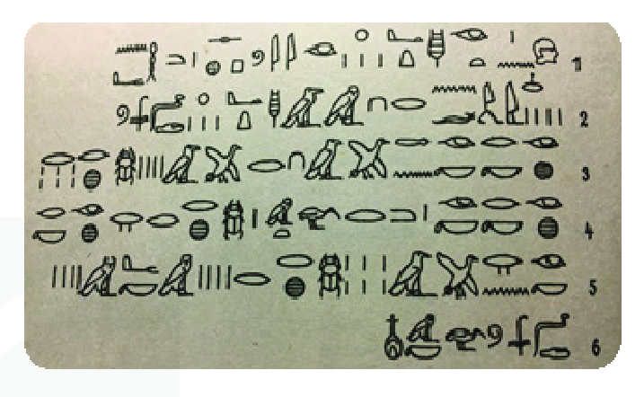
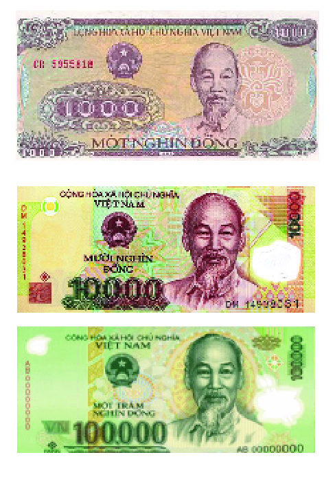
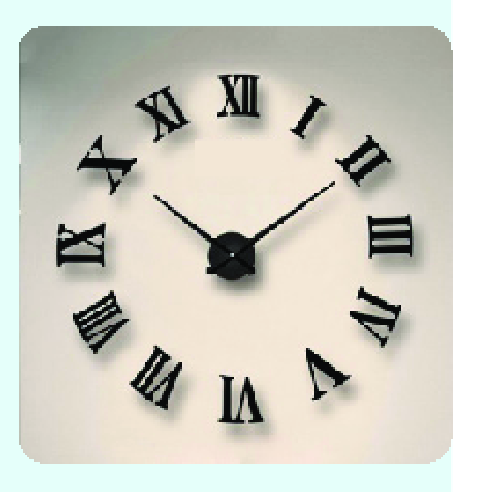
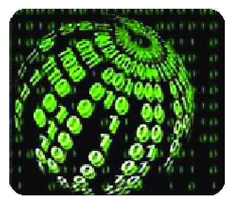

<!-- pdf:10 -->

# BÀI 2: CÁCH GHI SỐ TỰ NHIÊN

## 🔤 Khái niệm, thuật ngữ

- Hệ thập phân
- Chữ số (Ả Rập)
- Số La Mã, chữ số La Mã

## 🎯 Kiến thức, kĩ năng

- Nhận biết giá trị các chữ số của một số tự nhiên viết trong hệ thập phân.
- Biểu diễn mỗi số tự nhiên thành tổng giá trị các chữ số của nó.
- Đọc và viết số La Mã từ $1$ đến $30$.

## 🔴 Mở đầu

Trong lịch sử loài người, số tự nhiên bắt nguồn từ nhu cầu đếm và có từ rất sớm. Nhưng trải qua nhiều thế kỉ người ta mới có được cách ghi số tự nhiên như ngày nay, vừa dễ đọc, vừa sử dụng thuận tiện trong khoa học. Cách ghi số tự nhiên đó như thế nào?

## 1. HỆ THẬP PHÂN

> **Cách ghi số tự nhiên trong hệ thập phân**
> - Trong **hệ thập phân**, mỗi số tự nhiên được viết dưới dạng một dãy những **chữ số** lấy trong $10$ chữ số $0, 1, 2, 3, 4, 5, 6, 7, 8$ và $9$; vị trí của các chữ số trong dãy gọi là **hàng**.
> - Cứ $10$ đơn vị ở một hàng thì bằng $1$ đơn vị ở hàng liền trước nó. Chẳng hạn, $10$ chục thì bằng $1$ trăm; $10$ trăm thì bằng $1$ nghìn; $\dots$

**Chú ý:** Khi viết các số tự nhiên, ta quy ước:

1. Với các số tự nhiên khác $0$, chữ số đầu tiên (từ trái sang phải) khác $0$.

2. Để dễ đọc, đối với các số có bốn chữ số trở lên, ta viết tách riêng từng **lớp**. Mỗi lớp là một nhóm ba chữ số kể từ phải sang trái.

Chẳng hạn, số $221\,707\,263\,598$ (đọc là hai trăm hai mươi mốt tỉ, bảy trăm linh bảy triệu, hai trăm sáu mươi ba nghìn, năm trăm chín mươi tám) có các lớp, hàng nêu trong bảng 1.

| Lớp | Tỉ | Tỉ | Tỉ | Triệu | Triệu | Triệu | Nghìn | Nghìn | Nghìn | Đơn vị | Đơn vị | Đơn vị |
| --- | :---: | :---: | :---: | :---: | :---: | :---: | :---: | :---: | :---: | :---: | :---: | :---: |
| **Hàng** | Trăm tỉ | Chục tỉ | Tỉ | Trăm triệu | Chục triệu | Triệu | Trăm nghìn | Chục nghìn | Nghìn | Trăm | Chục | Đơn vị |
| **Chữ số** | $2$ | $2$ | $1$ | $7$ | $0$ | $7$ | $2$ | $6$ | $3$ | $5$ | $9$ | $8$ |
<!-- ocr-ok: đã đối chiếu ảnh trang PDF 10, Bảng 1 nhiều cột gộp ô theo lớp và hàng -->

*Bảng 1*

> ❓ Từ ba chữ số $0, 1$ và $2$, viết các số tự nhiên có ba chữ số, mỗi chữ số chỉ viết một lần.

<!-- pdf:11 -->

**Giá trị các chữ số của một số tự nhiên**

**HĐ1:** Trong số $32\,019$, ta thấy:
<!-- ocr-ok: đã đối chiếu ảnh trang PDF 11, OCR bỏ sót nhãn HĐ1 trên nền đỏ -->

“Chữ số $2$ nằm ở hàng nghìn và có giá trị bằng $2 \times 1\,000 = 2\,000$”.

Hãy phát biểu theo mẫu câu đó đối với các chữ số còn lại.
<!-- ocr-ok: đã đối chiếu ảnh trang PDF 11, OCR đọc sai dấu tiếng Việt -->

**HĐ2:** Viết số $32\,019$ thành tổng giá trị các chữ số của nó.

> Các chữ số mà chúng ta đang dùng được gọi là **chữ số Ả Rập**. Tuy nhiên, người Ả Rập không sáng tạo ra chúng. Họ có công học cách viết đó của người Ấn Độ và truyền bá vào châu Âu.

<!-- term: Tổng giá trị các chữ số của một số tự nhiên -->
> Mỗi số tự nhiên viết trong hệ thập phân đều biểu diễn được thành *tổng giá trị các chữ số của nó*.

**Ví dụ:**

$236 = (2 \times 100) + (3 \times 10) + 6$;

$\overline{ab} = (a \times 10) + b$, với $a \ne 0$.

$\overline{abc} = (a \times 100) + (b \times 10) + c$, với $a \ne 0$.

Trong đó: $\overline{ab}$ là kí hiệu số tự nhiên có hai chữ số, hàng chục là $a$, hàng đơn vị là $b$;

$\overline{abc}$ là kí hiệu số tự nhiên có ba chữ số, hàng trăm là $a$, hàng chục là $b$, hàng đơn vị là $c$.

**Luyện tập:**

Viết số $34\,604$ thành tổng giá trị các chữ số của nó.

**Vận dụng:**

Bác Hoa đi chợ mua đồ. Bác chỉ mang ba loại tiền: loại (có mệnh giá) $1$ nghìn đồng, loại $10$ nghìn đồng và loại $100$ nghìn đồng. Tổng số tiền bác phải trả là $492$ nghìn đồng. Nếu mỗi loại tiền, bác mang theo không quá $9$ tờ thì bác sẽ phải trả bao nhiêu tờ tiền mỗi loại, mà người bán không phải trả lại tiền thừa?

## 2. SỐ LA MÃ

Ngoài cách ghi số trong hệ thập phân người ta còn có những cách ghi số khác. Cách ghi số La Mã xuất hiện trong nhiều công trình kiến trúc ở châu Âu hay trên mặt đồng hồ theo phong cách cổ điển. Trong nhiều văn bản và sách báo, số La Mã thường được dùng để đánh số thứ tự.

<!-- pdf:12 -->

> **Cách viết số La Mã**
> - Để viết các **số La Mã** không quá $30$, ta dùng ba kí tự I, V và X (gọi là những **chữ số La Mã**). *Ba chữ số ấy cùng với hai cụm chữ số là IV và IX là năm* **thành phần** dùng để ghi số La Mã. *Giá trị của mỗi thành phần* được ghi trong bảng sau và *không thay đổi*, dù nó đứng ở bất kì vị trí nào:
>
> | Thành phần | I | V | X | IV | IX |
> | --- | :---: | :---: | :---: | :---: | :---: |
> | Giá trị (viết trong hệ thập phân) | $1$ | $5$ | $10$ | $4$ | $9$ |
>
> - Dưới đây là các số La Mã biểu diễn các số từ $1$ đến $10$:
>
> | I | II | III | IV | V | VI | VII | VIII | IX | X |
> | :---: | :---: | :---: | :---: | :---: | :---: | :---: | :---: | :---: | :---: |
> | $1$ | $2$ | $3$ | $4$ | $5$ | $6$ | $7$ | $8$ | $9$ | $10$ |
>
> - Để biểu diễn các số từ $11$ đến $20$, ta thêm X vào bên trái mỗi số từ I đến X:
>
> | XI | XII | XIII | XIV | XV | XVI | XVII | XVIII | XIX | XX |
> | :---: | :---: | :---: | :---: | :---: | :---: | :---: | :---: | :---: | :---: |
> | $11$ | $12$ | $13$ | $14$ | $15$ | $16$ | $17$ | $18$ | $19$ | $20$ |
>
> - Để biểu diễn các số từ $21$ đến $30$, ta thêm XX vào bên trái mỗi số từ I đến X:
>
> | XXI | XXII | XXIII | XXIV | XXV | XXVI | XXVII | XXVIII | XXIX | XXX |
> | :---: | :---: | :---: | :---: | :---: | :---: | :---: | :---: | :---: | :---: |
> | $21$ | $22$ | $23$ | $24$ | $25$ | $26$ | $27$ | $28$ | $29$ | $30$ |

**Nhận xét:**

1. Mỗi số La Mã biểu diễn một số tự nhiên bằng tổng giá trị của các thành phần viết nên số đó. Chẳng hạn, số XXIV có ba thành phần là X, X và IV tương ứng với các giá trị $10, 10$ và $4$. Do đó XXIV biểu diễn số $24$.

2. Không có số La Mã nào biểu diễn số $0$.

> ❓ a) Viết các số $14$ và $27$ bằng số La Mã.
>
> b) Đọc các số La Mã XVI, XXII.

**Thử thách nhỏ:**

Sử dụng đúng $7$ que tính, em xếp được những số La Mã nào?

<!-- pdf:13 -->

## BÀI TẬP

1.6. Cho các số: $27\,501$; $106\,712$; $7\,110\,385$; $2\,915\,404\,267$ (viết trong hệ thập phân).
<!-- ocr-ok: đã đối chiếu ảnh trang PDF 13, OCR đọc sai nhãn 1.6 và dính chữ -->

a) Đọc mỗi số đã cho;

b) Chữ số $7$ trong mỗi số đã cho có giá trị là bao nhiêu?

1.7. Chữ số $4$ đứng ở hàng nào trong một số tự nhiên nếu nó có giá trị bằng:

a) $400$; b) $40$; c) $4$.

1.8. Đọc các số La Mã: XIV; XVI; XXIII.

1.9. Viết các số sau bằng số La Mã: $18$; $25$.

1.10. Một số tự nhiên được viết bởi ba chữ số $0$ và ba chữ số $9$ nằm xen kẽ nhau. Đó là số nào?

1.11. Dùng các chữ số $0, 3$ và $5$, viết một số tự nhiên có ba chữ số khác nhau mà chữ số $5$ có giá trị là $50$.

1.12. Trong một cửa hàng bánh kẹo, người ta đóng gói kẹo thành các loại: mỗi gói có $10$ cái kẹo; mỗi hộp có $10$ gói; mỗi thùng có $10$ hộp. Một người mua $9$ thùng, $9$ hộp và $9$ gói kẹo. Hỏi người đó đã mua tất cả bao nhiêu cái kẹo?

## 💡 Em có biết?

**Hệ La Mã**

Ngoài các chữ số I, V, X và cụm chữ số IV, IX hệ La Mã còn có các chữ số khác là L, C, D, M (tương ứng với $50, 100, 500$ và $1\,000$) và các cụm chữ số XL, XC, CD, CM (tương ứng với $40, 90, 400$ và $900$). Các chữ số và cụm chữ số ấy là các thành phần dùng để ghi số La Mã theo các quy tắc sau:

1. Trong một số La Mã, mỗi chữ số V, L và D không có mặt quá một lần; mỗi chữ số I, X, C và M không lặp lại quá ba lần liên tiếp.

2. Mỗi số La Mã là một dãy các thành phần. Giá trị của mỗi thành phần đều không nhỏ hơn giá trị của thành phần liền kề bên phải.

3. Mỗi số La Mã biểu diễn số tự nhiên bằng tổng giá trị của các thành phần viết nên số đó.
   Ví dụ, số MMXIX gồm bốn thành phần là M, M, X và IX tương ứng với các giá trị $1\,000, 1\,000, 10$ và $9$. Vậy số MMXIX biểu diễn số $1\,000 + 1\,000 + 10 + 9 = 2\,019$.

**Ghi số trong hệ nhị phân**

Để ghi số trong **hệ nhị phân**, ta chỉ dùng hai chữ số là $0$ và $1$. Mỗi số tự nhiên được viết dưới dạng một dãy chữ số chỉ gồm $0$ và $1$. Chẳng hạn, trong hệ nhị phân, hai số $100$ và $1\,001$ lần lượt biểu diễn số $4$ và $9$ trong hệ thập phân.

Hai chữ số $1$ và $0$ tương ứng với hai trạng thái “đóng” và “mở” của mạch điện. Do đó hệ nhị phân được sử dụng nhiều trong khoa học máy tính.

## 📷 Danh sách hình trong bài

| Mã hình | Trang PDF | Vị trí trong bài | Chú thích gốc |
| --- | :---: | --- | --- |
| H6-toan-b02-01 | 10 | Mở đầu | (sách không đánh số, bảng khắc kí hiệu số thời cổ đại) |
| H6-toan-b02-02 | 11 | Mục 1, Vận dụng | (sách không đánh số, ba loại tờ tiền mệnh giá 1 000 đồng, 10 000 đồng và 100 000 đồng) |
| H6-toan-b02-03 | 12 | Mục 2 | (sách không đánh số, mặt đồng hồ ghi các số La Mã) |
| H6-toan-b02-04 | 12 | Mục 2, Thử thách nhỏ | (sách không đánh số, công trình kiến trúc ở châu Âu có khắc chữ số La Mã) |
| H6-toan-b02-05 | 13 | Em có biết? | (sách không đánh số, minh hoạ dãy số nhị phân 0 và 1) |
