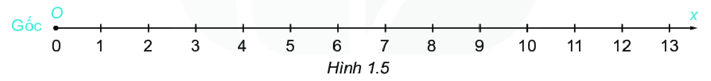

<!-- pdf:14 -->

# BÀI 3: THỨ TỰ TRONG TẬP HỢP CÁC SỐ TỰ NHIÊN

## 🔤 Khái niệm, thuật ngữ

- Điểm biểu diễn một số
- Hai số tự nhiên liên tiếp
- Số liền trước, số liền sau

## 🎯 Kiến thức, kĩ năng

- Nhận biết thứ tự trong tập hợp các số tự nhiên.
- So sánh hai số tự nhiên.

## 🔴 Mở đầu

Mỗi khi có trận bóng đá hay, người dân lại xếp hàng dài chờ mua vé. Nhìn dòng người xếp hàng một tưởng như dài vô tận kia, Hà tự hỏi: dòng người xếp hàng ấy và dãy số tự nhiên đang học có gì giống nhau nhỉ?

**Thứ tự của các số tự nhiên**

Ta đã biết tập hợp tất cả các số tự nhiên được kí hiệu là $\mathbb{N}$, nghĩa là $\mathbb{N} = \{0; 1; 2; 3; \dots\}$. Mỗi phần tử $0; 1; 2; 3; \dots$ của $\mathbb{N}$ được biểu diễn bởi một điểm trên **tia số** như hình 1.5.

*Hình 1.5*

Trên tia số, **điểm biểu diễn** số tự nhiên $a$ gọi là *điểm $a$*. Chẳng hạn, điểm $3$, điểm $6$, $\dots$

**HĐ1:** Trong hai điểm $5$ và $8$ trên tia số, điểm nào nằm trước (bên trái), điểm nào nằm sau (bên phải)?

**HĐ2:** Điểm biểu diễn số tự nhiên nào nằm ngay trước điểm $8$? Điểm biểu diễn số tự nhiên nào nằm ngay sau điểm $8$?

**HĐ3:** Cho $n$ là một số tự nhiên nhỏ hơn $7$. Theo em, điểm $n$ nằm trước hay sau điểm $7$?

> Tia số là hình ảnh trực quan giúp chúng ta tìm hiểu về thứ tự của các số tự nhiên.

<!-- term: So sánh hai số tự nhiên -->
> - Trong hai số tự nhiên khác nhau, luôn có một số nhỏ hơn số kia. Nếu số $a$ nhỏ hơn số $b$ thì trên tia số (nằm ngang) điểm $a$ nằm trước điểm $b$. Khi đó, ta viết $a < b$ hoặc $b > a$.
> - Mỗi số tự nhiên có đúng một số liền sau, chẳng hạn $9$ là **số liền sau** của $8$ (còn $8$ là **số liền trước** của $9$). Hai số $8$ và $9$ là **hai số tự nhiên liên tiếp**.
> - Nếu $a < b$ và $b < c$ thì $a < c$ (**tính chất bắc cầu**). Chẳng hạn $a < 5$ và $5 < 7$ suy ra $a < 7$.

**Chú ý:** Số $0$ không có số liền trước và là số tự nhiên nhỏ nhất.

<!-- pdf:15 -->

**Luyện tập:**

a) Hãy so sánh hai số tự nhiên sau đây, dùng kí hiệu “$<$” hay “$>$” để viết kết quả:

$m = 12\,036\,001$ và $n = 12\,035\,987$.

b) Trên tia số (nằm ngang), trong hai điểm $m$ và $n$, điểm nào nằm trước?

> Hãy so sánh từng cặp chữ số ở cùng một hàng kể từ trái sang phải.

**Vận dụng:**

Theo dõi kết quả bán hàng trong ngày của một cửa hàng, người ta nhận thấy:

Số tiền thu được vào buổi sáng nhiều hơn vào buổi chiều;

Số tiền thu được vào buổi tối ít hơn vào buổi chiều.

Hãy so sánh số tiền thu được (đều là các số tự nhiên) của cửa hàng đó vào buổi sáng và buổi tối.

<!-- term: Kí hiệu nhỏ hơn hoặc bằng và lớn hơn hoặc bằng -->
> **Các kí hiệu "$\le$" và "$\ge$"**
> - Ta còn dùng kí hiệu $a \le b$ (đọc là "$a$ nhỏ hơn hoặc bằng $b$") để nói "$a < b$ hoặc $a = b$".
>   Ví dụ:
>   $\{x \in \mathbb{N} \mid x < 4\} = \{0; 1; 2; 3\}$,
>   $\{x \in \mathbb{N} \mid x \le 4\} = \{0; 1; 2; 3; 4\}$.
> - Tương tự, kí hiệu $a \ge b$ (đọc là "$a$ lớn hơn hoặc bằng $b$") có nghĩa là "$a > b$ hoặc $a = b$".
> - Tính chất bắc cầu còn có thể viết: nếu $a \le b$ và $b \le c$ thì $a \le c$.

> ❓ Trong các số $3, 5, 8, 9$, số nào thuộc tập hợp $A = \{x \in \mathbb{N} \mid x \ge 5\}$, số nào thuộc tập hợp $B = \{x \in \mathbb{N} \mid x \le 5\}$?

## BÀI TẬP

1.13. Viết thêm các số liền trước và số liền sau của hai số $3\,532$ và $3\,529$ để được sáu số tự nhiên rồi sắp xếp sáu số đó theo thứ tự từ bé đến lớn.

1.14. Cho ba số tự nhiên $a, b, c$, trong đó $a$ là số nhỏ nhất. Biết rằng trên tia số, điểm $b$ nằm giữa hai điểm $a$ và $c$. Hãy dùng kí hiệu “$<$” để mô tả thứ tự của ba số $a, b$ và $c$. Cho ví dụ bằng số cụ thể.

1.15. Liệt kê các phần tử của mỗi tập hợp sau:

a) $M = \{x \in \mathbb{N} \mid 10 \le x < 15\}$;

b) $K = \{x \in \mathbb{N}^* \mid x \le 3\}$;

c) $L = \{x \in \mathbb{N} \mid x \le 3\}$.

1.16. Ba bạn An, Bắc, Cường dựng một vạch thẳng đứng lên tường rồi đánh dấu chiều cao của các bạn lên đó bởi ba điểm. Cường đặt tên cho các điểm đó theo thứ tự từ dưới lên là $A, B, C$ và giải thích rằng điểm $A$ ứng với chiều cao của bạn An, $B$ ứng với chiều cao của Bắc và $C$ ứng với chiều cao của Cường. Biết rằng bạn An cao $150\text{ cm}$, bạn Bắc cao $153\text{ cm}$, bạn Cường cao $148\text{ cm}$. Theo em, Cường giải thích như thế có đúng không? Nếu không thì phải sửa như thế nào cho đúng?

## 📷 Danh sách hình trong bài

| Mã hình | Trang PDF | Vị trí trong bài | Chú thích gốc |
| --- | :---: | --- | --- |
| H6-toan-b03-01 | 14 | Mở đầu | (sách không đánh số, dòng người xếp hàng chờ mua vé bóng đá) |
| H6-toan-b03-02 | 14 | Thứ tự của các số tự nhiên | Hình 1.5 |
