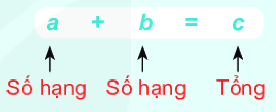
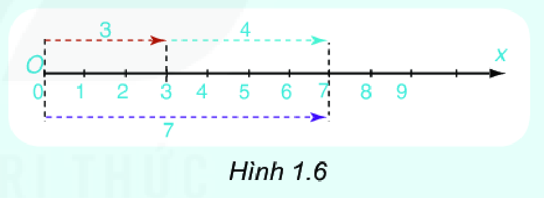
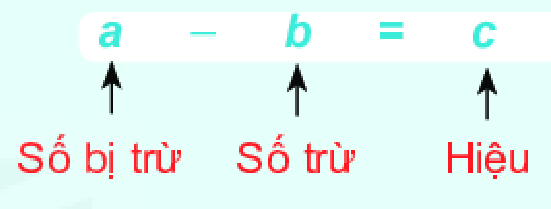
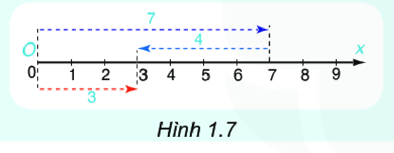
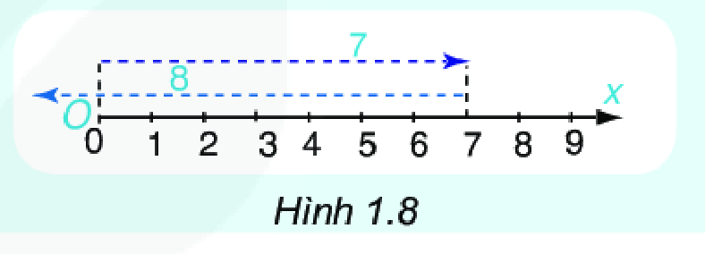

<!-- pdf:16 -->

# BÀI 4: PHÉP CỘNG VÀ PHÉP TRỪ SỐ TỰ NHIÊN

## 🔤 Khái niệm, thuật ngữ

- Phép cộng, số hạng, tổng
- Phép trừ, số bị trừ, số trừ, hiệu
- Tính chất giao hoán, kết hợp của phép cộng

## 🎯 Kiến thức, kĩ năng

- Thực hiện phép cộng và phép trừ số tự nhiên.
- Áp dụng tính chất giao hoán, kết hợp của phép cộng để tính nhẩm, tính hợp lí.
- Giải quyết một số vấn đề thực tiễn gắn với việc thực hiện phép cộng và phép trừ.

## 🔴 Mở đầu

Mai đi chợ mua cà tím hết $18\,000$ đồng, cà chua hết $21\,000$ đồng và rau cải hết $30\,000$ đồng. Mai đưa cô bán hàng tờ $100$ nghìn đồng thì được trả lại bao nhiêu tiền?

## 1. PHÉP CỘNG SỐ TỰ NHIÊN

<!-- term: Số hạng -->
> **Cộng hai số tự nhiên**
> - **Phép cộng** hai số tự nhiên $a$ và $b$ cho ta một số tự nhiên gọi là **tổng** của chúng, kí hiệu là $a + b$.
> - Có thể minh hoạ phép cộng nhờ tia số, chẳng hạn phép cộng $3 + 4 = 7$ được minh hoạ như sau (h.1.6):

*Hình 1.6*

**Vận dụng 1:**

Diện tích gieo trồng lúa vụ Thu Đông năm $2019$ vùng Đồng bằng sông Cửu Long ước tính đạt $713\,200\text{ ha}$, giảm $14\,500\text{ ha}$ so với vụ Thu Đông năm $2018$. *(Theo Tổng cục Thống kê 10/2019)*

Hãy tính diện tích gieo trồng lúa vụ Thu Đông năm $2018$ của Đồng bằng sông Cửu Long.

**Tính chất của phép cộng**

**HĐ1:** Cho $a = 28$ và $b = 34$.

a) Tính $a + b$ và $b + a$.

b) So sánh các kết quả nhận được ở câu a).

**HĐ2:** Cho $a = 17$, $b = 21$, $c = 35$.

a) Tính $(a + b) + c$ và $a + (b + c)$.

b) So sánh các kết quả nhận được ở câu a).

> Phép cộng số tự nhiên có các tính chất:
> - **Giao hoán**: $a + b = b + a$.
> - **Kết hợp**: $(a + b) + c = a + (b + c)$.

**Chú ý:** Tổng $(a + b) + c$ hay $a + (b + c)$ gọi là tổng của ba số $a, b, c$ và viết gọn là $a + b + c$.
<!-- ocr-ok: đã đối chiếu ảnh trang PDF 16, OCR dính chữ vàviếtgọnlà -->

<!-- pdf:17 -->

**Ví dụ:**

Tính một cách hợp lí: $66 + 289 + 134 + 321$.

**Giải:**

$66 + 289 + 134 + 321 = 66 + 134 + 289 + 321$ $\leftarrow$ Tính chất giao hoán

$= (66 + 134) + (289 + 321)$ $\leftarrow$ Tính chất kết hợp

$= 200 + 600$

$= 800$

> Khi cộng nhiều số, ta nên nhóm những số hạng có tổng là số chẵn chục, chẵn trăm, $\dots$ (nếu có).
<!-- ocr-ok: đã đối chiếu ảnh trang PDF 17, OCR trộn dòng hộp bóng thoại bên phải với cột trái -->

**Luyện tập 1:**

Tính một cách hợp lí: $117 + 68 + 23$.

## 2. PHÉP TRỪ SỐ TỰ NHIÊN
<!-- ocr-ok: đã đối chiếu ảnh trang PDF 17, tiêu đề mục màu trắng trên nền xanh -->

<!-- term: Số bị trừ -->
<!-- term: Số trừ -->
<!-- term: Hiệu -->
> **Trừ hai số tự nhiên**
> - Với hai số tự nhiên $a, b$ đã cho, nếu có số tự nhiên $c$ sao cho $a = b + c$ thì ta có **phép trừ** $a - b = c$.
> - Hình 1.7 minh hoạ phép trừ $7 - 4 = 3$. Hình 1.8 cho thấy phép trừ $7 - 8$ không thực hiện được trong tập hợp các số tự nhiên.

*Hình 1.7*

*Hình 1.8*

> Trong tập hợp $\mathbb{N}$, phép trừ $a - b$ chỉ thực hiện được nếu $a \ge b$.

**Luyện tập 2:**

Tính: $865\,279 - 45\,027$.

**Vận dụng 2:**

Giải bài toán mở đầu.

## BÀI TẬP

1.17. Tính tổng, hiệu bằng cách đặt tính:

a) $63\,548 + 19\,256$;

b) $129\,107 - 34\,693$.

1.18. Thay "$?$" bằng số thích hợp:

$? + 2\,895 = 2\,895 + 6\,789$.

1.19. Tìm $x$ thoả mãn:
<!-- ocr-ok: đã đối chiếu ảnh trang PDF 17, OCR bỏ sót nhãn 1.19 màu xanh -->

a) $7 + x = 362$;

b) $25 - x = 15$;

c) $x - 56 = 4$.

1.20. Năm $2020$ dân số Việt Nam ước tính khoảng $97$ triệu người và dự kiến tới đầu năm $2021$ sẽ tăng thêm khoảng $830$ nghìn người. Ước tính dân số Việt Nam đầu năm $2021$.

1.21. Nhà ga số $1$ và nhà ga số $2$ của một sân bay có thể tiếp nhận tương ứng khoảng $6\,526\,300$ và $3\,514\,500$ lượt hành khách mỗi năm. Nhờ đưa vào sử dụng nhà ga số $3$ mà mỗi năm sân bay này có thể tiếp nhận được khoảng $22\,851\,200$ lượt hành khách. Hãy tính số lượt hành khách mà nhà ga số $3$ có thể tiếp nhận mỗi năm.

1.22. Tính một cách hợp lí:

a) $285 + 470 + 115 + 230$;

b) $571 + 216 + 129 + 124$.

## 📷 Danh sách hình trong bài

| Mã hình | Trang PDF | Vị trí trong bài | Chú thích gốc |
| --- | :---: | --- | --- |
| H6-toan-b04-01 | 16 | Mục 1 | (sách không đánh số, sơ đồ thành phần phép cộng $a + b = c$: số hạng, số hạng, tổng) |
| H6-toan-b04-02 | 16 | Mục 1 | Hình 1.6 |
| H6-toan-b04-03 | 17 | Mục 2 | (sách không đánh số, sơ đồ thành phần phép trừ $a - b = c$: số bị trừ, số trừ, hiệu) |
| H6-toan-b04-04 | 17 | Mục 2 | Hình 1.7 |
| H6-toan-b04-05 | 17 | Mục 2 | Hình 1.8 |
