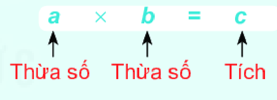
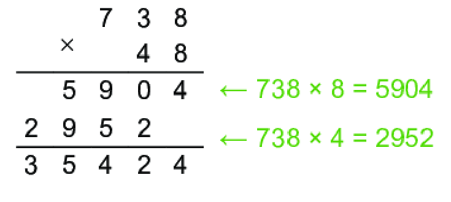
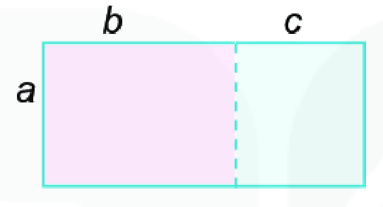
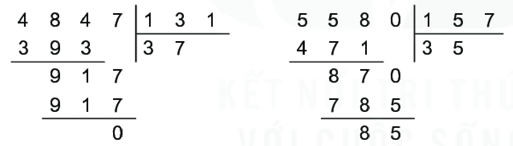

<!-- pdf:18 -->

# BÀI 5: PHÉP NHÂN VÀ PHÉP CHIA SỐ TỰ NHIÊN

## 🔤 Khái niệm, thuật ngữ

- Phép nhân, thừa số, tích
- Tính chất giao hoán, kết hợp của phép nhân
- Tính chất phân phối của phép nhân đối với phép cộng
- Phép chia hết, phép chia có dư
- Số bị chia, số chia, thương, số dư

## 🎯 Kiến thức, kĩ năng

- Thực hiện phép nhân hai số tự nhiên.
- Thực hiện phép chia hai số tự nhiên (chia hết và chia có dư).
- Áp dụng tính chất của phép nhân và phép chia trong tính toán (tính nhẩm, tính hợp lí).
- Giải quyết được những vấn đề thực tiễn gắn với việc thực hiện phép nhân và phép chia số tự nhiên.

## 🔴 Mở đầu

Mẹ em mua một túi $10\text{ kg}$ gạo tám thơm Hải Hậu loại $20$ nghìn đồng một kilôgam. Hỏi mẹ em phải đưa cho cô bán hàng bao nhiêu tờ giấy bạc $50$ nghìn đồng để trả tiền gạo?

## 1. PHÉP NHÂN SỐ TỰ NHIÊN
<!-- ocr-ok: đã đối chiếu ảnh trang PDF 18, tiêu đề mục màu trắng trên nền xanh -->

> **Nhân hai số tự nhiên**
> - **Phép nhân** hai số tự nhiên $a$ và $b$ cho ta một số tự nhiên gọi là **tích** của $a$ và $b$, kí hiệu là $a \times b$ hoặc $a \cdot b$:
>   $a \cdot b = a + a + \dots + a$ ($b$ số hạng).
>   Ví dụ: $5 \cdot 4 = 5 + 5 + 5 + 5 = 20$.

**Chú ý:** Nếu các **thừa số** đều bằng chữ, hoặc chỉ có một thừa số bằng số thì ta có thể không viết dấu nhân giữa các thừa số. Chẳng hạn, $a \cdot b = ab$; $2 \cdot m = 2m$.

**Ví dụ 1:**

Đặt tính nhân: $738 \cdot 48$

$\begin{array}{r} 738 \\ \times \quad 48 \\ \hline 5904 \\ 2952\phantom{0} \\ \hline 35424 \end{array}$ ($\leftarrow 738 \times 8 = 5904$; $\leftarrow 738 \times 4 = 2952$)

<!-- pdf:19 -->

**Luyện tập 1:**

Tính:

a) $834 \cdot 57$;

b) $603 \cdot 295$.

**Vận dụng 1:**

Giá tiền phôtô một trang giấy là $350$ đồng. Để phôtô một tài liệu dày $250$ trang thì hết bao nhiêu tiền?

**Tính chất của phép nhân**

**HĐ1:** So sánh kết quả của hai phép tính $a \cdot b$ và $b \cdot a$ với $a = 25$, $b = 18$.
<!-- ocr-ok: đã đối chiếu ảnh trang PDF 19, OCR bỏ sót nhãn HĐ1 và công thức -->

**HĐ2:** Tìm số tự nhiên $c$ sao cho $(325 \cdot 28) \cdot 15 = 325 \cdot (28 \cdot c)$.
<!-- ocr-ok: đã đối chiếu ảnh trang PDF 19, OCR đọc sai nhãn HĐ2 và chữ Tìm -->

**HĐ3:** Hình chữ nhật bên được tạo thành từ hai hình chữ nhật nhỏ có chung chiều rộng. Hãy tính diện tích hình chữ nhật này bằng hai cách.

<!-- term: Tính chất giao hoán và kết hợp của phép nhân -->
> Phép nhân có các tính chất:
> - *Giao hoán*: $ab = ba$.
> - *Kết hợp*: $(ab)c = a(bc)$.
> - **Phân phối của phép nhân đối với phép cộng**: $a(b + c) = ab + ac$.

**Chú ý:** Tích $(ab)c$ hay $a(bc)$ gọi là tích của ba số $a, b, c$ và viết gọn là $abc$.

**Ví dụ 2:**

Tính nhẩm: $24 \cdot 25$.

**Giải:** $24 \cdot 25 = (6 \cdot 4) \cdot 25 = 6 \cdot (4 \cdot 25) = 6 \cdot 100 = 600$.

> Trong tính nhẩm ta thường sử dụng các kết quả sau:
> $2 \cdot 5 = 10$;
> $4 \cdot 25 = 100$;
> $8 \cdot 125 = 1\,000$.

**Luyện tập 2:**

Tính nhẩm: $125 \cdot 8\,001 \cdot 8$.

**Vận dụng 2:**

Một trường học lên kế hoạch thay tất cả các bóng đèn sợi đốt bình thường bằng bóng đèn led cho $32$ phòng học, mỗi phòng $8$ bóng. Nếu mỗi bóng đèn led có giá $96\,000$ đồng thì nhà trường phải trả bao nhiêu tiền để thay đủ đèn led cho tất cả các phòng học?

<!-- pdf:20 -->

## 2. PHÉP CHIA HẾT VÀ PHÉP CHIA CÓ DƯ

**Chia hai số tự nhiên**

**HĐ4:** Thực hiện các phép chia $196 : 7$ và $215 : 18$.

**HĐ5:** Trong hai phép chia trên, hãy chỉ ra phép chia hết và phép chia có dư. Trong mỗi trường hợp, hãy cho biết số bị chia, số chia, thương và số dư (nếu có).

> Với hai số tự nhiên $a$ và $b$ đã cho ($b$ khác $0$), ta luôn tìm được đúng hai số tự nhiên $q$ và $r$ sao cho $a = bq + r$, trong đó $0 \le r < b$.
> - Nếu $r = 0$ thì ta có **phép chia hết** $a : b = q$; $a$ là **số bị chia**, $b$ là **số chia**, $q$ là **thương**.
> - Nếu $r \ne 0$ thì ta có **phép chia có dư** $a : b = q$ (dư $r$); $a$ là số bị chia, $b$ là số chia, $q$ là thương và $r$ là **số dư**.

**Ví dụ 3:**

Đặt tính rồi thực hiện các phép chia sau:

$4\,847 : 131$ và $5\,580 : 157$.

**Giải:**

> Trong phép chia có dư, số dư bao giờ cũng nhỏ hơn số chia.

Vậy, $4\,847 : 131 = 37$. Vậy, $5\,580 : 157 = 35$ (dư $85$).

**Luyện tập 3:**

Thực hiện các phép chia sau:

a) $945 : 45$;

b) $3\,121 : 51$.

**Ví dụ 4:**

Phải dùng ít nhất bao nhiêu xe ô tô $45$ chỗ ngồi để chở hết $2\,457$ cổ động viên của một đội bóng?

**Giải:**

Vì $2\,457 : 45 = 54$ (dư $27$) nên xếp đủ $54$ xe thì còn thừa $27$ người và phải dùng thêm $1$ xe nữa để chở nốt những người này.

Vậy, cần dùng ít nhất là $54 + 1 = 55$ (xe).

**Vận dụng 3:**

Giải bài toán mở đầu.

<!-- pdf:21 -->

## BÀI TẬP

1.23. Thực hiện các phép nhân sau:

a) $951 \cdot 23$;

b) $47 \cdot 273$;

c) $845 \cdot 253$;

d) $1\,356 \cdot 125$.

1.24. Tính nhẩm:

a) $125 \cdot 10$;

b) $2\,021 \cdot 100$;

c) $1\,991 \cdot 25 \cdot 4$;

d) $3\,025 \cdot 125 \cdot 8$.

1.25. Tính nhẩm:

a) $125 \cdot 101$. *Hướng dẫn:* viết $101 = 100 + 1$.

b) $21 \cdot 49$. *Hướng dẫn:* viết $49 = 50 - 1$.

1.26. Tìm thương và số dư (nếu có) của các phép chia sau:

a) $1\,092 : 91$;

b) $2\,059 : 17$.

1.27. Trường em có $50$ phòng học, mỗi phòng có $11$ bộ bàn ghế, mỗi bộ bàn ghế có thể xếp cho $4$ học sinh ngồi. Trường có thể nhận nhiều nhất bao nhiêu học sinh để mọi học sinh đều có chỗ ngồi.

1.28. Tỉnh Bắc Giang có dân số $1\,803\,905$ và đứng thứ mười hai về số dân trong $63$ tỉnh thành toàn quốc. Em hãy tính dân số Thanh Hoá (tỉnh đông dân thứ ba), biết rằng gấp đôi số dân Bắc Giang vẫn còn kém dân số Thanh Hoá $32\,228$ người.

1.29. Một trường Trung học cơ sở có $997$ học sinh tham dự lễ tổng kết cuối năm. Ban tổ chức đã chuẩn bị những chiếc ghế băng $5$ chỗ ngồi. Phải có ít nhất bao nhiêu ghế băng như vậy để tất cả học sinh đều có chỗ ngồi?

1.30. Một nhà máy dùng ô tô chuyển $1\,290$ kiện hàng tới một cửa hàng. Nếu mỗi chuyến xe chở được $45$ kiện thì phải cần ít nhất bao nhiêu chuyến xe để chuyển hết số kiện hàng trên?
<!-- ocr-ok: đã đối chiếu ảnh trang PDF 21, OCR đọc sai dấu tiếng Việt trong bài 1.30 -->

## 📷 Danh sách hình trong bài

| Mã hình | Trang PDF | Vị trí trong bài | Chú thích gốc |
| --- | :---: | --- | --- |
| H6-toan-b05-01 | 18 | Mục 1 | (sách không đánh số, sơ đồ thành phần phép nhân $a \times b = c$: thừa số, thừa số, tích) |
| H6-toan-b05-02 | 18 | Mục 1, Ví dụ 1 | (sách không đánh số, đặt tính nhân $738 \cdot 48$) |
| H6-toan-b05-03 | 19 | Mục 1, HĐ3 | (sách không đánh số, hình chữ nhật chiều rộng $a$ tạo thành từ hai hình chữ nhật nhỏ chiều dài $b$ và $c$) |
| H6-toan-b05-04 | 20 | Mục 2, Ví dụ 3 | (sách không đánh số, đặt tính chia $4\,847 : 131$ và $5\,580 : 157$) |
| H6-toan-b05-05 | 20 | Mục 2, Ví dụ 4 | (sách không đánh số, xe ô tô chở cổ động viên) |
