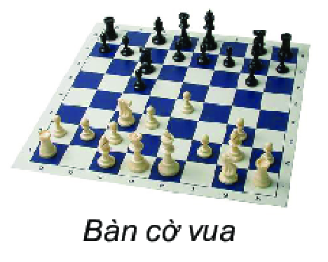
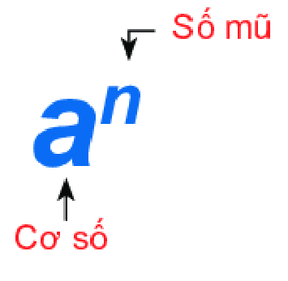
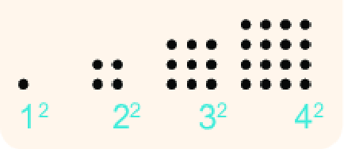
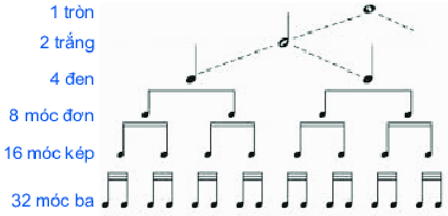

<!-- pdf:24 -->

# BÀI 6: LUỸ THỪA VỚI SỐ MŨ TỰ NHIÊN

## 🔤 Khái niệm, thuật ngữ

- Luỹ thừa
- Cơ số; Số mũ
- Bình phương; Lập phương

## 🎯 Kiến thức, kĩ năng

- Thực hiện phép tính nâng lên luỹ thừa với số mũ tự nhiên.
- Nhân, chia hai luỹ thừa cùng cơ số với số mũ tự nhiên.
- Giải quyết được những vấn đề thực tiễn gắn với thực hiện phép tính luỹ thừa với số mũ tự nhiên.

## 🔴 Mở đầu

Truyền thuyết Ấn Độ kể rằng, người phát minh ra bàn cờ vua đã chọn phần thưởng là số thóc rải trên $64$ ô của bàn cờ vua như sau: ô thứ nhất để $1$ hạt thóc, ô thứ hai để $2$ hạt, ô thứ ba để $4$ hạt, ô thứ tư để $8$ hạt, $\dots$ Cứ như thế, số hạt ở ô sau gấp đôi số hạt ở ô trước.

Liệu nhà vua có đủ thóc để thưởng cho nhà phát minh đó hay không?

*Bàn cờ vua*

## 1. LUỸ THỪA VỚI SỐ MŨ TỰ NHIÊN

**Phép nâng lên luỹ thừa**

Bảng sau đây chỉ ra cách tính số hạt thóc ở một số ô trong bàn cờ trong bài toán mở đầu:

| Ô thứ | Phép tính tìm số hạt thóc | Số hạt thóc |
| :---: | :---: | :---: |
| $1$ | $1$ | $1$ |
| $2$ | $2$ | $2$ |
| $3$ | $2 \cdot 2$ | $4$ |
| $4$ | $2 \cdot 2 \cdot 2$ | $8$ |
| $5$ | $2 \cdot 2 \cdot 2 \cdot 2$ | $16$ |
| $\dots$ | $\dots$ | $\dots$ |

**HĐ1:** Để tìm số hạt thóc ở ô thứ $8$, ta phải thực hiện phép nhân có bao nhiêu thừa số $2$?

> **Luỹ thừa** bậc $n$ của số tự nhiên $a$ là tích của $n$ thừa số bằng nhau, mỗi thừa số bằng $a$:
> $a^n = \underbrace{a \cdot a \cdot \dots \cdot a}_{n \text{ thừa số}}$ ($n \in \mathbb{N}^*$)
> $a^n$ đọc là "$a$ mũ $n$" hoặc "$a$ luỹ thừa $n$", $a$ là **cơ số**, $n$ là **số mũ**.

Phép nhân nhiều thừa số bằng nhau gọi là **phép nâng lên luỹ thừa**.

<!-- pdf:25 -->

**Chú ý:** Ta có $a^1 = a$.

$a^2$ cũng được gọi là $a$ **bình phương** (hay bình phương của $a$);

$a^3$ được gọi là $a$ **lập phương** (hay lập phương của $a$).

> Các số $0, 1, 4, 9, 16, \dots$ gọi là các **số chính phương**.

**Ví dụ 1:**

a) Viết biểu thức $3 \cdot 3 \cdot 3 \cdot 3 \cdot 3$ dưới dạng luỹ thừa. Hãy chỉ ra cơ số và số mũ của luỹ thừa đó.

b) Tính $11^2$.

**Giải:**

a) $3 \cdot 3 \cdot 3 \cdot 3 \cdot 3 = 3^5$, cơ số là $3$, số mũ là $5$.

b) $11^2 = 11 \cdot 11 = 121$.

**Luyện tập 1:**

Hoàn thành bảng bình phương của các số tự nhiên từ $1$ đến $10$.

| $a$ | $1$ | $2$ | $3$ | $4$ | $5$ | $6$ | $7$ | $8$ | $9$ | $10$ |
| :---: | :---: | :---: | :---: | :---: | :---: | :---: | :---: | :---: | :---: | :---: |
| $a^2$ | $?$ | $?$ | $?$ | $?$ | $?$ | $?$ | $?$ | $?$ | $?$ | $?$ |

**Vận dụng 1:**

1. Tính số hạt thóc có trong ô thứ $7$ của bàn cờ nói trong bài toán mở đầu.

2. Hãy viết mỗi số tự nhiên sau thành tổng giá trị các chữ số của nó bằng cách dùng các luỹ thừa của $10$ theo mẫu:
   $4\,257 = 4 \cdot 10^3 + 2 \cdot 10^2 + 5 \cdot 10 + 7$.

   a) $23\,197$;

   b) $203\,184$.

> Ta có:
> $100 = 10^2$
> $1\,000 = 10^3$
> $1\ 0000 = 10^4$,
> $\dots$
<!-- Ghi chú in gốc: sách in "1 0000 = 10^4," (khoảng trắng đặt sau chữ số 1 thay vì tách lớp nghìn 10 000) -->

## 2. NHÂN VÀ CHIA HAI LUỸ THỪA CÙNG CƠ SỐ

**Nhân hai luỹ thừa cùng cơ số**

**HĐ2:**

a) Viết kết quả phép nhân sau dưới dạng một luỹ thừa của $7$:

$7^2 \cdot 7^3 = (7 \cdot 7) \cdot (7 \cdot 7 \cdot 7) = ?$

b) Nêu nhận xét về mối liên hệ giữa các số mũ của $7$ trong hai thừa số và tích tìm được ở câu a).

<!-- term: Quy tắc nhân hai luỹ thừa cùng cơ số -->
> Khi nhân hai luỹ thừa cùng cơ số, ta giữ nguyên cơ số và cộng các số mũ:
> $a^m \cdot a^n = a^{m + n}$

**Ví dụ 2:**

$5^6 \cdot 5^3 = 5^{6 + 3} = 5^9$; $\quad 10^5 \cdot 10^4 \cdot 10^2 = 10^{5 + 4 + 2} = 10^{11}$.

**Luyện tập 2:**

Viết kết quả phép tính dưới dạng một luỹ thừa:

a) $5^3 \cdot 5^7$;

b) $2^4 \cdot 2^5 \cdot 2^9$;

c) $10^2 \cdot 10^4 \cdot 10^6 \cdot 10^8$.

<!-- pdf:26 -->

**Chia hai luỹ thừa cùng cơ số**

**HĐ3:**

a) Viết kết quả phép chia sau dưới dạng một luỹ thừa của $6$:

$6^5 : 6^2 = \frac{6^5}{6^2} = \frac{6 \cdot 6 \cdot 6 \cdot 6 \cdot 6}{6 \cdot 6} = ?$

b) Nêu nhận xét về mối liên hệ giữa các số mũ của $6$ trong số bị chia, số chia và thương tìm được ở câu a).

<!-- term: Quy tắc chia hai luỹ thừa cùng cơ số -->
> Khi *chia* hai luỹ thừa cùng cơ số (khác $0$), ta giữ nguyên cơ số và *trừ* các số mũ.
> $a^m : a^n = a^{m - n}$ (với $a \ne 0$, $m \ge n$)

**Chú ý:** Người ta quy ước $a^0 = 1$ (với $a \ne 0$).

**Ví dụ 3:**

$2^6 : 2^3 = 2^{6 - 3} = 2^3$; $\quad 10^7 : 10^4 = 10^{7 - 4} = 10^3$.

**Luyện tập 3:**

Viết kết quả các phép tính dưới dạng một luỹ thừa:

a) $7^6 : 7^4$;

b) $1\,091^{100} : 1\,091^{100}$.

## BÀI TẬP

1.36. Viết các tích sau dưới dạng một luỹ thừa:

a) $9 \cdot 9 \cdot 9 \cdot 9 \cdot 9$;

b) $10 \cdot 10 \cdot 10 \cdot 10$.

1.37. Hoàn thành bảng sau vào vở

| Luỹ thừa | Cơ số | Số mũ | Giá trị của luỹ thừa |
| :---: | :---: | :---: | :---: |
| $4^3$ | $?$ | $?$ | $?$ |
| $?$ | $3$ | $5$ | $?$ |
| $?$ | $2$ | $?$ | $128$ |

1.38. Tính

a) $2^5$;

b) $3^3$;

c) $5^2$;

d) $10^9$.

1.39. Viết các số sau thành tổng giá trị các chữ số của nó bằng cách dùng các luỹ thừa của $10$:

$215$; $902$; $2\,020$; $883\,001$.

1.40. Tính $11^2$, $111^2$. Từ đó hãy dự đoán kết quả của $1\,111^2$.

1.41. Biết $2^{10} = 1\,024$. Hãy tính $2^9$ và $2^{11}$.
<!-- ocr-ok: đã đối chiếu ảnh trang PDF 26, câu chứa nhiều luỹ thừa LaTeX -->

1.42. Tính:

a) $5^7 \cdot 5^3$;

b) $5^8 : 5^4$.

1.43. Ta có: $1 + 3 + 5 = 9 = 3^2$.

Viết các tổng sau dưới dạng bình phương của một số tự nhiên

a) $1 + 3 + 5 + 7$;

b) $1 + 3 + 5 + 7 + 9$.

1.44. Trái Đất có khối lượng khoảng $60 \cdot 10^{20}$ tấn. Mỗi giây Mặt Trời tiêu thụ $4 \cdot 10^6$ tấn khí hydrogen. Hỏi Mặt Trời cần bao nhiêu giây để tiêu thụ một lượng khí hydrogen có khối lượng bằng khối lượng Trái Đất?

1.45. Mỗi giờ có khoảng $828 \cdot 10^7$ tế bào hồng cầu được thay thế nhờ tuỷ xương. Hãy tính mỗi giây có bao nhiêu tế bào hồng cầu đã được thay thế.

## 💡 Em có biết?

Trong âm nhạc, người ta ghi các bản nhạc bằng cách dùng các nốt nhạc. Quan hệ về trường độ của chúng như sau:

$1$ tròn $= 2^1$ trắng $= 2^2$ đen $= 2^3$ móc đơn $= 2^4$ móc kép.
<!-- ocr-ok: đã đối chiếu ảnh trang PDF 26, hệ thức luỹ thừa xen kẽ tên nốt nhạc -->

$1$ trắng $= 2^1$ đen $= 2^2$ móc đơn $= 2^3$ móc kép $= 2^4$ móc ba.
<!-- ocr-ok: đã đối chiếu ảnh trang PDF 26, hệ thức luỹ thừa xen kẽ tên nốt nhạc -->

## 📷 Danh sách hình trong bài

| Mã hình | Trang PDF | Vị trí trong bài | Chú thích gốc |
| --- | :---: | --- | --- |
| H6-toan-b06-01 | 24 | Mở đầu | Bàn cờ vua |
| H6-toan-b06-02 | 24 | Mục 1 | (sách không đánh số, sơ đồ cơ số và số mũ của luỹ thừa $a^n$) |
| H6-toan-b06-03 | 25 | Mục 1, Chú ý | (sách không đánh số, minh hoạ các số chính phương $1^2, 2^2, 3^2, 4^2$) |
| H6-toan-b06-04 | 26 | Em có biết? | (sách không đánh số, sơ đồ quan hệ về trường độ của các nốt nhạc) |
