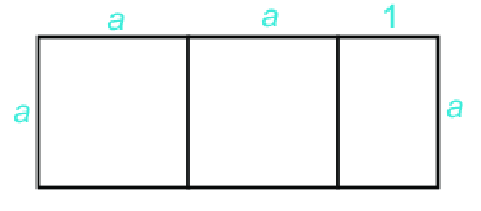

<!-- pdf:27 -->

# BÀI 7: THỨ TỰ THỰC HIỆN CÁC PHÉP TÍNH

## 🔤 Khái niệm, thuật ngữ

- Biểu thức
- Giá trị của một biểu thức

## 🎯 Kiến thức, kĩ năng

- Nhận biết thứ tự thực hiện các phép tính.
- Tính giá trị của một biểu thức.

## 🔴 Mở đầu

$5 + 3 \times 2$ bằng mấy?

- Tròn: $16$
- Vuông: $11$
- Pi: Bạn nào đúng nhỉ?
<!-- ocr-ok: đã đối chiếu ảnh trang PDF 27, lời thoại bóng nói của Tròn, Vuông và Pi -->

<!-- term: Giá trị của biểu thức -->
> Ta đã biết: các số được nối với nhau bởi dấu các phép tính (cộng, trừ, nhân, chia, nâng lên luỹ thừa) làm thành *một* **biểu thức**. Trong một biểu thức có thể có những dấu ngoặc để chỉ thứ tự thực hiện các phép tính.
>
> Để tính giá trị của một biểu thức, ta thực hiện các phép tính trong biểu thức đó theo quy ước sau:

> Ta coi mỗi số cũng là một biểu thức.

<!-- term: Thứ tự thực hiện các phép tính -->
> *Thứ tự thực hiện các phép tính trong một biểu thức*
>
> 1. Đối với biểu thức không có dấu ngoặc:
>    - Nếu chỉ có phép cộng, trừ hoặc chỉ có phép nhân, chia, ta thực hiện các phép tính từ trái sang phải.
>    - Nếu có các phép tính cộng, trừ, nhân, chia, nâng lên luỹ thừa thì ta thực hiện phép nâng lên luỹ thừa trước, rồi đến nhân và chia, cuối cùng đến cộng và trừ.
> 2. Đối với biểu thức có dấu ngoặc: Nếu biểu thức có các dấu ngoặc tròn $( )$, dấu ngoặc vuông $[ ]$, dấu ngoặc nhọn $\{ \}$ thì ta thực hiện phép tính trong các dấu ngoặc tròn trước, rồi thực hiện phép tính trong các dấu ngoặc vuông, cuối cùng thực hiện phép tính trong dấu ngoặc nhọn.

> ❓ Trong tình huống mở đầu, bạn nào trả lời đúng?

<!-- pdf:28 -->

**Ví dụ:**

Tính giá trị của các biểu thức sau:

a) $8 + 36 : 3 \cdot 2$;

b) $[1 + 2 \cdot (5 \cdot 3 - 2^3)] \cdot 7$.

**Giải:**

a) $8 + 36 : 3 \cdot 2 = 8 + 12 \cdot 2 = 8 + 24 = 32$. ($\leftarrow$ Nhân, chia từ trái sang phải)
<!-- ocr-ok: đã đối chiếu ảnh trang PDF 28, OCR bỏ sót chú thích chữ xanh nhạt bên phải phép tính -->

b) $[1 + 2 \cdot (5 \cdot 3 - 2^3)] \cdot 7 = [1 + 2 \cdot (5 \cdot 3 - 8)] \cdot 7$ ($\leftarrow$ Thực hiện trong ngoặc trước; trong ngoặc: luỹ thừa $\rightarrow$ nhân $\rightarrow$ cộng)
<!-- ocr-ok: đã đối chiếu ảnh trang PDF 28, OCR bỏ sót chú thích chữ xanh nhạt bên phải phép tính -->

$= [1 + 2 \cdot (15 - 8)] \cdot 7 = [1 + 2 \cdot 7] \cdot 7$

$= [1 + 14] \cdot 7 = 15 \cdot 7 = 105$.

**Luyện tập 1:**

1. Tính giá trị của các biểu thức sau:

   a) $25 \cdot 2^3 - 3^2 + 125$;

   b) $2 \cdot 3^2 + 5 \cdot (2 + 3)$.

**Vận dụng:**

Một người đi xe đạp trong $5$ giờ. Trong $3$ giờ đầu, người đó đi với vận tốc $14\text{ km/h}$; $2$ giờ sau, người đó đi với vận tốc $9\text{ km/h}$.

a) Lập các biểu thức tính quãng đường người đó đi được trong $3$ giờ đầu; trong $2$ giờ sau; trong $5$ giờ.

b) Tính quãng đường người đó đi được trong $5$ giờ.

<!-- term: Giá trị của biểu thức -->
**Chú ý:** Trong một biểu thức có thể có chứa chữ. Để tính giá trị của biểu thức đó khi *cho giá trị của các chữ*, ta thay thế giá trị đã cho vào biểu thức rồi tính giá trị của biểu thức nhận được.

**Luyện tập 2:**

a) Lập biểu thức tính diện tích của hình chữ nhật ở hình bên.

b) Tính diện tích của hình chữ nhật đó khi $a = 3\text{ cm}$.

## BÀI TẬP

1.46. Tính:

a) $235 + 78 - 142$;

b) $14 + 2 \cdot 8^2$;

c) $\{2^3 + [1 + (3 - 1)^2]\} : 13$.

1.47. Tính giá trị của biểu thức:

$1 + 2(a + b) - 4^3$ khi $a = 25$; $b = 9$.

1.48. Trong $8$ tháng đầu năm, một cửa hàng bán được $1\,264$ chiếc ti vi. Trong $4$ tháng cuối năm, trung bình mỗi tháng cửa hàng bán được $164$ ti vi. Hỏi trong cả năm, trung bình mỗi tháng cửa hàng đó bán được bao nhiêu ti vi? Viết biểu thức tính kết quả.

1.49. Căn hộ nhà bác Cường diện tích $105\text{ m}^2$. Trừ bếp và nhà vệ sinh diện tích $30\text{ m}^2$, toàn bộ diện tích sàn còn lại được lát gỗ như sau: $18\text{ m}^2$ được lát bằng gỗ loại $1$ giá $350\text{ nghìn đồng/m}^2$; phần còn lại dùng gỗ loại $2$ có giá $170\text{ nghìn đồng/m}^2$. Công lát là $30\text{ nghìn đồng/m}^2$.

Viết biểu thức tính tổng chi phí bác Cường cần trả để lát sàn căn hộ như trên. Tính giá trị của biểu thức đó.

## 📷 Danh sách hình trong bài

| Mã hình | Trang PDF | Vị trí trong bài | Chú thích gốc |
| --- | :---: | --- | --- |
| H6-toan-b07-01 | 27 | Mở đầu | (sách không đánh số, tình huống mở đầu: $5 + 3 \times 2$ bằng mấy?) |
| H6-toan-b07-02 | 28 | Vận dụng | (sách không đánh số, người đi xe đạp) |
| H6-toan-b07-03 | 28 | Luyện tập 2 | (sách không đánh số, hình chữ nhật chiều rộng $a$, chiều dài gồm hai đoạn $a$ và một đoạn $1$) |
