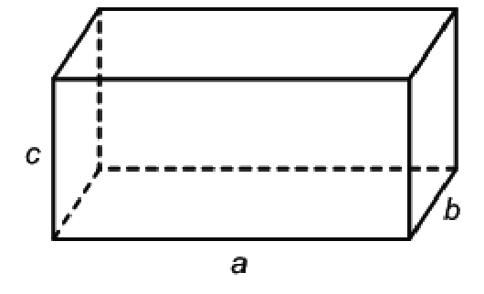

<!-- pdf:29 -->

# LUYỆN TẬP CHUNG

**Ví dụ 1:**

Tính giá trị của biểu thức $120 + [55 - (11 - 3 \cdot 2)^2] + 2^3$.

**Giải:**

$120 + [55 - (11 - 3 \cdot 2)^2] + 2^3$ ($\leftarrow$ Trong ngoặc $( )$: nhân $\rightarrow$ trừ)

$= 120 + [55 - (11 - 6)^2] + 2^3$

$= 120 + [55 - 5^2] + 2^3$ ($\leftarrow$ Trong ngoặc $[ ]$: luỹ thừa $\rightarrow$ trừ)
<!-- ocr-ok: đã đối chiếu ảnh trang PDF 29, OCR bỏ sót chú thích chữ xanh nhạt bên phải phép tính -->

$= 120 + [55 - 25] + 2^3$

$= 120 + 30 + 2^3$

$= 150 + 8$

$= 158.$

Vậy biểu thức có giá trị bằng $158$.

**Ví dụ 2:**

Hình khối bên được ghép bằng những khối lập phương cạnh $3\text{ cm}$.

a) Lập biểu thức tính số khối lập phương tạo thành hình khối.

b) Tính thể tích của hình khối.

**Giải:**

a) *Cách 1:* Các khối lập phương được xếp thành $4$ tầng: tầng trên cùng có $4 \cdot 4$ khối, tầng thứ hai có $4 \cdot 5$ khối, tầng thứ ba có $4 \cdot 6$ khối, tầng thứ tư có $4 \cdot 7$ khối. Tổng số khối là $4 \cdot 4 + 4 \cdot 5 + 4 \cdot 6 + 4 \cdot 7$ (khối).
<!-- ocr-ok: đã đối chiếu ảnh trang PDF 29, đoạn chứa nhiều biểu thức nhân xen kẽ chữ -->

*Cách 2:* Tính từ phía trước về phía sau, hình khối được tạo thành bởi $7$ lớp khối lập phương. Lớp đầu tiên có $4$ khối. Số khối của lớp thứ hai bằng hai lần số khối lớp thứ nhất và bằng $2 \cdot 4$. Lớp thứ ba có $3 \cdot 4$ khối. Bốn lớp sau cùng, mỗi lớp có $4 \cdot 4$ khối.

Tổng số khối là $4 + 2 \cdot 4 + 3 \cdot 4 + 4 \cdot 4 \cdot 4$ (khối).

b) Mỗi khối lập phương có thể tích $3^3\text{ (cm}^3\text{)}$. Hình khối đã cho có thể tích bằng

$(4 \cdot 4 + 4 \cdot 5 + 4 \cdot 6 + 4 \cdot 7) \cdot 3^3 = 4 \cdot (4 + 5 + 6 + 7) \cdot 27 = 4 \cdot 22 \cdot 27 = 2\,376\text{ (cm}^3\text{)}$.

## BÀI TẬP

1.50. Tính giá trị của biểu thức:

a) $36 - 18 : 6$;

b) $2 \cdot 3^2 + 24 : 6 \cdot 2$;

c) $2 \cdot 3^2 - 24 : (6 \cdot 2)$.

1.51. Viết kết quả phép tính dưới dạng một luỹ thừa:

a) $3^3 : 3^2$;

b) $5^4 : 5^2$;

c) $8^3 \cdot 8^2$;

d) $5^4 \cdot 5^3 : 5^2$.

1.52. Viết biểu thức tính diện tích toàn phần của hình hộp chữ nhật (hình dưới) theo $a, b, c$. Tính giá trị biểu thức đó khi $a = 3\text{ cm}$; $b = 4\text{ cm}$; $c = 5\text{ cm}$.

1.53. Tính

a) $110 - 7^2 + 22 : 2$;

b) $9 \cdot (8^2 - 15)$;

c) $5 \cdot 8 - (17 + 8) : 5$;

d) $75 : 3 + 6 \cdot 9^2$.

## 📷 Danh sách hình trong bài

| Mã hình | Trang PDF | Vị trí trong bài | Chú thích gốc |
| --- | :---: | --- | --- |
| H6-toan-ltc-c01-02-01 | 29 | Ví dụ 2 | (sách không đánh số, hình khối được ghép bằng những khối lập phương cạnh $3\text{ cm}$) |
| H6-toan-ltc-c01-02-02 | 29 | Bài tập 1.52 | (sách không đánh số, hình hộp chữ nhật có ba kích thước $a, b, c$) |
