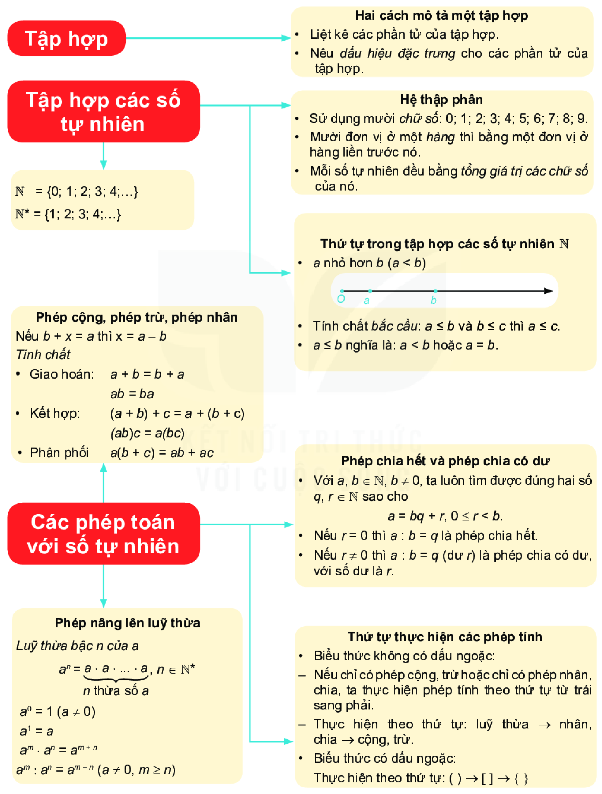

<!-- pdf:30 -->

# CHÚNG TA ĐÃ HỌC NHỮNG GÌ?

- *Tập hợp*
  - *Hai cách mô tả một tập hợp*
    - Liệt kê các phần tử của tập hợp.
    - Nêu *dấu hiệu đặc trưng* cho các phần tử của tập hợp.
- *Tập hợp các số tự nhiên*
  - $\mathbb{N} = \{0; 1; 2; 3; 4; \dots\}$
  - $\mathbb{N}^* = \{1; 2; 3; 4; \dots\}$
  - *Hệ thập phân*
    - Sử dụng mười *chữ số*: $0; 1; 2; 3; 4; 5; 6; 7; 8; 9$.
    - Mười đơn vị ở một *hàng* thì bằng một đơn vị ở hàng liền trước nó.
    - Mỗi số tự nhiên đều bằng *tổng giá trị các chữ số* của nó.
  - *Thứ tự trong tập hợp các số tự nhiên $\mathbb{N}$*
    - $a$ nhỏ hơn $b$ ($a < b$) (trên tia số gốc $O$, điểm $a$ nằm trước điểm $b$)
    - Tính chất *bắc cầu*: $a \le b$ và $b \le c$ thì $a \le c$.
    - $a \le b$ nghĩa là: $a < b$ hoặc $a = b$.
- *Các phép toán với số tự nhiên*
  - *Phép cộng, phép trừ, phép nhân*
    - Nếu $b + x = a$ thì $x = a - b$
    - *Tính chất*
      - Giao hoán: $a + b = b + a$; $ab = ba$
      - Kết hợp: $(a + b) + c = a + (b + c)$; $(ab)c = a(bc)$
      - Phân phối: $a(b + c) = ab + ac$
  - *Phép chia hết và phép chia có dư*
    - Với $a, b \in \mathbb{N}$, $b \ne 0$, ta luôn tìm được đúng hai số $q, r \in \mathbb{N}$ sao cho $a = bq + r$, $0 \le r < b$.
    - Nếu $r = 0$ thì $a : b = q$ là phép chia hết.
    - Nếu $r \ne 0$ thì $a : b = q$ (dư $r$) là phép chia có dư, với số dư là $r$.
  - *Phép nâng lên luỹ thừa*
    - *Luỹ thừa bậc $n$ của $a$*: $a^n = \underbrace{a \cdot a \cdot \dots \cdot a}_{n \text{ thừa số } a}$, $n \in \mathbb{N}^*$
    - $a^0 = 1$ ($a \ne 0$)
    - $a^1 = a$
    - $a^m \cdot a^n = a^{m + n}$
    - $a^m : a^n = a^{m - n}$ ($a \ne 0$, $m \ge n$)
  - *Thứ tự thực hiện các phép tính*
    - Biểu thức không có dấu ngoặc:
      - Nếu chỉ có phép cộng, trừ hoặc chỉ có phép nhân, chia, ta thực hiện phép tính theo thứ tự từ trái sang phải.
      - Thực hiện theo thứ tự: luỹ thừa $\rightarrow$ nhân, chia $\rightarrow$ cộng, trừ.
    - Biểu thức có dấu ngoặc:
      - Thực hiện theo thứ tự: $( ) \rightarrow [ ] \rightarrow \{ \}$

<!-- pdf:31 -->

## BÀI TẬP CUỐI CHƯƠNG I

1.54. Viết số tự nhiên $a$ sau đây: Mười lăm tỉ hai trăm sáu mươi bảy triệu không trăm hai mươi mốt nghìn chín trăm linh tám.

a) Số $a$ có bao nhiêu chữ số? Viết tập hợp các chữ số của $a$;

b) Số $a$ có bao nhiêu triệu, chữ số hàng triệu là chữ số nào?

c) Trong $a$ có hai chữ số $1$ nằm ở những hàng nào? Mỗi chữ số ấy có giá trị bằng bao nhiêu?

1.55.

a) Số $2\,020$ là số liền sau của số nào? Là số liền trước của số nào?

b) Cho số tự nhiên $a$ khác $0$. Số liền trước của $a$ là số nào? Số liền sau của $a$ là số nào?

c) Trong các số tự nhiên, số nào *không có* số liền sau? Số nào *không có* số liền trước?

1.56. Đặt tính chia tìm tích, thương và số dư (nếu có):

a) $21\,759 \cdot 1\,862$;

b) $3\,789 : 231$;

b) $9\,848 : 345$.

1.57. Tính giá trị biểu thức

$21 \cdot [(1\,245 + 987) : 2^3 - 15 \cdot 12] + 21$.

1.58. Khối $6$ có $320$ học sinh đi tham quan. Nhà trường cần thuê ít nhất bao nhiêu xe ô tô $45$ chỗ ngồi để đủ chỗ cho tất cả học sinh?

1.59. Một phòng chiếu phim có $18$ hàng ghế, mỗi hàng có $18$ ghế. Giá một vé xem phim là $50\,000$ đồng.
<!-- ocr-ok: đã đối chiếu ảnh trang PDF 31, câu chứa nhiều số trong LaTeX -->

a) Tối thứ Bảy, tất cả các vé đều được bán hết. Số tiền bán vé thu được là bao nhiêu?

b) Tối thứ Sáu, số tiền bán vé thu được là $10\,550\,000$ đồng. Hỏi có bao nhiêu vé không bán được?

c) Chủ Nhật còn $41$ vé không bán được. Hỏi số tiền bán vé thu được là bao nhiêu?

## 📷 Danh sách hình trong bài

| Mã hình | Trang PDF | Vị trí trong bài | Chú thích gốc |
| --- | :---: | --- | --- |
| H6-toan-ot-c01-01 | 30 | Chúng ta đã học những gì? | (sách không đánh số, sơ đồ tổng kết kiến thức Chương I: Tập hợp các số tự nhiên) |
