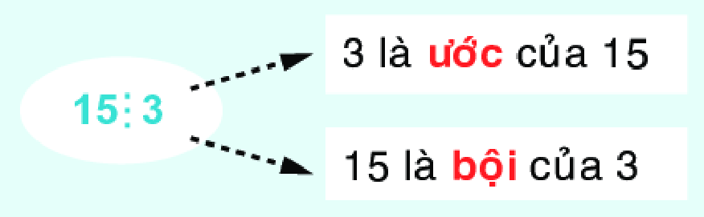

<!-- pdf:33 -->

<!-- Trang mở đầu Chương II (PDF 32): CHƯƠNG II. TÍNH CHIA HẾT TRONG TẬP HỢP CÁC SỐ TỰ NHIÊN — Giới thiệu ứng dụng của số nguyên tố trong quá trình mã hoá và giải mã thông tin (khoá công khai, khoá riêng) cùng các khái niệm hợp số, ước chung và bội chung. -->

# BÀI 8: QUAN HỆ CHIA HẾT VÀ TÍNH CHẤT

## 🔤 Khái niệm, thuật ngữ

- Chia hết
- Ước
- Bội

## 🎯 Kiến thức, kĩ năng

- Nhận biết quan hệ chia hết, khái niệm ước và bội.
- Tìm các ước và bội của một số tự nhiên.
- Nhận biết tính chia hết của một tổng cho một số.

## 🔴 Mở đầu

Trong đợt tổng kết học kì I, lớp 6A được Hội cha mẹ học sinh thưởng $50$ cái bút. Trường lại thưởng thêm cho lớp $4$ hộp bút nữa. Các bạn đề nghị chia đều phần thưởng cho $4$ tổ. Nếu không biết số bút trong mỗi hộp, ta có thể chia đều số bút đó cho $4$ tổ được không?

## 1. QUAN HỆ CHIA HẾT

**Khi nào thì $a$ chia hết cho $b$?**

- **Vuông:** Trong hai số $15$ và $16$, số nào chia hết cho $3$, số nào không chia hết cho $3$?
- **Tròn:** Số $15$ chia hết cho $3$ vì $15 : 3 = 5$ và không còn dư. Số $16$ không chia hết cho $3$ vì $16$ chia $3$ bằng $5$ dư $1$.
<!-- ocr-ok: đã đối chiếu trực tiếp ảnh trang PDF 33, khớp 100% chữ gốc (OCR rơi số hiệu màu nhạt / công thức / bảng) -->

> Cho hai số tự nhiên $a$ và $b$ ($b \ne 0$).
> Nếu có số tự nhiên $k$ sao cho $a = kb$ thì ta nói $a$ **chia hết** cho $b$ và kí hiệu là $a \vdots b$.
> Nếu $a$ **không chia hết** cho $b$ ta kí hiệu là $a \not\vdots b$.

Ví dụ: $15 \vdots 3$; $\quad 16 \not\vdots 3$.

> ❓ Tìm kí hiệu thích hợp ($\vdots$, $\not\vdots$) thay cho dấu "$?$":
>
> $24 \; \boxed{?} \; 6 \qquad 45 \; \boxed{?} \; 10 \qquad 35 \; \boxed{?} \; 5 \qquad 42 \; \boxed{?} \; 4.$

**Ví dụ 1:** Nhân dịp sinh nhật, mẹ cho Việt $12$ gói kẹo để liên hoan với các bạn, mỗi gói có $35$ cái. Biết lớp Việt có $5$ tổ, hỏi Việt có thể chia đều số kẹo cho các tổ không?

**Giải:**

Việt có số kẹo là $12 \cdot 35$. Vì $35 \vdots 5$ nên $(12 \cdot 35) \vdots 5$, do đó Việt có thể chia đều số kẹo cho mỗi tổ.

<!-- term: Tính chia hết của một tích -->
> **Pi:** Trong một tích, nếu có một thừa số chia hết cho một số thì tích chia hết cho số đó.

<!-- pdf:34 -->

**Ước và bội**

- $15 \vdots 3$: $3$ là ước của $15$; $15$ là bội của $3$.

> Nếu $a$ chia hết cho $b$, ta nói $b$ là **ước** của $a$ và $a$ là **bội** của $b$.
<!-- ocr-ok: đã đối chiếu trực tiếp ảnh trang PDF 34, khớp 100% chữ gốc (OCR rơi số hiệu màu nhạt / công thức / bảng) -->

Ta kí hiệu $\text{Ư}(a)$ là tập hợp các ước của $a$ và $\text{B}(b)$ là tập hợp các bội của $b$.

> ❓ Bạn Vuông hay Tròn đúng nhỉ?
> - **Vuông:** $5$ là ước của $15$
> - **Tròn:** $6$ là ước của $15$

**Cách tìm ước và bội**

**HĐ1:** Lần lượt chia $12$ cho các số từ $1$ đến $12$, em hãy viết tập hợp tất cả các ước của $12$.

**HĐ2:** Bằng cách nhân $8$ với $0, 1, 2, \dots$ em hãy viết các bội của $8$ nhỏ hơn $80$.

<!-- term: Quy tắc tìm ước và bội -->
> - Muốn tìm các ước của $a$ ($a > 1$), ta lần lượt chia $a$ cho các số tự nhiên từ $1$ đến $a$ để xem $a$ chia hết cho số nào thì số đó là ước của $a$.
> - Ta có thể tìm các bội của một số khác $0$ bằng cách nhân số đó lần lượt với $0, 1, 2, 3, \dots$

**Ví dụ 2:**

a) Lần lượt chia $15$ cho các số từ $1$ đến $15$, ta thấy $15$ chia hết cho $1, 3, 5, 15$ nên $\text{Ư}(15) = \{1; 3; 5; 15\}$.
<!-- ocr-ok: đã đối chiếu trực tiếp ảnh trang PDF 34, khớp 100% chữ gốc (OCR rơi số hiệu màu nhạt / công thức / bảng) -->

b) Lần lượt nhân $6$ với $0, 1, 2, 3, 4, 5, 6, \dots$ ta được các bội của $6$ là: $0, 6, 12, 18, 24, 30, 36, \dots$
<!-- ocr-ok: đã đối chiếu trực tiếp ảnh trang PDF 34, khớp 100% chữ gốc (OCR rơi số hiệu màu nhạt / công thức / bảng) -->

Các bội của $6$ nhỏ hơn $30$ là: $0, 6, 12, 18, 24$.
<!-- ocr-ok: đã đối chiếu trực tiếp ảnh trang PDF 34, khớp 100% chữ gốc (OCR rơi số hiệu màu nhạt / công thức / bảng) -->

**Luyện tập 1:**

a) Hãy tìm tất cả các ước của $20$;

b) Hãy tìm tất cả các bội nhỏ hơn $50$ của $4$.

**Thử thách nhỏ:** Hãy tìm ba ước khác nhau của $12$ sao cho tổng của chúng bằng $12$.

<!-- pdf:35 -->

## 2. TÍNH CHẤT CHIA HẾT CỦA MỘT TỔNG
<!-- ocr-ok: đã đối chiếu trực tiếp ảnh trang PDF 35, khớp 100% chữ gốc (OCR rơi số hiệu màu nhạt / công thức / bảng) -->

**Trường hợp chia hết**

**HĐ3:** Viết hai số chia hết cho $5$. Tổng của chúng có chia hết cho $5$ không?

**HĐ4:** Viết ba số chia hết cho $7$. Tổng của chúng có chia hết cho $7$ không?

<!-- term: Tính chia hết của một tổng (hiệu) cho một số -->
> **Tính chất 1:**
> Nếu tất cả các số hạng của một tổng đều chia hết cho cùng một số thì tổng chia hết cho số đó.
> - Nếu $a \vdots m$ và $b \vdots m$ thì $(a + b) \vdots m$.
> - Nếu $a \vdots m$, $b \vdots m$ và $c \vdots m$ thì $(a + b + c) \vdots m$.

<!-- term: Tính chia hết của một tổng (hiệu) cho một số -->
**Chú ý:** Tính chất $1$ cũng đúng với một hiệu, chẳng hạn $30 \vdots 3$ và $18 \vdots 3$, suy ra $(30 - 18) \vdots 3$.

**Ví dụ 3:** Không thực hiện phép tính, hãy cho biết $6 + 15 + 30$ có chia hết cho $3$ không? Vì sao?

**Giải:**

Các số $6, 15, 30$ đều chia hết cho $3$ nên $6 + 15 + 30$ chia hết cho $3$.

**Luyện tập 2:** Không thực hiện phép tính, hãy cho biết:

a) $24 + 48$ có chia hết cho $4$ không? Vì sao?

b) $48 + 12 - 36$ có chia hết cho $6$ không? Vì sao?

**Vận dụng 1:** Hãy tìm $x$ thuộc tập $\{1; 14; 16; 22; 28\}$, biết tổng $21 + x$ chia hết cho $7$.

**Trường hợp không chia hết**

**HĐ5:** Hãy viết hai số, trong đó một số chia hết cho $5$ và số còn lại không chia hết cho $5$. Tổng của chúng có chia hết cho $5$ không?

**HĐ6:** Hãy viết ba số, trong đó hai số chia hết cho $4$ và số còn lại không chia hết cho $4$. Tổng của chúng có chia hết cho $4$ không?

<!-- term: Tính không chia hết của một tổng (hiệu) cho một số -->
> **Tính chất 2:**
> Nếu có một số hạng của một tổng không chia hết cho một số đã cho, các số hạng còn lại đều chia hết cho số đó thì tổng không chia hết cho số đã cho.
> - Nếu $a \vdots m$ và $b \not\vdots m$ thì $(a + b) \not\vdots m$.
> - Nếu $a \vdots m$, $b \vdots m$ và $c \not\vdots m$ thì $(a + b + c) \not\vdots m$.

<!-- pdf:36 -->

<!-- term: Tính không chia hết của một tổng (hiệu) cho một số -->
**Chú ý:** Tính chất $2$ cũng đúng với một hiệu, chẳng hạn:

$45 \vdots 5$ và $7 \not\vdots 5$, suy ra $(45 - 7) \not\vdots 5$; $\quad 15 \not\vdots 4$ và $8 \vdots 4$, suy ra $(15 - 8) \not\vdots 4$.
<!-- ocr-ok: đã đối chiếu trực tiếp ảnh trang PDF 36, khớp 100% chữ gốc (OCR rơi số hiệu màu nhạt / công thức / bảng) -->

**Ví dụ 4:** Không thực hiện phép tính, hãy cho biết $5 + 45 + 2019$ có chia hết cho $5$ không? Vì sao?

**Giải:**

Các số $5, 45$ đều chia hết cho $5$ nhưng $2019$ không chia hết cho $5$ nên $5 + 45 + 2019$ không chia hết cho $5$.

**Ví dụ 5:** *Trở lại tình huống mở đầu*, ta thấy tổng số bút mà lớp 6A được thưởng bằng

$50 + 4 \times (\text{số bút trong } 1 \text{ hộp}).$

Vì $50 \not\vdots 4$ và $4 \times (\text{số bút trong } 1 \text{ hộp})$ chia hết cho $4$ nên tổng số bút đó không chia đều được cho $4$ tổ.

**Luyện tập 3:** Không thực hiện phép tính, hãy cho biết:

a) $20 + 81$ có chia hết cho $5$ không? Vì sao?

b) $34 + 28 - 12$ có chia hết cho $4$ không? Vì sao?

**Vận dụng 2:** Tìm $x$ thuộc tập $\{5; 25; 39; 54\}$ sao cho tổng $20 + 45 + x$ không chia hết cho $5$.

**Tranh luận:**

- **Vuông:** Hai số không chia hết cho $4$ thì tổng của chúng cũng không chia hết cho $4$.
- **Tròn:** Tớ thấy không đúng.
- **Pi:** Còn bạn thì sao?

<!-- pdf:37 -->

## BÀI TẬP

2.1. Hãy tìm các ước của mỗi số sau:

$30; 35; 17.$

2.2. Trong các số sau, số nào là bội của $4$?

$16; 24; 35.$

2.3. Tìm các số tự nhiên $x, y$ sao cho
<!-- ocr-ok: đã đối chiếu trực tiếp ảnh trang PDF 37, khớp 100% chữ gốc (OCR rơi số hiệu màu nhạt / công thức / bảng) -->

a) $x \in \text{B}(7)$ và $x < 70$;

b) $y \in \text{Ư}(50)$ và $y > 5$.

2.4. Không thực hiện phép tính, hãy cho biết tổng nào sau đây chia hết cho $5$?

a) $15 + 1\,975 + 2\,019$;

b) $20 + 90 + 2\,025 + 2\,050$.

2.5. Không thực hiện phép tính, hãy cho biết hiệu nào sau đây chia hết cho $8$?

a) $100 - 40$;

b) $80 - 16$.

2.6. Khẳng định nào sau đây là đúng?

a) $219 \cdot 7 + 8$ chia hết cho $7$;

b) $8 \cdot 12 + 9$ chia hết cho $3$.

2.7. Cô giáo muốn chia đều $40$ học sinh thành các nhóm để thực hiện các dự án học tập. Hoàn thành bảng sau vào vở (bỏ trống trong trường hợp không chia được).

| Số nhóm | Số người ở một nhóm |
| :---: | :---: |
| $4$ | $?$ |
| $?$ | $8$ |
| $6$ | $?$ |
| $8$ | $?$ |
| $?$ | $4$ |
<!-- ocr-ok: đã đối chiếu trực tiếp ảnh trang PDF 37, khớp 100% chữ gốc (OCR rơi số hiệu màu nhạt / công thức / bảng) -->

2.8. Đội thể thao của trường có $45$ vận động viên. Huấn luyện viên muốn chia thành các nhóm để tập luyện sao cho mỗi nhóm có ít nhất $2$ người và không quá $10$ người. Biết rằng các nhóm có số người như nhau, em hãy giúp huấn luyện viên chia nhé.

2.9.

a) Tìm $x$ thuộc tập $\{23; 24; 25; 26\}$, biết $56 - x$ chia hết cho $8$;
<!-- ocr-ok: đã đối chiếu trực tiếp ảnh trang PDF 37, khớp 100% chữ gốc (OCR rơi số hiệu màu nhạt / công thức / bảng) -->

b) Tìm $x$ thuộc tập $\{22; 24; 45; 48\}$, biết $60 + x$ không chia hết cho $6$.
<!-- ocr-ok: đã đối chiếu trực tiếp ảnh trang PDF 37, khớp 100% chữ gốc (OCR rơi số hiệu màu nhạt / công thức / bảng) -->

## 📷 Danh sách hình trong bài

| Mã hình | Trang PDF | Vị trí trong bài | Chú thích gốc |
| --- | :---: | --- | --- |
| H6-toan-b08-01 | 34 | Mục 1, Ước và bội | (sách không đánh số, sơ đồ minh hoạ ước và bội từ $15 \vdots 3$) |
