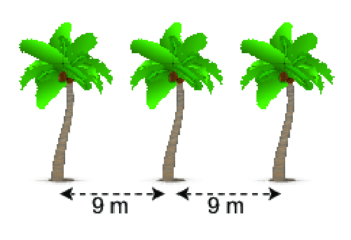
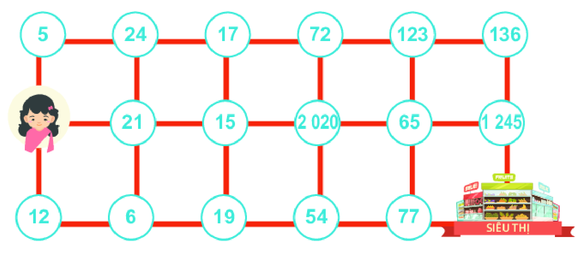

<!-- pdf:38 -->

# BÀI 9: DẤU HIỆU CHIA HẾT

## 🎯 Kiến thức, kĩ năng

- Vận dụng được dấu hiệu chia hết cho $2, 5, 9, 3$ để xác định một số đã cho có chia hết cho $2, 5, 9, 3$ hay không.

## 🔴 Mở đầu

- **Pi:** Tìm số dư của phép chia $71\,001$ cho $9$.
- **Tròn:** Phép chia này không có dư vì $71\,001$ chia hết cho $9$.
- **Vuông:** Sao bạn Tròn trả lời nhanh vậy nhỉ?

## 1. DẤU HIỆU CHIA HẾT CHO 2, CHO 5

Ta có:

$120 = 12 \cdot 10 = 12 \cdot 2 \cdot 5$ chia hết cho $2$ và cho $5$;

$2\,010 = 201 \cdot 10 = 201 \cdot 2 \cdot 5$ chia hết cho $2$ và cho $5$.

Ta nhận thấy các số $120$ và $2\,010$ có chữ số tận cùng là $0$ đều chia hết cho $2$ và $5$. Vậy các số có chữ số tận cùng như thế nào thì chia hết cho $2$? Các số có chữ số tận cùng như thế nào thì chia hết cho $5$?

**Dấu hiệu chia hết cho $2$, cho $5$**

Xét số $n = \overline{23*}$ ($*$ là chữ số tận cùng của $n$). Ta viết $n = 230 + *$.

**HĐ1:** Số $230$ có chia hết cho $2$ và chia hết cho $5$ không?

**HĐ2:** Vận dụng tính chất chia hết của một tổng, hãy cho biết:

a) Thay dấu $*$ bởi chữ số nào thì $n$ chia hết cho $2$?

b) Thay dấu $*$ bởi chữ số nào thì $n$ chia hết cho $5$?

<!-- term: Dấu hiệu chia hết -->
<!-- term: Dấu hiệu chia hết cho 2 -->
> - Các số có chữ số tận cùng là $0, 2, 4, 6, 8$ thì chia hết cho $2$ và chỉ những số đó mới chia hết cho $2$.

<!-- term: Dấu hiệu chia hết -->
<!-- term: Dấu hiệu chia hết cho 5 -->
> - Các số có chữ số tận cùng là $0$ hoặc $5$ thì chia hết cho $5$ và chỉ những số đó mới chia hết cho $5$.

**Ví dụ 1:**

a) Các số $1\,930$, $1\,954$ đều chia hết cho $2$ vì có chữ số tận cùng là số chẵn.

b) Các số $1\,975$; $2\,021$ đều không chia hết cho $2$ vì có chữ số tận cùng là số lẻ.

c) Các số $1\,930$; $1\,945$ đều chia hết cho $5$ vì có chữ số tận cùng là $0$ hoặc $5$.

d) Các số $1\,954$; $1\,972$ đều không chia hết cho $5$ vì có chữ số tận cùng khác $0$ và $5$.

<!-- pdf:39 -->

**Ví dụ 2:** Không thực hiện phép tính, em hãy cho biết tổng (hiệu) sau có chia hết cho $2$ không.

a) $1\,985 + 2\,020$; $\qquad$ b) $1\,968 - 1\,930$.

**Giải:**

a) Số $1\,985$ có chữ số tận cùng là $5$ nên không chia hết cho $2$; số $2\,020$ có chữ số tận cùng là $0$ nên chia hết cho $2$. Vậy tổng $1\,985 + 2\,020$ không chia hết cho $2$.

b) Số $1\,968$ có chữ số tận cùng là $8$ nên chia hết cho $2$; số $1\,930$ có chữ số tận cùng là $0$ nên chia hết cho $2$. Vậy hiệu $1\,968 - 1\,930$ chia hết cho $2$.

**Luyện tập 1:**

1. Không thực hiện phép tính, em hãy cho biết tổng (hiệu) sau có chia hết cho $2$ không.

a) $1\,954 + 1\,975$; $\qquad$ b) $2\,020 - 938$.

2. Không thực hiện phép tính, em hãy cho biết tổng (hiệu) sau có chia hết cho $5$ không.

a) $1\,945 + 2\,020$; $\qquad$ b) $1\,954 - 1\,930$.

## 2. DẤU HIỆU CHIA HẾT CHO 9, CHO 3

Hà nhận thấy số $180$ chia hết cho $9$ và *tổng các chữ số* của nó là $1 + 8 + 0 = 9$ cũng *chia hết cho $9$*. Liệu những số chia hết cho $9$ đều có tính chất này không?

**Dấu hiệu chia hết cho $9$**

Cho các số $27, 82, 195, 234$.

**HĐ3:** Hãy sắp xếp các số trên thành hai nhóm: Nhóm các số chia hết cho $9$ và nhóm các số không chia hết cho $9$.

**HĐ4:** Tính tổng các chữ số của mỗi số và xét tính chia hết cho $9$ của các tổng đó trong mỗi nhóm.

<!-- term: Dấu hiệu chia hết -->
<!-- term: Dấu hiệu chia hết cho 9 -->
> Các số có tổng các chữ số chia hết cho $9$ thì chia hết cho $9$ và chỉ những số đó mới chia hết cho $9$.

**Ví dụ 3:** *Trở lại tình huống mở đầu*, số $71\,001$ có tổng các chữ số chia hết cho $9$ nên $71\,001$ chia hết cho $9$. Như vậy, em đã biết vì sao bạn Tròn trả lời nhanh rồi nhỉ.

**Luyện tập 2:** Thay dấu $*$ bởi một chữ số để được số $\overline{12*}$ chia hết cho $9$.

<!-- pdf:40 -->

**Vận dụng:** Trên một bờ đất dài $108\text{ m}$, một bác nông dân có kế hoạch trồng một số cây dừa thành một hàng sao cho hai cây cách đều nhau là $9\text{ m}$ và luôn có cây ở vị trí đầu và cuối của bờ đất. Hỏi bác nông dân có trồng được như vậy không? Nếu được, bác cần bao nhiêu cây dừa để trồng?

**Dấu hiệu chia hết cho $3$**

Cho các số $42, 80, 191, 234$.

**HĐ5:** Hãy sắp xếp các số trên thành hai nhóm: Nhóm các số chia hết cho $3$ và nhóm các số không chia hết cho $3$.

**HĐ6:** Tính tổng các chữ số của mỗi số và xét tính chia hết cho $3$ của các tổng đó trong mỗi nhóm.

<!-- term: Dấu hiệu chia hết -->
<!-- term: Dấu hiệu chia hết cho 3 -->
> Các số có tổng các chữ số chia hết cho $3$ thì chia hết cho $3$ và chỉ những số đó mới chia hết cho $3$.

**Ví dụ 4:**

a) Các số $4\,683$, $3\,576$ đều chia hết cho $3$ vì có tổng các chữ số chia hết cho $3$.

b) Các số $4\,321$, $1\,975$ đều không chia hết cho $3$ vì có tổng các chữ số không chia hết cho $3$.

**Luyện tập 3:** Thay dấu $*$ bằng một chữ số để số $\overline{12*5}$ chia hết cho $3$.

**Thử thách nhỏ:** Bạn Hà cần tìm đường đến siêu thị. Biết rằng Hà chỉ có thể đi qua ô có chứa số chia hết cho $2$ hoặc chia hết cho $3$ và mỗi ô chỉ đi qua một lần. Em hãy giúp Hà đến được siêu thị nhé.

<!-- pdf:41 -->

## BÀI TẬP

2.10. Trong các số sau, số nào chia hết cho $2$, số nào chia hết cho $5$?

$324; 248; 2\,020; 2\,025.$

2.11. Trong các số sau, số nào chia hết cho $3$, số nào chia hết cho $9$?

$450; 123; 2\,019; 2\,025.$

2.12. Khối lớp $6$ của một trường có $290$ học sinh đi dã ngoại. Cô phụ trách muốn chia đều số học sinh của khối $6$ thành $9$ nhóm. Hỏi cô có chia nhóm được như vậy không?

2.13. Có $162$ học sinh tham gia chương trình đào tạo bóng đá, được chia thành các đội. Mỗi đội cần có $9$ học sinh. Hỏi có đội nào không có đủ $9$ học sinh hay không?

2.14. Thay dấu $*$ bởi một chữ số để số $\overline{345*}$:

a) Chia hết cho $2$; $\qquad$ b) Chia hết cho $3$;

c) Chia hết cho $5$; $\qquad$ d) Chia hết cho $9$.

2.15. Dùng ba chữ số $3, 0, 4$, hãy viết các số tự nhiên có ba chữ số khác nhau và thoả mãn một trong hai điều kiện:

a) Các số đó chia hết cho $2$;

b) Các số đó chia hết cho $5$.

2.16. Từ các chữ số $5, 0, 4, 2$, viết các số tự nhiên có ba chữ số khác nhau sao cho mỗi số đó chia hết cho $3$.

## 💡 Em có biết?

Xét số $234$, ta thấy $234 = 2 \cdot 100 + 3 \cdot 10 + 4$.

Viết $100$ thành $99 + 1$, $10$ thành $9 + 1$, ta được
<!-- ocr-ok: đã đối chiếu trực tiếp ảnh trang PDF 41, khớp 100% chữ gốc (OCR rơi số hiệu màu nhạt / công thức / bảng) -->

$234 = 2(99 + 1) + 3(9 + 1) + 4 = 2 \cdot 99 + 2 + 3 \cdot 9 + 3 + 4$

$= 2 \cdot 9 \cdot 11 + 2 + 3 \cdot 9 + 3 + 4$

$= \underbrace{(2 + 3 + 4)}_{\text{Tổng các chữ số}} + \underbrace{(2 \cdot 9 \cdot 11 + 3 \cdot 9)}_{\text{Số chia hết cho } 9}$

Vậy số $234$ được viết thành tổng các chữ số của nó và một số chia hết cho $9$.

Các số tự nhiên khác cũng như vậy. Từ đó ta suy ra được dấu hiệu chia hết cho $9$ và cho $3$.

> **Pi:** Một số tự nhiên luôn viết được thành tổng các chữ số của nó và một số chia hết cho $9$.

## 📷 Danh sách hình trong bài

| Mã hình | Trang PDF | Vị trí trong bài | Chú thích gốc |
| --- | :---: | --- | --- |
| H6-toan-b09-01 | 40 | Mục 2, Vận dụng | (sách không đánh số, hình minh hoạ hàng cây dừa cách đều nhau $9\text{ m}$) |
| H6-toan-b09-02 | 40 | Mục 2, Thử thách nhỏ | (sách không đánh số, sơ đồ các ô số trên đường đến siêu thị) |
