<!-- pdf:42 -->

# BÀI 10: SỐ NGUYÊN TỐ

## 🔤 Khái niệm, thuật ngữ

- Số nguyên tố
- Hợp số

## 🎯 Kiến thức, kĩ năng

- Nhận biết khái niệm số nguyên tố và hợp số.
- Phân tích một số tự nhiên lớn hơn $1$ ra thừa số nguyên tố trong những trường hợp đơn giản.

## 🔴 Mở đầu

Mẹ mua một bó hoa có $11$ bông hoa hồng. Bạn Mai giúp mẹ cắm các bông hoa này vào các lọ nhỏ sao cho số hoa trong mỗi lọ là như nhau. Mai nhận thấy không thể cắm đều số bông hoa này vào các lọ hoa (mỗi lọ có nhiều hơn $1$ bông) cho dù số lọ hoa là $2; 3; 4; 5; \dots$ Nhưng nếu bỏ ra $1$ bông còn $10$ bông thì lại cắm đều được vào $2$ lọ, mỗi lọ có $5$ bông hoa.

Vậy, số $11$ và số $10$ có gì khác nhau, điều này có liên quan gì đến số các ước của chúng không?

## 1. SỐ NGUYÊN TỐ VÀ HỢP SỐ

**Chia nhóm các số tự nhiên theo số ước**

**HĐ1:** Tìm các ước và số ước của các số trong bảng bên.

**HĐ2:** Hãy chia các số cho trong bảng $2.1$ thành hai nhóm: nhóm $A$ gồm các số chỉ có hai ước, nhóm $B$ gồm các số có nhiều hơn hai ước.

**HĐ3:** Suy nghĩ và trả lời câu hỏi:

a) Số $1$ có bao nhiêu ước?

b) Số $0$ có chia hết cho $2, 5, 7, 2\,017, 2\,018$ không? Em có nhận xét gì về số ước của $0$?

| Số | Các ước | Số ước |
| :---: | :---: | :---: |
| $2$ | $?$ | $?$ |
| $3$ | $?$ | $?$ |
| $4$ | $?$ | $?$ |
| $5$ | $?$ | $?$ |
| $6$ | $?$ | $?$ |
| $7$ | $?$ | $?$ |
| $8$ | $?$ | $?$ |
| $9$ | $?$ | $?$ |
| $10$ | $1, 2, 5, 10$ | $4$ |
| $11$ | $1, 11$ | $2$ |

*Bảng 2.1*

> **Tròn:** Số $11$ chỉ có hai ước, số $10$ lại có bốn ước.
<!-- ocr-ok: đã đối chiếu trực tiếp ảnh trang PDF 42, khớp 100% chữ gốc (OCR rơi số hiệu màu nhạt / công thức / bảng) -->

> - **Số nguyên tố** là số tự nhiên lớn hơn $1$, chỉ có hai ước là $1$ và chính nó.
> - **Hợp số** là số tự nhiên lớn hơn $1$, có nhiều hơn hai ước.

> **Pi:** Số $0$ và số $1$ không là số nguyên tố và không là hợp số.

<!-- pdf:43 -->

**Luyện tập 1:** Em hãy tìm nhà thích hợp cho các số trong bảng $2.1$.

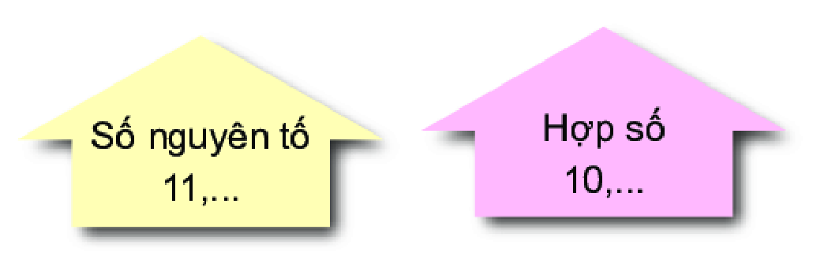

**Ví dụ 1:** Số nào dưới đây là số nguyên tố, số nào là hợp số? Vì sao?

a) $1\,975$; $\qquad$ b) $17$.

**Giải:**

a) Số $1\,975$ có tận cùng là $5$ nên nó chia hết cho $5$. Do đó, ngoài hai ước là $1$ và $1\,975$ nó còn có thêm ước là $5$. Vậy, $1\,975$ là hợp số.

b) Số $17$ chỉ có hai ước là $1$ và $17$ nên nó là số nguyên tố.

> **Pi:** Để khẳng định một số là hợp số, ta thường sử dụng các dấu hiệu chia hết để tìm ra một ước khác $1$ và chính nó.

**Luyện tập 2:** Trong các số cho dưới đây, số nào là số nguyên tố, số nào là hợp số? Vì sao?

a) $1\,930$; $\qquad$ b) $23$.

**Thử thách nhỏ:** Bạn Hà đang ở ô tìm đường đến phòng chiếu phim $2$. Biết rằng chỉ có thể đi từ một ô sang ô chung cạnh có chứa số nguyên tố. Em hãy giúp Hà đến được phòng chiếu phim nhé.

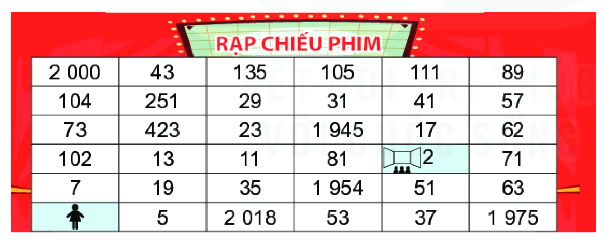

> **Tròn:** Để biết một số tự nhiên nhỏ hơn $1\,000$ có là số nguyên tố hay không, bạn có thể tra bảng số nguyên tố ở cuối sách.

## 2. PHÂN TÍCH MỘT SỐ RA THỪA SỐ NGUYÊN TỐ

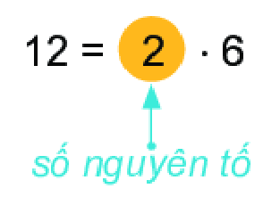

> **Tròn:** $2$ là **ước nguyên tố** của $12$ hay $2$ là một **thừa số nguyên tố** của tích $2 \cdot 6$.
<!-- ocr-ok: đã đối chiếu trực tiếp ảnh trang PDF 43, khớp 100% chữ gốc (OCR rơi số hiệu màu nhạt / công thức / bảng) -->

<!-- pdf:44 -->

**Phân tích một số tự nhiên ra thừa số nguyên tố**

<!-- term: Phân tích một số ra thừa số nguyên tố -->
- Mọi hợp số đều có thể phân tích được thành tích của các thừa số nguyên tố. Ví dụ, ta phân tích số $24$ như sau:

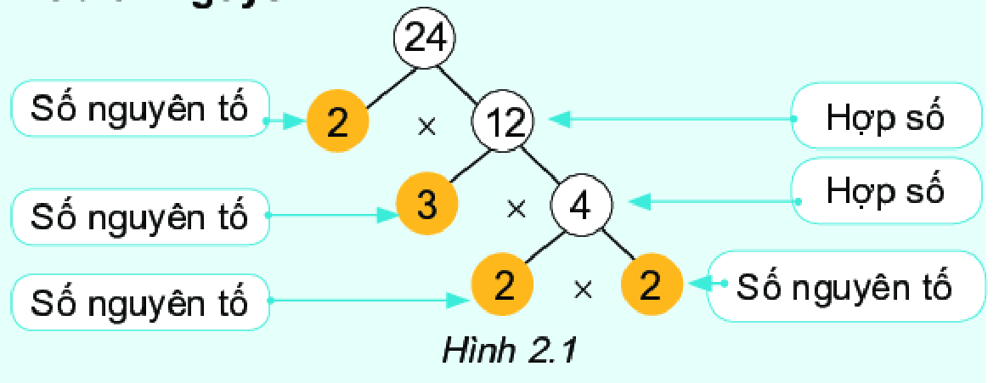
*Hình 2.1*

Ta nói rằng ta đã *phân tích số $24$ ra thừa số nguyên tố*, được kết quả

$24 = 2 \cdot 3 \cdot 2 \cdot 2 = 2 \cdot 2 \cdot 2 \cdot 3$ và được viết gọn là $24 = 2^3 \cdot 3$.

<!-- term: Phân tích một số ra thừa số nguyên tố -->
- Người ta quy ước dạng phân tích ra thừa số nguyên tố của một số nguyên tố là chính nó.
- Khi phân tích một số ra thừa số nguyên tố, trong kết quả ta thường viết các thừa số theo thứ tự từ bé đến lớn và tích các thừa số giống nhau dưới dạng luỹ thừa.

> ❓ Bạn Việt phân tích số $60$ ra thừa số nguyên tố và cho kết quả $60 = 3 \cdot 4 \cdot 5$. Kết quả của Việt đúng hay sai? Nếu sai, em hãy sửa lại cho đúng.

**Tranh luận:** Bạn nào đúng nhỉ?

- **Tròn:** Số $7$ không phân tích được thành tích các thừa số nguyên tố.
- **Vuông:** Phân tích ra thừa số nguyên tố của số $7$ là $7$.

**Phương pháp phân tích theo sơ đồ cây**

Quá trình phân tích số $24$ ra thừa số nguyên tố như trên có thể được trình bày dưới dạng một sơ đồ như hình $2.1$ gọi là **sơ đồ cây**.

Số $24$ còn có thể phân tích ra thừa số nguyên tố theo sơ đồ cây khác như hình $2.2$.

Vậy, $24 = 2 \cdot 2 \cdot 2 \cdot 3 = 2^3 \cdot 3$.

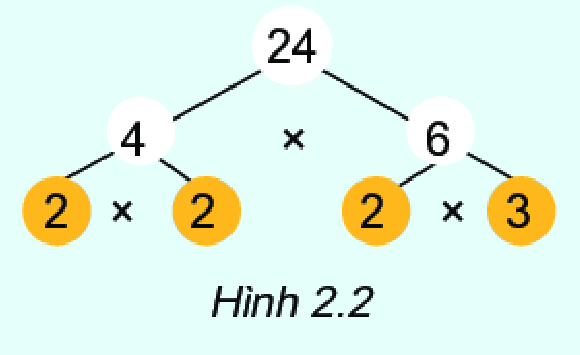
*Hình 2.2*

> ❓ Tìm các số còn thiếu trong phân tích số $18$ ra thừa số nguyên tố theo sơ đồ cây ở hình $2.3$.

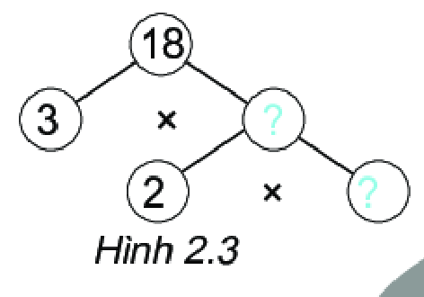
*Hình 2.3*

<!-- pdf:45 -->

**Phương pháp phân tích theo sơ đồ cột**

Ta còn có thể phân tích một số ra thừa số nguyên tố theo sơ đồ cột. Ví dụ, ta phân tích số $24$ thành tích các thừa số nguyên tố theo cách làm như sau:

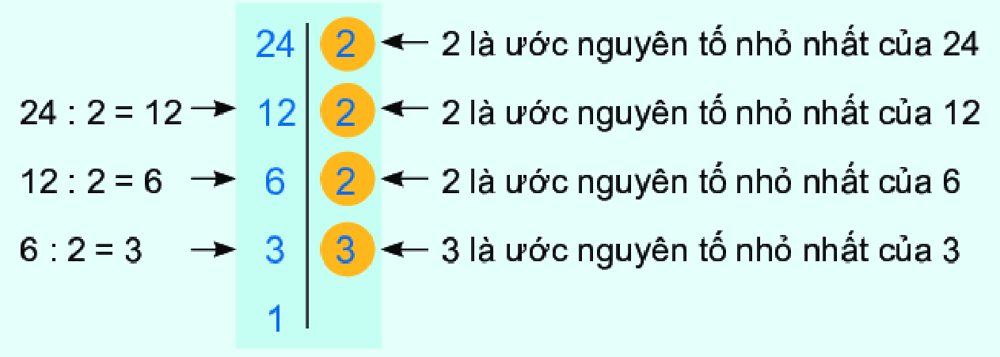

Vậy, $24 = 2^3 \cdot 3$.

Sơ đồ phân tích số $24$ thành tích các thừa số nguyên tố như trên được gọi là **sơ đồ cột**.

**Nhận xét:** Trong hai cách phân tích số $24$ ra thừa số nguyên tố, nếu viết các thừa số nguyên tố theo thứ tự từ bé đến lớn và tích các thừa số nguyên tố giống nhau dưới dạng luỹ thừa thì dù phân tích bằng cách nào, ta cũng nhận được cùng một kết quả.

> ❓ Tìm các số còn thiếu trong phân tích số $30$ ra thừa số nguyên tố theo sơ đồ cột ở hình bên.

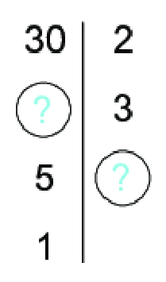

**Ví dụ 2:** Phân tích số $70$ ra thừa số nguyên tố theo sơ đồ cột.

Vậy, $70 = 2 \cdot 5 \cdot 7$.

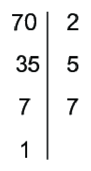

**Luyện tập 3:** Phân tích các số sau ra thừa số nguyên tố theo sơ đồ cột:

a) $36$; $\qquad$ b) $105$.

## BÀI TẬP

2.17. Phân tích các số sau ra thừa số nguyên tố: $70; 115$.

2.18. Kết quả phân tích các số $120; 102$ ra thừa số nguyên tố của bạn Nam như sau:

$120 = 2 \cdot 3 \cdot 4 \cdot 5$; $102 = 2 \cdot 51$.

Theo em, kết quả của Nam đúng hay sai? Nếu sai, em hãy sửa lại cho đúng.

2.19. Các khẳng định sau đúng hay sai? Vì sao?

a) Ước nguyên tố của $30$ là $5$ và $6$;

b) Tích của hai số nguyên tố bất kì luôn là số lẻ;

c) Ước nguyên tố nhỏ nhất của số chẵn là $2$;

d) Mọi bội của $3$ đều là hợp số;

e) Mọi số chẵn đều là hợp số.

<!-- pdf:46 -->

2.20. Kiểm tra xem các số sau là số nguyên tố hay hợp số bằng cách dùng dấu hiệu chia hết hoặc tra bảng số nguyên tố:

$89; 97; 125; 541; 2\,013; 2\,018.$

2.21. Hãy phân tích $A$ ra thừa số nguyên tố:

$A = 4^4 \cdot 9^5.$

2.22. Tìm các số còn thiếu trong các sơ đồ phân tích một số ra thừa số nguyên tố sau:

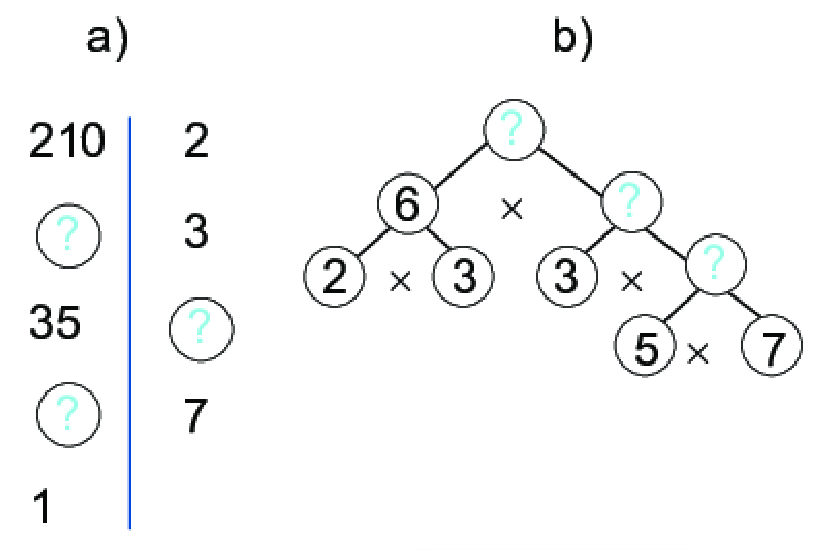

2.23. Một lớp có $30$ học sinh. Cô giáo muốn chia lớp thành các nhóm để thực hiện các dự án học tập nhỏ. Biết rằng, các nhóm đều có số người bằng nhau và có nhiều hơn $1$ người trong mỗi nhóm. Hỏi mỗi nhóm có thể có bao nhiêu người?

2.24. Trong nghi lễ thượng cờ lúc $6$ giờ sáng và hạ cờ lúc $21$ giờ hằng ngày ở Quảng trường Ba Đình, đội tiêu binh có $34$ người gồm $1$ sĩ quan chỉ huy đứng đầu và $33$ chiến sĩ. Hỏi có bao nhiêu cách sắp xếp $33$ chiến sĩ thành các hàng sao cho mỗi hàng có số người như nhau?

*Lễ thượng cờ ở Quảng trường Ba Đình*

## 💡 Em có biết?

**Sàng Eratosthenes** (đọc là Ơ-ra-tô-xten) là một thuật toán cổ để tìm các số nguyên tố nhỏ hơn hoặc bằng một số tự nhiên $N$ cho trước. Thuật toán này dựa theo ý tưởng của nhà toán học cổ Hi Lạp là Eratosthenes. Chẳng hạn, để tìm các số nguyên tố nhỏ hơn $50$, ta làm như sau:

*Bước 1.* Lập bảng các số từ $1$ đến $50$.

*Bước 2.* Gạch bỏ số $1$. Ta được $2$ là số nguyên tố. Gạch tất cả các số lớn hơn $2$ và là bội của $2$.

*Bước 3.* Số nguyên tố tiếp theo là $3$. Gạch tất cả các số lớn hơn $3$ và là bội của $3$.

*Bước 4.* Số nguyên tố tiếp theo là $5$. Gạch tất cả các số lớn hơn $5$ và là bội của $5$.

*Bước 5.* Số nguyên tố tiếp theo là $7$. Gạch tất cả các số lớn hơn $7$ và là bội của $7$.

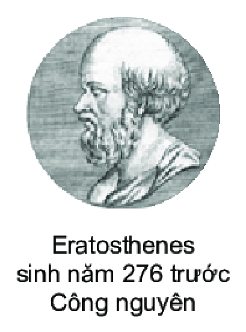
*Eratosthenes sinh năm 276 trước Công nguyên*

Các số không bị gạch trong bảng chính là các số nguyên tố.

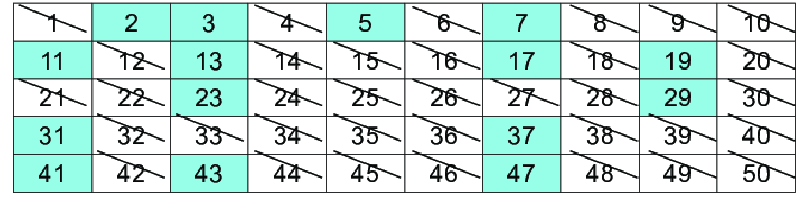

Cách làm như trên giống như việc dùng một cái sàng để loại bỏ số $1$ và các hợp số. Do đó nó có tên là sàng Eratosthenes.

## 📷 Danh sách hình trong bài

| Mã hình | Trang PDF | Vị trí trong bài | Chú thích gốc |
| --- | :---: | --- | --- |
| H6-toan-b10-01 | 42 | Mở đầu | (sách không đánh số, hình hai lọ hoa hồng và một bông hoa lẻ) |
| H6-toan-b10-02 | 43 | Mục 1, Luyện tập 1 | (sách không đánh số, hình nhà Số nguyên tố và nhà Hợp số) |
| H6-toan-b10-03 | 43 | Mục 1, Thử thách nhỏ | (sách không đánh số, bảng các ô số dẫn đến Rạp chiếu phim) |
| H6-toan-b10-04 | 43 | Mục 2 | (sách không đánh số, sơ đồ minh hoạ $12 = 2 \cdot 6$ với $2$ là số nguyên tố) |
| H6-toan-b10-05 | 44 | Mục 2, Phân tích một số tự nhiên ra thừa số nguyên tố | Hình 2.1 |
| H6-toan-b10-06 | 44 | Mục 2, Phương pháp phân tích theo sơ đồ cây | Hình 2.2 |
| H6-toan-b10-07 | 44 | Mục 2, Câu hỏi | Hình 2.3 |
| H6-toan-b10-08 | 45 | Mục 2, Phương pháp phân tích theo sơ đồ cột | (sách không đánh số, sơ đồ cột phân tích số $24$) |
| H6-toan-b10-09 | 45 | Mục 2, Câu hỏi | (sách không đánh số, sơ đồ cột phân tích số $30$) |
| H6-toan-b10-10 | 45 | Mục 2, Ví dụ 2 | (sách không đánh số, sơ đồ cột phân tích số $70$) |
| H6-toan-b10-11 | 46 | Bài tập, Bài 2.22 | (sách không đánh số, sơ đồ cột câu a và sơ đồ cây câu b) |
| H6-toan-b10-12 | 46 | Bài tập, Bài 2.24 | Lễ thượng cờ ở Quảng trường Ba Đình |
| H6-toan-b10-13 | 46 | Em có biết? | Eratosthenes sinh năm 276 trước Công nguyên |
| H6-toan-b10-14 | 46 | Em có biết? | (sách không đánh số, bảng sàng Eratosthenes các số từ $1$ đến $50$) |
