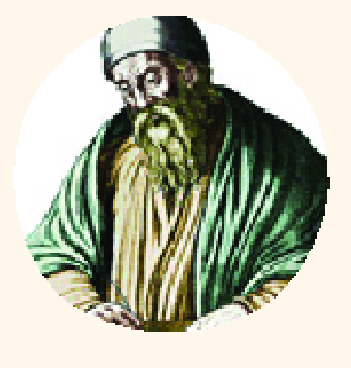

<!-- pdf:49 -->

# BÀI 11: ƯỚC CHUNG. ƯỚC CHUNG LỚN NHẤT

## 🔤 Khái niệm, thuật ngữ

- Ước chung
- Ước chung lớn nhất
- Hai số nguyên tố cùng nhau
- Phân số tối giản

## 🎯 Kiến thức, kĩ năng

- Xác định ước chung, ước chung lớn nhất của hai hoặc ba số tự nhiên đã cho.
- Nhận biết phân số tối giản.

## 🔴 Mở đầu

Một bác thợ mộc muốn làm kệ để đồ từ hai tấm gỗ dài $18\text{ dm}$ và $30\text{ dm}$. Bác muốn cắt hai tấm gỗ này thành các thanh gỗ có cùng độ dài mà không để thừa mẩu gỗ nào. Em hãy giúp bác thợ mộc tìm độ dài lớn nhất có thể của mỗi thanh gỗ được cắt.

## 1. ƯỚC CHUNG VÀ ƯỚC CHUNG LỚN NHẤT

**Ước chung và ước chung lớn nhất của hai hay nhiều số**

**HĐ1:** Tìm các tập hợp $\text{Ư}(24)$ và $\text{Ư}(28)$.
<!-- ocr-ok: đã đối chiếu trực tiếp ảnh trang PDF 49, khớp 100% chữ gốc (OCR rơi số hiệu màu nhạt / công thức / bảng) -->

**HĐ2:** Gọi $\text{ƯC}(24, 28)$ là tập hợp các số vừa là ước của $24$, vừa là ước của $28$. Hãy viết tập hợp $\text{ƯC}(24, 28)$.

**HĐ3:** Tìm số lớn nhất trong tập $\text{ƯC}(24, 28)$.

> **Ước chung** của hai hay nhiều số là ước của tất cả các số đó.
>
> **Ước chung lớn nhất** của hai hay nhiều số là số lớn nhất trong tập hợp các ước chung của các số đó.

> **Tròn:** $\text{ƯC}(a, b)$ là một tập hợp; $\text{ƯCLN}(a, b)$ là một số.
<!-- ocr-ok: đã đối chiếu trực tiếp ảnh trang PDF 49, khớp 100% chữ gốc (OCR rơi số hiệu màu nhạt / công thức / bảng) -->

Ta kí hiệu:

- $\text{ƯC}(a, b)$ là tập hợp các ước chung của $a$ và $b$;
- $\text{ƯCLN}(a, b)$ là ước chung lớn nhất của $a$ và $b$.

**Chú ý:** Ta chỉ xét ước chung của các số khác $0$.

**Ví dụ 1:**

Ta có $\text{Ư}(18) = \{1; 2; 3; 6; 9; 18\}$,

$\text{Ư}(30) = \{1; 2; 3; 5; 6; 10; 15; 30\}$.

Các số $1, 2, 3, 6$ đều là ước của hai số $18$ và $30$ nên

$\text{ƯC}(18, 30) = \{1; 2; 3; 6\}.$

Vì $6$ là số lớn nhất trong các ước chung nên $\text{ƯCLN}(18, 30) = 6$.

> **Tròn:** $x \in \text{ƯC}(a, b, c)$ nếu $a \vdots x$, $b \vdots x$ và $c \vdots x$.

**Ví dụ 2:** *Trở lại bài toán mở đầu*, độ dài lớn nhất (đơn vị $\text{dm}$) của mỗi thanh gỗ được cắt chính là ước chung lớn nhất của $18$ và $30$. Vậy, bác thợ mộc nên cắt các tấm gỗ thành các thanh gỗ dài $6\text{ dm}$.

<!-- pdf:50 -->

**Tìm ƯCLN trong trường hợp đặc biệt**

- **Pi:** Các em hãy tìm $\text{ƯCLN}(6, 18)$.
- **Tròn:** Ta có $\text{Ư}(6) = \{1; 2; 3; 6\}$, $\text{Ư}(18) = \{1; 2; 3; 6; 9; 18\}$ nên $\text{ƯC}(6, 18) = \{1; 2; 3; 6\}$, do đó $\text{ƯCLN}(6, 18) = 6$.
- **Vuông:** Em có cách khác ngắn hơn. Vì $18 \vdots 6$ nên ta có $\text{ƯCLN}(6, 18) = 6$.
- **Pi:** Em sẽ chọn cách làm của bạn nào?
<!-- ocr-ok: đã đối chiếu trực tiếp ảnh trang PDF 50, khớp 100% chữ gốc (OCR rơi số hiệu màu nhạt / công thức / bảng) -->

<!-- term: Ước chung lớn nhất trong trường hợp đặc biệt -->
> **Nhận xét:**
> - Trong các số đã cho, nếu số nhỏ nhất là ước của các số còn lại thì ƯCLN của các số đã cho chính là số nhỏ nhất ấy.
>   Nếu $a \vdots b$ thì $\text{ƯCLN}(a, b) = b$.
> - Số $1$ chỉ có một ước là $1$. Do đó với mọi số tự nhiên $a$ và $b$, ta có
>   $\text{ƯCLN}(a, 1) = 1$; $\text{ƯCLN}(a, b, 1) = 1$.

> ❓ Tìm $\text{ƯCLN}(90, 10)$.

**Luyện tập 1:** Bố có $12$ quả bóng màu xanh và $15$ quả bóng màu đỏ. Bố muốn chia số bóng cho ba anh em Việt, Hà và Nam đều như nhau gồm cả bóng màu xanh và bóng màu đỏ. Hỏi bố có thực hiện được điều đó hay không?

**Vận dụng 1:** Tuần này lớp 6A và 6B gồm $40$ học sinh nữ và $36$ học sinh nam được phân công đi thu gom rác làm sạch bờ biển ở địa phương. Nếu chia nhóm sao cho số học sinh nam và nữ trong các nhóm bằng nhau thì:

a) Có thể chia được thành bao nhiêu nhóm học sinh?

b) Có thể chia nhiều nhất bao nhiêu nhóm học sinh?

## 2. CÁCH TÌM ƯỚC CHUNG LỚN NHẤT

$\text{ƯCLN}(a, b)$ là ước của $a$ và $b$ nên các thừa số nguyên tố của $\text{ƯCLN}(a, b)$ là thừa số nguyên tố chung của $a$ và $b$. Vì vậy, để tìm $\text{ƯCLN}(a, b)$ ta cần phân tích $a$ và $b$ ra thừa số nguyên tố.

**Tìm ước chung lớn nhất bằng cách phân tích các số ra thừa số nguyên tố**

Để tìm $\text{ƯCLN}(24, 60)$, ta làm như sau:

1. Phân tích các số $24$ và $60$ ra thừa số nguyên tố, ta được:

   $24 = 2 \cdot 2 \cdot 2 \cdot 3 = 2^3 \cdot 3$;

   $60 = 2 \cdot 2 \cdot 3 \cdot 5 = 2^2 \cdot 3 \cdot 5$.

2. Ta thấy $2$ và $3$ là các thừa số nguyên tố chung của $24$ và $60$.

3. Trong các phân tích ra thừa số nguyên tố của $24$ và $60$, *số mũ nhỏ nhất* của thừa số chung $2$ là $2$, *số mũ nhỏ nhất* của thừa số chung $3$ là $1$ nên $\text{ƯCLN}(24, 60) = 2^2 \cdot 3 = 12$.

<!-- pdf:51 -->

<!-- term: Cách tìm ước chung lớn nhất -->
> Các bước tìm ƯCLN của hai hay nhiều số lớn hơn $1$:
> 1. Phân tích mỗi số ra thừa số nguyên tố;
> 2. Chọn ra các thừa số nguyên tố chung;
> 3. Lập tích các thừa số đã chọn, mỗi thừa số lấy với số mũ nhỏ nhất. Tích đó là ƯCLN phải tìm.

> ❓ Tìm $\text{ƯCLN}(45, 150)$, biết $45 = 3^2 \cdot 5$ và $150 = 2 \cdot 3 \cdot 5^2$.

**Ví dụ 3:** Tìm $\text{ƯCLN}(56, 140, 168)$ bằng cách phân tích ra thừa số nguyên tố.

**Giải:** Phân tích các số $56, 140$ và $168$ ra thừa số nguyên tố ta được:

$56 = 2^3 \cdot 7; \qquad 140 = 2^2 \cdot 5 \cdot 7; \qquad 168 = 2^3 \cdot 3 \cdot 7.$

Ta thấy $2$ và $7$ là các thừa số nguyên tố chung của $56, 140$ và $168$. Số mũ nhỏ nhất của $2$ là $2$ và số mũ nhỏ nhất của $7$ là $1$ nên
<!-- ocr-ok: đã đối chiếu trực tiếp ảnh trang PDF 51, khớp 100% chữ gốc (OCR rơi số hiệu màu nhạt / công thức / bảng) -->

$\text{ƯCLN}(56, 140, 168) = 2^2 \cdot 7 = 28.$

**Luyện tập 2:** Tìm $\text{ƯCLN}(36, 84)$.

**Vận dụng 2:** Một đại đội bộ binh có ba trung đội: trung đội I có $24$ chiến sĩ, trung đội II có $28$ chiến sĩ, trung đội III có $36$ chiến sĩ. Trong cuộc diễu binh, cả ba trung đội phải xếp thành các hàng dọc đều nhau mà không có chiến sĩ nào trong mỗi trung đội bị lẻ hàng. Hỏi có thể xếp được nhiều nhất bao nhiêu hàng dọc?

**Tìm ước chung từ ước chung lớn nhất**

Ta đã biết $\text{ƯC}(24, 28) = \{1; 2; 4\}$ và $\text{ƯCLN}(24, 28) = 4$.

Ta thấy $1, 2, 4$ là tất cả ước của $4$.

<!-- term: Cách tìm ước chung từ ước chung lớn nhất -->
> Để tìm ước chung của các số, ta có thể làm như sau:
> 1. Tìm ƯCLN của các số đó.
> 2. Tìm các ước của ƯCLN đó.

> ❓ Biết $\text{ƯCLN}(75, 105) = 15$, hãy tìm $\text{ƯC}(75, 105)$.

**Ví dụ 4:** Tìm $\text{ƯC}(75, 105, 120)$.

**Giải:** Phân tích các số $75, 105$ và $120$ ra thừa số nguyên tố:

$75 = 3 \cdot 5^2; \qquad 105 = 3 \cdot 5 \cdot 7; \qquad 120 = 2^3 \cdot 3 \cdot 5.$

Ta chọn ra các thừa số nguyên tố chung, đó là $3$ và $5$.

Số mũ nhỏ nhất của $3$ là $1$, số mũ nhỏ nhất của $5$ là $1$. Khi đó $\text{ƯCLN}(75, 105, 120) = 3 \cdot 5 = 15$. Các ước của $15$ là $1, 3, 5, 15$.
<!-- ocr-ok: đã đối chiếu trực tiếp ảnh trang PDF 51, khớp 100% chữ gốc (OCR rơi số hiệu màu nhạt / công thức / bảng) -->

Vậy $\text{ƯC}(75, 105, 120) = \{1; 3; 5; 15\}$.

> **Pi:** Khi tìm ước chung của các số, người ta thường dựa vào ƯCLN của chúng.

<!-- pdf:52 -->

**Thử thách nhỏ:** Vào ngày thứ Bảy, cô Lan tổ chức cho học sinh đi tham quan Bảo tàng Dân tộc học. Các học sinh đóng tiền mua vé, mỗi em một vé. Số tiền cô Lan thu được từng ngày được ghi lại ở bảng bên.

a) Hỏi số tiền để mua một vé (giá vé được tính theo đơn vị nghìn đồng) có thể là bao nhiêu, biết giá vé lớn hơn $2\,000$ đồng?

b) Có bao nhiêu học sinh tham gia chuyến đi, biết số học sinh trong lớp trong khoảng từ $20$ đến $40$ người?

| Ngày | Số tiền đóng (đồng) |
| --- | :---: |
| Thứ Hai | $56\,000$ |
| Thứ Ba | $28\,000$ |
| Thứ Tư | $42\,000$ |
| Thứ Năm | $98\,000$ |
<!-- ocr-ok: đã đối chiếu trực tiếp ảnh trang PDF 52, khớp 100% chữ gốc (OCR rơi số hiệu màu nhạt / công thức / bảng) -->

## 3. PHÂN SỐ TỐI GIẢN

**Rút gọn về phân số tối giản**

- Ta **rút gọn phân số** bằng cách chia cả tử và mẫu của phân số đó cho một ước chung khác $1$ (nếu có).
- Phân số $\frac{a}{b}$ được gọi là **phân số tối giản** nếu $a$ và $b$ không có ước chung nào khác $1$, nghĩa là $\text{ƯCLN}(a, b) = 1$.

  *Chẳng hạn*, rút gọn phân số $\frac{18}{30}$ bằng cách chia cả tử và mẫu cho $3$, ta được $\frac{6}{10}$. Ta thấy $\frac{6}{10}$ chưa là phân số tối giản, ta rút gọn tiếp bằng cách chia cả tử và mẫu cho $2$. Khi đó ta được phân số tối giản $\frac{3}{5}$.

- Để đưa một phân số chưa tối giản $\frac{a}{b}$ về phân số tối giản, ta chia cả tử và mẫu cho $\text{ƯCLN}(a, b)$.

  *Chẳng hạn*, phân số $\frac{18}{30}$ chưa là phân số tối giản và $\text{ƯCLN}(18, 30) = 6$ nên

  $\frac{18}{30} = \frac{18 : 6}{30 : 6} = \frac{3}{5}. \text{ Ta có } \frac{3}{5} \text{ là phân số tối giản.}$

> ❓ Phân số $\frac{16}{10}$ đã là phân số tối giản chưa? Nếu chưa, hãy rút gọn về phân số tối giản.

**Ví dụ 5:** Các phân số sau đã là phân số tối giản chưa? Nếu chưa, hãy rút gọn về phân số tối giản:

a) $\frac{8}{5}$; $\qquad$ b) $\frac{36}{54}$.

**Giải:**

a) Ta có $\text{ƯCLN}(8, 5) = 1$, nên $\frac{8}{5}$ là phân số tối giản.

b) $\text{ƯCLN}(36, 54) = 18$, nên $\frac{36}{54}$ không là phân số tối giản.

Ta có $\frac{36}{54} = \frac{36 : 18}{54 : 18} = \frac{2}{3}$. Ta được $\frac{2}{3}$ là phân số tối giản.

> **Tròn:** Nếu $\text{ƯCLN}(a, b) = 1$ thì hai số $a, b$ được gọi là **hai số nguyên tố cùng nhau**.

<!-- pdf:53 -->

**Luyện tập 3:** Rút gọn về phân số tối giản: $\quad$ a) $\frac{90}{27}$; $\qquad$ b) $\frac{50}{125}$.

## BÀI TẬP

2.30. Tìm tập hợp ước chung của:

a) $30$ và $45$; $\qquad$ b) $42$ và $70$.

2.31. Tìm ƯCLN của hai số:

a) $40$ và $70$; $\qquad$ b) $55$ và $77$.

2.32. Tìm ƯCLN của:
<!-- ocr-ok: đã đối chiếu trực tiếp ảnh trang PDF 53, khớp 100% chữ gốc (OCR rơi số hiệu màu nhạt / công thức / bảng) -->

a) $2^2 \cdot 5$ và $2 \cdot 3 \cdot 5$;

b) $2^4 \cdot 3$; $2^2 \cdot 3^2 \cdot 5$ và $2^4 \cdot 11$.

2.33. Cho hai số $a = 72$ và $b = 96$.
<!-- ocr-ok: đã đối chiếu trực tiếp ảnh trang PDF 53, khớp 100% chữ gốc (OCR rơi số hiệu màu nhạt / công thức / bảng) -->

a) Phân tích $a$ và $b$ ra thừa số nguyên tố;

b) Tìm $\text{ƯCLN}(a, b)$, rồi tìm $\text{ƯC}(a, b)$.

2.34. Các phân số sau đã là phân số tối giản chưa? Nếu chưa, hãy rút gọn về phân số tối giản:

a) $\frac{50}{85}$; $\qquad$ b) $\frac{23}{81}$.

2.35. Hãy cho hai ví dụ về hai số có ƯCLN bằng $1$ mà cả hai đều là hợp số.

## 💡 Em có biết?

Tìm ước chung lớn nhất bằng nhận xét sau:

Nếu $a, b$ là hai số tự nhiên với $a \ge b$ và $a = bq + r$, $r$ là số dư của phép chia $a$ cho $b$ thì $\text{ƯCLN}(a, b) = \text{ƯCLN}(b, r)$.

**THUẬT TOÁN EUCLID (Ơ-CLÍT)**

*Bước 1.* Thực hiện phép chia $a$ cho $b$:

$a = bq + r$ với $r < b$ là số dư của phép chia này.

Nếu $r = 0$ thì $a \vdots b$, do đó $\text{ƯCLN}(a, b) = b$.

Nếu $r \ne 0$ thì $\text{ƯCLN}(a, b) = \text{ƯCLN}(b, r)$.

Sau Bước $1$, chúng ta đã chuyển việc tìm ƯCLN của hai số $a$ và $b$ về việc tìm ƯCLN của hai số nhỏ hơn là $b$ và $r$.

*Bước 2.* Thực hiện các phép toán như Bước $1$, tức là thực hiện phép chia $b$ cho $r$.

$b = rs + t$ với $t < r$.

Nếu $t = 0$ thì $b \vdots r$, do đó $\text{ƯCLN}(b, r) = r$.

Nếu $t \ne 0$ thì $\text{ƯCLN}(b, r) = \text{ƯCLN}(r, t)$.

Quá trình này tiếp tục đến khi phép chia không còn dư. Khi đó ƯCLN chính là số chia của phép chia không còn dư đó.

Ví dụ, để tìm $\text{ƯCLN}(4\,836, 234)$ người ta thực hiện các phép chia $4\,836$ cho $234$ (dư $156$); Thực hiện phép chia $234$ cho $156$, (dư $78$). Vì $156$ chia hết cho $78$, suy ra $\text{ƯCLN}(4\,836, 234) = 78$.
<!-- ocr-ok: đã đối chiếu trực tiếp ảnh trang PDF 53, khớp 100% chữ gốc (OCR rơi số hiệu màu nhạt / công thức / bảng) -->

> **Thuật toán Euclid** là thuật toán thông dụng được dùng để tìm ƯCLN. Thuật toán này được viết bởi Euclid - nhà toán học người Hi Lạp, sinh vào khoảng năm $325$ trước Công nguyên.

## 📷 Danh sách hình trong bài

| Mã hình | Trang PDF | Vị trí trong bài | Chú thích gốc |
| --- | :---: | --- | --- |
| H6-toan-b11-01 | 49 | Mở đầu | (sách không đánh số, hình kệ để đồ bằng gỗ) |
| H6-toan-b11-02 | 53 | Em có biết? | (sách không đánh số, chân dung nhà toán học Euclid) |
