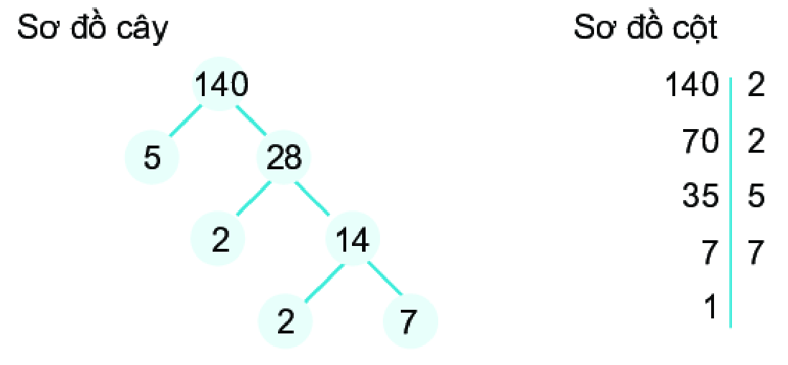
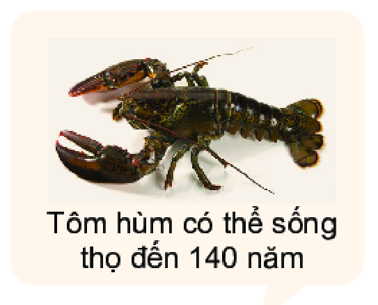

<!-- pdf:47 -->

# LUYỆN TẬP CHUNG

**Ví dụ 1:** Đội văn nghệ có $36$ bạn, được xếp thành các hàng có số người bằng nhau. Hỏi có thể có những cách xếp hàng nào, biết mỗi hàng có từ $3$ đến $12$ bạn?

**Giải:** Do xếp $36$ bạn thành các hàng đều nhau nên số bạn trong mỗi hàng phải là ước của $36$.

Ta có $\text{Ư}(36) = \{1; 2; 3; 4; 6; 9; 12; 18; 36\}$.

Vì mỗi hàng có từ $3$ đến $12$ bạn nên số bạn trong mỗi hàng chỉ có thể là: $3, 4, 6, 9, 12$.

Do đó, ta có $5$ cách xếp thoả mãn yêu cầu đề bài, cụ thể:

| Số bạn ở mỗi hàng | $3$ | $4$ | $6$ | $9$ | $12$ |
| --- | :---: | :---: | :---: | :---: | :---: |
| Số hàng | $12$ | $9$ | $6$ | $4$ | $3$ |

**Ví dụ 2:** Sử dụng dấu hiệu chia hết, hãy cho biết số $1\,872$ có chia hết cho $2, 3, 5, 9, 10$ không.

**Giải:**

$1\,872$ có chữ số tận cùng là số chẵn nên $1\,872 \vdots 2$.

$1\,872$ có tổng các chữ số là $1 + 8 + 7 + 2 = 18$ chia hết cho $3$, nên $1\,872 \vdots 3$.

Chữ số tận cùng của $1\,872$ khác $0$ và $5$ nên $1\,872 \not\vdots 5$.
<!-- ocr-ok: đã đối chiếu trực tiếp ảnh trang PDF 47, khớp 100% chữ gốc (OCR rơi số hiệu màu nhạt / công thức / bảng) -->

$1\,872$ có tổng các chữ số là $1 + 8 + 7 + 2 = 18$ chia hết cho $9$, nên $1\,872 \vdots 9$.

Chữ số tận cùng của $1\,872$ khác $0$ nên $1\,872 \not\vdots 10$.

**Ví dụ 3:** Phân tích số $140$ thành tích các thừa số nguyên tố theo sơ đồ cây và sơ đồ cột.

**Giải:**

- Sơ đồ cây: Vậy $140 = 2^2 \cdot 5 \cdot 7$.
- Sơ đồ cột: Vậy $140 = 2^2 \cdot 5 \cdot 7$.
<!-- ocr-ok: đã đối chiếu trực tiếp ảnh trang PDF 47, khớp 100% chữ gốc (OCR rơi số hiệu màu nhạt / công thức / bảng) -->

> **Vuông:** Tôm hùm có thể sống thọ đến $140$ năm
<!-- ocr-ok: đã đối chiếu trực tiếp ảnh trang PDF 47, khớp 100% chữ gốc (OCR rơi số hiệu màu nhạt / công thức / bảng) -->

<!-- pdf:48 -->

## BÀI TẬP

2.25. Từ các chữ số $5, 0, 1, 3$, viết các số tự nhiên có ba chữ số khác nhau thoả mãn:

a) Các số đó chia hết cho $5$;

b) Các số đó chia hết cho $3$.

2.26. Hãy phân tích các số $A, B$ ra thừa số nguyên tố

$A = 4^2 \cdot 6^3$;

$B = 9^2 \cdot 15^2$.

2.27. Tìm các số tự nhiên $x$ không vượt quá $22$ sao cho:
<!-- ocr-ok: đã đối chiếu trực tiếp ảnh trang PDF 48, khớp 100% chữ gốc (OCR rơi số hiệu màu nhạt / công thức / bảng) -->

a) $100 - x$ chia hết cho $4$;

b) $18 + 90 + x$ chia hết cho $9$.

2.28. Lớp 6B có $40$ học sinh. Để thực hiện dự án học tập nhỏ, cô giáo muốn chia lớp thành các nhóm có số người như nhau, mỗi nhóm nhiều hơn $3$ người. Hỏi mỗi nhóm có thể có bao nhiêu người?

2.29. Hai số nguyên tố được gọi là sinh đôi nếu chúng hơn kém nhau $2$ đơn vị, ví dụ $71$ và $73$ là hai số nguyên tố sinh đôi. Em hãy liệt kê hết các cặp các số nguyên tố sinh đôi nhỏ hơn $40$.

## 💡 Em có biết?

Cho đến nay, người ta vẫn chưa khẳng định được có hữu hạn hay vô hạn cặp số nguyên tố sinh đôi.

## 📷 Danh sách hình trong bài

| Mã hình | Trang PDF | Vị trí trong bài | Chú thích gốc |
| --- | :---: | --- | --- |
| H6-toan-ltc-c02-01-01 | 47 | Ví dụ 3 | Sơ đồ cây — Sơ đồ cột |
| H6-toan-ltc-c02-01-02 | 47 | Ví dụ 3 | Tôm hùm có thể sống thọ đến $140$ năm |
