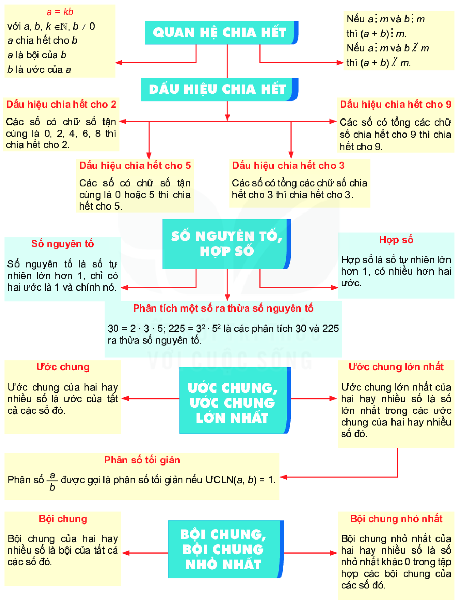

<!-- pdf:61 -->

# CHÚNG TA ĐÃ HỌC NHỮNG GÌ?

- *QUAN HỆ CHIA HẾT*
  - $a = kb$ với $a, b, k \in \mathbb{N}, b \ne 0$: $a$ chia hết cho $b$; $a$ là bội của $b$; $b$ là ước của $a$.
  - Nếu $a \vdots m$ và $b \vdots m$ thì $(a + b) \vdots m$.
  - Nếu $a \vdots m$ và $b \not\vdots m$ thì $(a + b) \not\vdots m$.
- *DẤU HIỆU CHIA HẾT*
  - *Dấu hiệu chia hết cho $2$:* Các số có chữ số tận cùng là $0, 2, 4, 6, 8$ thì chia hết cho $2$.
  - *Dấu hiệu chia hết cho $5$:* Các số có chữ số tận cùng là $0$ hoặc $5$ thì chia hết cho $5$.
  - *Dấu hiệu chia hết cho $3$:* Các số có tổng các chữ số chia hết cho $3$ thì chia hết cho $3$.
  - *Dấu hiệu chia hết cho $9$:* Các số có tổng các chữ số chia hết cho $9$ thì chia hết cho $9$.
- *SỐ NGUYÊN TỐ, HỢP SỐ*
  - *Số nguyên tố:* Số nguyên tố là số tự nhiên lớn hơn $1$, chỉ có hai ước là $1$ và chính nó.
  - *Hợp số:* Hợp số là số tự nhiên lớn hơn $1$, có nhiều hơn hai ước.
  - *Phân tích một số ra thừa số nguyên tố:* $30 = 2 \cdot 3 \cdot 5$; $225 = 3^2 \cdot 5^2$ là các phân tích $30$ và $225$ ra thừa số nguyên tố.
- *ƯỚC CHUNG, ƯỚC CHUNG LỚN NHẤT*
  - *Ước chung:* Ước chung của hai hay nhiều số là ước của tất cả các số đó.
  - *Ước chung lớn nhất:* Ước chung lớn nhất của hai hay nhiều số là số lớn nhất trong các ước chung của hai hay nhiều số đó.
  - *Phân số tối giản:* Phân số $\frac{a}{b}$ được gọi là phân số tối giản nếu $\text{ƯCLN}(a, b) = 1$.
- *BỘI CHUNG, BỘI CHUNG NHỎ NHẤT*
  - *Bội chung:* Bội chung của hai hay nhiều số là bội của tất cả các số đó.
  - *Bội chung nhỏ nhất:* Bội chung nhỏ nhất của hai hay nhiều số là số nhỏ nhất khác $0$ trong tập hợp các bội chung của các số đó.
<!-- ocr-ok: đã đối chiếu ảnh trang PDF 61, sơ đồ tổng kết chương nhiều nhánh -->

<!-- pdf:62 -->

## BÀI TẬP CUỐI CHƯƠNG II

2.53. Tìm $x \in \{50; 108; 189; 1\,234; 2\,019; 2\,020\}$ sao cho:
<!-- ocr-ok: đã đối chiếu trực tiếp ảnh trang PDF 62, khớp 100% chữ gốc (OCR rơi số hiệu màu nhạt / công thức / bảng) -->

a) $x - 12$ chia hết cho $2$;

b) $x - 27$ chia hết cho $3$;

c) $x + 20$ chia hết cho $5$;

d) $x + 36$ chia hết cho $9$.

2.54. Thực hiện phép tính sau rồi phân tích kết quả ra thừa số nguyên tố:

a) $14^2 + 5^2 + 2^2$;

b) $400 : 5 + 40$.

2.55. Tìm ƯCLN và BCNN của:
<!-- ocr-ok: đã đối chiếu ảnh trang PDF 62, OCR đọc ƯCLN thành ƯƠCLN -->

a) $21$ và $98$; $\qquad$ b) $36$ và $54$.

2.56. Các phân số sau đã là phân số tối giản chưa? Nếu chưa, hãy rút gọn về phân số tối giản.

a) $\frac{27}{123}$; $\qquad$ b) $\frac{33}{77}$.

2.57. Thực hiện phép tính:
<!-- ocr-ok: đã đối chiếu trực tiếp ảnh trang PDF 62, khớp 100% chữ gốc (OCR rơi số hiệu màu nhạt / công thức / bảng) -->

a) $\frac{5}{12} + \frac{3}{16}$; $\qquad$ b) $\frac{4}{15} - \frac{2}{9}$.

2.58. Có $12$ quả cam, $18$ quả xoài và $30$ quả bơ. Mẹ muốn Mai chia đều mỗi loại quả đó vào các túi quà sao cho mỗi túi đều có cả cam, xoài và bơ. Hỏi Mai có thể chia được nhiều nhất là mấy túi quà?

2.59. Bác Nam định kì $3$ tháng một lần thay dầu, $6$ tháng một lần xoay lốp xe ô tô của mình. Hỏi nếu bác ấy làm hai việc đó cùng lúc vào tháng $4$ năm nay, thì lần gần nhất tiếp theo bác ấy sẽ cùng làm hai việc đó vào tháng nào?

2.60. Biết rằng $79$ và $97$ là hai số nguyên tố. Hãy tìm ƯCLN và BCNN của hai số này.

2.61. Biết hai số $3^a \cdot 5^2$ và $3^3 \cdot 5^b$ có ƯCLN là $3^3 \cdot 5^2$ và BCNN là $3^4 \cdot 5^3$. Tìm $a$ và $b$.
<!-- ocr-ok: đã đối chiếu ảnh trang PDF 62, OCR đọc BCNN thành BƠNN -->

2.62.

Bác kia chăn vịt khác thường

Buộc đi cho được chẵn hàng mới ưa

Hàng 2 xếp thấy chưa vừa

Hàng 3 xếp vẫn còn thừa một con

Hàng 4 xếp vẫn chưa tròn

Hàng 5 xếp thiếu một con mới đầy

Xếp thành hàng 7, đẹp thay

Vịt bao nhiêu? Tính được ngay mới tài.

*(Biết số vịt chưa đến 200 con)*

## 📷 Danh sách hình trong bài

| Mã hình | Trang PDF | Vị trí trong bài | Chú thích gốc |
| --- | :---: | --- | --- |
| H6-toan-ot-c02-01 | 61 | Sơ đồ tổng kết Chương II | (sách không đánh số, sơ đồ tổng kết kiến thức Chương II: Chúng ta đã học những gì?) |
