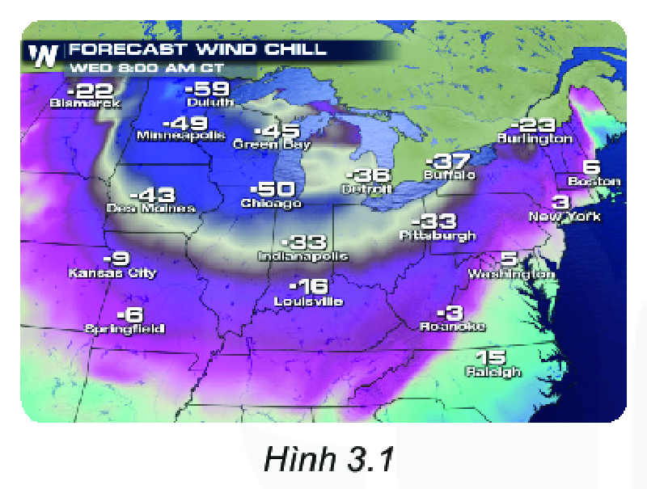
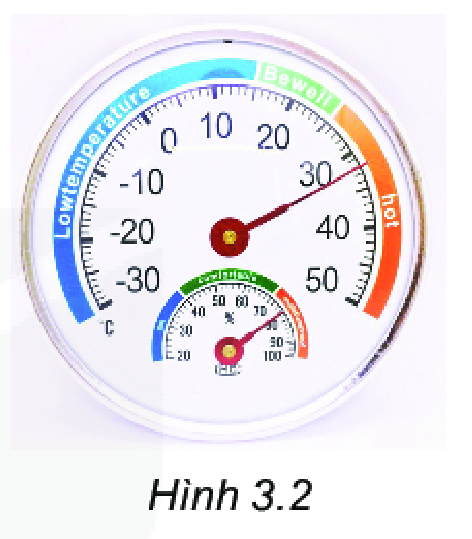
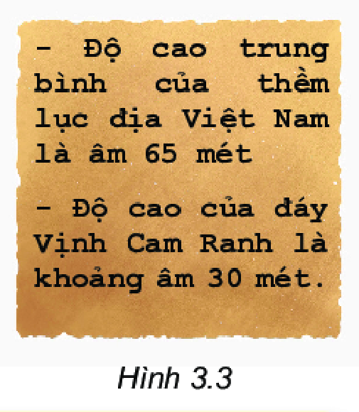
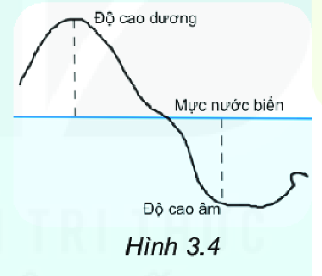
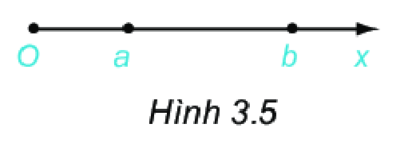
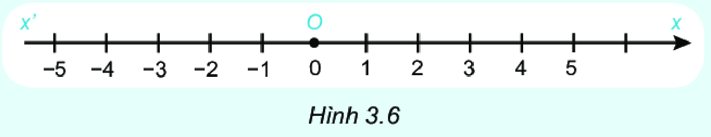
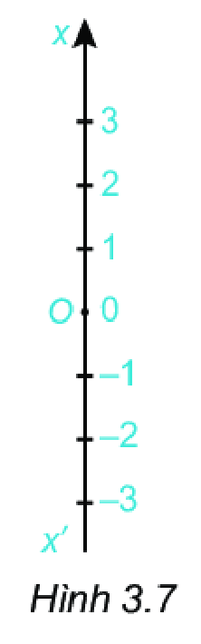
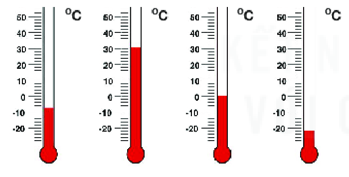
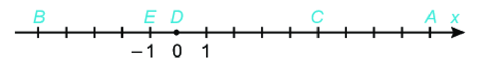

<!-- pdf:64 -->

<!-- Trang mở đầu Chương III. SỐ NGUYÊN (SỐ HỌC, PDF 63): Số âm được cho là lần đầu xuất hiện trong khoảng từ năm 202 trước Công nguyên đến năm 220. Số dương và số âm dùng để biểu thị các đại lượng đối lập nhau. Người ta cũng coi số âm là kết quả của việc lấy số nhỏ trừ đi số lớn. Chương này tìm hiểu về: Tập hợp các số nguyên; Phép cộng và phép trừ số nguyên; Quy tắc dấu ngoặc; Phép nhân số nguyên; Ước và bội của một số nguyên. -->

# BÀI 13: TẬP HỢP CÁC SỐ NGUYÊN

## 🔤 Khái niệm, thuật ngữ

- Số nguyên
- Số nguyên dương
- Số nguyên âm
- Tập hợp số nguyên
- Trục số, chiều dương, chiều âm

## 🎯 Kiến thức, kĩ năng

- Nhận biết, đọc và viết số nguyên.
- Nhận biết tập hợp số nguyên.
- Nhận biết ý nghĩa của số nguyên âm trong một số tình huống thực tế.
- Biểu diễn số nguyên trên trục số.
- So sánh hai số nguyên.

## 🔴 Mở đầu

*Hình 3.1*

*Hình 3.2*

Quan sát hình 3.1 và 3.2, các em thấy ngoài các số quen thuộc như $6$ hay $10$ gọi là những **số dương**, còn có các số với dấu "$-$" đứng trước, đó là các **số âm**. Vậy số âm có ý nghĩa gì trong đời sống và có quan hệ như thế nào với các số đã học?

## 1. LÀM QUEN VỚI SỐ NGUYÊN ÂM
<!-- ocr-ok: đã đối chiếu ảnh trang PDF 64, OCR bỏ sót tiêu đề mục chữ trắng trên nền xanh -->

**Số nguyên dương, số nguyên âm**

**HĐ1:** Số $-3$ đọc là "âm $3$". Tương tự, hãy đọc các số âm mà em thấy trên bản đồ thời tiết (h.3.1) và trên chiếc nhiệt kế (h.3.2).

**HĐ2:** Bằng cách sử dụng dấu "$-$", hãy viết các số âm được nói đến trong hình 3.3.

*Hình 3.3*

- Độ cao trung bình của thềm lục địa Việt Nam là âm $65$ mét.
- Độ cao của đáy Vịnh Cam Ranh là khoảng âm $30$ mét.
<!-- ocr-ok: đã đối chiếu ảnh trang PDF 64, chữ nằm trong bảng Hình 3.3 OCR không đọc được -->

> - Các số tự nhiên $1, 2, 3, 4, \dots$ còn được gọi là các **số nguyên dương**.
> - Các số $-1, -2, -3, \dots$ gọi là các **số nguyên âm**.
> - Tập hợp $\mathbb{Z}$ gồm các số nguyên âm, số $0$ và các số nguyên dương gọi là **tập hợp số nguyên**.
>   $\mathbb{Z} = \{\dots; -4; -3; -2; -1; 0; 1; 2; 3; 4; \dots\}$

**Chú ý:**

1. Số $0$ không là số nguyên dương, cũng không là số nguyên âm.

2. Đôi khi ta còn viết thêm dấu "$+$" ngay trước một số nguyên dương. Chẳng hạn số $6$ còn viết là $+6$ (đọc là "dương sáu").

<!-- pdf:65 -->

**Luyện tập 1:**

a) Viết ba số nguyên dương và ba số nguyên âm;

b) Đọc các số mà em đã viết.

**Khi nào người ta dùng số âm?**

*Số dương và số âm được dùng để biểu thị các đại lượng đối lập nhau, hoặc có hướng ngược nhau:*

| Số dương biểu thị | Số âm biểu thị |
| --- | --- |
| Nhiệt độ *trên* $0^\circ\text{C}$ | Nhiệt độ *dưới* $0^\circ\text{C}$ |
| Độ cao *trên* mực nước biển | Độ cao *dưới* mực nước biển (h.3.4) |
| Số tiền hiện *có* | Số tiền còn *nợ* |
| Số tiền *lãi* | Số tiền *lỗ* |
| Độ *viễn thị* | Độ *cận thị* |
| $\dots$ | $\dots$ |

**Ví dụ:**

1. Đỉnh Phan-xi-păng (Việt Nam) cao khoảng $3\,143\text{ m}$ (trên mực nước biển). Độ cao của rãnh Mariana (Tây Bắc Thái Bình Dương) là $-10\,971\text{ m}$, nghĩa là rãnh này sâu $10\,971\text{ m}$ (dưới mực nước biển). (Người ta quy ước độ cao của mực nước biển là $0\text{ m}$).

2. Kính $1$ dioptre (đi-ốp) là kính viễn thị; Kính $-1$ dioptre là kính cận thị.
<!-- ocr-ok: đã đối chiếu ảnh trang PDF 65, OCR đọc lỗi kí hiệu số thứ tự trong vòng tròn xanh -->

*Hình 3.4*

Sau khi đo đạc bằng các phương pháp hiện đại, cơ quan chức năng đã xác định được độ cao của đỉnh Phan-xi-păng là $3\,147,3\text{ m}$. Độ cao này cao hơn so với kết quả vẫn được sử dụng trên nhiều tài liệu từ $110$ năm qua là $3\,143\text{ m}$. *(Theo Pháp luật Việt Nam)*

> ❓ Khi được hỏi còn tiền không, Nam hóm hỉnh đáp: "Trong túi tớ còn âm mười nghìn đồng". Em hiểu câu nói đó của Nam có nghĩa là gì?

**Vận dụng 1:** Ông M nhận được hai tin nhắn từ một ngân hàng với nội dung như sau:

1. "Tài khoản ...010. Số tiền giao dịch: $+160\,000$. ..."

2. "Tài khoản ...010. Số tiền giao dịch: $-4\,000\,000$. ..."

Em hãy giải thích ý nghĩa của số âm và số dương trong mỗi tin nhắn trên.

<!-- pdf:66 -->

## 2. THỨ TỰ TRONG TẬP SỐ NGUYÊN
<!-- ocr-ok: đã đối chiếu ảnh trang PDF 66, OCR bỏ sót tiêu đề mục chữ trắng trên nền xanh -->

Cho hai số tự nhiên $a$ và $b$. Ta đã biết trên tia số nếu điểm $a$ nằm bên trái điểm $b$ thì $a < b$ (h.3.5).

Đối với số nguyên, điều đó còn đúng hay không?

*Hình 3.5*

**Trục số**

- Ta biểu diễn các số $0, 1, 2, 3, \dots$ và các số nguyên âm $-1, -2, -3, \dots$ như hình 3.6. Khi đó ta được một **trục số** gốc $O$.

*Hình 3.6*

- Chiều từ trái sang phải là **chiều dương**; chiều ngược lại là **chiều âm**.

<!-- term: Điểm biểu diễn số nguyên -->
- Điểm biểu diễn số nguyên $a$ gọi là điểm $a$.

- Cho hai số nguyên $a$ và $b$. Trên trục số, nếu điểm $a$ nằm bên trái điểm $b$ thì số $a$ nhỏ hơn số $b$, kí hiệu $a < b$.

**Chú ý:** Ta cũng có thể vẽ trục số như hình 3.7.

*Hình 3.7*

> ❓ Trên trục số, mỗi điểm sau nằm cách gốc $O$ bao nhiêu đơn vị?
>
> a) Điểm $2$;
>
> b) Điểm $-4$.

**Luyện tập 2:** Xuất phát từ gốc $O$, ta sẽ đi đến điểm nào nếu:

a) Di chuyển $5$ đơn vị theo chiều dương?

b) Di chuyển $5$ đơn vị theo chiều âm?

**So sánh hai số nguyên**

**HĐ3:** Trên trục số các số nguyên âm nằm ở bên trái hay bên phải gốc $O$? Từ đó em hãy sắp xếp ba số $0$, $1$ và $-1$ theo thứ tự từ nhỏ đến lớn.

**HĐ4:** Quan sát trên trục số (h.3.6), ta thấy:

$3 < 5$ nhưng $-3 > -5$;

$4 > 1$ nhưng $-4 < -1$.

Theo em, trong hai số $-12$ và $-15$, số nào lớn hơn?

<!-- term: Thứ tự và so sánh hai số nguyên -->
> 1. Mọi số nguyên âm đều nhỏ hơn $0$, do đó nhỏ hơn mọi số nguyên dương.
> 2. Nếu $a, b$ là hai số nguyên dương và $a > b$ thì $-a < -b$.

**Chú ý:** Kí hiệu $a \le b$ có nghĩa là "$a < b$ hoặc $a = b$".
<!-- ocr-ok: đã đối chiếu ảnh trang PDF 66, câu ngắn nhiều kí hiệu toán học -->

<!-- pdf:67 -->

**Ví dụ 1:**

a) $10$ là số nguyên dương, $-29$ là số nguyên âm nên $-29 < 10$;

b) Vì $57 > 1$ nên $-57 < -1$.

**Luyện tập 3:**

1. Sắp xếp các số sau theo thứ tự tăng dần: $2; -4; 0; 5; -11; -3; 9$.

2. Trong tập $\{x \in \mathbb{Z} \mid -5 < x \le 2\}$, những số nào lớn hơn $-1$?

**Vận dụng 2:** Độ cao luồng vào cảng của một số cảng biển ở Việt Nam được cho trong bảng bên (số liệu gần đúng). Hãy sắp xếp các cảng đó theo thứ tự giảm dần về độ cao.

| Cảng | Độ cao |
| --- | :---: |
| Cảng Nha Trang (Khánh Hoà) | $-12\text{ m}$ |
| Cảng Tân Vũ (Hải Phòng) | $-7\text{ m}$ |
| Cảng Cát Lái (Vũng Tàu) | $-13\text{ m}$ |

**Tranh luận:** Một con kiến bò trên sợi dây (giống như một trục số). Nếu nó đi được $4$ đơn vị theo chiều dương, ta nói kiến bò được $4$ đơn vị; nếu nó đi được $4$ đơn vị nhưng theo chiều âm, ta nói kiến bò được $-4$ đơn vị.

a) Em hiểu thế nào nếu nói: "Kiến $A$ bò được $12$ đơn vị" và "Kiến $B$ bò được $-15$ đơn vị"?

b) Từ nhận xét rằng $12 > -15$, An kết luận: Kiến $A$ bò được quãng đường dài hơn kiến $B$. Em có đồng ý với An không?

## BÀI TẬP

3.1. Mỗi nhiệt kế dưới đây chỉ bao nhiêu độ C?

3.2. Hãy sử dụng số nguyên âm để diễn tả lại ý nghĩa của các câu sau đây:

a) Độ sâu trung bình của vịnh Thái Lan khoảng $45\text{ m}$ và độ sâu lớn nhất là $80\text{ m}$ dưới mực nước biển;

b) Mùa đông ở Siberia (Nga) dài và khắc nghiệt, với nhiệt độ trung bình tháng $1$ là $25^\circ\text{C}$ dưới $0^\circ\text{C}$;

c) Năm 2012, núi lửa Havre (Bắc New Zealand) phun ra cột tro từ độ sâu $700\text{ m}$ dưới mực nước biển.

3.3. Em hiểu ý nghĩa của mỗi câu sau như thế nào (diễn tả bằng một câu không sử dụng số âm):

a) Khi máy bay ở độ cao $10\,000\text{ m}$, nhiệt độ bên ngoài có thể xuống đến $-50^\circ\text{C}$;

b) Cá voi xanh có thể lặn được $-2\,500\text{ m}$.

3.4. Hãy biểu diễn các số sau đây trên cùng một trục số: $3; -3; -5; 6; -4; 4$.

3.5. Các điểm $A, B, C, D$ và $E$ trong hình dưới đây biểu diễn những số nào?

3.6. Hãy sắp xếp các số sau theo thứ tự tăng dần.

$-3; +4; 7; -7; 0; -1; +15; -8; 25.$

3.7. So sánh hai số:
<!-- ocr-ok: đã đối chiếu ảnh trang PDF 67, OCR bỏ sót số bài 3.7 màu xanh -->

a) $-39$ và $-54$;

b) $-3\,179$ và $-3\,279$.

3.8. Liệt kê các phần tử của mỗi tập hợp sau:

a) $A = \{x \in \mathbb{Z} \mid -2 \le x < 4\}$;

b) $B = \{x \in \mathbb{Z} \mid -2 < x \le 4\}$.

## 📷 Danh sách hình trong bài

| Mã hình | Trang PDF | Vị trí trong bài | Chú thích gốc |
| --- | :---: | --- | --- |
| H6-toan-b13-01 | 64 | Mở đầu | Hình 3.1 |
| H6-toan-b13-02 | 64 | Mở đầu | Hình 3.2 |
| H6-toan-b13-03 | 64 | Mục 1, HĐ2 | Hình 3.3 |
| H6-toan-b13-04 | 65 | Mục 1, Ví dụ | Hình 3.4 |
| H6-toan-b13-05 | 65 | Mục 1, hộp thông tin bên phải | (sách không đánh số, ảnh đỉnh Phan-xi-păng) |
| H6-toan-b13-06 | 65 | Mục 1, Vận dụng 1 | (sách không đánh số, ảnh chụp màn hình điện thoại tin nhắn biến động số dư) |
| H6-toan-b13-07 | 66 | Mục 2 | Hình 3.5 |
| H6-toan-b13-08 | 66 | Mục 2, Trục số | Hình 3.6 |
| H6-toan-b13-09 | 66 | Mục 2, Chú ý | Hình 3.7 |
| H6-toan-b13-10 | 67 | Bài tập 3.1 | (sách không đánh số, hình bốn chiếc nhiệt kế) |
| H6-toan-b13-11 | 67 | Bài tập 3.5 | (sách không đánh số, trục số có các điểm $A, B, C, D, E$) |
