<!-- pdf:68 -->

# BÀI 14: PHÉP CỘNG VÀ PHÉP TRỪ SỐ NGUYÊN

## 🔤 Khái niệm, thuật ngữ

- Tính chất giao hoán của phép cộng
- Tính chất kết hợp của phép cộng

## 🎯 Kiến thức, kĩ năng

- Thực hiện phép cộng, trừ hai số nguyên.
- Vận dụng các tính chất của phép cộng để tính nhẩm, tính hợp lí.
- Giải toán thực tiễn liên quan đến phép cộng hay trừ hai số nguyên.

## 🔴 Mở đầu

Nhiệt độ ban ngày ở đỉnh Mẫu Sơn (Lạng Sơn) vào một ngày mùa đông là $-3^\circ\text{C}$. Nếu ban đêm giảm thêm $5^\circ\text{C}$ nữa thì nhiệt độ ở đó sẽ là bao nhiêu?

## 1. CỘNG HAI SỐ NGUYÊN CÙNG DẤU
<!-- ocr-ok: đã đối chiếu ảnh trang PDF 68, OCR bỏ sót tiêu đề mục chữ trắng trên nền xanh -->

Em đã biết phép cộng hai số nguyên dương, chẳng hạn $3 + 5 = 8$, có thể minh hoạ trên tia số (h.3.8).

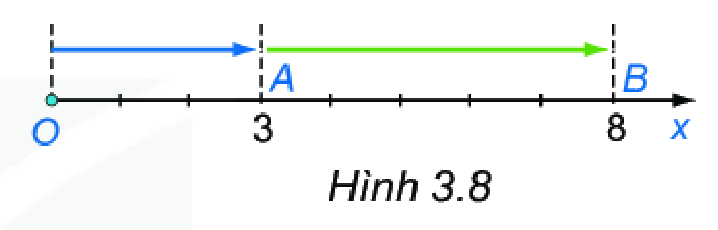
*Hình 3.8*

Khi tính toán, ta cần chú ý rằng mỗi số nguyên (dương hoặc âm) có hai phần: **phần dấu** và **phần số tự nhiên** (h.3.9).

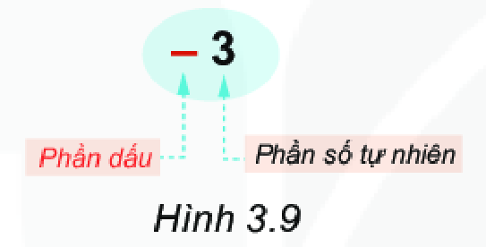
*Hình 3.9*

- **Vuông:** Phần dấu của số $5$ là gì nhỉ?
<!-- ocr-ok: đã đối chiếu ảnh trang PDF 68, lời thoại của nhân vật Vuông trong bóng thoại -->

Để biết nhiệt độ ban đêm ở đỉnh Mẫu Sơn trong tình huống trên, ta cần tính tổng $(-3) + (-5)$.

**Cộng hai số nguyên âm**

**HĐ1:** Từ gốc $O$ trên trục số, di chuyển *sang trái* $3$ đơn vị đến điểm $A$ (h.3.10). Điểm $A$ biểu diễn số nào?

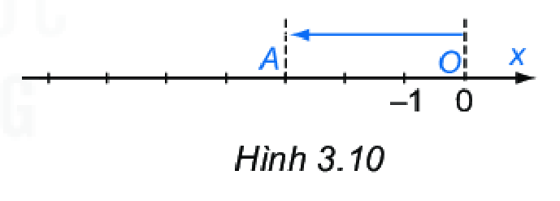
*Hình 3.10*

**HĐ2:** Di chuyển tiếp sang trái thêm $5$ đơn vị đến điểm $B$ (h.3.11). $B$ chính là điểm biểu diễn kết quả của phép cộng $(-3) + (-5)$. Điểm $B$ biểu diễn số nào? Từ đó suy ra giá trị của tổng $(-3) + (-5)$.

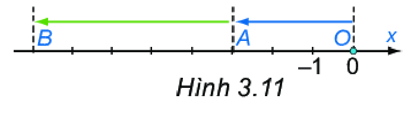
*Hình 3.11*

> **Quy tắc cộng hai số nguyên âm**
>
> Muốn cộng hai số nguyên âm, ta cộng phần số tự nhiên của chúng với nhau rồi đặt dấu "$-$" trước kết quả.

**Ví dụ 1:**

$(-28) + (-37) = -(28 + 37) = -65.$

- **Pi:** Tổng của hai số nguyên âm là một số nguyên âm.

**Luyện tập 1:** Thực hiện các phép cộng sau:
<!-- ocr-ok: đã đối chiếu ảnh trang PDF 68, OCR bỏ sót nhãn Luyện tập 1 màu xanh lá -->

$(-12) + (-48)$; $\quad (-236) + (-1\,025)$.

<!-- pdf:69 -->

**Vận dụng 1:** *Sử dụng phép cộng hai số nguyên âm để giải bài toán sau* (h.3.12):

Một chiếc tàu ngầm cần lặn (coi là theo phương thẳng đứng) xuống điểm $A$ dưới đáy biển. Khi tàu đến điểm $B$ ở độ cao $-135\text{ m}$, máy đo báo rằng tàu còn cách $A$ một khoảng $45\text{ m}$. Hỏi điểm $A$ nằm ở độ cao bao nhiêu mét?

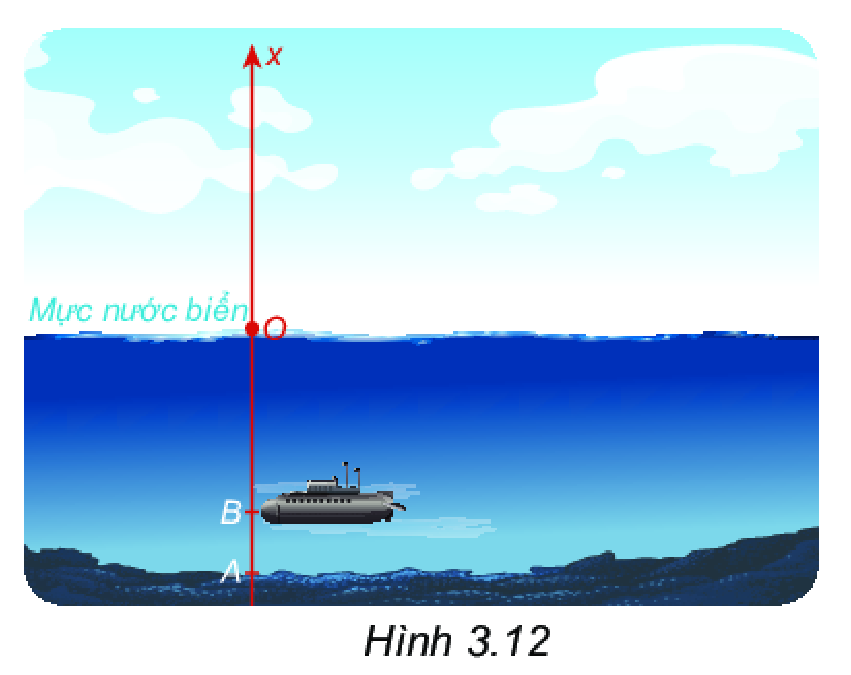
*Hình 3.12*

## 2. CỘNG HAI SỐ NGUYÊN KHÁC DẤU

**Hai số đối nhau**

Trên trục số (h.3.13), hai điểm $3$ và $-3$ có cùng khoảng cách đến gốc $O$. Ta gọi $3$ và $-3$ là **hai số đối nhau** ($-3$ là **số đối** của $3$ và $3$ là số đối của $-3$). Tương tự $1$ và $-1$ cũng là hai số đối nhau.

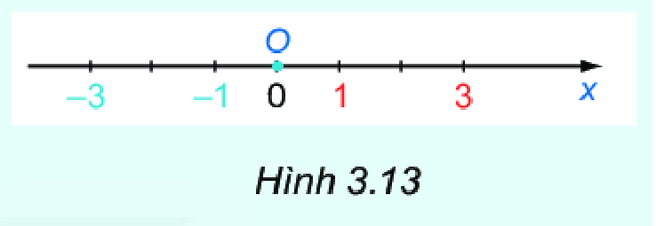
*Hình 3.13*

> ❓ Tìm số đối của $4, -5, 9, -11$.

- **Tròn:** Muốn tìm số đối của một số, ta chỉ việc đổi dấu của nó.

**Chú ý:**

1. Ta quy ước số đối của $0$ là chính nó.

2. Trên hình 3.14, ta thấy $(-5) + 5 = 0$.

Một cách tổng quát: Tổng của hai số đối nhau luôn bằng $0$.

3. Kí hiệu số đối của số nguyên $a$ là $-a$. Ta có số đối của $-a$ là $-(-a) = a$. Chẳng hạn số đối của $-5$ là $-(-5) = 5$.

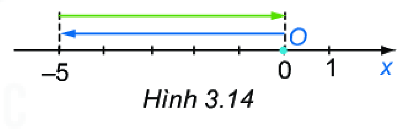
*Hình 3.14*

**Luyện tập 2:** Tìm số đối của mỗi số $5$ và $-2$ rồi biểu diễn chúng trên cùng một trục số.

**Tổng của hai số nguyên khác dấu**

Một ngày tại Paris có nhiệt độ là $-5^\circ\text{C}$. Theo dự báo thời tiết ngày hôm sau tăng thêm $3^\circ\text{C}$ nhưng thực tế lại tăng thêm $8^\circ\text{C}$. Hỏi nhiệt độ dự báo và thực tế của ngày hôm sau sẽ là bao nhiêu?

**HĐ3:** Từ điểm $A$ biểu diễn số $-5$ trên trục số di chuyển sang phải $3$ đơn vị (h.3.15) đến điểm $B$. Điểm $B$ biểu diễn kết quả phép cộng nào?

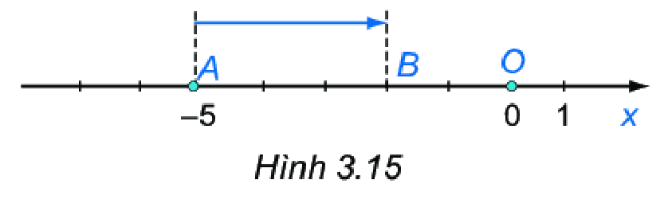
*Hình 3.15*

**HĐ4:** Từ điểm $A$ di chuyển sang phải $8$ đơn vị (h.3.16) đến điểm $C$. Điểm $C$ biểu diễn kết quả của phép cộng nào?

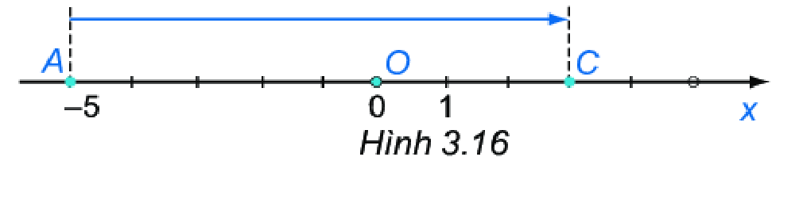
*Hình 3.16*

<!-- pdf:70 -->

> **Quy tắc cộng hai số nguyên khác dấu**
>
> 1. Hai số nguyên đối nhau thì có tổng bằng $0$.
> 2. Muốn cộng hai số nguyên khác dấu (không đối nhau), ta tìm hiệu hai phần số tự nhiên của chúng (số lớn trừ số nhỏ) rồi đặt trước hiệu tìm được dấu của số có phần số tự nhiên lớn hơn.

**Ví dụ 2:**

a) $9 + (-9) = 0$.

b) $9 + (-5) = 9 - 5 = 4$ (do $9 > 5$).

c) $(-12) + 9 = -(12 - 9) = -3$ (do $12 > 9$).

**Luyện tập 3:** Thực hiện phép tính:
<!-- ocr-ok: đã đối chiếu ảnh trang PDF 70, OCR bỏ sót nhãn Luyện tập 3 màu xanh lá -->

a) $203 + (-195)$;

b) $(-137) + 86$.

**Vận dụng 2:** *Sử dụng phép cộng hai số nguyên khác dấu để giải bài toán sau:*

Một máy thăm dò đáy biển ngày hôm trước hoạt động ở độ cao $-946\text{ m}$. Ngày hôm sau người ta cho máy nổi lên $55\text{ m}$ so với hôm trước. Hỏi ngày hôm sau máy thăm dò đáy biển hoạt động ở độ cao nào?

**Tranh luận:**

- **Tròn:** Đố bạn: tổng của hai số nguyên khác dấu là số dương hay số âm?
- **Vuông:** ???

Em hãy trả lời giúp Vuông.

## 3. TÍNH CHẤT CỦA PHÉP CỘNG
<!-- ocr-ok: đã đối chiếu ảnh trang PDF 70, OCR bỏ sót tiêu đề mục chữ trắng trên nền xanh -->

**HĐ5:** Tính và so sánh giá trị của $a + b$ và $b + a$ với $a = -7, b = 11$.

**HĐ6:** Tính và so sánh giá trị của $(a + b) + c$ và $a + (b + c)$ với $a = 2, b = -4, c = -6$.

<!-- term: Tính chất giao hoán của phép cộng số nguyên -->
<!-- term: Tính chất kết hợp của phép cộng số nguyên -->
> Phép cộng số nguyên có các tính chất:
> - Giao hoán: $a + b = b + a$;
> - Kết hợp: $(a + b) + c = a + (b + c)$.

<!-- term: Cộng số nguyên với số 0 -->
- **Pi:** Mỗi số cộng với $0$ thì bằng chính số đó: $a + 0 = 0 + a = a$.
<!-- ocr-ok: đã đối chiếu ảnh trang PDF 70, lời thoại của nhân vật Pi trong bóng thoại -->

**Chú ý:** Ta cũng nói đến tổng của nhiều số nguyên tương tự như số tự nhiên.

<!-- pdf:71 -->

**Ví dụ 3:** Tính một cách hợp lí:
<!-- ocr-ok: đã đối chiếu ảnh trang PDF 71, OCR bỏ sót nhãn Ví dụ 3 màu xanh lá -->

a) $137 + (-40) + 2\,020 + (-157)$; $\quad$ b) $5 + (-7) + 9 + (-11) + 13 + (-15)$.

**Giải:**

a) $137 + (-40) + 2\,020 + (-157) = 137 + (-157) + (-40) + 2\,020$ $\quad \leftarrow$ Tính chất giao hoán
<!-- ocr-ok: đã đối chiếu ảnh trang PDF 71, OCR bỏ sót chú thích mũi tên màu xanh lá bên phải -->

$= [137 + (-157)] + [(-40) + 2\,020]$ $\quad \leftarrow$ Tính chất kết hợp

$= -(157 - 137) + (2\,020 - 40) = (-20) + 1\,980 = 1\,980 - 20 = 1\,960$. $\quad \leftarrow$ Cộng hai số trái dấu
<!-- ocr-ok: đã đối chiếu ảnh trang PDF 71, OCR bỏ sót chú thích mũi tên màu xanh lá bên phải -->

b) $5 + (-7) + 9 + (-11) + 13 + (-15) = [5 + (-7)] + [9 + (-11)] + [13 + (-15)]$ $\quad \leftarrow$ Tính chất kết hợp
<!-- ocr-ok: đã đối chiếu ảnh trang PDF 71, OCR bỏ sót chú thích mũi tên màu xanh lá bên phải -->

$= (-2) + (-2) + (-2) = -(2 + 2 + 2) = -6$. $\quad \leftarrow$ Cộng ba số âm

**Luyện tập 4:** Tính một cách hợp lí:
<!-- ocr-ok: đã đối chiếu ảnh trang PDF 71, OCR bỏ sót nhãn Luyện tập 4 màu xanh lá -->

a) $(-2\,019) + (-550) + (-451)$;

b) $(-2) + 5 + (-6) + 9$.

## 4. TRỪ HAI SỐ NGUYÊN

**HĐ7:** Nửa tháng đầu một cửa hàng bán lẻ lãi được $5$ triệu đồng, nửa tháng sau bị lỗ $2$ triệu đồng. Hỏi tháng đó cửa hàng lãi hay lỗ bao nhiêu triệu đồng?

Giải bài toán trên bằng hai cách:

*Cách 1.* Tính hiệu giữa số tiền lãi và số tiền lỗ.

*Cách 2.* Hiểu lỗ $2$ triệu là "lãi" $-2$ triệu để quy về tính tổng của hai số nguyên.

**HĐ8:** Hãy quan sát ba dòng đầu và dự đoán kết quả ở hai dòng cuối:

$3 - 1 = 3 + (-1)$

$3 - 2 = 3 + (-2)$

$3 - 3 = 3 + (-3)$

$3 - 4 = ?$

$3 - 5 = ?$

- **Pi:** Nếu $b + x = a$ thì $x = a - b$.

> **Quy tắc trừ hai số nguyên**
>
> Muốn trừ số nguyên $a$ cho số nguyên $b$, ta cộng $a$ với số đối của $b$:
> $a - b = a + (-b).$

**Ví dụ 4:**

a) $7 - 10 = 7 + (-10) = -(10 - 7) = -3$

b) Trở lại HĐ7, ta có: $5 - 2 = 5 + (-2) = 3$. Vậy cửa hàng lãi $3$ triệu đồng.

<!-- pdf:72 -->

**Luyện tập 5:** Tính các hiệu sau:
<!-- ocr-ok: đã đối chiếu ảnh trang PDF 72, OCR bỏ sót nhãn Luyện tập 5 màu xanh lá -->

a) $5 - (-3)$;

b) $(-7) - 8$.

**Vận dụng 3:** Nhiệt độ bên ngoài của một máy bay ở độ cao $10\,000\text{ m}$ là $-48^\circ\text{C}$. Khi hạ cánh, nhiệt độ ở sân bay là $27^\circ\text{C}$. Hỏi nhiệt độ bên ngoài của máy bay khi ở độ cao $10\,000\text{ m}$ và khi hạ cánh chênh lệch bao nhiêu độ C?

## BÀI TẬP

3.9. Tính tổng hai số cùng dấu:

a) $(-7) + (-2)$; $\quad$ b) $(-8) + (-5)$;

c) $(-11) + (-7)$; $\quad$ d) $(-6) + (-15)$.

3.10. Tính tổng hai số khác dấu:

a) $6 + (-2)$; $\quad$ b) $9 + (-3)$;

c) $(-10) + 4$; $\quad$ d) $(-1) + 8$.

3.11. Biểu diễn $-4$ và số đối của nó trên cùng một trục số.

3.12. Thực hiện các phép trừ sau:

a) $9 - (-2)$; $\quad$ b) $(-7) - 4$;

c) $27 - 30$; $\quad$ d) $(-63) - (-15)$.

3.13. *Vẽ trục số và dùng phép cộng hai số khác dấu để giải bài toán:*

Giả sử có một con ếch nhảy dọc theo một trục số. Đầu tiên ếch nhảy từ gốc $O$ đến điểm $A$ biểu diễn số $4$. Tiếp theo, ếch nhảy *theo chiều ngược lại* đến điểm $B$ *cách điểm $A$ một khoảng bằng $6$ đơn vị*. Hỏi điểm $B$ biểu diễn số nào trên trục số?

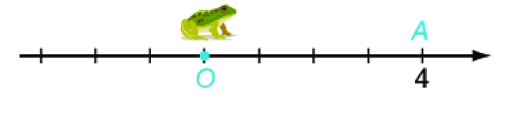

3.14. Mỗi hình sau đây mô phỏng phép tính nào? (Tất cả đều xuất phát từ gốc $O$)

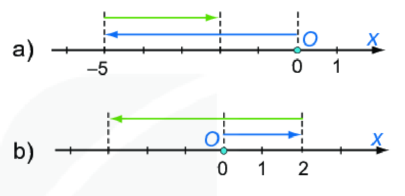

3.15. Tính nhẩm:

a) $(-3) + (-2)$; $\quad$ b) $(-8) - 7$;

c) $(-35) + (-15)$; $\quad$ d) $12 - (-8)$.

3.16. Tính một cách hợp lí:

a) $152 + (-73) - (-18) - 127$;

b) $7 + 8 + (-9) + (-10)$.

3.17. Tính giá trị của biểu thức $(-156) - x$, khi:
<!-- ocr-ok: đã đối chiếu ảnh trang PDF 72, OCR bỏ sót số bài 3.17 màu xanh -->

a) $x = -26$;

b) $x = 76$;

c) $x = (-28) - (-143)$.

3.18. Thay mỗi dấu "$*$" bằng một chữ số thích hợp để có:
<!-- ocr-ok: đã đối chiếu ảnh trang PDF 72, OCR bỏ sót số bài 3.18 màu xanh và đọc lỗi dấu sao -->

a) $(-\overline{6*}) + (-34) = -100$;

b) $(-789) + \overline{2**} = -515$.

## 📷 Danh sách hình trong bài

| Mã hình | Trang PDF | Vị trí trong bài | Chú thích gốc |
| --- | :---: | --- | --- |
| H6-toan-b14-01 | 68 | Mục 1 | Hình 3.8 |
| H6-toan-b14-02 | 68 | Mục 1 | Hình 3.9 |
| H6-toan-b14-03 | 68 | Mục 1, HĐ1 | Hình 3.10 |
| H6-toan-b14-04 | 68 | Mục 1, HĐ2 | Hình 3.11 |
| H6-toan-b14-05 | 69 | Mục 1, Vận dụng 1 | Hình 3.12 |
| H6-toan-b14-06 | 69 | Mục 2, Hai số đối nhau | Hình 3.13 |
| H6-toan-b14-07 | 69 | Mục 2, Chú ý | Hình 3.14 |
| H6-toan-b14-08 | 69 | Mục 2, HĐ3 | Hình 3.15 |
| H6-toan-b14-09 | 69 | Mục 2, HĐ4 | Hình 3.16 |
| H6-toan-b14-10 | 72 | Bài tập 3.13 | (sách không đánh số, trục số minh hoạ con ếch nhảy) |
| H6-toan-b14-11 | 72 | Bài tập 3.14 | (sách không đánh số, hai trục số câu a và b mô phỏng phép tính) |
