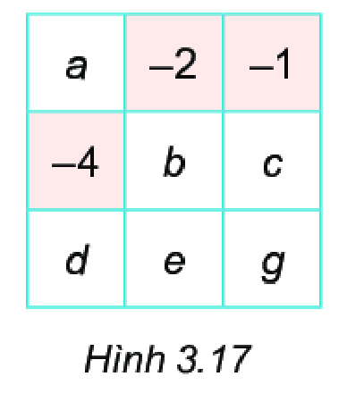

<!-- pdf:73 -->

# BÀI 15: QUY TẮC DẤU NGOẶC

## 🔤 Khái niệm, thuật ngữ

- Quy tắc dấu ngoặc

## 🎯 Kiến thức, kĩ năng

- Nhận biết và áp dụng quy tắc dấu ngoặc trong tính toán, nhất là để tính nhẩm hay tính hợp lí.

## 🔴 Mở đầu

Đối với một biểu thức có dấu ngoặc, ta thường thực hiện các phép tính trong dấu ngoặc trước. Nhưng đôi khi việc *bỏ đi các dấu ngoặc* sẽ làm cho việc tính toán trở nên thuận lợi hơn.

**Bỏ dấu ngoặc trong trường hợp đơn giản**

- Các số âm (hay dương) trong một dãy tính thường được viết trong dấu ngoặc. Nhờ quy tắc cộng hay trừ số nguyên, ta có thể viết dãy tính dưới dạng không có dấu ngoặc. Ví dụ:
  $2 + (-9) = 2 - 9$
  $(-2) - (-9) = -2 + 9$
  $3 - (+7) + (-4) - (-8) = 3 - 7 - 4 + 8$.
- Vì phép trừ chuyển được về phép cộng nên các dãy tính như trên cũng được gọi là một *tổng*.

> ❓ Viết tổng sau dưới dạng không có dấu ngoặc rồi tính giá trị của nó:
> $(-23) - 15 - (-23) + 5 + (-10).$

**Dấu của một số hạng khi bỏ dấu ngoặc**

**HĐ1:** Tính và so sánh kết quả của $4 + (12 - 15)$ và $4 + 12 - 15$.

**HĐ2:** Tính và so sánh kết quả của $4 - (12 - 15)$ và $4 - 12 + 15$. Hãy nhận xét về sự thay đổi dấu của các số hạng trong dấu ngoặc trước và sau khi bỏ dấu ngoặc.

> **Quy tắc dấu ngoặc**
>
> - Khi bỏ dấu ngoặc có dấu "$+$" đằng trước, ta *giữ nguyên dấu của các số hạng* trong ngoặc;
> - Khi bỏ dấu ngoặc có dấu "$-$" đằng trước, ta phải *đổi dấu tất cả các số hạng* trong dấu ngoặc: dấu "$+$" đổi thành "$-$" và dấu "$-$" đổi thành "$+$".

**Ví dụ:**

$794 + [136 - (136 + 794)] = 794 + [136 - 136 - 794]$ $\quad \leftarrow$ Bỏ dấu ngoặc tròn

$= 794 + [-794] = 0$.

<!-- pdf:74 -->

**Luyện tập 1:** Bỏ dấu ngoặc rồi tính các tổng sau:

a) $(-385 + 210) + (385 - 217)$; $\quad$ b) $(72 - 1\,956) - (-1\,956 + 28)$.

<!-- term: Đổi chỗ và đặt dấu ngoặc trong một biểu thức -->
**Chú ý:** Áp dụng các tính chất giao hoán, kết hợp và quy tắc dấu ngoặc, trong một biểu thức, ta có thể:
- *Thay đổi tuỳ ý vị trí của các số hạng kèm theo dấu của chúng.*
  $a - b - c = -b + a - c = -c - b + a.$
  Chẳng hạn, $50 - 90 - 30 = -90 + 50 - 30 = -30 - 90 + 50 = -70$.
- *Đặt dấu ngoặc để nhóm các số hạng một cách tuỳ ý.* Nếu trước dấu ngoặc là dấu "$-$" thì phải đổi dấu tất cả các số hạng trong ngoặc.
  $a - b - c = (a - b) - c = a - (b + c).$
  Chẳng hạn, $50 - 90 - 30 = (50 - 90) - 30 = 50 - (90 + 30) = -70$.

**Luyện tập 2:** Tính một cách hợp lí:
<!-- ocr-ok: đã đối chiếu ảnh trang PDF 74, OCR bỏ sót nhãn Luyện tập 2 màu xanh lá -->

a) $12 + 13 + 14 - 15 - 16 - 17$; $\quad$ b) $(35 - 17) - (25 - 7 + 22)$.

**Thử thách nhỏ:** Cho bảng $3 \times 3$ ô vuông như hình 3.17.

a) Biết rằng tổng các số trong mỗi hàng, mỗi cột, mỗi đường chéo đều bằng $0$. Tính tổng các số trong bảng đó.

b) Hãy thay các chữ trong bảng bởi số thích hợp sao cho tổng các số trong mỗi hàng, mỗi cột, mỗi đường chéo đều bằng $0$.

*Hình 3.17*

## BÀI TẬP

3.19. Bỏ dấu ngoặc và tính các tổng sau:

a) $-321 + (-29) - 142 - (-72)$;

b) $214 - (-36) + (-305)$.

3.20. Tính một cách hợp lí:

a) $21 - 22 + 23 - 24$;

b) $125 - (115 - 99)$.

3.21. Bỏ dấu ngoặc rồi tính:

a) $(56 - 27) - (11 + 28 - 16)$;

b) $28 + (19 - 28) - (32 - 57)$.

3.22. Tính một cách hợp lí:

a) $232 - (581 + 132 - 331)$;

b) $[12 + (-57)] - [-57 - (-12)]$.

3.23. Tính giá trị của các biểu thức sau:

a) $(23 + x) - (56 - x)$ với $x = 7$;

b) $25 - x - (29 + y - 8)$ với $x = 13, y = 11$.

## 📷 Danh sách hình trong bài

| Mã hình | Trang PDF | Vị trí trong bài | Chú thích gốc |
| --- | :---: | --- | --- |
| H6-toan-b15-01 | 74 | Thử thách nhỏ | Hình 3.17 |
